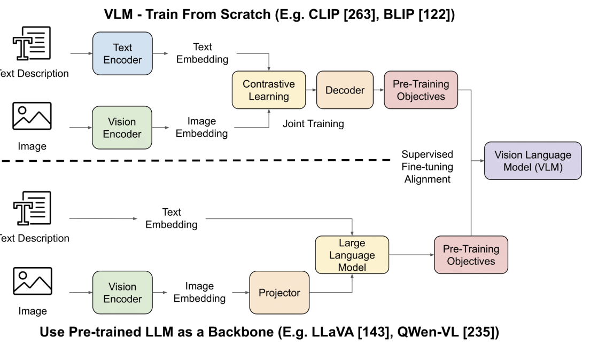
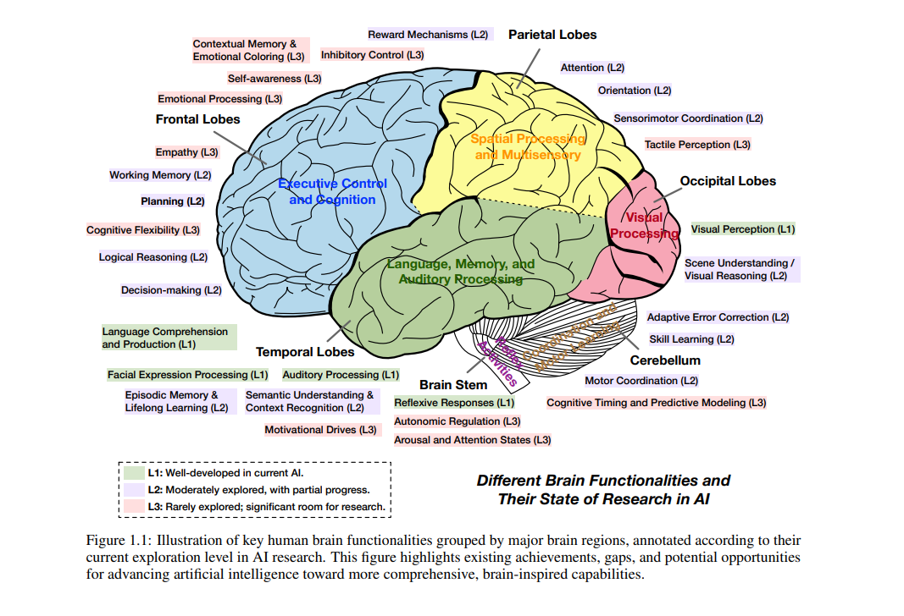

# Section 1: Foundations of Vision-Language Models

> Slides 3–10, 94–95 · ~15 min in the deck, though the professor spent closer to 20 on the ViT whiteboard walkthrough.
> **Goal:** have one mental template (encoder → connector → consumer) that every later model fits into, and understand **exactly** how a ViT turns pixels into tokens.

[← Index](00-INDEX.md) · [Next: CLIP →](02-Section-2-CLIP.md)

**How to read each topic:** 📖 explanation → 🌍 real-world example → 🖼️ diagram → 🧪 code (run and verified; outputs shown are real) → 📚 go deeper.

**Running the code:** the pure-PyTorch snippets need only `pip install torch`. Snippets marked **[HF]** also need `pip install transformers pillow requests` and download a model the first time. All outputs below come from actually running the code (CPU, PyTorch 2.x, transformers 4.5x).

---

## A. What is a Vision-Language Model?

### 📖 Explanation

A VLM takes **image(s) + text** and returns something useful.

| Input text can be… | Output can be… |
|---|---|
| a caption | a **similarity score** (CLIP) |
| a question | **free-form text** (LLaVA, Qwen-VL) |
| an instruction | a **label** |
| a prompt (or a click or box, for SAM) | **coordinates / a box** (Qwen-VL) or a **pixel mask** (SAM) |

What happens underneath: the model **jointly represents and reasons over both modalities in a shared computational (vector) space**. Every image and every piece of text becomes a list of numbers (a vector), and those vectors are arranged so that **meaning becomes geometry**. "Similar in meaning" becomes "close together".

**Why this is a break from classical CV.** The professor's line was that in older CV, *"the machine only knows what the labels tell it."* A classifier learns a mapping `pixels → class_id`. The class id is just an integer. The model has no idea that class 281 is "a small furry animal that meows". If you **swap the labels** "cat" and "dog" in your training data, it will happily learn that cats are dogs. A classifier is also stuck with a **closed vocabulary**: 100, 500 or 1,000 classes is never enough, because new objects keep appearing (a new phone model, a new logo, a new defect type on your factory line).

A VLM uses **language as the supervision signal**, so it can generalise to **any concept you can express in words**, without retraining. This is the *open-vocabulary* promise: *"generalise like LLMs do."*

### 🌍 Real-world example: the same photo, two systems

Take a photo of two cats lying on a pink blanket next to two TV remotes (the COCO image we use in every section of these notes).

| System | What it can tell you |
|---|---|
| **ImageNet classifier (ViT-B/16)**, closed vocabulary | exactly one of 1,000 fixed labels: *"Egyptian cat" (93%)*. It cannot say "two", cannot mention the remotes, cannot answer a question. |
| **VLM (LLaVA / Qwen2-VL)**, open vocabulary | *"There are two cats, and they are next to a pink blanket."* It can also find the remote: `<box>(51,149),(276,249)</box>` |

Both outputs above are **real**. We ran both models in this section and in Sections 3 and 4.

### 🖼️ The two big families of VLM (from the slides)



*Top: "train from scratch", where two encoders are aligned with contrastive learning (CLIP). Bottom: "use a pretrained LLM as backbone", where a vision encoder feeds a projector that feeds an LLM (LLaVA, Qwen-VL). Most of this lecture is about moving from the top row to the bottom row.*

### 🧪 Code: a closed-vocabulary classifier [HF]

```python
import torch
from PIL import Image
from transformers import ViTImageProcessor, ViTForImageClassification

processor = ViTImageProcessor.from_pretrained("google/vit-base-patch16-224")
model = ViTForImageClassification.from_pretrained("google/vit-base-patch16-224").eval()
image = Image.open("coco_cats.jpg").convert("RGB")   # http://images.cocodataset.org/val2017/000000039769.jpg

with torch.no_grad():
    logits = model(**processor(images=image, return_tensors="pt")).logits
top5 = logits.softmax(-1)[0].topk(5)
for p, i in zip(top5.values, top5.indices):
    print(f"{model.config.id2label[i.item()]:28s} {p.item():.3f}")
```
```
Egyptian cat                 0.934
tabby, tabby cat             0.047
tiger cat                    0.013
lynx, catamount              0.002
Siamese cat, Siamese         0.000
```
The model can only choose among its 1,000 fixed labels. That is the limitation VLMs remove.

> 💡 **Learning Thought:** language is a far richer label than a class index. "Two furry dogs running across a frosty field" carries count, species, texture, action and scene. `class_id = 207` carries one bit of identity. Every VLM in this lecture is a different way of getting that richer supervision into a vision system.

📚 **Go deeper:**
- [Hugging Face blog: Vision Language Models Explained](https://huggingface.co/blog/vlms), the best single overview
- [Sebastian Raschka: Understanding Multimodal LLMs](https://magazine.sebastianraschka.com/p/understanding-multimodal-llms), which compares the two families in the figure above
- [Open VLM Leaderboard](https://huggingface.co/spaces/opencompass/open_vlm_leaderboard), to see which VLMs are state of the art today

---

## B. Why multimodal AI, and why now?

### 📖 Explanation

**Two reasons to want it:**
1. **Human inspiration:** people combine vision, language, speech and world knowledge without effort. A radiologist looks at a scan *and* reads the patient history *and* discusses it with a colleague. AI is pushed toward that.
2. **Downstream demand:** search and retrieval, accessibility (describing images to blind users), robotics, autonomous agents, content moderation, medical imaging. *"The world is more multimodal than text."*

**Two reasons it became possible now:**
1. **Data:** billions of noisy (image, alt-text) pairs on the web. Every `` on the internet is a free training example.
2. **One architecture for everything:** the **Transformer** processes pixels (as ViT) and tokens (as an LLM) with the **same attention machinery**. The professor called this *the* key enabler: *"most VLMs are possible because the Transformer is so universal. It can process not only text but images and other modalities, which we did not fully expect to work, but it works fantastically."*

### 🖼️ Where AI stands relative to human brain functions (slide 5)



*The professor showed this 2025 figure from a cognitive-science survey. **Green (L1)** functions are well developed in current AI (visual perception, language comprehension). **Purple (L2)** are partially explored, e.g. **scene understanding / visual reasoning**, which is exactly where VLMs sit. **Pink (L3)** are barely explored. Visual perception is "solved-ish". Visual **reasoning** is the open frontier this module is about.*

### 🌍 Real-world examples (from the pre-read)

| Product | What the VLM does | Model family |
|---|---|---|
| Customer-support copilot | reads the screenshot a customer sends and suggests the fix | LLaVA / Qwen-VL |
| Invoice automation | extracts line items, totals, signatures from scans | Qwen-VL (OCR + grounding) |
| Visual search / moderation | "find all images of X" or "flag images showing Y", no retraining per category | CLIP |
| Photo editing / robotics | isolate the exact object you clicked | SAM |

📚 **Go deeper:** [3Blue1Brown: Attention in transformers, visually explained](https://www.3blue1brown.com/lessons/attention) (why one mechanism can handle any sequence)

---

## C. A short history (slide 6)

| Year | Milestone | Why it mattered for VLMs |
|---|---|---|
| 2012 | AlexNet: deep CNNs win ImageNet | GPUs + big labelled data + deep nets work "in the wild" |
| 2015 | ResNet: skip connections | very deep networks become trainable |
| 2017 | "Attention Is All You Need" | the universal sequence model |
| 2020 | **ViT**: images as patch sequences | the same Transformer can now *see* |
| 2021 | **CLIP**: contrastive image-text pretraining | shared space learned from 400M web pairs |
| 2022 | Flamingo: few-shot VLM via cross-attention | LLMs conditioned on images |
| 2023 | **LLaVA** (instruction-tuned chat) + **SAM** (promptable segmentation) | open and cheap visual chat; a segmentation foundation model |
| 2023 | **Qwen-VL**: grounding, OCR, multi-image in one model | "where", not just "what" |
| 2024 | SAM 2 (video), Qwen2-VL (dynamic resolution) | video plus any-resolution input |

The professor's story: it began with **Alex Krizhevsky**, a student in Geoffrey Hinton's group, showing that CNNs trained on GPUs work on in-the-wild data (ImageNet). That *"snowballed"* into everything else. His point: *"Rome was not built in a day, and CLIP was not built in one year."* ImageNet, GPUs, Transformers and ViT all had to exist first. If an interviewer asks "why did CLIP appear in 2021?", this chain is the answer.

📚 **Go deeper:** original papers: [ResNet](https://arxiv.org/abs/1512.03385) · [ViT](https://arxiv.org/abs/2010.11929) · [Flamingo](https://arxiv.org/abs/2204.14198)

---

## D. Recap: the Vision Transformer (ViT) ⭐

Every model in this lecture uses a ViT or a ViT variant as its eyes: CLIP's image tower, LLaVA's vision tower, Qwen-VL's encoder and SAM's encoder. **Learn this once and you understand the visual front end of all of them.**

### 🖼️ The architecture (slide 7, from the ViT paper)

![ViT architecture: patches → linear projection → + position embeddings + [CLS] → Transformer encoder → MLP head](assets/vit-architecture.png)

*Left: the image is cut into 9 patches (3×3, as the professor drew on the board). Each is flattened, linearly projected, and given a position embedding (the purple numbered boxes 1–9). The extra learnable `[class]` token `0*` goes first. Right: each encoder block is `Norm → Multi-Head Attention → +residual → Norm → MLP → +residual`, repeated L times.*

### 📖 The five steps

```
Image (H×W×3)
  │ 1. Patchify: cut into P×P patches
  ▼
N = (H/P)·(W/P) patches, each P·P·3 raw numbers
  │ 2. Flatten + linear projection  (W_e: P²·3 → D)   ← same role as a word embedding
  ▼
N patch embeddings, each D-dim
  │ 3. Add positional embedding (one learned D-dim vector per position)
  │ 4. Prepend a learnable [CLS] token  → N+1 tokens
  ▼
  │ 5. Transformer encoder stack (multi-head self-attention + MLP) × L
  ▼
[CLS] output → MLP head → softmax over classes     (original ViT training)
```

**Analogy:** a ViT reads an image the way you read a comic strip. Cut it into panels, number the panels, and read them in order. Each panel (patch) is a "word", and the numbering (positional embedding) tells you where it sat on the page.

### 📖 Step 1–2: patchify and project, in detail

Take a 224×224 RGB image and 16×16 patches:
- Patches per side: 224 / 16 = **14** → 14 × 14 = **196 patches**
- Each patch is 16 × 16 pixels × 3 colours = **768 numbers**. Flatten them into one vector.
- A learned matrix `W_e` (768 → D) maps each patch vector to the model width D. This is **exactly** what a word-embedding lookup does for text, except the "word" is a pixel patch, so it needs a linear map instead of a table lookup.

**Implementation trick:** "cut into 16×16 patches, then a linear layer" is mathematically identical to **a `Conv2d` with `kernel_size=16, stride=16`**. The kernel sees one patch at a time and never overlaps. That is why every ViT implementation (including Hugging Face's) uses a Conv2d as the patchifier. The code below proves the equivalence.

### 📖 Step 3: positional embeddings

Self-attention is **order-agnostic**. It treats its input as a *bag* of tokens. Shuffle the 196 patches and the attention outputs come out shuffled in the same way, with nothing else changing (proven in the code below). Without extra information, the model **cannot tell top-left from bottom-right**. Positional embeddings fix this: position *k* gets its own learned D-dim vector `pos[k]`, **added** element-wise to patch *k*'s embedding.

The original Transformer used fixed sinusoidal encodings. *"Nowadays they are all learnt."* ViT learns a `(197, 768)` table.

### 📖 Step 4: the `[CLS]` token and pooling

After the encoder you have 197 output vectors. For classification you need **one** vector for the whole image. The options are:
- **Average pooling:** mean over all patch outputs
- **Max pooling:** element-wise max. The whiteboard example: max of `[4,2,6]` and `[1,1,5]` is `[4,2,6]`.
- **A learned `[CLS]` token:** a learnable vector prepended at position 0. Through attention it gathers information from every patch, and its final state is the image summary. ViT used this because *"it was in fashion at that point"* (from BERT).

### 📖 Step 5: the encoder block and the classification head

Standard Transformer encoder: `x = x + MSA(LN(x))`, then `x = x + MLP(LN(x))`, repeated L times (12 for ViT-B, 24 for ViT-L). The MLP is `W₂ · GELU(W₁ x)`. For classification, `[CLS]` → linear head → softmax over 1,000 classes, trained end to end on (image, class) pairs.

### 🧪 Code 1: build a ViT from scratch and verify each step

```python
import torch, torch.nn as nn

# ---------- 1. Patchify by hand ----------
img = torch.randn(1, 3, 224, 224)                        # (B, C, H, W)
P = 16
patches = img.unfold(2, P, P).unfold(3, P, P)            # (1, 3, 14, 14, 16, 16)
patches = patches.permute(0, 2, 3, 1, 4, 5).reshape(1, 14 * 14, 3 * P * P)
print("patches:", tuple(patches.shape))                  # (1, 196, 768)

# ---------- 2. Linear projection == Conv2d(kernel=stride=P) ----------
D = 768
proj = nn.Linear(3 * P * P, D)
conv = nn.Conv2d(3, D, kernel_size=P, stride=P)
with torch.no_grad():                                    # copy the same weights into the conv
    conv.weight.copy_(proj.weight.view(D, 3, P, P)); conv.bias.copy_(proj.bias)
a = proj(patches)
b = conv(img).flatten(2).transpose(1, 2)
print("linear == conv:", torch.allclose(a, b, atol=1e-4))

# ---------- 3. A tiny but complete ViT ----------
class TinyViT(nn.Module):
    def __init__(self, img=224, patch=16, dim=192, depth=4, heads=3, n_classes=10):
        super().__init__()
        n = (img // patch) ** 2
        self.patch_embed = nn.Conv2d(3, dim, patch, patch)          # patchify + project
        self.cls = nn.Parameter(torch.zeros(1, 1, dim))              # learnable [CLS]
        self.pos = nn.Parameter(torch.randn(1, n + 1, dim) * 0.02)   # learned positions
        layer = nn.TransformerEncoderLayer(dim, heads, 4 * dim, activation="gelu",
                                           batch_first=True, norm_first=True)
        self.encoder = nn.TransformerEncoder(layer, depth)
        self.norm, self.head = nn.LayerNorm(dim), nn.Linear(dim, n_classes)
    def forward(self, x):
        x = self.patch_embed(x).flatten(2).transpose(1, 2)           # (B, 196, D)
        x = torch.cat([self.cls.expand(x.size(0), -1, -1), x], 1) + self.pos   # (B, 197, D)
        return self.head(self.norm(self.encoder(x))[:, 0])          # [CLS] -> logits

vit = TinyViT()
print("TinyViT logits:", tuple(vit(torch.randn(2, 3, 224, 224)).shape))

# ---------- 4. Why positions: attention is permutation-equivariant ----------
attn = nn.MultiheadAttention(64, 4, batch_first=True)
tok, perm = torch.randn(1, 9, 64), torch.randperm(9)
out, _ = attn(tok, tok, tok)
out_p, _ = attn(tok[:, perm], tok[:, perm], tok[:, perm])
print("shuffle in -> same outputs shuffled:", torch.allclose(out[:, perm], out_p, atol=1e-5))

# ---------- 5. Pooling (the whiteboard example) ----------
feats = torch.tensor([[4., 2., 6.], [1., 1., 5.]])
print("max pool:", feats.max(0).values.tolist(), " avg pool:", feats.mean(0).tolist())
```
```
patches: (1, 196, 768)
linear == conv: True
TinyViT logits: (2, 10)
shuffle in -> same outputs shuffled: True
max pool: [4.0, 2.0, 6.0]  avg pool: [2.5, 1.5, 5.5]
```
The line `shuffle in -> same outputs shuffled: True` is the whole argument for positional embeddings, in one line.

### 🧪 Code 2: look inside a real pretrained ViT [HF]

```python
model = ViTForImageClassification.from_pretrained("google/vit-base-patch16-224",
                                                  attn_implementation="eager").eval()
inputs = processor(images=image, return_tensors="pt")
out = model(**inputs, output_hidden_states=True, output_attentions=True)
print(model.vit.embeddings.patch_embeddings.projection)       # the patchifier
print(model.vit.embeddings.position_embeddings.shape)         # learned position table
print(out.hidden_states[-1].shape, out.attentions[-1].shape)
```
```
Conv2d(3, 768, kernel_size=(16, 16), stride=(16, 16))    ← patchify + project = one Conv2d
torch.Size([1, 197, 768])                                 ← 197 learned position vectors
torch.Size([1, 197, 768]) torch.Size([1, 12, 197, 197])   ← [CLS]+196 tokens; 12 heads × 197×197 attention
```

### 📖 Worked token counts: memorise these, they recur all lecture

| Encoder @ resolution | Patch | Grid | **Tokens** | Where you'll see it |
|---|---|---|---|---|
| ViT-B/16 @ 224 | 16 | 14×14 | **196** | original ViT |
| ViT-L/14 @ 224 | 14 | 16×16 | **256** | CLIP best model, LLaVA v1 |
| ViT-L/14 @ 336 | 14 | 24×24 | **576** | LLaVA-1.5 |
| ViT-bigG/14 @ 448 | 14 | 32×32 | **1,024** | Qwen-VL (then compressed to 256) |
| ViT-H/16 @ 1024 | 16 | 64×64 | **4,096** | SAM |

Reading a name like **ViT-L/14**: **L**arge model, **14×14-pixel** patches. A **smaller patch size means more tokens**: finer detail, but attention costs O(N²). Going from 196 to 4,096 tokens makes attention about 437× more expensive.

### 📖 The whiteboard walkthrough (what the professor drew)

1. **Patchify** a 2D image into 9 patches, then **line them up as a 1D sequence**. *"Everything in the world can be converted into a sequence. This is almost an empirical proof of that."*
2. **Flatten** each patch into a vector, e.g. pixels `3,3,6,7,8,9…` in a row. (He first said patches are *"processed by CNNs pretrained on large datasets like ResNet"*. That is an optional **hybrid** ViT stem. The standard ViT is linear only.)
3. **Linear projection:** `z = Wᵀx`, to the model's hidden size D.
4. **Add positional vectors** *"because attention is order-agnostic."*
5. **Pool** with max, average or `[CLS]`.
6. **MLP head:** `W₂ᵀ · σ(W₁ᵀ x)`, then softmax gives a probability distribution over classes.

> ⚠️ **Trap: which non-linearity?** On the whiteboard the professor wrote "sigmoid" for the MLP. Real ViT MLP blocks use **GELU** (`activation="gelu"` in the code above). If an interviewer asks, say GELU.

> ⚠️ **Trap (Q&A #2): positional encoding is not adding 1, 2, 3.** Each position has its **own D-dimensional vector**, added element-wise to the patch embedding. It is not the scalar index. (In the code: `self.pos` has shape `(1, 197, D)`.)

> ⚠️ **Trap (Q&A #5): `[CLS]` in ViT vs GPT.** Decoder-only LMs like GPT have **no `[CLS]` token**. They produce a representation per token for next-token prediction. ViT (like BERT) prepends a learnable `[CLS]` whose final state is the whole-image summary.

> ⚠️ **Trap (Q&A #8): ViT is not OCR.** It sees text in an image as **visual patterns in patches**. A 16×16 patch might hold half a letter. With enough training it learns features for characters and layouts, but it does not read text as characters. This matters later: OCR quality depends heavily on **resolution** (LLaVA-NeXT, Qwen-VL at 448px).

**Other Q&A answers worth keeping:**
- **Pooling** compresses many feature vectors into a smaller summary. It *is* a form of dimensionality reduction when it reduces the number of tokens or spatial positions (Q&A #3, #4).
- **Projection layer:** maps a vector from one space to another, via a learned linear map or small MLP (Q&A #7). You will see this word in every section.
- **MLP in a Transformer:** the feed-forward network, linear → non-linearity → linear (Q&A #6).
- **How an image becomes embeddings (Q&A #11):** patches → flatten → learned linear projection → "visual tokens".
- **ResNet vs ViT (Q&A #10):** ResNet is efficient with smaller data and conventional tasks thanks to its built-in locality bias. ViT wins with **large data and compute**, and when global context matters.
- **Where ViTs are used (Q&A #9):** classification, detection, segmentation, OCR/documents, medical imaging, video, and as the vision encoder in VLMs.

> 💡 **Learning Thought:** ViT's architectural innovation is almost zero. It is a text Transformer with a new tokenizer, where the tokenizer is "cut the image into squares and project each one". That is exactly why it unified vision and language: once an image is a token sequence, all the machinery built for text applies. It is also why the **number of visual tokens** is the main cost driver in every VLM.

📚 **Go deeper:**
- Paper: [An Image is Worth 16x16 Words (ViT)](https://arxiv.org/abs/2010.11929) · [official code](https://github.com/google-research/vision_transformer)
- [d2l.ai: Vision Transformer chapter](https://d2l.ai/chapter_attention-mechanisms-and-transformers/vision-transformer.html), a textbook derivation with runnable code
- [lucidrains/vit-pytorch](https://github.com/lucidrains/vit-pytorch), clean single-file implementations of ViT and dozens of variants
- [The Illustrated Transformer](https://jalammar.github.io/illustrated-transformer/) and the interactive [Transformer Explainer](https://poloclub.github.io/transformer-explainer/), for the encoder block itself
- [HF docs: ViT](https://huggingface.co/docs/transformers/model_doc/vit)

---

## E. The three paradigms (slide 8)

### 📖 Explanation

| Paradigm | Input | Output | Example | Good at | Can't do |
|---|---|---|---|---|---|
| **Contrastive** | image + candidate text labels | similarity scores | **CLIP** | retrieval, zero-shot classification | generate text |
| **Generative / instruction-following** | image + free-text instruction | free-form text | **LLaVA, Qwen-VL** | chat, reasoning, grounding (Qwen) | pixel-precise masks |
| **Promptable dense prediction** | image + spatial prompt (point/box/mask) | pixel-level mask | **SAM** | segmenting anything | name what it segmented |

In plain words:
- **Contrastive:** *"How well does this text describe this image?"* It returns a number.
- **Generative:** *"Tell me about this image."* It writes an answer.
- **Promptable:** *"Which pixels belong to the thing I clicked?"* It paints a mask.

The professor also tied SAM to his own PhD work. Segmentation is hard because objects have **arbitrary shapes**: a cow is easy, but a doughnut (with a hole) or grass is not. And it must be **promptable**: "segment the *brown* doughnut, not the black one."

### 🌍 Real-world example: one e-commerce company, three paradigms

| Feature | Paradigm |
|---|---|
| "Search products by typing *red running shoes*" | contrastive (CLIP embeddings in a vector database) |
| "Chat: *does this jacket have a hood?*" (with a product photo) | generative (LLaVA / Qwen-VL) |
| "Remove the background from seller photos" | promptable segmentation (SAM) |

### 🧪 Code: the three I/O contracts as function signatures

```python
from typing import List
import numpy as np
from PIL import Image

def contrastive(image: Image.Image, labels: List[str]) -> List[float]:
    """CLIP: one score per candidate text. Cannot write new text."""

def generative(image: Image.Image, instruction: str) -> str:
    """LLaVA / Qwen-VL: free-form answer (Qwen-VL may embed <box> coordinates)."""

def promptable(image: Image.Image, points: List[tuple], boxes: List[tuple]) -> np.ndarray:
    """SAM: (3, H, W) boolean masks + IoU scores. No class names, no text."""
```
Every model later in these notes is one of these three signatures.

---

## F. The generic anatomy of a VLM (slide 9)

### 📖 Explanation

```
IMAGE ──► Vision Encoder (CNN/ViT) ─┐
                                    ├──► Fusion / Connector ──► Output
TEXT  ──► Text Encoder / Tokenizer ─┘   (projection,           (logits / text /
                                         cross-attn, or          mask)
                                         shared space)
```

*"Every model in this lecture is a variation on this template. They differ in the **connector** and in what the **output** is used for."*

The encoders are usually **pretrained separately**. The hard and interesting part is **aligning two unrelated embedding spaces** so they can be compared or fused. The professor noted the surprise: the authors of these papers showed that this alignment is **not as difficult as expected**. Once the inference architecture is clear, *"the same way we will capture the dataset and also train"*.

### 🧪 Code: the anatomy, printed from a real model [HF]

This is a real LLaVA-family model (0.5B, same class as LLaVA-1.5). The three boxes of the diagram are literally three sub-modules:

```python
from transformers import LlavaForConditionalGeneration
model = LlavaForConditionalGeneration.from_pretrained("llava-hf/llava-interleave-qwen-0.5b-hf")
for name, m in model.model.named_children():
    print(f"{name:22s} {type(m).__name__:26s} {sum(p.numel() for p in m.parameters())/1e6:6.1f}M")
```
```
vision_tower           SiglipVisionModel           397.7M   ← vision encoder
multi_modal_projector  LlavaMultiModalProjector      2.2M   ← connector (0.25% of the model!)
language_model         Qwen2Model                  464.1M   ← consumer
```

Qwen2-VL-2B (the hands-on model) has the same shape: `visual` (665M) contains the `merger` connector, then `language_model` (1,544M).

---

## G. Where does fusion happen? (slide 10)

### 📖 Explanation

"Where does fusion happen?" is a question you can ask of any new VLM to classify it.

| Fusion style | How the modalities interact | Models | Trade-off |
|---|---|---|---|
| **Dual encoder, no fusion** | Two towers never see each other. They meet only in a final **dot product**. | CLIP | very fast (embeddings can be pre-computed and indexed), but **no joint reasoning** |
| **Early fusion into a decoder** | Visual tokens are treated as a **foreign language** and concatenated with text tokens. Fusion happens through the LLM's ordinary **self-attention**. | LLaVA, Qwen-VL | rich reasoning; cost grows with the number of visual tokens |
| **Cross-attention fusion** | A dedicated cross-attention module explicitly mixes two token sets. | SAM's mask decoder, Qwen-VL's adapter, Flamingo | explicit, controllable mixing; an extra module to train |

The professor's analogy for early fusion: it is like **code-mixing Hindi and English** in one sentence. The LLM reads both "languages" in one stream, and attention lets a Hindi word attend to an English word.

### 🧪 Code: the three fusion styles in a few lines each

```python
import torch, torch.nn as nn, torch.nn.functional as F
D = 64
img_tokens, txt_tokens = torch.randn(1, 49, D), torch.randn(1, 8, D)

# 1) Dual encoder (CLIP): pool each side to ONE vector, compare. No token ever sees the other modality.
score = F.cosine_similarity(img_tokens.mean(1), txt_tokens.mean(1))            # (1,)

# 2) Early fusion (LLaVA): concatenate, then ordinary self-attention over the joint sequence.
self_attn = nn.MultiheadAttention(D, 4, batch_first=True)
seq = torch.cat([img_tokens, txt_tokens], dim=1)                               # (1, 57, D)
fused, _ = self_attn(seq, seq, seq)                                            # every token sees every token

# 3) Cross-attention (SAM decoder / Qwen-VL adapter): one set queries the other.
cross = nn.MultiheadAttention(D, 4, batch_first=True)
txt_reads_img, _ = cross(query=txt_tokens, key=img_tokens, value=img_tokens)   # (1, 8, D)
print(score.shape, fused.shape, txt_reads_img.shape)
```
```
torch.Size([1]) torch.Size([1, 57, 64]) torch.Size([1, 8, 64])
```
Look at the output shapes. The dual encoder collapses everything to **one number**, early fusion keeps **all 57 tokens mixed together**, and cross-attention returns **one updated vector per query**.

> ⚠️ **Trap (Q&A #13): what "fusion" means.** Fusion is **combining information from different modalities so the model can reason over them jointly**. CLIP arguably has *no* fusion. It only has **alignment**: two separate vectors made comparable. Alignment and fusion are different things.

> 💡 **Learning Thought:** Qwen-VL is in two rows of the table. It uses cross-attention inside the adapter (to compress) and then self-attention inside the LLM (to reason). Many modern models mix fusion styles, so ask "where, and in how many places?"

📚 **Go deeper:** [Flamingo paper](https://arxiv.org/abs/2204.14198), the canonical cross-attention-fusion VLM (gated cross-attention layers inside a frozen LLM)

---

## H. The four models at a glance (slide 94)

| Model | Org / year | Paradigm | Key idea |
|---|---|---|---|
| CLIP | OpenAI, 2021 | contrastive dual encoder | learn a shared space from 400M web (image, text) pairs |
| LLaVA | Wisconsin/MSR, 2023 | generative, instruction-tuned | frozen CLIP encoder → simple projector → LLM |
| Qwen-VL | Alibaba, 2023 | generative + grounded | compressive cross-attention adapter for grounding, OCR, multi-image |
| SAM | Meta AI, 2023 | promptable segmentation | a mask foundation model driven by a 1.1B-mask data engine |

**Learning objectives (slide 95):** after this lecture you should be able to
1. Explain the contrastive vs generative vs promptable difference
2. **Derive** the CLIP loss and zero-shot mechanism
3. **Trace a pixel to an LLM-readable token** in LLaVA and Qwen-VL
4. Describe SAM's task and data engine
5. Compare all four on architecture, data and objective

---

## 🎯 Interview Questions

**Q1. Walk me through how a ViT turns a 224×224 image into Transformer input.**
> Split it into 16×16 patches, which gives 14×14 = 196 patches. Flatten each one to 768 numbers (16·16·3). Linearly project each to the hidden size D; in practice this is one Conv2d with kernel = stride = 16. That is the same role as a word-embedding lookup. Add a learned positional embedding per position, because self-attention is permutation-equivariant. Prepend a learnable `[CLS]` token, giving 197 tokens. Then run a standard pre-norm Transformer encoder (MSA + GELU MLP, with residuals). For classification, the final `[CLS]` state goes through a linear head.

**Q2. Why does ViT need positional embeddings when a CNN doesn't?**
> A CNN's convolution is local and slides across the image, so spatial structure is built into the operation. Self-attention is permutation-equivariant: shuffle the input tokens and the outputs shuffle identically. Positional embeddings are the only source of "where" information. This matters a lot for VLMs, whose weaknesses are exactly spatial ones (left/right, counting, grounding).

**Q3. Why is patchify-plus-linear the same as a strided convolution?**
> A Conv2d with kernel = stride = P applies one weight tensor to each non-overlapping P×P window. That equals flattening the window and multiplying by a (P²·3 → D) matrix. The conv form is simply faster and avoids explicit reshaping.

**Q4. What is the difference between contrastive, generative and promptable VLMs? Give one use case each.**
> Contrastive (CLIP) scores how well an image and a text match, e.g. text-to-image search. Generative (LLaVA/Qwen-VL) conditions an LLM on visual tokens to produce free text, e.g. "explain this error screenshot". Promptable dense prediction (SAM) takes a spatial prompt and returns a pixel mask, e.g. one-click background removal.

**Q5. "Where does fusion happen?" Classify CLIP, LLaVA and SAM.**
> CLIP: nowhere. Two independent towers are compared by dot product (alignment, not fusion). LLaVA: early fusion. Projected visual tokens are concatenated with text and mixed by the LLM's self-attention. SAM: two-way cross-attention in the mask decoder between prompt tokens and image tokens.

**Q6. How does patch size trade off accuracy and compute?**
> Smaller patches give more tokens, so finer spatial detail (better OCR, small objects). But attention is O(N²): at 224px, going from /16 (196 tokens) to /14 (256) is about 1.7× the attention cost, and at 1024px /16 there are 4,096 tokens. VLMs then pay again in the LLM, whose sequence length also grows.

**Q7. When would you choose ResNet over ViT?**
> With a smaller dataset or a tight compute budget, ResNet's inductive biases (locality, translation equivariance) let it learn efficiently. With web-scale data, or when global context matters, ViT scales better. It is also the default when you want to plug into a Transformer-based multimodal stack.

**Q8. Why did VLMs become practical around 2021 and not earlier?**
> Four things converged: GPU-scale deep learning (2012), the Transformer (2017), ViT showing Transformers can process images (2020), and web-scale noisy image-text data. CLIP needed all four.

---

## ✅ Self-check

1. How many tokens does ViT-L/14 produce for a 336×336 image, excluding `[CLS]`? *(576)*
2. The live Mentimeter asked: what is the purpose of patchifying? *(To convert the image into a sequence of tokens a Transformer can process.)*
3. The live Mentimeter asked: what do positional embeddings provide? *(Spatial position of each patch. **Not** the colour of the patch, and they do **not** replace self-attention.)*
4. What single PyTorch layer implements "patchify + linear projection"? *(`Conv2d(3, D, kernel_size=P, stride=P)`)*
5. Name the fusion style of Qwen-VL's adapter, and the fusion style inside its LLM.
6. Which of the four models cannot output any text at all? *(SAM. CLIP outputs scores, not text either.)*
7. In the real LLaVA printout, what fraction of the parameters is the connector? *(2.2M / 864M ≈ 0.25%)*

**Next:** [Section 2: CLIP →](02-Section-2-CLIP.md)
