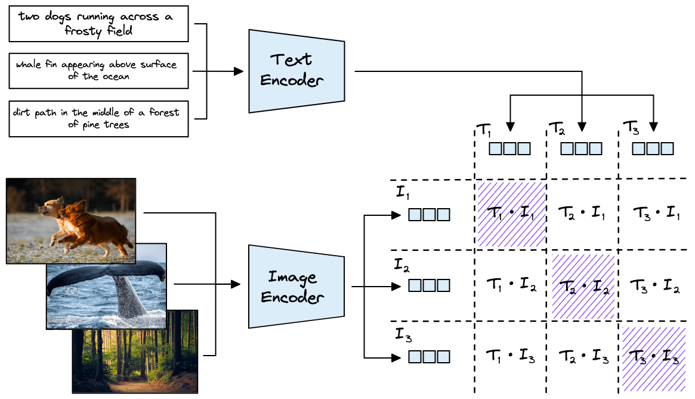
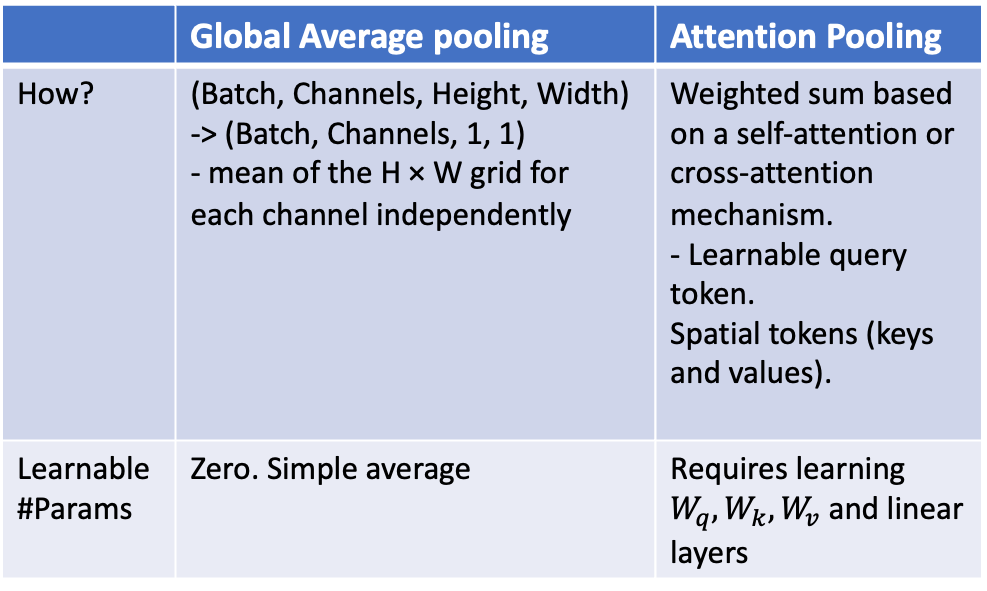
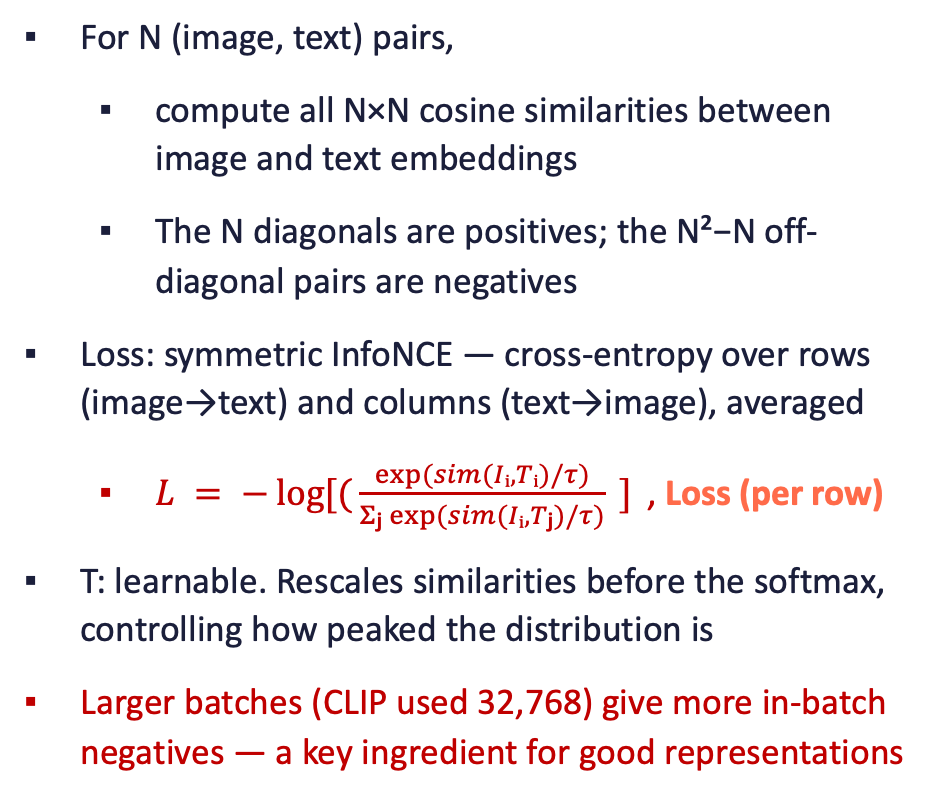
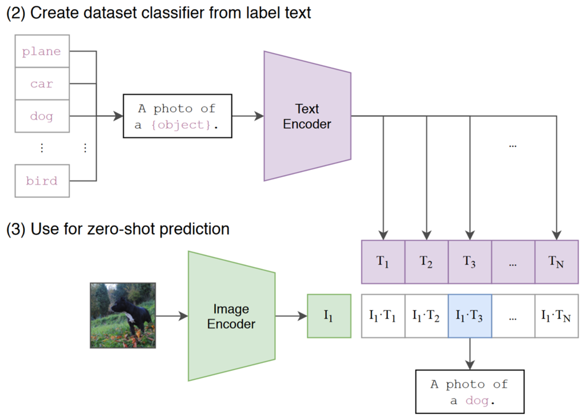
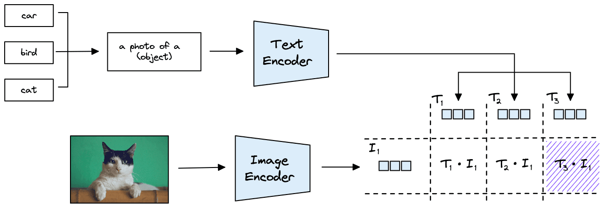
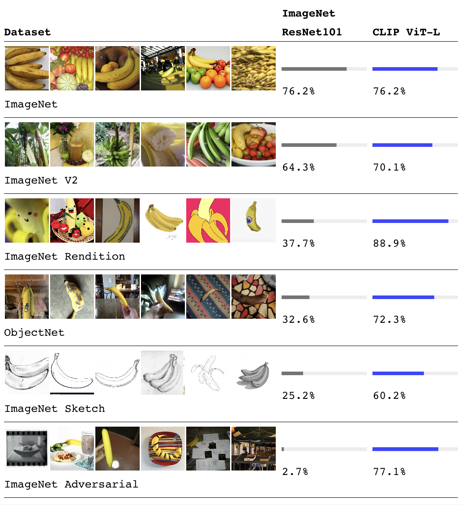

# Section 2: CLIP: Contrastive Language-Image Pretraining

> Slides 11–28, 96 · Radford et al., OpenAI, 2021: *"Learning Transferable Visual Models From Natural Language Supervision"*
> **Goal:** be able to derive the CLIP loss on a whiteboard, **implement it in 10 lines**, and explain why zero-shot classification works.

[← Section 1](01-Section-1-Foundations-of-VLMs.md) · [Index](00-INDEX.md) · [Next: LLaVA →](03-Section-3-LLaVA.md)

**Legend:** 📖 explanation · 🌍 real-world example · 🖼️ diagram · 🧪 code (run and verified; outputs are real) · 📚 go deeper
**Code needs:** `pip install torch` (and `transformers pillow requests` for the **[HF]** snippets).

---

## A. Motivation: learn from language, not labels

### 📖 Explanation

- A classic ImageNet ResNet has a **closed vocabulary of ~1,000 classes**. Adding a class ("electric scooter") means collecting thousands of labelled photos and **retraining the classification head**.
- CLIP's idea: **predict which caption goes with which image**, straight from raw web text.
- Captions carry far richer supervision than a class index. They name objects, attributes, actions, styles ("a watercolor of…") and context.
- Result: a model that can classify **anything expressible in words**, zero-shot, at inference time.

### 🌍 Real-world example

A marketplace adds a new category, "pickleball paddles", on Monday.
- **Classifier approach:** collect about 1,000 labelled paddle images, retrain, redeploy. That takes weeks.
- **CLIP approach:** add the string `"a photo of a pickleball paddle"` to the label list. It works the same afternoon, with no training.

### CLIP at a glance (slide 13)

| | |
|---|---|
| **Architecture** | two independent encoders (image and text), **no cross-attention** between them |
| **Objective** | contrastive: pull matching pairs together, push every other pair in the batch apart |
| **Data** | **WIT**: **400M** (image, text) pairs scraped from the internet |
| **Inference** | zero-shot: compare the image embedding with text embeddings of candidate class names |

📚 **Go deeper:** [OpenAI's CLIP blog post](https://openai.com/index/clip/) (short and readable) · [CLIP paper](https://arxiv.org/abs/2103.00020), sections 1–2 are very accessible

---

## B. Architecture: the dual encoder

### 📖 Explanation

```
 image ──► Image Encoder (ResNet or ViT) ──► I_f ──► W_i ──► L2-norm ──► I_e ─┐
                                                                             ├─► cosine sim  I_e·T_e / τ
 "a photo of a dog" ──► Text Encoder (Transformer) ──► T_f ──► W_t ──► L2-norm ──► T_e ─┘   (N×N matrix)
```

Two towers that **never talk to each other** until the very last step:
1. Each tower produces a feature vector: `I_f` (image) and `T_f` (text), possibly of **different** sizes.
2. Two **learned projection matrices**, `W_i` and `W_t`, map both into the **same** D-dim space (512 for ViT-B, 768 for ViT-L).
3. Both are **L2-normalised** (length 1), so their **dot product is the cosine similarity** in [−1, 1].

The whole "shared space" is created by the two projection matrices plus the encoders. Nothing else links them.

### 🖼️ Diagram (slide 14 / 18)



*Three captions ("two dogs running across a frosty field", "whale fin…", "dirt path in a forest…") go through the text encoder, and three images through the image encoder. Every image is compared with every caption, giving a 3×3 matrix. The **shaded diagonal** holds the true pairs (positives). Training pushes the diagonal up and everything else down. This is the professor's exact whiteboard example.*

### 📖 The professor's challenge question 🔎

> *"If the image encoder outputs 256-d and the text encoder also outputs 256-d, do you **still** need the projection W?"*

**Yes.** Having the same shape is not the same as sharing a geometry. The two encoders were trained separately, so dimension 17 of the image vector has nothing to do with dimension 17 of the text vector. **Analogy:** two maps of the same city, one in kilometres with north up, the other in miles with east up. Both use (x, y) coordinates, but you can't overlay them until you rotate, scale and shift one. `W` is that learned re-mapping (rotation, scaling, shearing). Without it, a dot product between the two is meaningless.

> ⚠️ **Trap (Q&A #20): the text vector is not padded or extended to match the image vector.** Both are projected by learned layers into a new, common dimension.

> ⚠️ **Trap (Q&A #25): PCA cannot align the spaces.** PCA rotates or reduces dimensions using the variance of *one* dataset. It knows nothing about which image goes with which caption. Alignment needs a **learning objective over pairs**.

> ⚠️ **Trap (Q&A #16): the shared space is model-specific.** A CLIP ViT-B/32 embedding and a CLIP ViT-L/14 embedding are **not** comparable. Never mix embeddings from different checkpoints in one vector index.

> ⚠️ **Trap (Q&A #14, #18): different encoder output sizes are fine.** Image encoder → image projection → shared space ← text projection ← text encoder.

---

## C. The image encoder (slides 15–16)

### 📖 Explanation

**Two families:**
1. **ResNet (RN50, RN101, RN50x4/16/64).** The final **global average pooling** is replaced with **attention pooling**.
2. **ViT (B/32, B/16, L/14, L/14@336px).** The number in the name is the patch size, which controls the token grid.

The output is **one global vector per image**, projected to the shared dimension (512–768).

### 🖼️ Global average pooling vs attention pooling (slide 15)



| | Global average pooling | Attention pooling |
|---|---|---|
| How | `(B, C, H, W) → (B, C, 1, 1)`: mean over the H×W grid, per channel | a **learnable query token** attends over the spatial tokens (which act as keys and values), giving a **weighted** sum |
| Params | **zero** | learnable (W_q, W_k, W_v and linear layers) |
| Effect | every location counts equally, so background sky counts as much as the dog | the model learns **which locations matter** |

**Analogy:** average pooling is a class vote where everyone's vote counts the same. Attention pooling lets a learned "chairperson" (the query) decide whose opinion to weight more.

### 🧪 Code: attention pooling vs GAP

```python
import torch, torch.nn as nn

class AttentionPool(nn.Module):
    """One learnable query attends over all spatial tokens (CLIP-ResNet style)."""
    def __init__(self, dim, heads=8):
        super().__init__()
        self.query = nn.Parameter(torch.randn(1, 1, dim) * 0.02)
        self.attn = nn.MultiheadAttention(dim, heads, batch_first=True)
    def forward(self, fmap):                        # fmap: (B, C, H, W) from the CNN
        tokens = fmap.flatten(2).transpose(1, 2)    # (B, H*W, C): keys and values
        q = self.query.expand(fmap.size(0), -1, -1)
        pooled, w = self.attn(q, tokens, tokens)    # (B, 1, C)
        return pooled.squeeze(1), w

fmap = torch.randn(2, 512, 7, 7)
gap = fmap.mean(dim=(2, 3))                         # zero parameters
ap, w = AttentionPool(512)(fmap)
print("GAP:", tuple(gap.shape), " AttnPool:", tuple(ap.shape), " weights over 49 cells:", tuple(w.shape))
```
```
GAP: (2, 512)  AttnPool: (2, 512)  weights over 49 cells: (2, 1, 49)
```
`w` shows how much each of the 7×7 = 49 locations contributed. You can reshape it to 7×7 and plot it as a heat map.

Keep this pattern in mind: **one learnable query attending over many tokens**. Qwen-VL's adapter (Section 4) is exactly this, with **256 queries instead of 1**.

### Variants (slide 16)

| Variant | Encoder | Embed dim | Note |
|---|---|---|---|
| RN50 / RN101 | modified ResNet | 1024 | attention pooling |
| RN50x4/16/64 | EfficientNet-style scaled ResNet | 640–1024 | compute-matched scaling |
| ViT-B/32, B/16 | ViT base | 512 | patch size = granularity |
| ViT-L/14 | ViT large | 768 | strongest released variant |
| **ViT-L/14@336px** | L/14 fine-tuned at higher resolution | 768 | **best published zero-shot** |

### 📖 Whiteboard background: CNNs and ResNets (from the transcript)

- A **convolution** slides a small kernel across the image (stride 1: left to right, then top to bottom). With a **2×2 kernel** on a W×H image at stride 1, you get **(W−1)·(H−1)** outputs. Stacking many kernels and layers (plus pooling and ReLU) gives progressively smaller, more semantic feature maps.
- **Low layers learn edges and textures, middle layers learn shapes (circles, curves), high layers learn semantics.** Low-level features transfer across almost any image. *"Every image is a collection of small edges and textures,"* which is why pretrained backbones are reused.
- **ResNet = skip connections:** output = `F(x) + x`. If `F` is not useful, gradient descent can push it toward 0 and the layer becomes an identity. That is why very deep networks train. *"Transformers are definitely not the first to use skip connections."*

```python
import torch.nn as nn
class ResidualBlock(nn.Module):
    def __init__(self, c):
        super().__init__()
        self.f = nn.Sequential(nn.Conv2d(c, c, 3, padding=1), nn.BatchNorm2d(c), nn.ReLU(),
                               nn.Conv2d(c, c, 3, padding=1), nn.BatchNorm2d(c))
    def forward(self, x):
        return nn.functional.relu(self.f(x) + x)      # the skip connection: F(x) + x
```

📚 **Go deeper:** [ResNet paper](https://arxiv.org/abs/1512.03385) · [OpenCLIP](https://github.com/mlfoundations/open_clip), open reproductions of every CLIP variant plus bigger ones such as ViT-bigG (used by Qwen-VL)

---

## D. The text encoder (slide 17)

| Property | Value |
|---|---|
| Backbone | standard Transformer, **63M params, 12 layers, 512 wide, 8 heads** |
| Tokenizer | lower-cased **BPE**, **49K** vocab |
| Attention | **causal (masked)** self-attention |
| Max length | **76 tokens** per caption. Long captions must be truncated or handled differently. |
| Sentence vector | activations at the **`[EOS]`** position |
| Projection | learned linear layer into the shared dimension |

### 📖 Why the `[EOS]` token?

With **causal** attention, token *t* can only see tokens 1…*t*. The **last** token, `[EOS]`, is the only position that has "read" the whole caption, so its state is the natural sentence summary. The first token has seen only itself.

```
"a   photo  of   a   dog  [EOS]"
 ↑ sees only itself          ↑ sees everything → use this one
```

> ⚠️ **Trap (deck quiz Q5): why `[EOS]` and not average pooling?** Because of the causal mask. Averaging would mix early tokens that have only seen part of the sentence.

> ⚠️ **Practical trap: the 76-token limit.** CLIP silently truncates long captions. A 200-word product description loses most of its text. Summarise, or split and average embeddings.

---

## E. The contrastive objective: symmetric InfoNCE ⭐

### 🖼️ The slide (slide 18)



### 📖 Setup

For a batch of **N** (image, text) pairs, compute all **N × N** cosine similarities `s_ij = I_e(i) · T_e(j)`.
- The **N diagonal** entries are **positives**.
- The **N² − N off-diagonal** entries are **negatives**.
- Each image, looking along its row, has **1 positive and N − 1 negatives**.

### 📖 The loss

Image → text (per row *i*):

$$\mathcal{L}^{I\to T}_i = -\log \frac{\exp(s_{ii}/\tau)}{\sum_{j=1}^{N}\exp(s_{ij}/\tau)}$$

Text → image (per column *i*): the same formula, summing down the column instead.

$$\mathcal{L} = \tfrac{1}{2}\big(\overline{\mathcal{L}^{I\to T}} + \overline{\mathcal{L}^{T\to I}}\big)$$

In words: **each row is an N-way classification problem ("which of these N captions is mine?") solved with cross-entropy, where the correct class is the diagonal.** Do the same for the columns ("which of these N images is mine?") and average the two.

**Analogy:** a room with N people and N name-tags scattered on a table. Each person must pick their own tag (rows), and each tag must "pick" its owner (columns). The loss is how badly they are doing at both.

**Why symmetric?** Image→text alone would let the model cheat. A "hub" caption that is somewhat close to *every* image could win many rows without truly matching any one. Adding text→image forces each caption to prefer its own image as well.

### 📖 Why this formula? (the professor's monotonicity argument)

The goal is "`s(I₁,T₁)` must be larger than `s(I₁,T₂)` and `s(I₁,T₃)`". An **if-then** rule is not differentiable, so it has to become a smooth loss:
- `exp` is monotonically increasing: `x > x₁ ⇒ eˣ > eˣ¹`
- `log` is monotonically increasing too
- so `−log(softmax)` is **monotonically decreasing** in the positive similarity. Raise `s_ii` and the loss falls. Raise any `s_ij` (j ≠ i) and the loss rises.

*"That is the whole trick: turn the condition into something differentiable."*

### 📖 Worked example (N = 3)

Suppose the similarity matrix after normalisation is:

|  | T₁ | T₂ | T₃ |
|---|---|---|---|
| **I₁** | **0.9** | 0.2 | 0.1 |
| **I₂** | 0.3 | **0.8** | 0.2 |
| **I₃** | 0.1 | 0.3 | **0.7** |

**With τ = 1 (no sharpening):**
- Row 1 softmax: e^0.9 = 2.460, e^0.2 = 1.221, e^0.1 = 1.105 → sum 4.786 → **p(T₁|I₁) = 0.514**
- Row 1 loss = −ln 0.514 = **0.666**
- Row losses: 0.666, 0.768, 0.797 → **L^{I→T} = 0.744**
- Column losses: 0.692, 0.768, 0.768 → **L^{T→I} = 0.743**
- **Total ≈ 0.743**

The model already ranks every pair correctly, yet the loss is still high. With τ = 1, cosine values in [−1, 1] are too close together for the softmax to be confident.

**With τ = 0.07 (CLIP's initial value):** logits become s / 0.07, so row 1 is 12.86, 2.86, 1.43 → **p(T₁|I₁) ≈ 0.9999** → **total ≈ 0.0011**

### 🧪 Code 1: the loss in 6 lines, reproducing the numbers above

```python
import torch, torch.nn.functional as F

def clip_loss(sim, tau):
    """sim: (N, N) cosine similarities; row i = image i, column j = text j."""
    logits = sim / tau
    labels = torch.arange(sim.size(0))            # the diagonal holds the matches
    loss_i2t = F.cross_entropy(logits, labels)    # rows: which caption is mine?
    loss_t2i = F.cross_entropy(logits.T, labels)  # columns: which image is mine?
    return (loss_i2t + loss_t2i) / 2

S = torch.tensor([[0.9, 0.2, 0.1],
                  [0.3, 0.8, 0.2],
                  [0.1, 0.3, 0.7]])
for tau in [1.0, 0.5, 0.07]:
    print(f"tau={tau:<5} loss={clip_loss(S, tau).item():.4f}  "
          f"p(T1|I1)={F.softmax(S[0] / tau, 0)[0].item():.4f}")
```
```
tau=1.0   loss=0.7432  p(T1|I1)=0.5139
tau=0.5   loss=0.4791  p(T1|I1)=0.6904
tau=0.07  loss=0.0011  p(T1|I1)=0.9999
```
The **ranking never changes** across the three rows, but the loss drops by about 700×. That is what temperature does.

> 💡 **Learning Thought:** τ does not change the *ranking*. It changes how hard the loss **punishes** near-misses. Cosine similarity lives in [−1, 1], and dividing by a small τ stretches that range so the softmax can become confident. CLIP **learns** τ instead of tuning it by hand. In the real CLIP below, a correct image-caption pair has a cosine of only **0.246**, so without a large 1/τ the softmax would be almost uniform.

### 📖 The temperature τ (slides 18, 24)

- It **rescales similarities before the softmax** and controls how **peaked** the distribution is.
- Lower τ gives a sharper distribution; higher τ gives a softer one (Q&A #21).
- In ordinary softmax use (for example LLM sampling temperature), τ is a fixed hyperparameter. **CLIP learns it.**

> ⚠️ **Trap: the pseudocode says `* exp(temperature)`.** The learned parameter is really a **log-scale**, `t = log(1/τ)`, and the logits are multiplied by `eᵗ = 1/τ`. Learning in log-space keeps the scale positive. In the paper, τ starts at 0.07 (scale ≈ 14.3) and the scale is **clipped at 100** (τ ≥ 0.01). The released `openai/clip-vit-base-patch32` has `logit_scale.exp() = 100.0`: training pushed it all the way to the clip value (shown in Code 3 below).

> ⚠️ **Trap: the professor's 2×2 whiteboard derivation picked one negative per row** to keep the board readable. Real CLIP uses **all N − 1** in-batch negatives in the softmax denominator, as the code above does.

### 📖 Why a batch size of 32,768?

- More in-batch negatives means a harder task and better representations. **32,767 negatives per image.**
- The professor's example, for the image *"two dogs running across a frosty field"*:
  - "two dogs running in a home" ✗
  - "two dogs **sitting** in a frosty field" ✗
  - "two dogs running across a field" ✓ (roughly)
  - "two **furry** dogs running across a **frosty** field" ✓✓
  
  A huge batch makes it more likely that some negatives are **almost right**. These **hard negatives** force the model to learn fine distinctions.
- Cost: a 32K × 32K similarity matrix is about 1.07 billion entries per step. *"We use 16, 32, 64 and our GPU is gone."*

> ⚠️ **Trap (Q&A #23): what if a pair doesn't match?** An **intentional** mismatch (an off-diagonal entry) is a negative and is exactly what the model learns from. An **accidental** mismatch in the data (a wrong alt-text) is **label noise** and hurts training. A different caption that also fits (a **false negative**, e.g. two dog photos in one batch) is an inherent weakness of in-batch negatives.

> ⚠️ **Trap (Q&A #12): is CLIP a Siamese network?** The two are related in spirit, since both pull pairs together and push others apart. A Siamese network **shares one encoder** across both inputs. CLIP has **two different encoders** for two different modalities.

### 🧪 Code 2: a mini CLIP that learns to pair two "modalities"

This toy makes the idea concrete. A hidden concept `z` generates both an "image" vector and a "text" vector through **two unrelated random maps**. The model has to discover which image goes with which text, using only the contrastive loss:

```python
import math, torch, torch.nn as nn, torch.nn.functional as F
torch.manual_seed(0)
N_CONCEPT, D_IMG, D_TXT, D_EMB = 16, 64, 32, 24
A_img, A_txt = torch.randn(N_CONCEPT, D_IMG), torch.randn(N_CONCEPT, D_TXT)
def batch(n):
    z = torch.randn(n, N_CONCEPT)                                   # the shared "meaning"
    return z @ A_img + 0.1 * torch.randn(n, D_IMG), z @ A_txt + 0.1 * torch.randn(n, D_TXT)

class MiniCLIP(nn.Module):
    def __init__(self):
        super().__init__()
        self.img_enc = nn.Sequential(nn.Linear(D_IMG, 128), nn.GELU(), nn.Linear(128, 128))
        self.txt_enc = nn.Sequential(nn.Linear(D_TXT, 128), nn.GELU(), nn.Linear(128, 128))
        self.W_i = nn.Linear(128, D_EMB, bias=False)                  # image projection
        self.W_t = nn.Linear(128, D_EMB, bias=False)                  # text projection
        self.logit_scale = nn.Parameter(torch.tensor(math.log(1 / 0.07)))   # learnable 1/tau (log-space)
    def forward(self, img, txt):
        I = F.normalize(self.W_i(self.img_enc(img)), dim=-1)         # L2-normalise
        T = F.normalize(self.W_t(self.txt_enc(txt)), dim=-1)
        return self.logit_scale.exp().clamp(max=100) * I @ T.T      # (N, N) logits

model = MiniCLIP()
opt = torch.optim.AdamW(model.parameters(), lr=1e-3)
for step in range(301):
    img, txt = batch(256)
    logits, labels = model(img, txt), torch.arange(256)
    loss = (F.cross_entropy(logits, labels) + F.cross_entropy(logits.T, labels)) / 2
    opt.zero_grad(); loss.backward(); opt.step()
    if step % 100 == 0:
        with torch.no_grad():
            img, txt = batch(512)
            acc = (model(img, txt).argmax(1) == torch.arange(512)).float().mean()
        print(f"step {step:3d}  loss {loss.item():.3f}  retrieval@1 (512-way) {acc.item():.2%}  "
              f"tau {1 / model.logit_scale.exp().item():.3f}")
```
```
step   0  loss 8.213  retrieval@1 (512-way) 1.56%  tau 0.070
step 100  loss 0.064  retrieval@1 (512-way) 100.00%  tau 0.067
step 200  loss 0.039  retrieval@1 (512-way) 100.00%  tau 0.065
step 300  loss 0.030  retrieval@1 (512-way) 100.00%  tau 0.063
```
Things to notice:
- The step-0 loss of 8.2 is **above** ln(256) = 5.55, the loss of guessing uniformly among 256 captions. At initialisation, the sharp 1/τ ≈ 14 makes the untrained model **confidently wrong**, which costs more than an honest uniform guess.
- At step 0, retrieval is 1.56%, a few times chance for 512 candidates (0.2%): the random encoders keep a little of the shared structure by luck. After 100 steps it is perfect.
- The learned τ **drifts downward** (0.070 → 0.063): as the model gets confident, it sharpens its own softmax. Real CLIP drifted all the way to 0.01.

---

## F. Training data and recipe (slides 19–20)

| | |
|---|---|
| Dataset | **WIT: 400M pairs**, built from **~500,000 search queries**, filtered for query-caption relevance |
| Batch | **32,768** |
| Schedule | 32 epochs, Adam with decoupled weight decay (AdamW), cosine LR schedule |
| Efficiency | mixed precision, gradient checkpointing, half-precision Adam statistics, sharded across GPUs |
| Compute | largest ResNet: **~592 V100-GPU-years** (*"years, not hours!"*). This pushed OpenAI toward the more efficient ViTs. |

**Scale for intuition:** 592 GPU-years on 1,000 GPUs is about 7 months of wall-clock time. That is why nobody retrains CLIP casually, and why every later model **reuses** it.

### 📖 The official pseudocode, annotated

```python
# I: [n, h, w, c] images      T: [n, seq_len] texts
I_f = image_encoder(I)                    # [n, d_i]
T_f = text_encoder(T)                     # [n, d_t]
I_e = l2_normalize(W_i @ I_f)             # [n, d_e]  project + normalise
T_e = l2_normalize(W_t @ T_f)             # [n, d_e]
logits = (I_e @ T_e.T) * exp(t)           # [n, n]    t = log(1/τ), learned
labels = arange(n)                        # diagonal = matches
loss_i = cross_entropy(logits,   labels)  # image → text (rows)
loss_t = cross_entropy(logits.T, labels)  # text → image (columns)
loss   = (loss_i + loss_t) / 2
```
Compare with `MiniCLIP` above: it is this pseudocode, line for line.

> ⚠️ **Trap (Q&A #17): who creates the pairs?** The **dataset** does: an image and the alt-text it appeared with. The encoders never generate pairs.

📚 **Go deeper:**
- [Lilian Weng: Contrastive Representation Learning](https://lilianweng.github.io/posts/2021-05-31-contrastive/), the best survey of contrastive losses (InfoNCE, triplet, SimCLR…)
- [CPC paper](https://arxiv.org/abs/1807.03748), where the InfoNCE loss comes from
- [SigLIP](https://arxiv.org/abs/2303.15343): replaces the softmax with a **sigmoid** per pair, so there is no N×N normalisation and no need for giant batches. The LLaVA-family model we run in Section 3 uses a SigLIP encoder.
- [ALIGN](https://arxiv.org/abs/2102.05918): Google's CLIP-like model on 1.8B even noisier pairs. Scale beats cleaning.

---

## G. Zero-shot classification (slide 21) ⭐

### 🖼️ How it works (from the CLIP paper, slide 13 / 21)





### 📖 The four steps

1. **Embed the image** once with the image encoder.
2. Turn each candidate class into a **sentence**, e.g. `"a photo of a {label}"`, and embed every one with the text encoder.
3. **Cosine similarity** between the image and each class sentence.
4. **Softmax** over the similarities gives a probability for each class. The argmax is the prediction.

- **No classification head is trained.** Any text can be a label: "a Persian cat", "a sketch of a cat"…
- **Why a sentence and not just "cat"?** CLIP was trained on **captions**, so a bare word is out of distribution. Wrapping it as "a photo of a …" matches the training data. The code below shows how large this effect is.
- **Prompt ensembling:** average the text embeddings of **~80 templates** ("a photo of a big {label}", "a sketch of a {label}", …) per class, then take the max. This measurably improves accuracy. The professor noted the flip side: it shows CLIP is **not robust to simple prompt changes**.

### 🧪 Code 3: real zero-shot with OpenAI CLIP [HF]

```python
import requests, torch
from PIL import Image
from transformers import CLIPModel, CLIPProcessor

model = CLIPModel.from_pretrained("openai/clip-vit-base-patch32").eval()
processor = CLIPProcessor.from_pretrained("openai/clip-vit-base-patch32")
url = "http://images.cocodataset.org/val2017/000000039769.jpg"      # two cats + two remotes on a pink blanket
image = Image.open(requests.get(url, stream=True).raw)
labels = ["cat", "dog", "car", "remote control", "sofa"]

# (a) bare labels vs (b) "a photo of a {label}"
for name, texts in [("bare word", labels), ("template ", [f"a photo of a {l}" for l in labels])]:
    inputs = processor(text=texts, images=image, return_tensors="pt", padding=True)
    with torch.no_grad():
        probs = model(**inputs).logits_per_image.softmax(dim=-1)[0]
    print(name, {l: round(p.item(), 3) for l, p in zip(labels, probs)})

# Inside the model: normalised embeddings and the learned temperature
with torch.no_grad():
    out = model(**processor(text=["a photo of a cat"], images=image, return_tensors="pt"))
img_emb, txt_emb = out.image_embeds, out.text_embeds                 # already L2-normalised
print("image emb:", tuple(img_emb.shape), " norm:", round(img_emb.norm().item(), 3))
print("cosine(image, 'a photo of a cat') =", round((img_emb @ txt_emb.T).item(), 3))
print("logit_scale = 1/tau =", round(model.logit_scale.exp().item(), 2))

# Prompt ensembling: average several templates per class, re-normalise
templates = ["a photo of a {}.", "a blurry photo of a {}.", "a close-up photo of a {}.",
             "a drawing of a {}.", "a photo of the large {}."]
class_embs = []
with torch.no_grad():
    for l in labels:
        t = processor(text=[tp.format(l) for tp in templates], images=image, return_tensors="pt", padding=True)
        m = model(**t).text_embeds.mean(0)
        class_embs.append(m / m.norm())
probs = (model.logit_scale.exp() * img_emb @ torch.stack(class_embs).T).softmax(-1)[0]
print("ensemble ", {l: round(p.item(), 3) for l, p in zip(labels, probs)})
```
```
bare word {'cat': 0.112, 'dog': 0.001, 'car': 0.002, 'remote control': 0.564, 'sofa': 0.322}
template  {'cat': 0.524, 'dog': 0.003, 'car': 0.001, 'remote control': 0.348, 'sofa': 0.124}
image emb: (1, 512)  norm: 1.0
cosine(image, 'a photo of a cat') = 0.246
logit_scale = 1/tau = 100.0
ensemble  {'cat': 0.546, 'dog': 0.001, 'car': 0.001, 'remote control': 0.214, 'sofa': 0.238}
```

**Reading the real output (this is the lecture's limitations list, live):**
1. **Prompt sensitivity is large.** The bare word "cat" gets **11%** and loses to "remote control". Wrapping it as "a photo of a cat" jumps it to **52%**. Same model, same image, different wording.
2. **Ensembling helps a little more** (52% → 55%) and makes the answer steadier.
3. **The softmax is forced to pick one label.** The image really contains cats **and** remotes **and** something sofa-like, but a softmax spreads 100% across the labels as if they excluded each other. For multi-label tagging, threshold the raw cosines per label instead.
4. **Raw cosines are small (0.246)**, so the ×100 learned scale is what makes the probabilities meaningful.

> ⚠️ **Trap (Q&A #26): zero-shot is not unsupervised.** *Unsupervised* is about **training** without labels. *Zero-shot* is about **inference** on classes or tasks you never trained on. CLIP's training is (weakly) supervised by captions. The professor's framing: zero-shot means *"during training you haven't seen such labels, that's all"*. It came from zero-shot object recognition: *"there may be a million classes, but we could train on at most 1,000–2,000."*

> ⚠️ **Trap (Q&A #19): inference with only one modality.** You route whatever you have through its own tower. For image search, only the text tower runs at query time, because image embeddings were pre-computed. Nothing "invents" the missing modality.

📚 **Go deeper:**
- [Pinecone: Zero-shot image classification with CLIP](https://www.pinecone.io/learn/series/image-search/zero-shot-image-classification-clip/), the source of the slide figures, with code
- [OpenAI's prompt-engineering notebook](https://github.com/openai/CLIP/blob/main/notebooks/Prompt_Engineering_for_ImageNet.ipynb), which has the actual **80 templates** and ensembling code
- [HF docs: CLIP](https://huggingface.co/docs/transformers/model_doc/clip)

---

## H. Evaluating a pretrained encoder (slides 22–23)

### 📖 Two methods

| | Linear probing | Zero-shot transfer |
|---|---|---|
| What | **freeze** the encoder, train a new **linear classifier** (`softmax(Wᵀ·feat)`) on the target's labelled data | no training at all: embed the class names, compare |
| Needs labels? | **yes** (train and test sets) | **no** |
| Measures | quality of the representation ("is the information *in* there?") | generalisation out of the box ("can it do the task *as is*?") |

### 🧪 Code: a linear probe on frozen features

```python
import torch, torch.nn as nn
# feats: (N, 512) frozen CLIP image embeddings; y: (N,) integer labels of YOUR dataset
def linear_probe(feats, y, n_classes, epochs=200):
    clf = nn.Linear(feats.shape[1], n_classes)                   # the ONLY trainable thing
    opt = torch.optim.AdamW(clf.parameters(), lr=1e-2, weight_decay=1e-4)
    for _ in range(epochs):
        loss = nn.functional.cross_entropy(clf(feats), y)
        opt.zero_grad(); loss.backward(); opt.step()
    return clf
# The CLIP paper used scikit-learn LogisticRegression on frozen features; same idea.
```

**CLIP's result:** zero-shot CLIP is competitive with, and sometimes beats, **linear-probed ResNet features**. It does this with **no target labels at all**. This changed how the field evaluates models: a good pretrained VLM should be judged by how well it generalises **without** task-specific fine-tuning.

### 🖼️ Robustness to distribution shift (slide 23)



*Both models score **76.2%** on standard ImageNet. On **ImageNet-Rendition** (cartoons, art), ResNet101 drops to **37.7%** and CLIP holds **88.9%**. On **ImageNet-Sketch**, 25.2% vs 60.2%. On **ImageNet-Adversarial**, **2.7% vs 77.1%**. The ResNet learned "ImageNet-style photos of bananas". CLIP learned "the concept of banana", because the web shows it the concept in thousands of styles.*

### Headline numbers (slide 23)
- **76.2%** zero-shot top-1 on ImageNet, matching a **fully supervised ResNet-50**
- **27+** datasets evaluated zero-shot (OCR, satellite imagery, action recognition, …)
- **400M** pairs, no manual labels
- **Much more robust to distribution shift** (figure above)
- Performance **scales smoothly** with compute and model size, an early sign of VLM scaling laws

> 💡 **Learning Thought:** the robustness figure is the strongest argument for natural-language supervision. A label says "banana". A caption says "a *cartoon* banana", "a *sketch* of bananas", "bananas *on a market stall*". Varied supervision gives a representation that doesn't depend on one visual style.

---

## I. Applications (slides 24, 96)

### 📖 Where CLIP is used

- **Image-text retrieval:** rank a corpus by embedding similarity (search engines, e-commerce, photo apps: "show me beach photos").
- **Guiding generation:** CLIP similarity underlies DALL·E 2's prior and early text-to-image guidance. Stable Diffusion v1 uses CLIP's **text encoder** to condition generation.
- **Backbone reuse:** CLIP's ViT is **LLaVA's frozen vision tower** and **initialises Qwen-VL's ViT** (via OpenCLIP).
- **Content moderation and tagging:** open-vocabulary tags without retraining for each new category.

### 🧪 Code: text-to-image search in 15 lines

```python
import torch, torch.nn.functional as F
from PIL import Image
# model, processor = CLIPModel/CLIPProcessor from Code 3 above

# OFFLINE: embed the whole gallery once, store (in production: FAISS / a vector DB)
def build_index(images, model, processor, bs=64):
    embs = []
    for i in range(0, len(images), bs):
        px = processor(images=images[i:i + bs], return_tensors="pt")["pixel_values"]
        with torch.no_grad():
            embs.append(F.normalize(model.vision_model(pixel_values=px).pooler_output @ model.visual_projection.weight.T, dim=-1))
    return torch.cat(embs)                                   # (N_images, 512)

# ONLINE: only the text tower runs per query
def search(query, index, model, processor, k=5):
    t = processor(text=[query], return_tensors="pt", padding=True)
    with torch.no_grad():
        q = F.normalize(model.text_model(**t).pooler_output @ model.text_projection.weight.T, dim=-1)
    scores = (index @ q.T).squeeze(1)                        # cosine similarity to every image
    return scores.topk(k)                                    # (values, indices)

# Try it on 4 crops of the cats photo as a tiny "gallery"
img = Image.open("coco_cats.jpg").convert("RGB")
gallery = {"left cat": img.crop((0, 60, 320, 480)), "right cat": img.crop((330, 20, 640, 380)),
           "remote": img.crop((25, 60, 185, 125)), "blanket": img.crop((150, 380, 450, 480))}
names, index = list(gallery), build_index(list(gallery.values()), model, processor)
for q in ["a tv remote control", "a sleeping cat", "pink fabric"]:
    v, i = search(q, index, model, processor, k=2)
    print(f"{q!r:24s} ->", [(names[j], round(s, 3)) for s, j in zip(v.tolist(), i.tolist())])
```
```
'a tv remote control'    -> [('remote', 0.279), ('right cat', 0.237)]
'a sleeping cat'         -> [('left cat', 0.268), ('right cat', 0.253)]
'pink fabric'            -> [('blanket', 0.318), ('left cat', 0.237)]
```
Every query finds the right crop, even "pink fabric", a concept nobody labelled. The winning margins are small (0.279 vs 0.237). That is normal for CLIP cosines and another reason the ×100 scale exists.

Why this is fast: at query time you run **one** text-encoder pass plus one matrix-vector product. On a **cross-encoder** (early fusion, like LLaVA) you would need one full forward pass **per image**. That is the practical reason dual encoders dominate retrieval.

---

## J. Limitations (slide 25)

1. **Coarse over fine:** it sacrifices fine detail for coarse semantics. It is weak at **counting, reading small text, and spatial relations** ("left of", "behind"). The professor's research example: chess pieces.
2. **Prompt sensitivity:** accuracy swings with template wording. We measured 11% vs 52% above.
3. **Bias:** web-scraped pairs are not curated for fairness, so gender and racial biases are inherited.
4. **No language output:** only a similarity score (more precisely, a **reusable representation**). **This is the gap LLaVA and Qwen-VL close.**

### 🌍 Real-world failure modes

| Query | Why CLIP struggles |
|---|---|
| "a photo of **three** apples" vs "**four** apples" | counting is lost in one pooled vector |
| "a mug **to the left of** a laptop" vs "to the right of" | the two captions embed almost identically (bag-of-concepts) |
| reading the price on a shelf label | small text is below the 224px / 32px-patch resolution |

> 💡 **Learning Thought:** CLIP learns *"does this caption describe this image **as a whole**?"*. One global vector per image cannot say *which part* of the image matches *which word*. Every limitation above (counting, left/right, small text) follows from that single pooled vector. LLaVA's first move is to **keep the patch grid** instead.

---

## 🎯 Interview Questions

**Q1. Derive CLIP's loss for a batch of N pairs, and write it in PyTorch.**
> Encode, project and L2-normalise both modalities. Form S = I_e·T_eᵀ / τ, an N×N matrix. Row i is a softmax classification over N captions whose correct answer is column i, so L_i = −log(e^{S_ii} / Σ_j e^{S_ij}). Do the same over the columns for text→image. The loss is the mean of the two averaged cross-entropies. In code: `labels = arange(N)`; `(CE(S, labels) + CE(S.T, labels)) / 2`.

**Q2. What does τ do, and why learn it?**
> It scales the logits before the softmax. Cosine similarity is bounded in [−1, 1], and real positive pairs sit around 0.2–0.35, so without scaling the softmax cannot become confident and the gradients stay weak. A small τ sharpens the distribution and puts pressure on hard negatives. Learning τ (as a log-scale, clipped at 100 for stability) avoids a sensitive hyperparameter search.

**Q3. Why does CLIP need such large batches? What does that imply?**
> In-batch negatives are the only negatives. N = 32,768 gives each image 32,767 of them, including many near-miss captions, which forces fine discrimination. The implication: contrastive pretraining is compute- and memory-hungry (an N² similarity matrix, sharded across many GPUs). SigLIP's per-pair sigmoid loss was invented partly to remove this dependency.

**Q4. How does zero-shot classification work, and why wrap labels in "a photo of a …"?**
> Embed the image once. Embed one sentence per candidate class. Take the argmax of the cosine similarity (optionally with a softmax). The template matches the caption-style text CLIP was trained on. With the real ViT-B/32 on a cats image, a bare "cat" scored 11% and "a photo of a cat" 52%. Averaging ~80 templates per class reduces prompt sensitivity further.

**Q5. Linear probe vs zero-shot: what does each tell you?**
> A linear probe tells you whether the frozen features *contain* the needed information, and it requires labelled data. Zero-shot tells you whether the model can do the task *out of the box* using language alone. CLIP's zero-shot matching linear-probed ResNet-50 was the headline result.

**Q6. Name three things CLIP is bad at and the architectural reason.**
> Counting, spatial relations and reading small text. The image is pooled into **one global vector** (attention pool or `[CLS]`), which throws away the patch-level spatial layout. The training signal is also whole-image-to-whole-caption matching, so nothing forces a word to align with a specific region.

**Q7. You're building image search over 50M product photos. How would you use CLIP?**
> Pre-compute and L2-normalise the image embeddings offline and store them in an ANN index (FAISS / HNSW or a vector database). At query time, embed only the text and run a nearest-neighbour search on inner product. Optionally re-rank the top 100 with a heavier cross-encoder VLM. The dual-encoder design is what makes this fast: no joint forward pass over each (query, image) pair. Keep the checkpoint fixed, because embeddings from different CLIP models are not comparable.

**Q8. Why does CLIP use the `[EOS]` token as the text embedding?**
> The text Transformer uses causal attention, so only the final token has attended to the entire caption. Its hidden state is the only complete summary.

**Q9. Why is CLIP so much more robust to distribution shift than an ImageNet ResNet?**
> Its supervision covers the same concept in thousands of styles (photos, sketches, cartoons, product shots) because it learns from web captions, not one curated photo dataset. On ImageNet-Rendition the ResNet dropped to 37.7% while CLIP held 88.9%, at equal accuracy on ImageNet itself.

**Q10. Multi-label tagging with CLIP: softmax or not?**
> Not a softmax across labels, because it forces labels to compete (cats vs remote in our demo). Use per-label cosine thresholds (calibrated on a small validation set), or a sigmoid on the scaled logits.

---

## ✅ Self-check (deck quiz, slides 26–28)

1. In a batch of N, how many negatives does **each image** have? → **N − 1** (the whole batch has N² − N)
2. What does τ control? → **the sharpness of the similarity softmax**
3. Why can CLIP classify unseen categories? → **class names become text embeddings compared with the image at inference**
4. CLIP's 400M-pair dataset? → **WIT (WebImageText)**
5. How is the text vector extracted? → **activations at the `[EOS]` position**
6. CLIP's loss? → **symmetric InfoNCE**

Extra:
- Compute the row-1 loss for the matrix above with τ = 0.5. *(Logits 1.8, 0.4, 0.2 → p = 0.690 → loss ≈ 0.371; the code prints total 0.4791 for all rows and columns)*
- Why doesn't PCA work as a projection?
- Global average pooling vs attention pooling: which has zero parameters?
- In the real demo, why did "remote control" win against the bare word "cat"?

**Next:** [Section 3: LLaVA →](03-Section-3-LLaVA.md)
