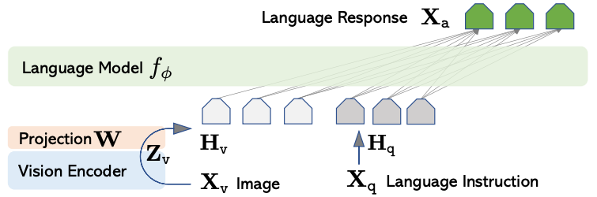
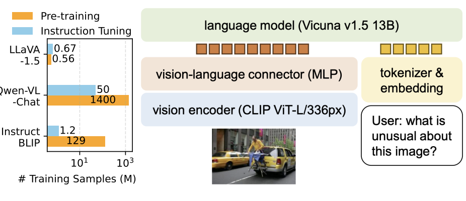
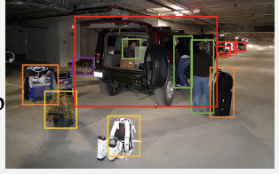
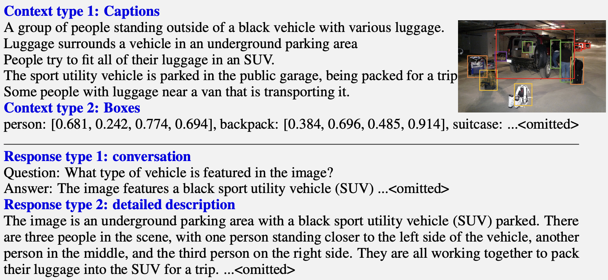
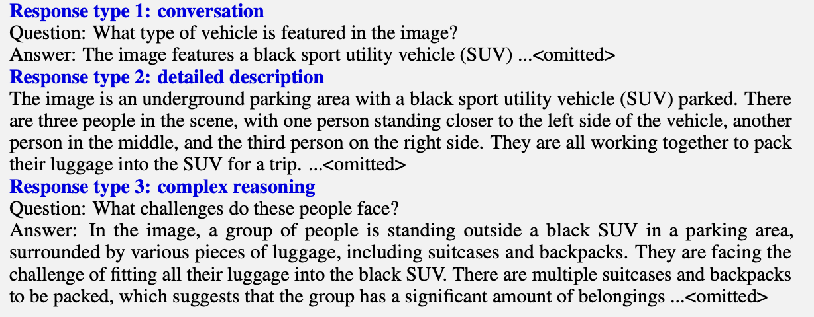
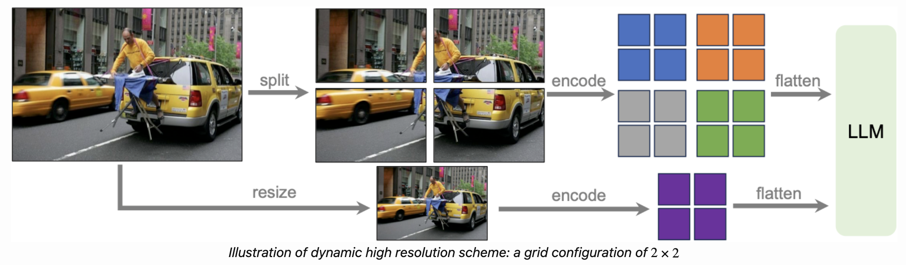

# Section 3: LLaVA: Large Language and Vision Assistant

> Slides 29–47 · Liu et al., 2023: *"Visual Instruction Tuning"* (LLaVA) and *"Improved Baselines with Visual Instruction Tuning"* (LLaVA-1.5)
> **Goal:** trace a pixel all the way to a word the LLM can read, **in code**, and explain why a tiny projector plus a clever data trick was enough.

[← Section 2](02-Section-2-CLIP.md) · [Index](00-INDEX.md) · [Next: Qwen-VL →](04-Section-4-Qwen-VL.md)

**Legend:** 📖 explanation · 🌍 real-world example · 🖼️ diagram · 🧪 code (run and verified; outputs are real) · 📚 go deeper
**Code needs:** `pip install torch` (and `transformers pillow requests` for **[HF]** snippets; the real model used is `llava-hf/llava-interleave-qwen-0.5b-hf`, ~1.8 GB, same `LlavaForConditionalGeneration` class as LLaVA-1.5).

**One-line summary (the professor's):** *"CLIP **matches** image and text; LLaVA can **converse** about them."*
*(The name: **L**arge **L**anguage **a**nd **V**ision **A**ssistant. The two Ls are "Large Language" (Q&A #28).)*

---

## A. Motivation

### 📖 Explanation

- CLIP learns vision-language representations but **cannot describe, reason about, or answer questions** about an image. Ask it "why is this funny?" and all it can return is a similarity score.
- **GPT-4V** showed multimodal chat was possible, but it was **closed**. Researchers could not study, reproduce or improve it.
- LLaVA's question: *can we take a **pretrained vision encoder** and a **pretrained LLM** and just teach them to follow instructions?*
- **Answer: yes**, with a **lightweight connector** and a **clever recipe for instruction data**.

Why not train from scratch? Text is abundant, but labelled images are scarce, and image space is much more diverse (*"the concept dog maps to hundreds or thousands of images"*). *"Without software or algorithmic innovation you would need 100,000 times more."* LLaVA is that algorithmic shortcut: **reuse, don't retrain**.

### 🌍 Real-world example

The professor's example: doctors look at an X-ray **and discuss it** with colleagues ("see this shadow here, what do you think?"). CLIP can only answer "does this image match *pneumonia*?". A LLaVA-style assistant (e.g. **LLaVA-Med**) can hold that conversation.

---

## B. Architecture: vision encoder → projector → LLM ⭐

### 🖼️ Diagrams (slides 31, 39)



*The paper's figure. `X_v` (image) → vision encoder → `Z_v` (patch features) → **projection W** → `H_v` (visual tokens, grey pentagons). `X_q` (instruction) → `H_q` (text tokens, dark pentagons). Both go into the language model `f_φ`, which generates `X_a` (the answer, green). Every answer token attends to every visual and text token (the thin lines).*



*LLaVA-1.5 (slide 39). Note the bar chart on the left: LLaVA-1.5 used **0.56M** pretraining + **0.67M** instruction samples, while Qwen-VL-Chat used **1,400M + 50M**. LLaVA gets competitive results with over 1,000× less data.*

### 📖 The pipeline

```
Image X_v ──► CLIP ViT-L/14 (FROZEN) ──► patch features Z_v   [576 × 1024]   (336px, [CLS] dropped)
                                               │
                                   Projection W (linear in v1, 2-layer MLP in v1.5)
                                               ▼
                                   visual tokens H_v            [576 × 4096]   ← same width as a word embedding
 "What is unusual about this image?" ─► tokenizer + embedding table ─► H_q   [n × 4096]
                                               │
          Vicuna / LLaMA decoder: [system][H_v][H_q][assistant…]  ← ONE interleaved sequence
                                               ▼
                                 generated response (autoregressive text)
```

**Idea: treat the image as a foreign language, and let the LLM do the rest.**
- **Vicuna** = LLaMA (Meta) + supervised fine-tuning on chat data. It is an open, decoder-only chat assistant. At the time, almost every open model was LLaMA-based.
- The professor's phrasing: *"it's almost **fooling the LLM** into believing the image tokens are just more words."*

### 🧪 Code 1: the real anatomy [HF]

```python
import requests, torch
from PIL import Image
from transformers import AutoProcessor, LlavaForConditionalGeneration

model_id = "llava-hf/llava-interleave-qwen-0.5b-hf"   # swap for "llava-hf/llava-1.5-7b-hf" on a GPU
model = LlavaForConditionalGeneration.from_pretrained(model_id, torch_dtype=torch.float32).eval()
processor = AutoProcessor.from_pretrained(model_id)

for name, m in model.model.named_children():
    print(f"{name:22s} {type(m).__name__:26s} {sum(p.numel() for p in m.parameters())/1e6:6.1f}M")
print(model.model.multi_modal_projector)
```
```
vision_tower           SiglipVisionModel           397.7M
multi_modal_projector  LlavaMultiModalProjector      2.2M
language_model         Qwen2Model                  464.1M
LlavaMultiModalProjector(
  (linear_1): Linear(in_features=1152, out_features=1024, bias=True)
  (act): GELUActivation()
  (linear_2): Linear(in_features=1024, out_features=1024, bias=True)
)
```
That is exactly the LLaVA-1.5 recipe: **vision tower → 2-layer GELU MLP → LLM**. This small variant uses a SigLIP encoder (1152-d) and a Qwen2-0.5B LLM (1024-d) instead of CLIP + Vicuna. The connector is **0.25%** of the parameters.

---

## C. Why the projection is necessary (slide 32)

### 📖 Explanation

A CLIP image vector and an LLM word embedding can be **the same size on paper** and still live in **two unrelated geometries**. Without W, the LLM receives the dog-image vector as an **arbitrary point** in its own space, not close to "dog", "animal" or anything it understands. **Training W teaches the image vector where it should have landed.**

The professor's whiteboard: in the vision space, image-of-dog `I_D` and image-of-cat `I_C` sit some distance `d₁` apart. In the LLM space, the words "dog" and "cat" sit somewhere else entirely. A linear projection is a combination of **rotation, scaling and shearing** (plus translation, via the bias), chosen so that `I_D` lands near "dog" and `I_C` near "cat". *Semantics comes from relative distances*, so the transform must preserve and align those distances. Dropping or padding dimensions would not do this. *"You can't just drop some embeddings; the space has to have meaning."*

**Analogy:** transliteration. The projector turns "image-script" into "LLM-script" word for word, like writing Hindi in the Latin alphabet. It doesn't *understand* anything. It just makes the symbols readable to a reader (the LLM) who already understands.

### 📖 The projector, with real sizes

| | Vision feature | LLM hidden | Projector | Params |
|---|---|---|---|---|
| **LLaVA v1** | 1024 (CLIP ViT-L/14) | 4096 (Vicuna-7B) | **one linear layer** | **4.20M** |
| **LLaVA-1.5** | 1024 | 4096 | **Linear → GELU → Linear** | **20.98M** |
| llava-interleave-0.5b (real, above) | 1152 (SigLIP) | 1024 (Qwen2-0.5B) | Linear → GELU → Linear | 2.2M |

(The professor used illustrative sizes such as "1000 → 256". The real numbers are above.)

- **Why does the MLP beat linear?** A linear map can only rotate, scale and shear the space, which is too rigid to align two independently learned manifolds. The **non-linearity** gives the connector more capacity (deck quiz Q2).
- **Why does something this simple work at all?** *"The LLM is powerful enough to interpret aligned visual tokens. The connector's only job is **translation**, not reasoning."*
- **Not LoRA-shaped:** *"the dimensions don't have to go low then high like LoRA."* The MLP can be any shape.

### 🧪 Code 2: build both projectors and count parameters

```python
import torch, torch.nn as nn
VIS_DIM, LLM_DIM = 1024, 4096                      # CLIP ViT-L/14 -> Vicuna-7B
proj_v1  = nn.Linear(VIS_DIM, LLM_DIM)
proj_v15 = nn.Sequential(nn.Linear(VIS_DIM, LLM_DIM), nn.GELU(), nn.Linear(LLM_DIM, LLM_DIM))
count = lambda m: sum(p.numel() for p in m.parameters())
print(f"v1 linear projector : {count(proj_v1)/1e6:.2f}M params")
print(f"v1.5 MLP projector  : {count(proj_v15)/1e6:.2f}M params")

patch_feats = torch.randn(1, 576, VIS_DIM)         # CLIP penultimate layer @336px, [CLS] dropped
print("visual tokens:", tuple(proj_v15(patch_feats).shape))
```
```
v1 linear projector : 4.20M params
v1.5 MLP projector  : 20.98M params
visual tokens: (1, 576, 4096)
```

### 📖 Patch-level features, not one pooled vector

LLaVA takes CLIP's **grid (patch) features**, not the single pooled vector CLIP uses for matching. This keeps **local detail**.

The professor's example: "*a man with a kite standing near a dog*". A single image vector close to the whole sentence is not real understanding. You want *man* ↔ {patches 1, 2, 3}, *kite* ↔ {patches 4, 5}, *dog* ↔ {patch 6}. **Images are compositional, like sentences.** *"The patches don't know where the boundaries are, so it will never be one single patch."* Keeping all the patches lets the LLM's attention link each word to the right region. CLIP *"knew this, but simplified it. A researcher's job is to simplify with current tools."*

> ⚠️ **Trap: "features from before and after the last layer".** The slide wording is ambiguous, and the professor read it as *concatenating* the two. In the released LLaVA code, the default is to take the **penultimate layer's patch features** (`mm_vision_select_layer = -2`) and **drop `[CLS]`** (`mm_vision_select_feature = "patch"`). The paper compared before-last and last layers, and before-last worked better, because the last layer is tuned for CLIP's global matching objective and has lost more local detail. In HF: `llava-hf/llava-1.5-7b-hf` has `config.vision_feature_layer = -2` and `vision_feature_select_strategy = "default"` (drop `[CLS]`). The SigLIP-based 0.5B model we run here has `-1` and `"full"`: SigLIP has **no `[CLS]` token** to drop, so it keeps every patch. Always check these two fields when swapping encoders.

📚 **Go deeper:** [LLaVA project page](https://llava-vl.github.io/) · [LLaVA paper](https://arxiv.org/abs/2304.08485) · [official repo](https://github.com/haotian-liu/LLaVA) (see `llava/model/multimodal_projector/builder.py`, which is ~40 lines)

---

## D. How image tokens enter the LLM (slides 34–35) ⭐

### 📖 Explanation

- Each image becomes a **fixed number of visual tokens** with the **same dimension as a word embedding**:
  - ViT-L/14 @ 224px → 16 × 16 = **256 tokens** (LLaVA v1)
  - ViT-L/14 @ 336px → 24 × 24 = **576 tokens** (LLaVA-1.5)
  - SigLIP/14 @ 384px → 27 × 27 = **729 tokens** (the real model above)
- Sequence layout: `[system prompt] [visual tokens] [human instruction] [assistant response]`
- The LLM runs **ordinary (causal, masked) self-attention** over the whole sequence. **No separate cross-attention module.** Every text token can attend back to every visual token that comes before it.
- The complexity lives in the **already-trained LLM**, not in the fusion mechanism.

**How it's done in code:** the prompt contains one placeholder token `<image>`. The processor **expands** it into N copies of an image-token id. The model computes the visual tokens and **writes them into those N embedding slots** before running the LLM. The LLM never "knows" the vectors came from pixels.

### 📖 Worked training example (slide 35)

| Segment | Content | Loss? |
|---|---|---|
| `[SYSTEM]` | "A chat between a curious user and an AI assistant…" | ✗ |
| `[IMAGE TOKENS]` | 576 vectors from CLIP → projector, the model's only view of the pixels | ✗ |
| `[USER]` | "What is unusual about this image?" | ✗ |
| `[ASSISTANT]` | "The man is ironing clothes on an ironing board attached to the back of a moving taxi." | ✅ **loss only here** |

**Loss:** standard next-token cross-entropy, **summed over the response tokens only**:

$$\mathcal{L} = -\sum_{t \in \text{answer}} \log p_\theta(x_t \mid X_v, X_{\text{instruct}}, x_{<t})$$

At each answer position, compare the predicted distribution over the vocabulary with the one-hot ground-truth next token (the professor's `0 0 1 0 0` vector). There is **no contrastive term**. Positions that should not be trained get label **−100**, the `ignore_index` of PyTorch's cross-entropy.

**Why mask the prompt?** Training on the system prompt or the question would teach the model to **predict the user's question**, which wastes capacity and can make it parrot prompts. This is exactly the bug in the hands-on notebook; see [file 7](07-Hands-On-Qwen2-VL-Notebook.md).

### 🧪 Code 3: splice visual tokens into the text and mask the labels (from scratch)

```python
import torch, torch.nn as nn, torch.nn.functional as F
VOCAB, LLM_DIM, IMAGE_TOKEN_ID, IGNORE = 32000, 4096, -200, -100
embed = nn.Embedding(VOCAB, LLM_DIM)                 # the LLM's word-embedding table
visual_tokens = proj_v15(torch.randn(1, 576, 1024))  # from Code 2

system = [1, 319, 13563]                                               # "A chat between ..."  (toy ids)
user   = [3148, 1001, 29901, IMAGE_TOKEN_ID, 1724, 338, 22910, 29973]  # "USER: <image> What is unusual?"
answer = [319, 1799, 338, 13977, 292, 2]                               # "ASSISTANT: A man is ironing ... </s>"
ids = system + user + answer

embs, labels = [], []
for i, t in enumerate(ids):
    in_answer = i >= len(system) + len(user)
    if t == IMAGE_TOKEN_ID:                           # ONE placeholder -> 576 visual vectors
        embs.append(visual_tokens[0]); labels += [IGNORE] * visual_tokens.shape[1]
    else:
        embs.append(embed(torch.tensor([t]))); labels.append(t if in_answer else IGNORE)
inputs_embeds = torch.cat(embs).unsqueeze(0)
labels = torch.tensor(labels).unsqueeze(0)
print("LLM input:", tuple(inputs_embeds.shape), f"| tokens with loss: {(labels != IGNORE).sum().item()} of {labels.shape[1]}")

# causal LM: position t predicts token t+1; ignore_index skips the masked positions
logits = torch.randn(1, labels.shape[1], VOCAB)     # stand-in for llm(inputs_embeds=...).logits
loss = F.cross_entropy(logits[:, :-1].reshape(-1, VOCAB), labels[:, 1:].reshape(-1), ignore_index=IGNORE)
```
```
LLM input: (1, 592, 4096) | tokens with loss: 6 of 592
```
Only **6 of 592** positions train the model. The 576 image positions and the whole prompt are context, not targets.

### 🧪 Code 4: real inference, and seeing the 729 image slots [HF]

```python
image = Image.open(requests.get("http://images.cocodataset.org/val2017/000000039769.jpg", stream=True).raw)
conversation = [{"role": "user", "content": [
    {"type": "image"},
    {"type": "text", "text": "How many cats are there, and what is next to them?"}]}]
prompt = processor.apply_chat_template(conversation, add_generation_prompt=True)
inputs = processor(images=image, text=prompt, return_tensors="pt")

n_img = (inputs["input_ids"] == model.config.image_token_index).sum().item()
print("prompt tokens:", inputs["input_ids"].shape[1], "| of which image placeholders:", n_img)
print("pixel_values:", tuple(inputs["pixel_values"].shape))

with torch.no_grad():
    out = model.generate(**inputs, max_new_tokens=40, do_sample=False)
print("ANSWER:", processor.decode(out[0][inputs["input_ids"].shape[1]:], skip_special_tokens=True))
```
```
prompt tokens: 751 | of which image placeholders: 729
pixel_values: (1, 3, 384, 384)
ANSWER: There are two cats, and they are next to a pink blanket.
```
- **751 tokens, 729 of them image.** The picture is 97% of the context. That is why visual-token count drives VLM cost.
- The answer is correct but **incomplete**: it misses the two remotes. A small model relies on the strongest visual evidence, and this also hints at the "language prior" limitation in §J.

> ⚠️ **Trap (Q&A #29): LLaVA only outputs text.** The visual tokens are **conditioning input**. The decoder produces text autoregressively. Generating images or masks would need a separate visual decoder or generator.

📚 **Go deeper:** [HF docs: LLaVA](https://huggingface.co/docs/transformers/model_doc/llava) (prompt formats per checkpoint, batching, multi-image)

---

## E. Visual instruction data, generated by text-only GPT-4 ⭐ (slides 36–37)

### 📖 Explanation

**The problem:** no large dataset of **(image, instruction, response)** triples existed, and you need a gold response to compute a loss.

**The trick:**
1. Start from **COCO**, whose images already have human **captions** and **bounding boxes**. The professor also mentioned Flickr8K/30K, early caption datasets from Yahoo's Flickr photo-sharing site.
2. Turn each image into a **text-only symbolic description**: captions plus a list of `object: [x1, y1, x2, y2]`.
3. Give that to **text-only GPT-4**, which **never sees the pixels**, with a few hand-written examples.
4. GPT-4 writes three kinds of data, **~158K samples** in total.

### 🖼️ The actual example from the paper (slides 36–37)







*Read these top to bottom. GPT-4 only received the **text** in the second figure: five captions plus boxes like `person: [0.681, 0.242, 0.774, 0.694]`. From that alone it wrote a conversation ("black SUV"), a detailed description ("three people… one closer to the left side of the vehicle…"; notice it used the **box coordinates** to reason about left, middle and right), and complex reasoning ("the challenge of fitting all their luggage into the SUV").*

| Type | What it teaches | Example |
|---|---|---|
| **Conversation** (~58K) | multi-turn, image-grounded Q&A | "What type of vehicle is in the image?" → "A black SUV." |
| **Detailed description** (~23K) | long, free-form descriptions | "Describe this image in detail." |
| **Complex reasoning** (~77K) | multi-step inference beyond surface content | "What challenges do these people face?" |

(The per-type split is from the paper. The slides give only the 158K total.)

### 🧪 Code 5: build a GPT-4 "symbolic image" prompt yourself

```python
def symbolic_context(captions, boxes, img_w, img_h):
    lines = ["Captions:"] + [f"- {c}" for c in captions] + ["Objects (normalised [x1, y1, x2, y2]):"]
    for name, (x1, y1, x2, y2) in boxes:
        lines.append(f"- {name}: [{x1/img_w:.3f}, {y1/img_h:.3f}, {x2/img_w:.3f}, {y2/img_h:.3f}]")
    return "\n".join(lines)

SYSTEM = ("You are an AI visual assistant looking at a single image, described by the captions and object "
          "boxes below. Ask and answer questions as if you can see the image. Only ask questions that the "
          "description can answer confidently.")
ctx = symbolic_context(["Two cats sleep on a pink blanket.", "Two remote controls lie next to the cats."],
                       [("cat", (10, 50, 320, 470)), ("cat", (340, 20, 640, 360)), ("remote", (40, 72, 176, 118))],
                       640, 480)
print(ctx)
messages = [{"role": "system", "content": SYSTEM}, {"role": "user", "content": ctx}]
# -> send `messages` to any strong text LLM; parse its Q&A pairs; pair them with the REAL image for training
```
```
Captions:
- Two cats sleep on a pink blanket.
- Two remote controls lie next to the cats.
Objects (normalised [x1, y1, x2, y2]):
- cat: [0.016, 0.104, 0.500, 0.979]
- cat: [0.531, 0.042, 1.000, 0.750]
- remote: [0.062, 0.150, 0.275, 0.246]
```

### 🌍 Real-world use of this trick today

Need a VLM for **your** domain (warehouse shelf photos, insurance claim photos)? If you have **any** structured metadata (detector boxes, SKU lists, OCR text, human notes), you can have a strong LLM turn it into instruction data, then fine-tune on (real image, generated Q&A). This is how LLaVA-Med was built from biomedical figure captions.

> 💡 **Learning Thought:** GPT-4 acted as a **"blind teacher"**. The captions and boxes are a *lossy text rendering* of the image, rich enough for GPT-4 to invent plausible dialogue. The student (LLaVA) then learns to produce that dialogue from the **real pixels**. This "use a stronger text model to write multimodal training data" pattern shows up across later VLMs. The risk is also inherited: anything the captions got wrong, or GPT-4 invented, becomes a trained-in hallucination.

> ⚠️ **Trap (deck quiz Q4):** the data came from **GPT-4 reading captions and boxes as text**. It did not come from video transcripts, social media comments, or SAM-generated labels.

---

## F. Two-stage training recipe ⭐ (slide 38)

### 📖 Explanation

Why two stages? The **projector starts randomly initialised**. If you update the LLM at the same time, a random projector feeds it garbage, and the gradients can **damage the LLM's language ability** before the projector has learned anything. So you train the new part first, then the rest. The professor compared this to LoRA-style practice of warming up new modules separately: *"many moving goals with a completely uninitialised part is very difficult."*

| | **Stage 1: feature-alignment pretraining** | **Stage 2: end-to-end instruction tuning** |
|---|---|---|
| Vision encoder | ❄️ frozen | ❄️ frozen |
| **Projector** | 🔥 **trained (the only trainable part)** | 🔥 trained (continued, **not reset**) |
| LLM | ❄️ frozen | 🔥 trained |
| Data | **~595K** filtered **CC3M** image-caption pairs | **158K** GPT-4-generated instructions |
| Goal | align visual features to the LLM's word-embedding space (learn to "transliterate") | teach instruction following, conversation, reasoning |
| Loss | autoregressive next-token CE | autoregressive next-token CE on assistant tokens |
| Cost | a few hours on 8×A100 | about 1 day on 8×A100 (7B/13B) |

### 🧪 Code 6: the two stages as `requires_grad` switches, on a real LLaVA [HF]

```python
def set_stage(model, stage):
    model.model.vision_tower.requires_grad_(False)                 # never trained
    model.model.multi_modal_projector.requires_grad_(True)         # trained in both stages
    model.model.language_model.requires_grad_(stage == 2)          # only in stage 2
    model.lm_head.requires_grad_(stage == 2)
    n = sum(p.numel() for p in model.parameters() if p.requires_grad)
    t = sum(p.numel() for p in model.parameters())
    print(f"stage {stage}: trainable {n/1e6:8.1f}M of {t/1e6:.1f}M ({100*n/t:.2f}%)")

set_stage(model, 1); set_stage(model, 2)
# then: optimizer = torch.optim.AdamW([p for p in model.parameters() if p.requires_grad], lr=...)
```
```
stage 1: trainable      2.2M of 864.0M (0.26%)
stage 2: trainable    466.3M of 864.0M (53.97%)
```
Stage 1 is cheap because only **0.26%** of the weights have gradients and optimiser state. The original LLaVA used lr 2e-3 for Stage 1 and 2e-5 for Stage 2: a large LR for the fresh projector, a small one so the LLM isn't damaged.

> ⚠️ **Trap: what loss does Stage 1 use?** In the transcript, the professor said Stage 1 is "generally trained in a contrastive manner", or alternatively as a 0/1 match classifier. **That is not what LLaVA does.** In the paper, each CC3M pair becomes a trivial instruction ("Describe the image briefly." → caption), and the projector is trained with the **same autoregressive next-token loss**, predicting the caption. Contrastive and matching (ITM) objectives are used by *other* models (CLIP; [BLIP-2](https://arxiv.org/abs/2301.12597)'s Q-Former), which is probably where the mix-up came from. For LLaVA, the answer is **captioning with next-token prediction**.

**Why does the LLM have to be trained in Stage 2?** (The professor's "smiling" example.)
- "*What colour is the car?*" needs to detect the object and the colour. The frozen encoder plus projector probably already carry that, and the model mostly needs to learn to *decode an answer*.
- "*Why might this person be smiling?*" needs locating the face, reading facial features, and inferring social context. That is **reasoning over visual evidence**, and *"there's very little chance the vision encoder understands smiling."* The LLM has to learn how visual tokens should influence its reasoning.

> ⚠️ **Trap (Q&A #35): "My LLM is already instruction-tuned, so do I need Stage 2?"** Yes. A text-only instruction-tuned LLM has **never seen visual embeddings**. It does not know how they should affect its answer. Multimodal instruction tuning teaches exactly that.

> ⚠️ **Trap (Q&A #34, #36):** the projector is trained in **both** stages (continued, not re-initialised). The LLM is updated **only in Stage 2**. The vision encoder is **never** updated.

---

## G. LLaVA-1.5 and LLaVA-NeXT (slide 39)

### 📖 LLaVA-1.5 (large gains at low extra cost)
- **MLP projector** (2-layer, GELU) instead of linear
- **Academic VQA datasets** mixed into instruction tuning. The three GPT-4 data types alone were not enough (665K samples in total).
- **Response-formatting prompts** to control answer length, e.g. *"Answer the question using a single word or phrase."* Without these, short-answer VQA data would make the model terse everywhere.
- **Higher resolution: 336px** → 576 tokens

### 📖 LLaVA-NeXT (1.6): "AnyRes"



*The slide's figure. The ironing-man image is **split** into a 2×2 grid of tiles, each **encoded** separately by the same frozen CLIP (the four coloured grids). The whole image is also **resized** and encoded once (purple) for global context. Everything is **flattened** and fed to the LLM.*

- Captures fine detail **without retraining the vision encoder**, because each tile is at CLIP's native 336px.
- The grid shape is chosen to match the image's **aspect ratio** (2×1 for wide, 1×2 for tall, 2×2 …), so there is less distortion.

### 🧪 Code 7: AnyRes token budget

```python
def anyres_tokens(grid_w, grid_h, tokens_per_tile=576):
    return grid_w * grid_h * tokens_per_tile + tokens_per_tile       # tiles + 1 global view
for g in [(1, 1), (2, 1), (2, 2), (3, 2)]:
    print(f"AnyRes grid {g[0]}x{g[1]} (@336px tiles) -> {anyres_tokens(*g):5d} visual tokens")
```
```
AnyRes grid 1x1 (@336px tiles) ->  1152 visual tokens
AnyRes grid 2x1 (@336px tiles) ->  1728 visual tokens
AnyRes grid 2x2 (@336px tiles) ->  2880 visual tokens
AnyRes grid 3x2 (@336px tiles) ->  4032 visual tokens
```
A 2×2 grid is **5× LLaVA-1.5**. *Effect:* much better **OCR, chart and document understanding, fine-grained recognition**. *Cost:* the LLM's attention and KV-cache grow with every token.

The professor's example for why detail matters: "*a man ironing clothes on a board attached to a moving taxi*". That is a rare scene, and describing it needs fine-grained perception that a coarse global view misses. *"You really have to home in on each one of these things."*

📚 **Go deeper:** [LLaVA-1.5 paper](https://arxiv.org/abs/2310.03744) (short, with excellent ablations) · [LLaVA-NeXT blog](https://llava-vl.github.io/blog/2024-01-30-llava-next/)

---

## H. Evaluation (slide 40)

| Benchmark | Tests |
|---|---|
| **LLaVA-Bench** | small curated set; **GPT-4 judges** response quality (open-ended chat) |
| **ScienceQA** | multiple-choice science questions with diagrams (grounded reasoning) |
| **VQAv2 / GQA** | standard VQA: objects, colour, shape, size, spatial relations |
| **POPE** | **object hallucination**: asks "Is there a <object> in the image?" for objects that are and aren't present |

### 🧪 Code 8: a POPE-style hallucination probe on your own images

```python
def pope_probe(model, processor, image, present, absent):
    """Ask yes/no about objects that ARE and ARE NOT in the image; count wrong 'yes'."""
    results = {}
    for obj in present + absent:
        conv = [{"role": "user", "content": [{"type": "image"},
                {"type": "text", "text": f"Is there a {obj} in the image? Answer yes or no."}]}]
        inputs = processor(images=image, text=processor.apply_chat_template(conv, add_generation_prompt=True),
                           return_tensors="pt")
        out = model.generate(**inputs, max_new_tokens=3, do_sample=False)
        results[obj] = processor.decode(out[0][inputs["input_ids"].shape[1]:], skip_special_tokens=True).strip().lower()
    false_yes = sum(results[o].startswith("yes") for o in absent)
    return results, false_yes / len(absent)             # hallucination rate on absent objects
```
```
{'cat': 'yes', 'remote control': 'yes', 'dog': 'no', 'laptop': 'yes', 'person': 'no'}  hallucination rate: 0.333
```
*(Real output from the 0.5B model on the cats image, with `present=["cat","remote control"]` and `absent=["dog","laptop","person"]`.)*

**The model hallucinated a laptop.** There is no laptop in the image, but there are two remotes with button grids, objects that often **co-occur** with laptops on a sofa. That is exactly the failure POPE's "adversarial" split targets: absent objects that commonly appear alongside the present ones. Real POPE uses 500 COCO images and three splits (random, popular, adversarial).

The professor emphasised basic perception: object, colour, shape and size, then region, then spatial relation. His research observation: **VLMs have become better at reasoning but worse at some basic visual abilities**. There is a line of papers on "making the V in VLM matter".

📚 **Go deeper:** [POPE paper](https://arxiv.org/abs/2305.10355) · [VQAv2](https://visualqa.org/)

---

## I. Open vs closed, compute, and the family tree (slides 41–43)

| | GPT-4V | LLaVA |
|---|---|---|
| Access | closed, API only | open weights **and** training recipe |
| Vision encoder | undisclosed | frozen CLIP ViT-L/14 |
| Data | undisclosed | 158K instructions + CC3M subset, published |
| Reproducibility | none | **a handful of A100s, about 1 day** |
| Role | proved the task is *possible* | proved it can be done **openly and cheaply** |

Compare: CLIP took **592 V100-years**. LLaVA's two stages take **hours plus about a day on 8 A100s**, because every expensive component was already pretrained. That low barrier is why LLaVA became the base for dozens of follow-ups (*"we now have survey papers on just LLaVA models"*):
- **LLaVA-Med:** the same recipe on biomedical figure-caption pairs plus GPT-4-generated medical instructions
- **LLaVA-Interactive / LLaVA-Plus:** **tool use**, calling segmentation or editing models mid-conversation (a preview of Lecture 2)
- **Video-LLaVA:** sampled video frames through an extended encoder

*The common thread:* align, then instruction-tune, with a lightweight connector. It generalises well beyond chat.

---

## J. Limitations (slide 44)

1. **Hallucination:** objects, attributes or relations that aren't in the image
2. **Resolution bottleneck** (base version): a fixed low-resolution CLIP input struggles with small text
3. **Weak localisation and counting:** the projector and fixed grid compress spatial information
4. **Inherits CLIP's blind spots:** the vision tower is frozen, so whatever CLIP can't see, LLaVA can't either

### 📖 The professor's research point: the language prior

The LLM has become so strong that it **biases** the answer. Sometimes the model is effectively **blind to the image**. Asked "what colour is the grass?", it says green from common sense without looking. **Test it yourself:** show a VLM a photo of **purple** grass and ask the colour. A model dominated by its language prior says "green". Much current research is about **restoring the visual side**.

> ⚠️ **Trap (Q&A #31): why left and right are hard.** Left/right needs **precise, viewpoint-sensitive spatial relations**. Training data rarely states them, and patch features encode "what" more reliably than "where relative to what". This is the same root cause as CLIP's limitation.

> ⚠️ **Trap (Q&A #30): how does a VLM know colour?** There is no separate colour detector. The vision encoder's features capture colour, and multimodal training links those features to words like "red".

> ⚠️ **Trap (Q&A #37): where does the cost come from?** Mostly from the **LLM** and the **number of visual tokens** (729 of 751 tokens in our real example). The projector is negligible. To cut cost: use a smaller or quantised LLM, fewer visual tokens or lower resolution, a frozen vision encoder, and LoRA/QLoRA (see the hands-on).

> ⚠️ **Trap (Q&A #32): what else can LLaVA do?** Besides description: VQA, multi-turn image-grounded chat, visual reasoning, and explaining charts, documents and screenshots.

---

## 🎯 Interview Questions

**Q1. Trace a pixel to a token the LLM reads, in LLaVA-1.5.**
> Resize the image to 336×336 and cut it into 14×14 patches (24×24 = 576). CLIP ViT-L/14 encodes them. Take the penultimate-layer patch features, 576 × 1024, and drop `[CLS]`. Pass each through the 2-layer GELU MLP projector to get 576 × 4096, the same width as Vicuna's word embeddings. The prompt's single `<image>` placeholder is expanded to 576 slots, and these vectors are written into those embedding positions. From there the LLM treats them like any other token embeddings under causal self-attention.

**Q2. Why train in two stages? What's frozen in each?**
> The projector starts random. Updating the LLM alongside a random projector would push noisy gradients into the LLM and damage its language ability. Stage 1 freezes CLIP and the LLM and trains only the projector (0.26% of weights in our real check) on ~595K caption pairs with next-token loss (alignment). Stage 2 keeps CLIP frozen and trains the projector and the LLM on 158K instruction samples, teaching the LLM how to *use* visual tokens for conversation and reasoning.

**Q3. How did LLaVA get instruction data without human annotators?**
> They rendered COCO images as text (human captions plus bounding boxes) and prompted text-only GPT-4 to write conversations, detailed descriptions and complex-reasoning Q&A about the "image" it could only read about. That gave 158K samples. The model then learns to produce those answers from the real pixels.

**Q4. Why does a linear projector work at all? Why is the MLP better?**
> The frozen CLIP features already encode the visual semantics, and the LLM already knows how to reason. The connector only has to translate between the two spaces. Linear gets most of the way there. A GELU MLP adds non-linear capacity to align two independently learned spaces, and it gave a clear gain in LLaVA-1.5 for about 21M parameters.

**Q5. What is AnyRes and what does it cost?**
> Tile the high-resolution image into encoder-native crops (grid chosen by aspect ratio), encode each one separately, add a downsampled global view, and concatenate. A 2×2 grid at 336px gives 4×576 + 576 = 2,880 visual tokens, 5× the base count. This improves OCR, charts and fine detail without retraining CLIP, at the price of longer sequences and more LLM compute and KV-cache memory.

**Q6. Why is the loss masked to the assistant tokens?**
> We want p(answer | image, question). Computing loss on the system prompt and question would train the model to predict the user's words, wasting capacity and encouraging it to parrot prompts. Label masking (setting non-answer labels to −100, the cross-entropy `ignore_index`) keeps the objective on the response. In our toy sequence, 6 of 592 positions carry loss.

**Q7. How would you reduce hallucination in a LLaVA-style model?**
> Better visual evidence: higher resolution or AnyRes, a stronger or unfrozen encoder. Hallucination-aware data: negative "no, there is no X" examples, measured with POPE-style probes. Grounding: make the model cite boxes, as Qwen-VL does. Decoding-time checks. At the system level, verify claims with a detector or SAM.

**Q8. When is LLaVA's frozen encoder a liability?**
> In domains far from CLIP's web data (medical scans, satellite imagery, dense documents), and for tasks that need fine localisation. Anything CLIP can't represent, the LLM can't recover. Qwen-VL's answer is to fine-tune the ViT.

**Q9. How do you adapt LLaVA to your company's domain on a budget?**
> Generate instruction data from existing metadata with a strong text LLM (the GPT-4 trick). Keep the vision tower frozen. Fine-tune the projector plus LoRA adapters on the LLM (QLoRA if memory-bound), with the loss masked to answers. Evaluate on held-out domain Q&A plus a POPE-style hallucination probe.

**Q10. Where does the compute go when serving a VLM?**
> Mostly into the LLM's processing of visual tokens. In our real run, 729 of 751 prompt tokens were image tokens. Prefill cost and KV-cache memory scale with that count, which is why resolution policies (AnyRes, `max_pixels`) are the main serving-cost knob.

---

## ✅ Self-check (deck quiz, slides 45–47)

1. Frozen in Stage 1? → **the vision encoder and the LLM** (only the projector trains)
2. Why does the MLP beat linear? → **more non-linear capacity to align the spaces**
3. AnyRes solves? → **higher resolution for fine detail such as small text**
4. How was the 158K data built? → **text-only GPT-4 prompted with captions and boxes**
5. The v1 → v1.5 connector change? → **linear → 2-layer MLP with GELU**
6. The three data types? → **conversation, detailed description, complex reasoning**

Extra:
- How many visual tokens does LLaVA-1.5 use per image? What about AnyRes on a 2×2 grid? *(576; 2,880)*
- What is Stage 1's actual loss? *(Next-token prediction of the caption, not contrastive.)*
- Which component is never updated in either stage? *(The CLIP vision encoder.)*
- In the real run, why did the answer mention the blanket but not the remotes?
- The POPE probe answered "yes" to *laptop*. Which POPE split is designed to catch this, and why did it happen?

**Next:** [Section 4: Qwen-VL →](04-Section-4-Qwen-VL.md)
