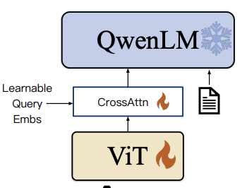
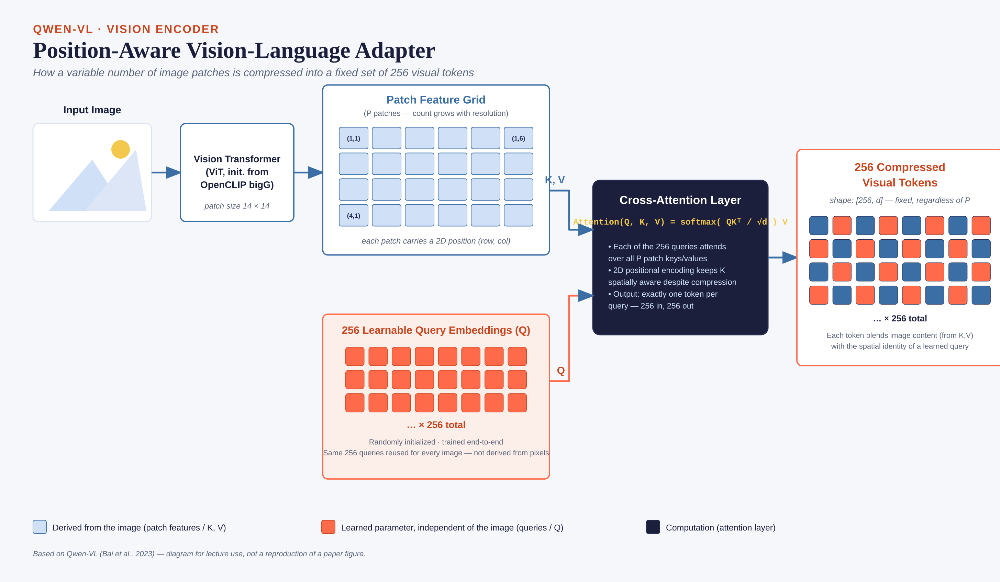
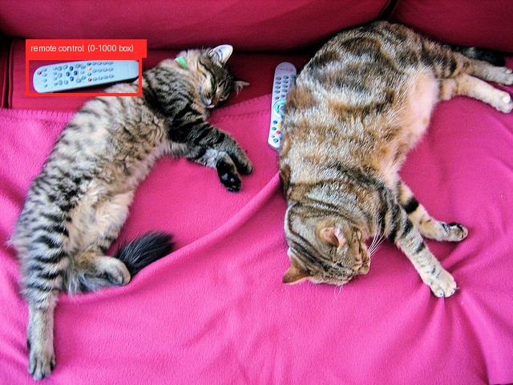
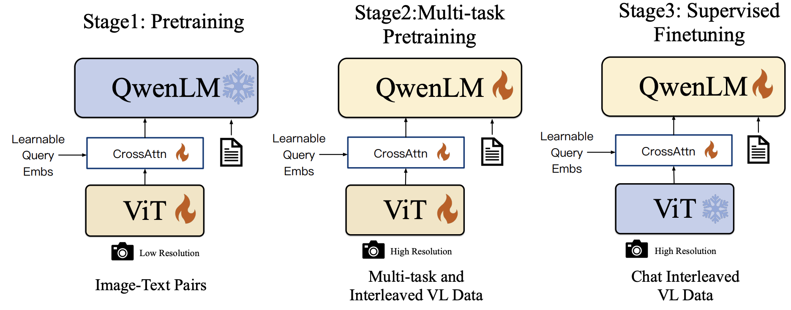

# Section 4: Qwen-VL: a frontier grounded VLM

> Slides 48–65 · Bai et al., Alibaba, 2023: *"Qwen-VL: A Versatile Vision-Language Model for Understanding, Localization, Text Reading, and Beyond"*
> **Goal:** understand the one idea that matters (a **cross-attention compressor with 256 learned queries**), **build it in PyTorch**, and see "boxes as text" work on a real model.

[← Section 3](03-Section-3-LLaVA.md) · [Index](00-INDEX.md) · [Next: SAM →](05-Section-5-SAM.md)

**Legend:** 📖 explanation · 🌍 real-world example · 🖼️ diagram · 🧪 code (run and verified; outputs are real) · 📚 go deeper
**Code needs:** `pip install torch` (and `transformers pillow torchvision` for **[HF]** snippets; the real model is `Qwen/Qwen2-VL-2B-Instruct`, the hands-on model, ~4.4 GB. It runs on CPU at about 70–80 s per answer.)

The professor was blunt: *"The adapter is the biggest important thing in Qwen. Everything else is just syntactic sugar on top."*

---

## A. Motivation: beyond chat

### 📖 Explanation

- LLaVA-style models **chat well** but are weak at **precise spatial grounding** and **dense text reading**. Chat skill came at the cost of fine-grained abilities.
- Qwen-VL targets a **broader task set in one model**: captioning, VQA, **grounding**, **OCR**, **multi-image / multi-round** dialogue. These tasks need the visual and language sides to be *equally* strong.
- **The key architectural bet:** compress **variable-resolution** visual features into a **fixed, efficient token budget**, **without losing spatial information**.

The professor's framing of the problem with LLaVA: a fixed grid of 256 patches is too few for a 4K document and wasteful for a thumbnail. *"Whatever the number is, it may not be sufficient."* Qwen-VL **decouples** the number of patches (driven by resolution) from the number of tokens the LLM sees (fixed at 256). *"They turn this idea on its side."*

### 🌍 Real-world examples where "what" isn't enough

| Task | Needs "what" | Also needs "where" / fine detail |
|---|---|---|
| UI agent: "click Submit" | know what a Submit button is | **its coordinates** |
| Invoice automation | read "Total: ₹4,580" | **small text** + **which field** it belongs to |
| Radiology assistant | "is there a nodule?" | **a box** around it, to make the answer verifiable |
| Compare two product photos | recognise both | **multi-image** reasoning |

---

## B. Architecture: ViT → position-aware VL adapter → Qwen LLM

### 🖼️ Diagram (slide 50)



*The three blocks. The 🔥 flame means "trainable in this stage" and ❄️ means "frozen". This is the Stage 1 view (see §F).*

### 📖 The pipeline

```
Image (224² in Stage 1, 448² later)
   │
   ▼
ViT, initialised from OpenCLIP ViT-bigG (~1.9B params), patch 14
   │   P patches; P grows with resolution: P = (H/14)·(W/14)
   ▼
Position-aware VL Adapter
   • ONE cross-attention layer
   • 256 learnable query embeddings   (Q)
   • patch features                   (K, V)
   • 2D absolute position encodings added to Q/K
   │   → exactly 256 tokens, whatever P was
   ▼
Qwen-7B LLM:  text +  256 visual tokens </img> + <ref>/<box> grounding tokens
   │
   ▼
Grounded response: text + bounding boxes (written as text)
```

### 📖 The vision encoder (slide 51)
- **ViT initialised from OpenCLIP ViT-bigG**, a large pretrained checkpoint (~1.9B parameters, width 1664)
- **224×224** in initial pretraining, raised to **448×448** for fine-grained tasks (OCR, grounding)
- **14×14 patches** (ViT-bigG's native setting)
- Output: a **variable-length grid of patch features**, passed to the adapter **without pooling**

> ⚠️ **Trap:** patch size and patch count are properties of the **ViT**, not the adapter. The ViT's output length grows with resolution. The adapter's output length does not.

📚 **Go deeper:** [Qwen-VL paper](https://arxiv.org/abs/2308.12966) · [Qwen-VL GitHub](https://github.com/QwenLM/Qwen-VL) · [OpenCLIP](https://github.com/mlfoundations/open_clip)

---

## C. The position-aware adapter ⭐⭐ (slides 52–53)

### 🖼️ Diagram (slide 52)



*Blue boxes are **derived from the image** (patch features become K and V, each carrying its (row, col) position). Orange boxes are **learned parameters, independent of the image** (the 256 queries, the same for every image). The dark box is the cross-attention computation. The output is always `[256, d]`.*

### 📖 The problem
A 448×448 image gives (448/14)² = 32² = **1,024 patch tokens**. That is too many to feed an LLM at scale, especially with several images or several dialogue rounds.

### 📖 The solution: learned queries plus cross-attention

$$\text{Out} = \text{softmax}\!\left(\frac{(Q + \text{PE}_q)\,W_Q \cdot \big((X + \text{PE}_{2D})\,W_K\big)^\top}{\sqrt{d}}\right)(X\,W_V)$$

| Role | What it is | Shape (448px) |
|---|---|---|
| **Q** | **256 learnable query embeddings**. Parameters of the model, identical for every image. | 256 × d |
| **K, V** | the image's patch features from the ViT | 1024 × d |
| **2D abs. position** | added so each key carries *where* its patch came from | 1024 × d |
| Attention matrix | each query scores every patch | **256 × 1024** |
| **Output** | one compressed token per query | **256 × d → LLM width (4096)** |

**How it behaves:**
- **256 in, 256 out, regardless of input resolution.** At 224px, 256 patches become 256 tokens (1× compression). At 448px, 1,024 patches become 256 (4×).
- Each query learns to **"ask" for a certain kind of information**, attending over **all** patches at once. The professor's contrast: an old-style adapter maps *each patch to one vector* (LLaVA). This one reuses the Transformer idea fully: *every output token looks at every patch*.
- W_Q, W_K, W_V and the 256 query vectors are **all learned**. *"Q is learnt, K has W_K, V has W_V. That is the whole basic idea, nothing else."*
- The **2D positional encodings** are what make it **"position-aware"**. Without them, the compressed tokens would lose where things were, and grounding would be impossible.

**Analogy: 256 reporters at a press conference.** The image is the press conference (P speakers, any number). Each of the 256 reporters has a fixed "beat" (their learned query: "anything about text?", "anything in the top-left?", "anything red?"). Each listens to **all** speakers, weighted by relevance, and files **one** summary. However many speakers there were, you always get 256 reports.

### 🧪 Code 1: build the adapter and prove "any resolution → 256 tokens"

```python
import math, torch, torch.nn as nn

def pos_2d(h, w, dim):
    """2D sin-cos positions: half the channels encode the row, half the column."""
    def pos_1d(n, d):
        pos = torch.arange(n).float()[:, None]
        freq = torch.exp(torch.arange(0, d, 2).float() * (-math.log(10000.0) / d))
        pe = torch.zeros(n, d)
        pe[:, 0::2], pe[:, 1::2] = torch.sin(pos * freq), torch.cos(pos * freq)
        return pe
    row = pos_1d(h, dim // 2)[:, None, :].expand(h, w, dim // 2)
    col = pos_1d(w, dim // 2)[None, :, :].expand(h, w, dim // 2)
    return torch.cat([row, col], dim=-1).reshape(h * w, dim)          # (h*w, dim)

class PositionAwareAdapter(nn.Module):
    def __init__(self, vis_dim=1664, llm_dim=4096, n_queries=256, heads=16):
        super().__init__()
        self.n_q = n_queries
        self.queries = nn.Parameter(torch.randn(n_queries, llm_dim) * 0.02)   # SAME for every image
        self.kv_proj = nn.Linear(vis_dim, llm_dim)
        self.attn = nn.MultiheadAttention(llm_dim, heads, batch_first=True)
        self.ln_q, self.ln_kv = nn.LayerNorm(llm_dim), nn.LayerNorm(llm_dim)
    def forward(self, patch_feats, grid_hw):
        B, (h, w), d = patch_feats.size(0), grid_hw, self.queries.shape[1]
        kv = self.ln_kv(self.kv_proj(patch_feats))                          # (B, P, d)
        q = self.ln_q(self.queries).unsqueeze(0).expand(B, -1, -1)          # (B, 256, d)
        side = int(self.n_q ** 0.5)                                         # queries laid out 16x16
        q_pos, k_pos = pos_2d(side, side, d).unsqueeze(0), pos_2d(h, w, d).unsqueeze(0)
        out, attn_w = self.attn(q + q_pos, kv + k_pos, kv)                  # positions on Q and K only
        return out, attn_w

adapter = PositionAwareAdapter()
print(f"adapter params: {sum(p.numel() for p in adapter.parameters())/1e6:.1f}M")
for res in [224, 448, 672]:
    g = res // 14
    out, w = adapter(torch.randn(1, g * g, 1664), (g, g))                  # ViT-bigG/14 patch features
    print(f"{res}px -> {g*g:4d} patches -> adapter -> {tuple(out.shape)}  attention map {tuple(w.shape)}")
```
```
adapter params: 75.0M
224px ->  256 patches -> adapter -> (1, 256, 4096)  attention map (1, 256, 256)
448px -> 1024 patches -> adapter -> (1, 256, 4096)  attention map (1, 256, 1024)
672px -> 2304 patches -> adapter -> (1, 256, 4096)  attention map (1, 256, 2304)
```
The **output shape never changes**. Only the attention map widens (each query reads more patches). The ~75M parameters are much more than LLaVA's 21M MLP, because it is a full attention layer at LLM width (the paper reports about 80M).

### 📖 Why a fixed length matters
- The sequence length, and so the LLM's compute, is **constant** whatever the image size.
- This is essential for **multi-image, multi-round** dialogue (Code 2 below).
- Adding tasks (OCR, grounding…) doesn't blow up the sequence.

### 🧪 Code 2: token budget, Qwen-VL vs LLaVA

```python
for n_img in [1, 3, 8]:
    print(f"{n_img} image(s): Qwen-VL {n_img*(256+2):5d} tokens | LLaVA-1.5 {n_img*576:5d} | LLaVA-NeXT 2x2 {n_img*2880:6d}")
```
```
1 image(s): Qwen-VL   258 tokens | LLaVA-1.5   576 | LLaVA-NeXT 2x2   2880
3 image(s): Qwen-VL   774 tokens | LLaVA-1.5  1728 | LLaVA-NeXT 2x2   8640
8 image(s): Qwen-VL  2064 tokens | LLaVA-1.5  4608 | LLaVA-NeXT 2x2  23040
```
(+2 for the `` and `</img>` markers.) With 8 images, LLaVA-NeXT would use 23K tokens, more than many 2023 LLMs' whole context window.

### 📖 LLaVA vs Qwen-VL connector
| | LLaVA | Qwen-VL |
|---|---|---|
| What it does | **translates** every patch independently (patch *i* → token *i*) | **summarises** all patches into a learned, fixed-size set |
| Tokens out | = number of patches (grows with resolution or tiles) | **always 256** |
| Mechanism | linear / MLP (no interaction between patches) | **cross-attention** (every query sees every patch) |

> 💡 **Learning Thought:** this "learned queries cross-attend to a variable-length input" pattern is general. It is the **[Perceiver](https://arxiv.org/abs/2103.03206) / Perceiver Resampler** (Flamingo), a one-layer version of **[BLIP-2's Q-Former](https://arxiv.org/abs/2301.12597)** (listed in the Q&A resources), and, with **one** query, CLIP's attention pooling from Section 2. Whenever you need to turn an arbitrary number of vectors into a fixed number, reach for learned queries plus cross-attention.

### 📖 Token arithmetic from the lecture
A single-image prompt, *"Describe the image"*: `` + 256 visual tokens + `</img>` = **258**, plus about 3 text tokens = **~261** tokens into the LLM. The professor worked this out on the board.

**Two kinds of attention, two places:** **cross-attention** inside the adapter (compression), then **self-attention** inside the LLM (reasoning), just as in LLaVA.

---

## D. Grounding through special text tokens ⭐ (slides 55–56)

### 📖 Explanation

| Token | Meaning |
|---|---|
| `…</img>` | where an image's 256 visual tokens go in the sequence |
| `<ref>…</ref>` | wraps the **referring phrase** a box belongs to (links a span of language to a region) |
| `<box>(x1,y1),(x2,y2)</box>` | a bounding box: top-left and bottom-right corners, **normalised to 0–1000 and written as plain text** |

**What happens inside:** the LLM generates **ordinary text tokens**. The coordinates come out by **next-token prediction**, like any other word. There is **no regression head**.

**Why this generalises:** one mechanism covers **multi-object grounding** ("find all the cows" → several `<ref><box>` pairs), **region captioning** (box in, description out), **grounded captioning** (describe the image and box every noun), and **region-based Q&A**. **No task-specific output head is needed.** *"What we used to do with multiple models, we can now do with exactly one."*

**Why 0–1000 and not pixels?** It makes coordinates **independent of resolution**, and it limits the "number vocabulary" to a small, regular set that Transformers can learn. *"Transformers are not very good at dealing with numbers"*, which is why grounding needs dedicated training data.

### 🖼️ A real training sample (slide 56)


*Black = the prompt, red = the target the model learns to generate. Note that **one `<ref>` can have several `<box>`es** (two bees). This is just a string. Grounding is taught purely through the **data format**.*

### 📖 Worked example
**User:** "Find the red umbrella in the image." **Model:** `<ref>the red umbrella</ref><box>(342,128),(410,256)</box>`

For a **640×480** image: x₁ = 342/1000 × 640 = **218.9**, y₁ = 128/1000 × 480 = **61.4**, x₂ = **262.4**, y₂ = **122.9**.

### 🧪 Code 3: box utilities: normalise, render, parse, de-normalise

```python
import re

def to_qwen_box(box_px, img_w, img_h):
    x1, y1, x2, y2 = box_px
    n = lambda v, s: int(round(v / s * 1000))
    return (n(x1, img_w), n(y1, img_h)), (n(x2, img_w), n(y2, img_h))

def render(phrase, box):
    (x1, y1), (x2, y2) = box
    return f"<ref>{phrase}</ref><box>({x1},{y1}),({x2},{y2})</box>"

BOX_RE = re.compile(r"<ref>(.*?)</ref><box>\((\d+),(\d+)\),\((\d+),(\d+)\)</box>")
def parse(text, img_w, img_h):
    return [(p, tuple(round(int(v) / 1000 * s, 1) for v, s in zip(c, (img_w, img_h, img_w, img_h))))
            for p, *c in BOX_RE.findall(text)]

s = render("the red umbrella", to_qwen_box((219, 61, 262, 123), 640, 480))
print(s)                                  # what a training target looks like
print(parse(s, 640, 480))                 # back to pixels
print(parse("Beautiful shot of <ref>bees</ref><box>(661,612),(833,812)</box> gathering nectars from "
            "<ref>an apricot flower</ref><box>(224,13),(399,313)</box>", 1920, 1080))
```
```
<ref>the red umbrella</ref><box>(342,127),(409,256)</box>
[('the red umbrella', (218.9, 61.0, 261.8, 122.9))]
[('bees', (1269.1, 661.0, 1599.4, 877.0)), ('an apricot flower', (430.1, 14.0, 766.1, 338.0))]
```
The round-trip loses less than 1 pixel, because 0–1000 quantisation is fine enough for grounding.

### 🧪 Code 4: real grounding with Qwen2-VL-2B (the hands-on model) [HF]

```python
import requests, torch
from PIL import Image
from transformers import Qwen2VLForConditionalGeneration, AutoProcessor

model_id = "Qwen/Qwen2-VL-2B-Instruct"
model = Qwen2VLForConditionalGeneration.from_pretrained(model_id, torch_dtype=torch.bfloat16).eval()
processor = AutoProcessor.from_pretrained(model_id, min_pixels=256*28*28, max_pixels=512*28*28)
image = Image.open(requests.get("http://images.cocodataset.org/val2017/000000039769.jpg", stream=True).raw)

def ask(question, max_new_tokens=64):
    messages = [{"role": "user", "content": [{"type": "image", "image": image},
                                             {"type": "text", "text": question}]}]
    text = processor.apply_chat_template(messages, tokenize=False, add_generation_prompt=True)
    inputs = processor(text=[text], images=[image], return_tensors="pt")
    with torch.no_grad():
        out = model.generate(**inputs, max_new_tokens=max_new_tokens, do_sample=False)
    return processor.batch_decode(out[:, inputs.input_ids.shape[1]:], skip_special_tokens=False)[0]

print(ask("How many cats are in the image?"))
print(ask("Detect the remote control in the image and output its bounding box."))
```
```
There are two cats in the image.<|im_end|>
<|object_ref_start|>remote control<|object_ref_end|><|box_start|>(51,149),(276,249)<|box_end|><|im_end|>
```
Converting `(51,149),(276,249)` to the 640×480 image gives pixels **(32.6, 71.5) → (176.6, 119.5)**:



*Real output: the box sits exactly on the remote. Two lessons:*
1. ***Qwen2-VL renames the tokens.*** *`<ref>` → `<|object_ref_start|>…<|object_ref_end|>` and `<box>` → `<|box_start|>…<|box_end|>`. The idea is identical: text coordinates on a 0–1000 scale. Always check the exact format of your checkpoint.*
2. ***It found one remote, not both.*** *"Detect the remote" was read as singular. To get every instance, ask "Detect **all** remote controls".*

```python
# Parser for the Qwen2-VL format
QWEN2_BOX = re.compile(r"<\|object_ref_start\|>(.*?)<\|object_ref_end\|><\|box_start\|>"
                       r"\((\d+),(\d+)\),\((\d+),(\d+)\)<\|box_end\|>")
```

The professor's motivating example: for "does this scan show a tumour?", *yes* is not enough. `<box>(66,77),(100,200)</box>` points to **where** the evidence is, which makes the answer verifiable.

> ⚠️ **Trap (live quiz, and many people got it wrong):** Qwen-VL does **not** use *"a separate regression head's raw floats"*. The boxes are **normalised integers (0–1000) inside `<box>` tokens, generated as text.**

> ⚠️ **Trap (Q&A #33): positional embeddings do not turn into boxes.** They give the visual features spatial information. The model learns to **emit coordinate-like text** because it was **trained on examples pairing regions with coordinates** (like the bees sample above).

📚 **Go deeper:** [HF docs: Qwen2-VL](https://huggingface.co/docs/transformers/model_doc/qwen2_vl) · [Qwen2.5-VL repo](https://github.com/QwenLM/Qwen2.5-VL), whose cookbooks cover grounding, OCR, document parsing and UI agents (newer versions use absolute pixel coordinates and JSON output)

---

## E. Multi-image and multi-round (slide 57)

### 📖 Explanation
- A single sequence can contain several `` blocks, labelled `Picture 1: …</img>`, `Picture 2: …</img>`. Text and images can be **interleaved** in any order.
- The dialogue history stays in context, as in a chat LLM.
- Combined with grounding: *"compare the object in image 1 with the region I'm pointing to in image 2"*, or *"how many animals are in pictures 1 and 2 together?"*
- This breadth of input and output (multi-image, grounding, OCR, chat) is what separates Qwen-VL's goals from LLaVA's chat-first focus.

### 🧪 Code 5: a multi-image message (Qwen2-VL chat format)

```python
messages = [{"role": "user", "content": [
    {"type": "image", "image": "shelf_monday.jpg"},     # becomes "Picture 1: <vision tokens>"
    {"type": "image", "image": "shelf_friday.jpg"},     # becomes "Picture 2: <vision tokens>"
    {"type": "text",  "text": "Which products are missing on Friday compared to Monday? "
                              "Give their boxes in Picture 1."}]}]
text = processor.apply_chat_template(messages, tokenize=False, add_generation_prompt=True)
# then processor(text=[text], images=[img1, img2], ...) exactly as in Code 4
```

### 🌍 Real-world example
Retail shelf auditing: photo on Monday vs Friday → "which SKUs went out of stock, and where on the shelf?" This needs multi-image reasoning **and** grounding in one model.

---

## F. Three-stage training pipeline ⭐ (slide 58)

### 🖼️ Diagram (slide 58)



*Follow the snowflakes. The **LLM** is frozen only in Stage 1. The **ViT** is frozen only in Stage 3. The **adapter** (CrossAttn) is trained in every stage.*

| | **Stage 1: pretraining** | **Stage 2: multi-task pretraining** | **Stage 3: supervised fine-tuning** |
|---|---|---|---|
| Resolution | **224px** | **448px** | 448px |
| Data | **~1.4B** weakly labelled web image-text pairs (cleaned) | high-quality curated data for **7 tasks** jointly: captioning, VQA, grounding, referring grounding, grounded captioning, **OCR**, text-only generation | conversational, **multi-image, multi-round** instructions |
| ViT | 🔥 trained | 🔥 trained | ❄️ **frozen again** (preserve its representations) |
| Adapter | 🔥 trained | 🔥 trained | 🔥 trained |
| **LLM** | ❄️ **frozen** | 🔥 trained | 🔥 trained |
| Output | base visual representation | **Qwen-VL** (base) | **Qwen-VL-Chat** |

### 🧪 Code 6: the three stages as a freeze schedule

```python
SCHEDULE = {            #  vision  adapter  llm
    1: dict(vision=True,  adapter=True, llm=False),   # learn to see + summarise for a FIXED LLM
    2: dict(vision=True,  adapter=True, llm=True),    # everything: fine-grained multi-task skills
    3: dict(vision=False, adapter=True, llm=True),    # chat SFT; protect the visual features
}
def apply_stage(model, stage):
    cfg = SCHEDULE[stage]
    model.visual.requires_grad_(cfg["vision"])
    model.adapter.requires_grad_(cfg["adapter"])
    model.llm.requires_grad_(cfg["llm"])
```

**Why this order:**
- **Stage 1 freezes the LLM** because the adapter is new, complex and randomly initialised. It first learns to *see* and summarise. The same logic as LLaVA's Stage 1: *"the adapter has nothing to do with the LLM itself; it's learning the image representation better."*
- **Stage 2 unfreezes everything at high resolution** and teaches the fine-grained skills (grounding, OCR) in the model's weights, not as an afterthought.
- **Stage 3** is instruction tuning (like LLaVA's Stage 2). It re-freezes the ViT so chat data doesn't erode the fine-grained visual features learned in Stage 2.

Professor's note: Stage 3 data came from LLM self-instruction (as in LLaVA) plus **in-house manual annotation**, model generation and concatenation strategies. So **Qwen-VL is open-weight but not fully reproducible**, since the data pipeline is internal.

> ⚠️ **Trap (deck quiz Q3):** in Stage 1 the **LLM** is frozen, not the vision encoder or adapter. It is the opposite of LLaVA, where the vision side is always frozen, because here the vision side is the part being adapted.

> ⚠️ **Trap: "Stage 2 is alignment."** The professor loosely called multi-task pretraining "similar to alignment". More precisely: Stage 1 does the alignment (vision+adapter → a frozen LLM's space). Stage 2 is **joint multi-task capability training** with everything unfrozen.

---

## G. Qwen-VL vs LLaVA (slide 59), OCR, and the family (slides 60–61)

| Aspect | LLaVA | Qwen-VL |
|---|---|---|
| Connector | linear / 2-layer MLP (all patches kept) | cross-attention adapter (compressed to 256) |
| Visual token count | grows with resolution or tiles | **fixed** |
| Vision encoder | CLIP ViT-L/14, **always frozen** | OpenCLIP ViT-bigG, **fine-tuned** in Stages 1–2 |
| Grounding | not built in | **native**, via `<ref>`/`<box>` |
| Multi-image | limited in the base version | **designed in** (Stage 3 data) |
| Training stages | 2 (align → instruct) | 3 (pretrain → multi-task → instruct) |
| Training data | ~1.2M samples | ~1.45B samples |
| Data openness | fully published | partly in-house |

### 📖 OCR and fine-grained recognition in practice (slide 60)
- **448px** training in Stages 2–3 lets it read **dense, small text**: receipts, signage, documents, charts.
- Native grounding means it can answer **"where"** as well as **"what"**, e.g. *locate a specific line item on a receipt*.
- OCR is one of the **seven Stage 2 tasks**, not an afterthought.
- All of this is affordable **because** of the fixed token budget.

The professor's OCR example: a protest photo. To answer "who is protesting?", read the tiny party symbol on a banner and decode which party it is. That is fine-grained OCR plus world knowledge.

### Model family (slide 61)
| Model | LLM | Vision | Role |
|---|---|---|---|
| Qwen-VL | Qwen-7B | ViT-bigG (~1.9B) | base (after Stage 2) |
| Qwen-VL-Chat | Qwen-7B | ViT-bigG | chat model (after Stage 3) |
| **Qwen2-VL** | Qwen2 (2B / 7B / 72B) | **dynamic-resolution ViT (675M)** | + naive dynamic resolution + **M-RoPE** |

---

## H. Limitations, and Qwen2-VL (slide 62)

### 📖 Limitations of Qwen-VL
1. **The fixed 256-token compression can lose fine spatial detail** compared with keeping every patch. Discussion question: *why would it hurt on a dense table of numbers?* A 448² page of small digits may have more distinct "facts" than 256 summary tokens can hold, and the cross-attention can blur neighbouring cells together.
2. **Three-stage training** is more complex and costly to reproduce than LLaVA's two stages.

### 📖 Qwen2-VL (the model used in the hands-on notebook)
- **Naive dynamic resolution:** a **variable** number of visual tokens per image, proportional to its area, instead of a fixed 256
- **M-RoPE** (multimodal rotary position embedding): position split into **temporal, height and width** components, which unifies text, image and video positions
- Its connector is **a small MLP that merges each 2×2 block of neighbouring patches into one token** (the `merger`), not the 256-query cross-attention adapter

### 🧪 Code 7: Qwen2-VL's real anatomy and dynamic resolution [HF]

```python
for name, m in model.model.named_children():
    print(f"{name:16s} {type(m).__name__:38s} {sum(p.numel() for p in m.parameters())/1e6:8.1f}M")
print(model.model.visual.merger)
```
```
visual           Qwen2VisionTransformerPretrainedModel    665.3M
language_model   Qwen2VLTextModel                         1543.7M
PatchMerger(
  (ln_q): LayerNorm((1280,), eps=1e-06, elementwise_affine=True)
  (mlp): Sequential(
    (0): Linear(in_features=5120, out_features=5120, bias=True)   ← 5120 = 4 patches × 1280 (a 2×2 block, concatenated)
    (1): GELU(approximate='none')
    (2): Linear(in_features=5120, out_features=1536, bias=True)   ← 1536 = the LLM's hidden size
  )
)
```

**How many tokens will my image cost?** This is Qwen2-VL's resize rule, re-implemented and **checked against the real processor**:

```python
import math
def smart_resize(h, w, factor=28, min_pixels=256*28*28, max_pixels=512*28*28):
    """Keep aspect ratio, snap to multiples of 28 (=14px patch × 2×2 merge), stay within the pixel budget."""
    h_bar, w_bar = round(h / factor) * factor, round(w / factor) * factor
    if h_bar * w_bar > max_pixels:
        beta = math.sqrt(h * w / max_pixels)
        h_bar, w_bar = math.floor(h / beta / factor) * factor, math.floor(w / beta / factor) * factor
    elif h_bar * w_bar < min_pixels:
        beta = math.sqrt(min_pixels / (h * w))
        h_bar, w_bar = math.ceil(h * beta / factor) * factor, math.ceil(w * beta / factor) * factor
    return h_bar, w_bar

for (w, h) in [(640, 480), (1920, 1080), (200, 150), (3000, 400)]:
    hb, wb = smart_resize(h, w)
    print(f"{w}x{h} -> resized {wb}x{hb} -> patches {hb//14}x{wb//14} -> tokens {(hb//28)*(wb//28)}")
```
```
640x480   -> resized 644x476  -> patches 34x46  -> tokens 391   (processor: grid [1, 34, 46] → 391 ✓)
1920x1080 -> resized 840x448  -> patches 32x60  -> tokens 480   (processor: 480 ✓)
200x150   -> resized 532x392  -> patches 28x38  -> tokens 266   (processor: 266 ✓, the small image is UPSCALED)
3000x400  -> resized 1708x224 -> patches 16x122 -> tokens 488   (processor: 488 ✓, the aspect ratio is kept)
```
Compare Qwen-VL, where every one of these would be exactly 256 tokens (with the panorama squashed into a square).

> ⚠️ **Trap (important for the hands-on):** the notebook model is **Qwen2-VL**, not Qwen-VL. Qwen2-VL **drops the 256-query cross-attention adapter** and goes back to a LLaVA-like "keep (merged) patches" approach, with a variable token count. When the TA points at `merger` and says "this is the projector you saw in the slides", it is the **2×2 patch-merger MLP**, not the cross-attention adapter from slide 52.

> 💡 **Learning Thought:** Qwen-VL → Qwen2-VL is a small history of one trade-off: **token efficiency vs spatial fidelity**. The fixed budget kept compute constant but lost detail. Better long-context LLMs and M-RoPE made it affordable to keep more tokens again, so Qwen2-VL spends tokens **in proportion to image area**, and you control the budget with `min_pixels` / `max_pixels`.

📚 **Go deeper:** [Qwen2-VL paper](https://arxiv.org/abs/2409.12191) (sections on naive dynamic resolution and M-RoPE) · [RoPE paper](https://arxiv.org/abs/2104.09864), background for M-RoPE

---

## 🎯 Interview Questions

**Q1. Explain Qwen-VL's adapter. Why cross-attention and not an MLP?**
> The adapter has 256 learned query vectors that cross-attend (Q = queries, K/V = ViT patch features with 2D absolute position encodings added) over all patches, producing exactly 256 tokens. An MLP maps patches one-to-one, so the token count follows the patch count. Cross-attention decouples output length from input length, and lets each output token pool information from anywhere in the image. In a from-scratch implementation, 224/448/672px inputs (256/1,024/2,304 patches) all give a 256×4096 output.

**Q2. How does an LLM output a bounding box with no regression head?**
> Boxes are serialised as text: `<ref>phrase</ref><box>(x1,y1),(x2,y2)</box>` with coordinates normalised to 0–1000. The model is trained on grounding data in that format, so boxes are produced by ordinary next-token prediction. Real Qwen2-VL-2B, asked for the remote, generated `(51,149),(276,249)`, which is exactly on the object once rescaled.

**Q3. Why normalise to 0–1000 and not use pixels?**
> Resolution independence: the same box means the same thing at 224 or 448, and whatever the original image size. It also keeps the numeric vocabulary small and regular, which is easier for a token model to learn. Quantisation error is under 1 pixel for typical images.

**Q4. Walk through Qwen-VL's three training stages and what's frozen.**
> Stage 1 (224px, ~1.4B weak pairs): train the ViT and adapter, LLM frozen, so the new adapter learns to feed a stable LLM. Stage 2 (448px, 7 tasks including grounding and OCR): everything trainable, which builds fine-grained skills. Stage 3 (instruction data, multi-image and multi-round): ViT frozen again, adapter and LLM trained. This produces Qwen-VL-Chat.

**Q5. Qwen-VL vs LLaVA: when would you choose each?**
> LLaVA: simple, cheap, fully open recipe, good for visual chat or domain fine-tuning on a small budget. Qwen-VL family: when you need grounding (UI agents clicking elements, locating invoice fields), OCR on documents, or multi-image reasoning at constant token cost.

**Q6. What would break if you removed the 2D positional encodings from the adapter?**
> The keys would carry content but not location. The 256 outputs would become a bag of visual concepts, and the model would lose the ability to produce correct coordinates or reason about spatial layout. Grounding would collapse.

**Q7. What changed in Qwen2-VL and why?**
> Naive dynamic resolution: the token count scales with image area (14px patches, 2×2 merged by an MLP, so 1 token per 28×28 px, bounded by min/max pixels). And M-RoPE, which splits rotary positions into time, height and width. The fixed 256-token compressor lost detail on dense content, and variable tokens plus better positional encoding fix that and extend naturally to video.

**Q8. (Discussion, slide 90) How would you add grounding to a LLaVA-style model with minimal architecture change?**
> Don't touch the architecture. Change the **data and vocabulary**: add `<ref>`/`<box>` special tokens (or plain-text coordinates), and instruction-tune on grounding datasets (RefCOCO, Visual Genome regions) serialised as normalised coordinates, like the bees sample. Raise the input resolution if you can. This is essentially what Qwen-VL and later LLaVA variants did.

**Q9. You're building a UI agent that must click buttons in 1920×1080 screenshots with Qwen2-VL. What do you watch out for?**
> The token budget: with `max_pixels=512·28²` a 1080p screenshot is shrunk to 840×448, and small button text may become unreadable. Raise `max_pixels` (at a cost), or crop regions. Also parse the exact box format of your checkpoint, convert 0–1000 to pixels using the **original** size, click the box centre, and ask for "all" instances when needed.

**Q10. How is Qwen-VL's adapter related to CLIP's attention pooling?**
> They are the same operation with a different number of queries. CLIP-ResNet's attention pool has **1** learnable query attending over the spatial grid, giving one image vector. Qwen-VL's adapter has **256**, giving 256 tokens. BLIP-2's Q-Former (32 queries, several layers) sits between them.

---

## ✅ Self-check (deck quiz, slides 63–65)

1. The adapter's main job? → **compress variable-length visual features into a fixed budget while keeping spatial layout**
2. Box representation? → **normalised 0–1000 text values inside `<box>` tokens**
3. Frozen in Stage 1? → **the LLM**
4. Multi-image? → **several `` blocks in one sequence**
5. Tokens per image? → **256**
6. Number of training stages? → **3** (pretrain, multi-task, SFT)

Extra:
- 448px, patch 14 → how many patches, and what compression ratio? *(1,024 → 256, 4×)*
- Convert `<box>(100,250),(500,750)</box>` to pixels for a 1920×1080 image. *(x: 192→960, y: 270→810)*
- What does `merger` in the Qwen2-VL printout actually do? *(Concatenates each 2×2 block of 1280-d patches into 5120-d, then MLP → 1536-d LLM token.)*
- How many visual tokens does Qwen2-VL spend on a 200×150 thumbnail with the notebook's settings, and why more than you'd expect? *(266, because it is upscaled to meet `min_pixels`.)*

**Next:** [Section 5: SAM →](05-Section-5-SAM.md)
