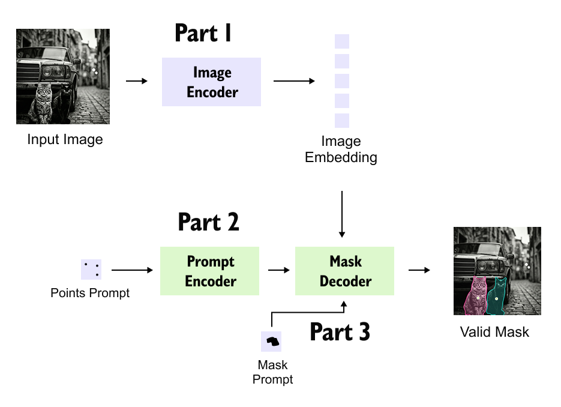
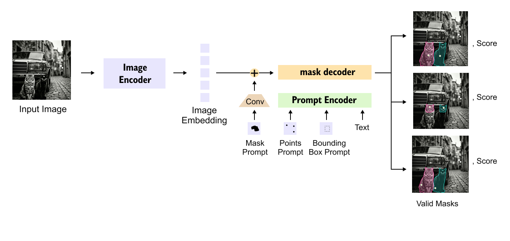
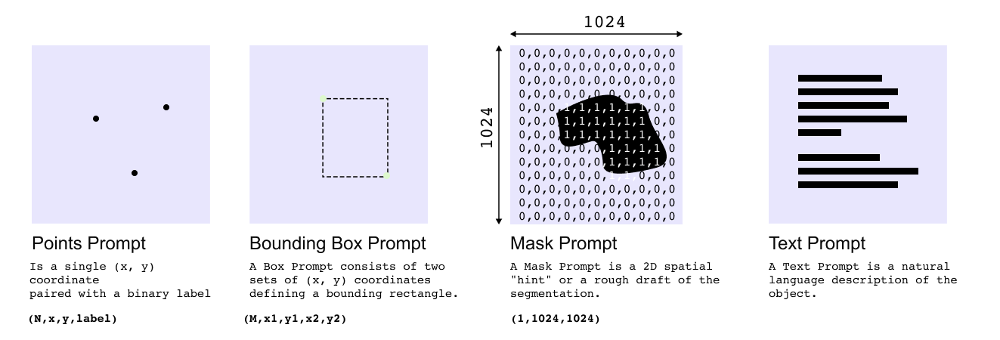
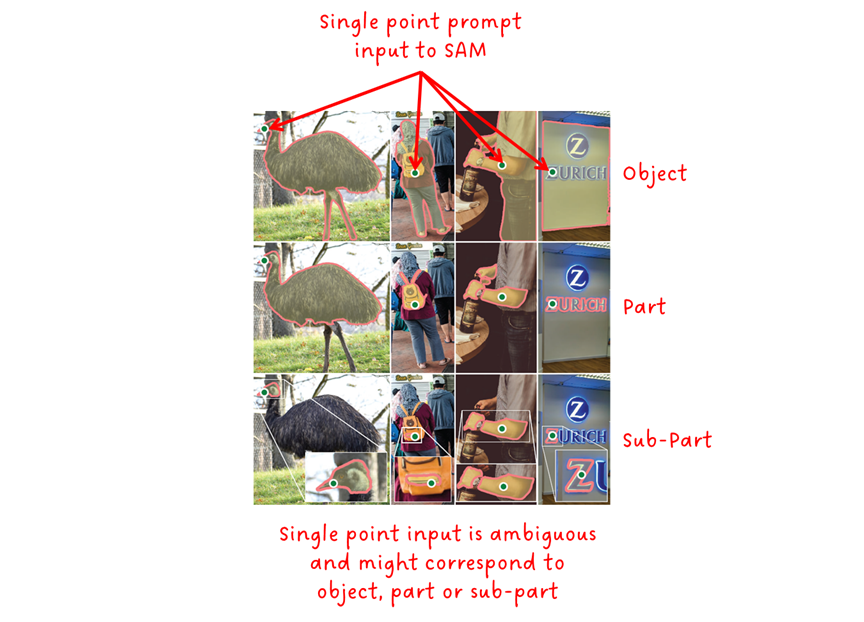
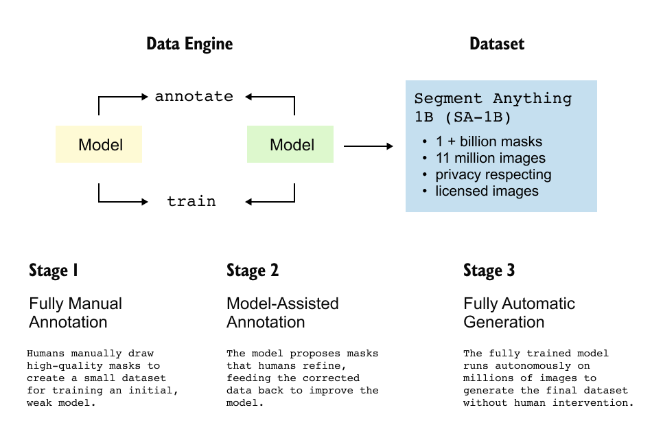
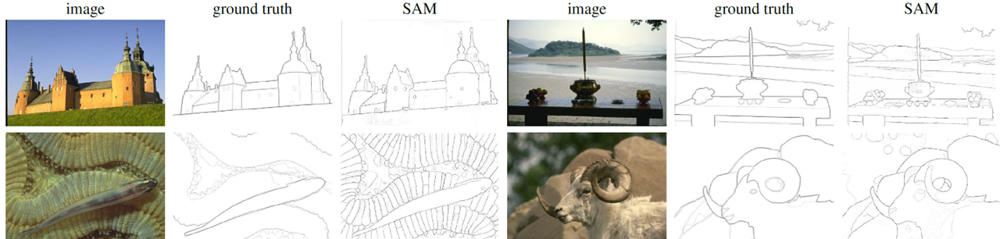

# Section 5: SAM: Segment Anything Model

> Slides 66–83 · Kirillov et al., Meta AI, 2023: *"Segment Anything"*; Ravi et al., 2024: *"SAM 2"*
> ⚠️ **Not taught live.** The professor moved SAM to the next class for time. This file is built from the slides, the pre-read, the paper, and **a real SAM run** (outputs below). Read it **before** Lecture 2.
> **Goal:** understand why SAM is split into a heavy encoder and a light decoder, why it outputs three masks, and how a model can help build its own dataset. And be able to **run it**.

[← Section 4](04-Section-4-Qwen-VL.md) · [Index](00-INDEX.md) · [Next: Synthesis →](06-Section-6-Synthesis-and-Comparison.md)

**Legend:** 📖 explanation · 🌍 real-world example · 🖼️ diagram · 🧪 code (run and verified; outputs are real) · 📚 go deeper
**Code needs:** `pip install torch` (and `transformers pillow numpy` for **[HF]** snippets; the real model is `facebook/sam-vit-base`, ~375 MB, fine on CPU).

---

## A. Motivation: a foundation model for segmentation

### 📖 Explanation

- NLP has foundation models that generalise through **prompting** (GPT-style). Before 2023, **segmentation had nothing like that**. Models were narrow specialists, trained on one dataset and object domain, and **retrained** for each new domain (medical → satellite).
- SAM proposes the **promptable segmentation task**: *given an image and a prompt, return a **valid** mask for whatever the prompt indicates.*
- A prompt can be a **point** (foreground or background click), a **box**, a **rough mask**, or (experimentally) **text**. This is the same "prompt = task" interface that NLP uses.
- Trained to be promptable at massive scale, SAM **transfers zero-shot** to segmentation tasks it never saw labelled examples for.

**What "valid" means:** even when a prompt is ambiguous, the output should be a *reasonable* mask for at least one of the things the prompt could mean.

**Segmentation vocabulary** (so the rest reads easily):

| Task | Output | Example |
|---|---|---|
| Classification | one label per image | "cat" |
| Detection | boxes + labels | two boxes, both "cat" |
| Semantic segmentation | a class for **every pixel** (instances merged) | all cat pixels = "cat" |
| Instance segmentation | a separate mask per **object** + label | cat #1 mask, cat #2 mask |
| **Promptable segmentation (SAM)** | a mask for **whatever you pointed at**, **no label** | "this blob of pixels" |

Recall the professor's framing from Section 1: objects have **arbitrary shapes** (a doughnut with a hole, grass). Segmentation must find the exact **foreground/background boundary**, and it must be **promptable** ("the brown doughnut, not the black one").

> ⚠️ **Trap:** SAM is in a "VLM" lecture, but it has **no notion of language or object class**. It segments; it does not recognise or describe. Its output is a mask with **no label attached**. *"It tells you where, never what."*

📚 **Go deeper:** [SAM paper](https://arxiv.org/abs/2304.02643) · [Interactive demo: segment-anything.com](https://segment-anything.com/), where you can click on your own photos and watch the masks appear

---

## B. Three components (slides 68–69)

### 🖼️ Diagrams





*Top: the three parts. Bottom: the full data flow. A **mask prompt** is embedded by a small **conv** and **added** (⊕) to the image embedding. **Points, boxes and text** go through the prompt encoder. The decoder returns **three masks, each with a confidence score**. In the example, the two cats and the car show why one click can mean different things.*

```
Image ──► Image Encoder: MAE-pretrained ViT-H/16      ← heavy, run ONCE per image (~0.15 s on an A100)
               │   image embedding 256×64×64 (cached)
               ▼
Prompt ──► Prompt Encoder (lightweight, per prompt)
               ▼
          Mask Decoder: 2-layer transformer, two-way cross-attention (prompt ↔ image)
               │                                       ← light, ~50 ms, runs PER PROMPT
               ▼
     3 candidate masks  +  IoU / confidence score for each
```

| Component | Cost | Runs | Role |
|---|---|---|---|
| **Image encoder** | heavy (~0.15 s) | **once per image** | pixels → reusable image embedding |
| **Prompt encoder** | tiny | per prompt | points, boxes, masks, text → prompt embeddings |
| **Mask decoder** | light (~50 ms) | per prompt | image + prompt embeddings → masks + scores |

### 🧪 Code 1: the real parameter split [HF]

```python
from transformers import SamModel, SamProcessor
model = SamModel.from_pretrained("facebook/sam-vit-base").eval()
processor = SamProcessor.from_pretrained("facebook/sam-vit-base")
for name, m in model.named_children():
    print(f"{name:22s} {type(m).__name__:24s} {sum(p.numel() for p in m.parameters())/1e6:7.2f}M")
```
```
shared_image_embedding SamPositionalEmbedding      0.00M
vision_encoder         SamVisionEncoder           89.67M   ← 95% of the model
prompt_encoder         SamPromptEncoder            0.01M   ← tiny
mask_decoder           SamMaskDecoder              4.06M   ← tiny
```
Even in the smallest SAM (ViT-B), the encoder holds about **95%** of the parameters. For ViT-H SAM the encoder is ~632M and the decoder is still ~4M.

---

## C. The image encoder (slide 70)

### 📖 Explanation
- A **ViT-H/16** (Huge, 16×16 patches), **pretrained with Masked Autoencoding (MAE)** and adapted for high-resolution segmentation.
- Input is **1024×1024** (longest side resized, then padded), so 1024/16 = a **64×64 patch grid**. The output embedding is **256 channels × 64 × 64**.
- **Run exactly once per image**. It is the expensive step.
- Its output is **cached and reused for every later prompt** on that image.
- **This split (heavy encoder, cheap decoder) is what makes SAM interactive.**

**MAE in one line:** hide ~75% of an image's patches and train the ViT to reconstruct the missing pixels. This is self-supervised, needs no labels, and learns strong **dense (per-patch)** features. That suits segmentation better than CLIP's single global vector.

**Analogy:** a photo editor who studies the whole photo carefully **once** (slow), then answers each "select this" request in a blink, because they already know the picture.

### 🧪 Code 2: encode once, then decode many prompts cheaply [HF]

```python
import time, torch
from PIL import Image
image = Image.open("coco_cats.jpg").convert("RGB")               # the 640x480 COCO cats photo

inputs = processor(image, return_tensors="pt")
t = time.time()
with torch.no_grad():
    image_embeddings = model.get_image_embeddings(inputs["pixel_values"])      # HEAVY, once
print(f"pixel_values {tuple(inputs['pixel_values'].shape)} -> embedding {tuple(image_embeddings.shape)} "
      f"in {time.time()-t:.2f}s")

def decode(**prompt):
    p = processor(image, return_tensors="pt", **prompt)
    p.pop("pixel_values")                                          # reuse the cached embedding
    t = time.time()
    with torch.no_grad():
        out = model(image_embeddings=image_embeddings, multimask_output=True, **p)   # LIGHT, per prompt
    masks = processor.image_processor.post_process_masks(
        out.pred_masks, p["original_sizes"], p["reshaped_input_sizes"])[0][0]       # (3, H, W) bool
    return masks, out.iou_scores[0, 0], time.time() - t
```
```
pixel_values (1, 3, 1024, 1024) -> embedding (1, 256, 64, 64) in 3.98s     (CPU; ~0.15 s on an A100)
```
Each later `decode(...)` call took **71–285 ms on CPU**. The ratio is what matters.

**Latency for 10 clicks** (paper's GPU numbers):
- With caching: 0.15 + 10 × 0.05 = **0.65 s**
- Re-encoding every time: 10 × 0.20 = **2.0 s**

In SAM's web demo, the embedding is computed on a server once and the **decoder runs in your browser**.

📚 **Go deeper:** [MAE paper](https://arxiv.org/abs/2111.06377)

---

## D. Prompt encoder and mask decoder (slides 71–72, 74)

### 🖼️ Prompt types (slide 71 / 74)



| Prompt | Tensor shape | How it's encoded | Typical use |
|---|---|---|---|
| **Point** (fg/bg click) | `(N, x, y, label)` | positional encoding of (x, y) **+ a learned fg or bg embedding** | fast interactive selection |
| **Box** | `(M, x1, y1, x2, y2)` | positional encoding of its **two corners** (each with its own learned embedding) | precise single-object segmentation |
| **Mask** | `(1, 1024, 1024)` → 256×256 input | **convolutional** embedding, **added element-wise** to the image embedding | refining an existing rough mask |
| **Text** (experimental) | a string | **CLIP text encoder** embedding | language-driven segmentation |

Points and boxes are **sparse** prompts: a few tokens. Masks are **dense**: a full grid added onto the image embedding.

**Background points** (label 0) say "not this". Click a shirt with fg=1, then click the face with bg=0, and SAM excludes the face. This is how interactive refinement works.

### 🖼️ The mask decoder (slide 72)

![SAM mask decoder: image embedding (256×64×64) and output + prompt tokens (N×256) go through 2 blocks of [self-attn → token-to-image attn → MLP → image-to-token attn]; then 2× conv-transpose upsampling; a dot product of each output token (via MLP) with the upsampled features gives object/part/sub-part masks; an IoU token → MLP gives IoU scores](assets/sam-mask-decoder.png)

*Read the red annotations. In **token-to-image** attention, the **tokens are the queries** (the prompt asks "which pixels match me?"). In **image-to-token** attention, the **image embeddings are the queries** (every pixel asks "what is the prompt looking for?"). This is repeated in two consecutive layers. Then **upsampling ×4** and a **dot product per mask** produce the **object / part / sub-part** masks. A separate **IoU token → MLP** predicts each mask's quality.*

### 📖 Two-way attention, step by step
Each of the **two stacked blocks** does:
1. **Self-attention** among the prompt and output tokens
2. **Prompt tokens attend to image tokens** ("which pixels match my click?")
3. MLP on the tokens
4. **Image tokens attend to prompt tokens** ("update every pixel's features given the prompt")

Then: **upsample** the image embedding 4× (64→256) and take a **dot product** between each updated output token (after a small MLP) and the upsampled features. That gives one mask logit map per output token. *Key: what we have. Query: what we are looking for. Value: what we want to propagate.*

> 💡 **Learning Thought:** "two-way" is the key word. In Qwen-VL's adapter, only the queries read the image. In SAM, the image features are **also rewritten in light of the prompt**, so the same pixels can belong to "shirt" for one click and "person" for another.

### 🧪 Code 3: a point prompt and a box prompt [HF]

```python
masks, iou, dt = decode(input_points=[[[480, 250]]])              # one click on the right cat
print(f"point -> masks {tuple(masks.shape)}, predicted IoU {[round(x, 3) for x in iou.tolist()]}, "
      f"areas {[int(m.sum()) for m in masks]} px, decode {dt*1000:.0f} ms")

bmasks, biou, bdt = decode(input_boxes=[[[32.6, 71.5, 176.6, 119.5]]])   # a box around the remote
print(f"box   -> best IoU {biou.max().item():.3f}, area {int(bmasks[biou.argmax()].sum())} px, decode {bdt*1000:.0f} ms")
# Background point example:  input_points=[[[480, 250], [420, 330]]], input_labels=[[1, 0]]
```
```
point -> masks (3, 480, 640), predicted IoU [0.914, 0.921, 0.848], areas [105447, 56573, 46170] px, decode 285 ms
box   -> best IoU 0.992, area 4123 px, decode 71 ms
```

---

## E. Resolving ambiguity: multi-mask output (slide 73) ⭐

### 🖼️ The ambiguity (slide 73)



*One click, three valid answers: the **whole object** (the emu, the person, the sign), a **part** (the emu's body, the backpack, the word "ZURICH"), and a **sub-part** (the emu's head, the bag's pocket, the letter "Z").*

### 📖 Explanation
- One click is often **ambiguous**. A point on a shirt could mean the **shirt**, the **person**, or a **button**.
- SAM's decoder **predicts 3 masks at once** per prompt, roughly **whole / part / sub-part**.
- An auxiliary **IoU-prediction head** estimates each mask's quality, so the **best of the three can be picked automatically** (or the user picks one).
- With **several** points or a box, the prompt is less ambiguous. SAM can then return one mask (`multimask_output=False`).

### 🖼️ Our real run: one click on the right cat


*The yellow square is the click. SAM's three answers are **both cats** (the "group" reading), **the cat** (the object, highest predicted IoU, so auto-selected), and **part of the cat** (the fur region around the click). The bottom-right panel is the Grounded-SAM idea in miniature: the **box came from Qwen2-VL** in Section 4, and SAM turned it into a pixel-precise mask.*

### 📖 The losses
- Mask prediction: **focal loss + dice loss** (the paper weights them **20:1**)
- IoU head: **MSE** between the predicted IoU and the actual IoU with the ground truth
- *Paper detail:* only the **lowest-loss** of the three masks is back-propagated, so each output slot is free to specialise in one granularity

Why these two mask losses? **Focal loss** down-weights easy pixels (mostly background), so the model focuses on hard boundary pixels. **Dice loss** directly optimises region overlap and is robust when the object is a small fraction of the image.

### 🧪 Code 4: SAM's training loss from scratch

```python
import torch, torch.nn.functional as F

def focal_loss(logits, target, alpha=0.25, gamma=2.0):
    p = logits.sigmoid()
    ce = F.binary_cross_entropy_with_logits(logits, target, reduction="none")
    p_t = p * target + (1 - p) * (1 - target)                 # prob. assigned to the TRUE class
    a_t = alpha * target + (1 - alpha) * (1 - target)
    return (a_t * ce * (1 - p_t) ** gamma).mean()             # easy pixels (p_t ≈ 1) contribute ~0

def dice_loss(logits, target, eps=1.0):
    p, t = logits.sigmoid().flatten(1), target.flatten(1)
    return (1 - (2 * (p * t).sum(1) + eps) / (p.sum(1) + t.sum(1) + eps)).mean()

def mask_iou(pred_bin, target):
    inter = (pred_bin & target.bool()).flatten(1).sum(1).float()
    union = (pred_bin | target.bool()).flatten(1).sum(1).float()
    return inter / union.clamp(min=1)

gt = torch.zeros(1, 64, 64); gt[:, 20:32, 20:32] = 1           # small object: 3.5% of pixels
cands = torch.full((3, 64, 64), -4.0)                          # decoder's 3 guesses (logits)
cands[0, 10:44, 10:44] = 4.0                                   # too big   ("whole")
cands[1, 20:32, 20:32] = 4.0                                   # right
cands[2, 24:28, 24:28] = 4.0                                   # too small ("sub-part")
pred_iou_head = torch.tensor([0.30, 0.85, 0.20], requires_grad=True)

per_mask = torch.stack([20 * focal_loss(c[None], gt) + dice_loss(c[None], gt) for c in cands])
true_iou = mask_iou(cands.sigmoid() > 0.5, gt.expand(3, -1, -1))
best = per_mask.argmin()                                       # backprop ONLY the best of 3
loss = per_mask[best] + F.mse_loss(pred_iou_head, true_iou)
print("per-mask 20*focal+dice:", [round(x, 3) for x in per_mask.tolist()])
print("true IoU of candidates :", [round(x, 3) for x in true_iou.tolist()], "-> best index", best.item())
print("total loss:", round(loss.item(), 4))

lazy = torch.full((1, 64, 64), -3.0)                           # predicts "nothing here"
print(f"lazy all-background: BCE {F.binary_cross_entropy_with_logits(lazy, gt).item():.3f}  "
      f"dice {dice_loss(lazy, gt).item():.3f}")
```
```
per-mask 20*focal+dice: [15.148, 0.206, 1.447]
true IoU of candidates : [0.125, 1.0, 0.111] -> best index 1
total loss: 0.2266
lazy all-background: BCE 0.154  dice 0.957
```
**The last line is the lesson.** A model that predicts "nothing anywhere" gets a *low* BCE (0.154), because 96.5% of pixels really are background. **Dice (0.957, close to the maximum of 1) exposes that it found nothing.** That is why segmentation losses add dice (or focal) on top of plain BCE.

> ⚠️ **Trap (deck quiz Q2):** three masks are **not** for speed and **not** one per RGB channel. They exist to **resolve ambiguity across granularities**.

📚 **Go deeper:** [Focal loss paper](https://arxiv.org/abs/1708.02002) · [V-Net (dice loss)](https://arxiv.org/abs/1606.04797)

---

## F. The data engine → SA-1B (slides 75–76) ⭐

### 🖼️ Diagram (slide 75)



### 📖 Explanation

There was no segmentation dataset big enough, so Meta built one **with SAM in the loop**. A **data engine** is an iterative pipeline where the model helps annotate data and is then retrained on it (annotate → train → annotate → …).

| Stage | Who does what | Effect |
|---|---|---|
| **1. Assisted-manual** | professional annotators label masks **with SAM's real-time help** (a click gives a mask, then they refine it with brush tools). SAM is **retrained 6 times** on the new data. | 4.3M masks; annotation time per mask falls from ~34 s to ~14 s |
| **2. Semi-automatic** | SAM **pre-fills confident masks automatically**. Annotators **only add missed objects**. | +5.9M masks, more **diverse** (less obvious objects) |
| **3. Fully automatic** | SAM is prompted with a **regular 32×32 grid of points** per image (1,024 prompts). **Confident and stable** masks are kept, near-duplicates removed with **non-max suppression**. | **1.1B masks**, the vast majority of SA-1B |

(Mask counts and timings are from the paper.)

> ⚠️ **Trap: the figure says Stage 1 is "Fully Manual".** The slide text and the paper say **assisted-manual**: humans draw masks, but SAM proposes them in real time. Only the very first model was bootstrapped from existing public datasets.

**SA-1B in numbers:**
- **11M** licensed, privacy-respecting images (faces and licence plates blurred)
- **1.1B** high-quality masks → 1.1B / 11M ≈ **100 masks per image**
- **3** stages, each more automated
- At release, roughly **400× more masks** than any earlier segmentation dataset

### 🧪 Code 5: the Stage 3 recipe (grid prompts, stability filter, NMS)

```python
import torch
# 1) A regular 32x32 grid of point prompts over a 1024x1024 image
g = (torch.arange(32) + 0.5) / 32
pts = torch.stack(torch.meshgrid(g * 1024, g * 1024, indexing="xy"), -1).reshape(-1, 2)
print("grid prompts:", tuple(pts.shape), "first:", pts[0].tolist(), "last:", pts[-1].tolist())

# 2) Stability: does the mask barely change when the threshold moves?
def stability(logits, delta=1.0):
    return ((logits > delta).sum() / (logits > -delta).sum().clamp(min=1)).item()
crisp = torch.full((64, 64), -4.0); crisp[20:32, 20:32] = 4.0
blurry = torch.linspace(-3, 3, 64)[None].expand(64, 64)
print("stability crisp:", round(stability(crisp), 3), " blurry:", round(stability(blurry), 3))

# 3) Non-max suppression: drop near-duplicate masks (via their boxes)
def nms(boxes, scores, thr=0.7):
    order, keep = scores.argsort(descending=True), []
    while order.numel():
        i = order[0]; keep.append(i.item()); rest = order[1:]
        xx1 = torch.maximum(boxes[i, 0], boxes[rest, 0]); yy1 = torch.maximum(boxes[i, 1], boxes[rest, 1])
        xx2 = torch.minimum(boxes[i, 2], boxes[rest, 2]); yy2 = torch.minimum(boxes[i, 3], boxes[rest, 3])
        inter = (xx2 - xx1).clamp(min=0) * (yy2 - yy1).clamp(min=0)
        area = lambda b: (b[:, 2] - b[:, 0]) * (b[:, 3] - b[:, 1])
        order = rest[inter / (area(boxes[i:i+1]) + area(boxes[rest]) - inter) <= thr]
    return keep
boxes = torch.tensor([[10, 10, 50, 50], [12, 12, 52, 52], [100, 100, 140, 150.]])
print("NMS keeps:", nms(boxes, torch.tensor([0.9, 0.8, 0.95])))
```
```
grid prompts: (1024, 2) first: [16.0, 16.0] last: [1008.0, 1008.0]
stability crisp: 1.0  blurry: 0.488
NMS keeps: [2, 0]
```
- **Stability:** a crisp mask is the same at every threshold (score 1.0). A blurry one changes size a lot (0.488), so it is rejected. The paper keeps masks with stability ≥ 0.95.
- **NMS:** boxes 0 and 1 overlap about 82%, so the lower-scoring one (1) is dropped.

In the official library all of this is one class, `SamAutomaticMaskGenerator(sam, points_per_side=32, pred_iou_thresh=0.88, stability_score_thresh=0.95)` (see §I).

> 💡 **Learning Thought:** compare the data strategies. CLIP **scraped** 400M noisy pairs. LLaVA had **GPT-4 write** its data. SAM had the **model label for itself**, with humans correcting less and less. When a task has no web-scale data, a model-in-the-loop data engine is one of the strongest options. It is also how many companies now build labelled datasets (pre-label with a model, humans fix).

---

## G. Zero-shot transfer and efficiency (slides 77–78)

### 🖼️ Zero-shot edge detection (slide 77)



*SAM was never trained to detect edges. Running automatic mask generation and taking the mask **boundaries** gives edge maps close to the human ground truth. It even finds more edges than the annotators marked (e.g. the fish's scales), which slightly hurts its benchmark score but shows how thoroughly it segments.*

- **Edge detection:** competitive zero-shot (above)
- **Object proposals / instance segmentation:** strong when paired with a **separate detector** for boxes
- **Text-to-mask** (experimental): through the CLIP text-prompt path
- **Interactivity:** the ~50 ms decoder gives real-time, in-browser point-and-click once the embedding is precomputed

**Conclusion (slide 78):** earlier interactive segmenters were single-domain and needed retraining for new domains. SAM's **scale (SA-1B)** plus its **promptable design** let it transfer zero-shot to domains it never saw labelled masks for.

---

## H. Applications (slide 79)

| Domain | How SAM is used | Real products / projects |
|---|---|---|
| **Medical imaging** | click-to-select organs or lesions to speed up annotation (usually after domain fine-tuning) | MedSAM-style fine-tunes |
| **Robotics** | object masks feed **grasp planning** and scene understanding | pick-and-place pipelines |
| **Creative and video tools** | one-click background removal, rotoscoping, object-based editing | "select subject" features in photo and video editors |
| **AR / mapping** | instance-level scene decomposition, geospatial imagery | building and field segmentation from satellite images |

---

## I. SAM in the bigger picture (slide 80)

### 📖 Explanation
- **Relation to CLIP / LLaVA / Qwen-VL:** SAM has **no notion of semantic class or language**. It segments; it doesn't recognise or describe.
- **Composability, Grounded-SAM:** a grounding or detection VLM **locates and names** the object ("the red umbrella" → a box), then **SAM turns the box into a pixel-precise mask**. We did exactly this in the demo above, with the box coming from Qwen2-VL.
- **SAM 2:** extends promptable segmentation to **video**, with a **streaming memory-attention module** and a **memory bank** of past frames, propagating masks across frames. Click an object once and it is tracked through the clip.
- **Limitations:** very **thin structures** (wires, hair), **tiny objects**, and **no class label** on the masks.

### 🧪 Code 6: the official `segment_anything` API (as in Meta's README / notebooks)

```python
# pip install git+https://github.com/facebookresearch/segment-anything.git
# checkpoint: sam_vit_h_4b8939.pth (from the repo README)
import numpy as np
from segment_anything import sam_model_registry, SamPredictor, SamAutomaticMaskGenerator

sam = sam_model_registry["vit_h"](checkpoint="sam_vit_h_4b8939.pth").to("cuda")

# Interactive: encode once, prompt many times
predictor = SamPredictor(sam)
predictor.set_image(image_rgb_np)                              # HEAVY: runs the image encoder
masks, scores, logits = predictor.predict(point_coords=np.array([[480, 250]]),
                                          point_labels=np.array([1]),     # 1 = foreground, 0 = background
                                          multimask_output=True)          # -> 3 masks + 3 scores
best = masks[scores.argmax()]

# Refine: feed the best low-res logits back as a MASK prompt, plus a background click
masks, scores, _ = predictor.predict(point_coords=np.array([[480, 250], [420, 330]]),
                                     point_labels=np.array([1, 0]),
                                     mask_input=logits[scores.argmax()][None],
                                     multimask_output=False)

# Fully automatic (= data-engine Stage 3)
generator = SamAutomaticMaskGenerator(sam, points_per_side=32,
                                      pred_iou_thresh=0.88, stability_score_thresh=0.95)
all_masks = generator.generate(image_rgb_np)   # list of dicts: segmentation, area, bbox, predicted_iou, stability_score
```

### 🌍 Pre-read discussion question
*SAM knows "where" but not "what". What does that rule out, and how would you work around it?*
> On its own it can't do semantic or instance segmentation with categories ("segment all cars"), counting by class, or anything that needs recognition. Workarounds: put a detector or grounding model first (Grounded-SAM, or Qwen-VL's `<box>` output as SAM's box prompt, as in our demo), or classify each mask afterwards with CLIP (crop the mask, zero-shot classify).

📚 **Go deeper:**
- [segment-anything repo](https://github.com/facebookresearch/segment-anything) and its [predictor example notebook](https://github.com/facebookresearch/segment-anything/blob/main/notebooks/predictor_example.ipynb)
- [HF docs: SAM](https://huggingface.co/docs/transformers/model_doc/sam), the API used in our code
- [SAM 2 paper](https://arxiv.org/abs/2408.00714) · [SAM 2 repo](https://github.com/facebookresearch/sam2)
- [Grounded-Segment-Anything](https://github.com/IDEA-Research/Grounded-Segment-Anything) · [Grounding DINO paper](https://arxiv.org/abs/2303.05499)

---

## 🎯 Interview Questions

**Q1. Why does SAM run the image encoder once and the decoder per prompt?**
> The ViT-H encoder is the expensive part (~0.15 s on an A100; ~95% of the parameters). Its output (256×64×64) depends only on the image, so it is cached. Each new click or box only needs the ~50 ms prompt encoder plus decoder. That is what makes interactive, even in-browser, segmentation possible: N prompts cost one encode plus N cheap decodes.

**Q2. Why three masks per prompt? How is one chosen?**
> A single point is ambiguous between whole, part and sub-part. Predicting three masks covers the plausible meanings. An IoU-prediction head (trained with MSE against the true IoU) scores each one, so the highest-scoring mask can be chosen automatically. In our real run, one click gave "both cats" (0.914), "the cat" (0.921, chosen) and "part of the cat" (0.848). During training only the best of the three is back-propagated, so each output slot specialises.

**Q3. Explain SAM's data engine. Why was it necessary?**
> No dataset at the needed scale existed. Stage 1: annotators label with SAM assisting, and SAM is retrained repeatedly. Stage 2: SAM pre-fills confident masks and humans add the missed ones, for diversity. Stage 3: SAM alone is prompted with a 32×32 point grid, keeping confident, stable masks after NMS. Result: SA-1B, 11M images and 1.1B masks (~100 per image), most of them from Stage 3.

**Q4. How would you build "segment the red umbrella" from these models?**
> Use a grounding model (Qwen2-VL, or Grounding DINO) to turn the phrase into a box. Convert the 0–1000 coordinates to pixels and pass the box as SAM's prompt. Take SAM's highest-IoU mask. Optionally verify with CLIP on the masked crop. We ran exactly this chain: Qwen2-VL's remote box → SAM mask with predicted IoU 0.992.

**Q5. Focal + dice loss: why not plain BCE?**
> Masks are highly imbalanced: most pixels are easy background. BCE is dominated by those easy pixels, and in our toy an "all background" prediction scored a low BCE of 0.154. Focal loss down-weights well-classified pixels so learning focuses on boundaries. Dice optimises overlap directly (the same lazy prediction scores 0.957, near the maximum), so it can't be gamed by ignoring small objects.

**Q6. How are sparse and dense prompts encoded differently?**
> Sparse (points, boxes): positional encodings of the coordinates plus learned type embeddings (fg/bg point, box corner 1/2). These become a few prompt tokens. Dense (mask): a small conv network embeds the mask to the image-embedding resolution, and it is added element-wise to the image embedding.

**Q7. What does "two-way" attention in the decoder mean, and why is it needed?**
> Tokens attend to the image (the prompt gathers evidence) **and** the image attends to the tokens (every pixel's features are updated given the prompt). The second direction lets the same pixels be re-interpreted per prompt: part of "shirt" for one click, part of "person" for another.

**Q8. SAM vs a Mask R-CNN-style instance segmenter: when would you use each?**
> Mask R-CNN is trained on fixed classes and outputs labelled instances automatically. Use it when you need "all cars, labelled" in a known domain. SAM is class-agnostic, promptable and zero-shot. Use it for interactive tools, new domains without labels, or as the mask stage after any detector or grounding model.

---

## ✅ Self-check (deck quiz, slides 81–83)

1. Why run the image encoder only once? → **it's expensive; its embedding is cached and reused**
2. Why three masks? → **ambiguity: whole / part / sub-part**
3. Stage 3 of the data engine? → **32×32 point grid; keep confident, stable, de-duplicated masks**
4. Not a SAM prompt type? → **an audio clip**
5. Most expensive component? → **the image encoder**
6. The dataset? → **SA-1B**

Extra:
- Masks per image in SA-1B? *(~100)*
- Latency for 20 clicks, cached vs re-encoding every time? *(0.15 + 20×0.05 = 1.15 s vs 20×0.2 = 4.0 s)*
- Which pretraining did SAM's ViT use, and why is it better suited than CLIP's? *(MAE: dense, per-patch reconstruction features vs one global matching vector.)*
- In our real run, which of the three masks had the highest predicted IoU, and what did it cover?
- Why can a lazy "all background" predictor score a low BCE but a high dice loss?

**Next:** [Section 6: Synthesis →](06-Section-6-Synthesis-and-Comparison.md)
