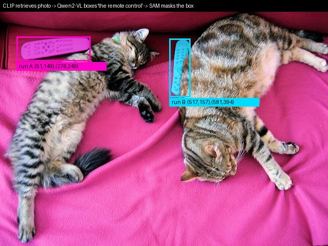

# Section 6: Synthesis, comparison and wrap-up

> Slides 84–93, 97, plus the professor's closing recap (end of transcript)
> **Goal:** compare all four models on one page, say which one to use when, and **compose them into a working pipeline** (built and run below).

[← Section 5](05-Section-5-SAM.md) · [Index](00-INDEX.md) · [Next: Hands-on →](07-Hands-On-Qwen2-VL-Notebook.md)

**Legend:** 📖 explanation · 🌍 real-world example · 🖼️ diagram · 🧪 code (run and verified; outputs are real) · 📚 go deeper

---

## A. Cross-model comparison (slide 85) ⭐

| | **CLIP** | **LLaVA** | **Qwen-VL** | **SAM** |
|---|---|---|---|---|
| **Paradigm** | contrastive | generative (chat) | generative + grounded | promptable segmentation |
| **Vision backbone** | ResNet / ViT, trained **from scratch** | **frozen** CLIP ViT-L/14 | ViT **initialised from OpenCLIP bigG**, fine-tuned | **MAE-pretrained** ViT-H |
| **Fusion** | shared embedding space (dot product) | linear / MLP projector → LLM self-attention | cross-attention adapter (256 tokens) → LLM | two-way cross-attention decoder |
| **Output** | similarity score / label | free-form text | text + bounding boxes | segmentation mask + IoU |
| **Training signal** | 400M web pairs | 158K GPT-4 instructions (+595K captions) | 1.4B pairs + multi-task + instructions | 1.1B masks from the SA-1B data engine |
| **Visual tokens** | 1 pooled vector | 256 (v1) / 576 (v1.5) / ~2,880 (NeXT) | **256 fixed** (Qwen2-VL: dynamic, e.g. 391) | 64×64 embedding grid |
| **Training stages** | 1 | 2 | 3 | data-engine loop |
| **Knows "what"?** | ✓ (coarse) | ✓ | ✓ | ✗ |
| **Knows "where"?** | ✗ | weak | ✓ (boxes) | ✓✓ (pixels) |
| **Real output in these notes** | "a photo of a cat": 52% | "There are two cats… pink blanket." | `<box>(51,149),(276,249)</box>` → the remote | 3 masks: both cats / the cat / part |

### 📖 The professor's closing summary
- **CLIP (2021):** *learn a joint embedding space* so that "similar in meaning" becomes a mathematical operation (distance or cosine). *"Why do we need a joint embedding space? So we can do vector operations corresponding to a semantic question."* The result is **representations**.
- **LLaVA:** *"LLMs are having all the fun: instructions, poems, Taylor Swift songs… why can't we do this with images?"* One assistant instead of one model per task. The result is an **assistant**: image as a foreign language, the LLM does the rest.
- **Qwen-VL:** *"By doing a sorry job representing the image, you lose information. It becomes almost just an LLM."* (Asked "what colour is the grass?", it says green without looking.) Build a **better adapter** that handles resolution efficiently. The result is **fine-grained ability**: grounding, OCR, multi-image.
- It is **cumulative**: joint space → instruction following → fine-grained grounding. *"We go from learning representations, to an assistant, to better visual representations with more flexibility."*

### 🌍 Choosing a model: a decision guide

```
What must the output be?
├─ a ranking / score / tag (search, dedup, moderation) ────────────► CLIP (or SigLIP)
├─ text about the image
│   ├─ just chat / describe / VQA, small budget, fully open ──────► LLaVA-family
│   └─ need boxes, small text (OCR), several images ──────────────► Qwen-VL family
└─ exact pixels of an object
    ├─ you can click or draw a box ───────────────────────────────► SAM
    └─ you only have a phrase ("the red umbrella") ───────────────► grounding VLM → SAM (Grounded-SAM)
```

---

## B. The shared thread: ViT everywhere (slide 86)

| Model | How it got its ViT |
|---|---|
| CLIP | trains it **from scratch** with contrastive supervision |
| LLaVA | **reuses CLIP's ViT, frozen** |
| Qwen-VL | **initialises from OpenCLIP**, then fine-tunes |
| SAM | **MAE-pretrained** ViT (self-supervised) |

This "**pretrain once, adapt everywhere**" pattern mirrors how BERT and GPT backbones were reused across NLP a few years earlier.

> 💡 **Learning Thought:** *"What differs is not 'how do we see', but 'what do we do with what we saw': **match, describe, ground, or segment**."* If you remember one sentence from this lecture, make it that one.

---

## C. How the models compose in real systems (slide 87) ⭐

| Pattern | Flow |
|---|---|
| **Grounded-SAM** | grounding/detection model → boxes + labels → **SAM** → pixel masks |
| **VLM agent with tools** | LLaVA/Qwen-VL agent **calls SAM as a tool** when it needs a precise mask, not a description (LLaVA-Plus does this) |
| **Multimodal RAG** | **CLIP** embeddings retrieve relevant images or documents → a generative VLM reasons over them |
| **Diffusion guidance** | **CLIP** similarity steers text-to-image generation and editing |

### 🧪 Code: a working CLIP → Qwen2-VL → SAM pipeline [HF]

A real, runnable version of all three patterns in one script: **retrieve** a photo with CLIP, **ground** a phrase with Qwen2-VL, **segment** with SAM. Every model here was introduced in an earlier section.

```python
import re, torch
from PIL import Image
from transformers import (CLIPModel, CLIPProcessor, Qwen2VLForConditionalGeneration,
                          AutoProcessor, SamModel, SamProcessor)

clip, clip_p = CLIPModel.from_pretrained("openai/clip-vit-base-patch32").eval(), CLIPProcessor.from_pretrained("openai/clip-vit-base-patch32")
qwen = Qwen2VLForConditionalGeneration.from_pretrained("Qwen/Qwen2-VL-2B-Instruct", torch_dtype=torch.bfloat16).eval()
qwen_p = AutoProcessor.from_pretrained("Qwen/Qwen2-VL-2B-Instruct", min_pixels=256*28*28, max_pixels=512*28*28)
sam, sam_p = SamModel.from_pretrained("facebook/sam-vit-base").eval(), SamProcessor.from_pretrained("facebook/sam-vit-base")

# A tiny "photo archive" (in production: millions of pre-computed CLIP embeddings in a vector DB)
cats = Image.open("coco_cats.jpg").convert("RGB")
archive = {"cats_on_sofa.jpg": cats,
           "blanket_closeup.jpg": cats.crop((150, 380, 450, 480)),
           "grayscale_copy.jpg": cats.convert("L").convert("RGB").rotate(90, expand=True)}

def retrieve(query):                                            # 1) CLIP: match
    names = list(archive)
    inp = clip_p(text=[query], images=list(archive.values()), return_tensors="pt", padding=True)
    with torch.no_grad():
        sims = clip(**inp).logits_per_text[0]
    return names[sims.argmax()], {n: round(s.item(), 2) for n, s in zip(names, sims)}

BOX = re.compile(r"<\|box_start\|>\((\d+),(\d+)\),\((\d+),(\d+)\)<\|box_end\|>")
def ground(image, phrase):                                      # 2) Qwen2-VL: ground
    msgs = [{"role": "user", "content": [{"type": "image", "image": image},
             {"type": "text", "text": f"Detect the {phrase} in the image and output its bounding box."}]}]
    text = qwen_p.apply_chat_template(msgs, tokenize=False, add_generation_prompt=True)
    inp = qwen_p(text=[text], images=[image], return_tensors="pt")
    with torch.no_grad():
        out = qwen.generate(**inp, max_new_tokens=48, do_sample=False)
    raw = qwen_p.batch_decode(out[:, inp.input_ids.shape[1]:], skip_special_tokens=False)[0]
    W, H = image.size
    return [[int(c) / 1000 * s for c, s in zip(m, (W, H, W, H))] for m in BOX.findall(raw)], raw

def segment(image, boxes):                                      # 3) SAM: segment
    inp = sam_p(image, input_boxes=[boxes], return_tensors="pt")
    with torch.no_grad():
        out = sam(**inp, multimask_output=False)                # a box is unambiguous -> 1 mask
    masks = sam_p.image_processor.post_process_masks(out.pred_masks, inp["original_sizes"], inp["reshaped_input_sizes"])[0]
    return masks[:, 0], out.iou_scores[0, :, 0]

name, sims = retrieve("a photo of cats sleeping next to a tv remote")
print("1) CLIP retrieval:", name, sims)
boxes, raw = ground(archive[name], "remote control")
print("2) Qwen2-VL grounding:", raw.replace("<|im_end|>", ""), "->", [[round(v, 1) for v in b] for b in boxes])
masks, iou = segment(archive[name], boxes)
print("3) SAM masks:", tuple(masks.shape), "pixels:", [int(m.sum()) for m in masks], "IoU:", [round(x, 3) for x in iou.tolist()])
```
```
1) CLIP retrieval: cats_on_sofa.jpg {'cats_on_sofa.jpg': 32.22, 'blanket_closeup.jpg': 15.54, 'grayscale_copy.jpg': 29.37}
2) Qwen2-VL grounding: <|object_ref_start|>remote control<|object_ref_end|><|box_start|>(517,157),(581,394)<|box_end|> -> [[330.9, 75.4, 371.8, 189.1]]
3) SAM masks: (1, 480, 640) pixels: [2052] IoU: [0.968]
```



**What this run teaches (all real):**
1. **CLIP retrieval works, with a small margin.** The rotated grayscale copy scores 29.37 vs 32.22 for the correct photo. The logits are ×100 cosines, so that is 0.322 vs 0.294. Same content, different style: close in CLIP space, as it should be.
2. **Grounding is stable in format but not in *which* instance.** The same prompt with greedy decoding returned the **left** remote in Section 4 (run A) and the **middle** remote here (run B). The only difference was that the image had been re-saved as a JPEG, changing pixels slightly. When there are two remotes, "*the* remote control" is **ambiguous**, and tiny input changes flip the choice. In production: ask for "**all** remote controls", and treat a single box as one sample, not the truth.
3. **SAM is robust to either box.** Both remotes got clean masks (IoU 0.968 and 0.981), including the thin, rotated one in the middle.
4. **Each model does only what it's good at.** CLIP never localises, Qwen never paints pixels, SAM never reads the query. The pipeline is the "agent".

This pattern of tool-using multimodal agents is the topic of **Lecture 2**.

📚 **Go deeper:** [Grounded-Segment-Anything](https://github.com/IDEA-Research/Grounded-Segment-Anything) (Grounding DINO + SAM, the reference implementation) · [Grounding DINO paper](https://arxiv.org/abs/2303.05499)

---

## D. Design trade-offs (slide 88)

| Trade-off | One side | Other side | Evidence from our runs |
|---|---|---|---|
| **Frozen vs fine-tuned backbone** | LLaVA keeps CLIP frozen (cheap, fast, but inherits blind spots) | Qwen-VL fine-tunes its ViT (more capable, more expensive) | LLaVA Stage 1 trains 0.26% of weights |
| **Token efficiency vs spatial fidelity** | Qwen-VL: fixed 256 tokens, constant compute, loses detail | LLaVA-NeXT: tiling, more compute, more detail | 8 images: 2,064 vs 23,040 tokens |
| **Data strategy** | CLIP and Qwen-VL: **scale** (hundreds of millions to billions of noisy pairs) | LLaVA and SAM: **smaller, carefully engineered** or human-in-the-loop data | LLaVA-1.5 ≈ 1.2M samples vs Qwen-VL ≈ 1.45B |
| **Specialisation vs generality** | SAM: one task, done extremely well | Qwen-VL: breadth, with some loss of peak performance | SAM box mask IoU 0.97–0.99; Qwen's box picks one instance |

---

## E. Key takeaways (slide 89)

1. A VLM is structurally **vision encoder + connector + consumer**. The four models differ mainly in the connector and the consumer.
2. **Contrastive pretraining (CLIP):** excellent, reusable representations, but **no language generation**.
3. **Instruction tuning (LLaVA):** frozen encoder + LLM + a **strikingly simple connector** gives a capable visual chat assistant.
4. **Adapter compression + grounding tokens (Qwen-VL):** extends this to spatial grounding, OCR and multi-image reasoning.
5. **Promptable, ambiguity-aware decoding (SAM):** generalises segmentation the way prompting generalised NLP.

---

## F. Discussion questions (slide 90), with model answers

**1. Add grounding to a LLaVA-style model with minimal architecture change?**
> Keep the architecture. Add `<ref>`/`<box>` tokens (or plain-text normalised coordinates) and instruction-tune on region-annotated data (RefCOCO, Visual Genome), serialised like Qwen-VL's bees sample. Higher resolution helps. Grounding is mostly a **data and output-format** problem, not an architecture problem.

**2. Why might Qwen-VL's fixed 256-token compression hurt on a dense table of numbers?**
> A table packs many independent, fine-grained facts (every digit in every cell). 256 summary tokens, each a weighted blend over many patches, may not have the capacity to keep them all separate. Neighbouring cells can blur together. Keeping more tokens (tiling, or dynamic resolution as in Qwen2-VL) fixes this.

**3. SAM knows "where" but not "what". What becomes hard?**
> Anything that needs categories: "segment all the cars", counting by class, semantic maps, answering questions. Fix it by composing: a detector or grounding VLM first (as in our pipeline), or CLIP classification of each mask afterwards.

**4. CLIP needs huge batches for good negatives. What does that imply for compute vs data, compared with LLaVA?**
> Contrastive learning scales cost with batch size squared and needs massive parallel hardware (592 V100-years), but it can use cheap, noisy web data. LLaVA's generative instruction tuning needs no negatives. It trains on 8 A100s in about a day with little but carefully constructed data, because it inherits expensive pretrained parts (CLIP and Vicuna). **Contrastive trades compute for cheap data; instruction tuning trades data engineering for cheap compute.**

---

## G. Emerging trends (slide 91)
- **Any-resolution, any-aspect-ratio encoders** (Qwen2-VL dynamic resolution) replacing fixed tiling. You saw it: a 3000×400 panorama becomes a 16×122 patch grid, not a squashed square.
- **Unified position embeddings across modalities and time** (M-RoPE) for native video
- **Any-to-any models** that both understand and **generate** images
- **Tool-using multimodal agents** that call specialist models like SAM on demand: the pipeline above, driven by an LLM that decides which tool to call

**Next lecture (M4-L2):** multimodal reasoning agents that compose VLMs into tool-using pipelines. SAM will be covered first.

📚 **Go deeper:** [PaliGemma blog](https://huggingface.co/blog/paligemma) (a newer open VLM that outputs detection *and* segmentation tokens directly) · [InternVL paper](https://arxiv.org/abs/2312.14238) (scaling the vision encoder to match the LLM) · [Open VLM Leaderboard](https://huggingface.co/spaces/opencompass/open_vlm_leaderboard)

---

## H. Glossary (slide 93 + pre-read)

| Term | Meaning |
|---|---|
| **Vision Transformer (ViT)** | cut the image into patches and treat each patch like a word |
| **Contrastive loss** | pulls matching pairs together and pushes non-matching pairs apart in embedding space |
| **Zero-shot transfer** | applying a model to a task or category it was never trained or fine-tuned on |
| **Vision-language connector / adapter** | the module that translates visual features into a form an LLM (or joint space) can use |
| **Grounding** | linking a piece of language to a specific spatial region in an image |
| **Promptable model** | adapts its output to any input prompt at inference time, without retraining |
| **Hallucination** | confidently describing something that isn't in the image (our LLaVA said "yes" to *laptop*) |
| **Data engine** | an iterative pipeline where a model helps annotate data and is retrained on it |
| **Visual tokens** | the vectors an image becomes inside the LLM; the main cost driver |

## I. Further reading (slide 97 + Q&A #39)

| Topic | Primary source | Friendlier companion |
|---|---|---|
| ViT | [Dosovitskiy et al., 2020](https://arxiv.org/abs/2010.11929) | [d2l.ai ViT chapter](https://d2l.ai/chapter_attention-mechanisms-and-transformers/vision-transformer.html) |
| CLIP | [Radford et al., 2021](https://arxiv.org/abs/2103.00020) | [Pinecone CLIP guide](https://www.pinecone.io/learn/series/image-search/zero-shot-image-classification-clip/) |
| Contrastive losses | [CPC / InfoNCE](https://arxiv.org/abs/1807.03748) | [Lilian Weng's survey](https://lilianweng.github.io/posts/2021-05-31-contrastive/) |
| LLaVA | [Liu et al., 2023](https://arxiv.org/abs/2304.08485) · [LLaVA-1.5](https://arxiv.org/abs/2310.03744) | [LLaVA project page](https://llava-vl.github.io/) |
| Connectors | [BLIP-2 (Q-Former)](https://arxiv.org/abs/2301.12597) · [Flamingo](https://arxiv.org/abs/2204.14198) | [Raschka: Understanding Multimodal LLMs](https://magazine.sebastianraschka.com/p/understanding-multimodal-llms) |
| Qwen-VL | [Bai et al., 2023](https://arxiv.org/abs/2308.12966) · [Qwen2-VL](https://arxiv.org/abs/2409.12191) | [HF Qwen2-VL docs](https://huggingface.co/docs/transformers/model_doc/qwen2_vl) |
| SAM | [Kirillov et al., 2023](https://arxiv.org/abs/2304.02643) · [SAM 2](https://arxiv.org/abs/2408.00714) | [SAM predictor notebook](https://github.com/facebookresearch/segment-anything/blob/main/notebooks/predictor_example.ipynb) |
| Overview | — | [HF blog: Vision Language Models Explained](https://huggingface.co/blog/vlms) |

---

## 🎯 Interview Questions

**Q1. Compare CLIP, LLaVA, Qwen-VL and SAM in 60 seconds.**
> All four start with a ViT. CLIP pairs it with a text tower and aligns them contrastively, which gives similarity scores, retrieval and zero-shot labels. LLaVA takes CLIP's frozen ViT, projects patch features into an LLM's embedding space, and instruction-tunes, which gives visual chat. Qwen-VL compresses patches with a 256-query cross-attention adapter, fine-tunes the ViT, and writes boxes as text, which gives grounding, OCR and multi-image. SAM uses an MAE ViT, a prompt encoder, and a light two-way decoder to produce pixel masks with no semantics.

**Q2. For a UI-automation agent that must click the "Submit" button in a screenshot, which model and why?**
> A grounded generative VLM, i.e. the Qwen-VL family. It must read small UI text (OCR at high resolution, so raise `max_pixels`) and output **where** to click (a box → centre point). CLIP can't localise. LLaVA base has no native grounding. SAM can't read or recognise "Submit".

**Q3. Retrieval over 10M images plus Q&A on the top hits: design it.**
> CLIP image embeddings go into an ANN index. The text query is embedded by CLIP's text tower to get the top-k images. Pass those to LLaVA or Qwen-VL with the question (multi-image for Qwen-VL). CLIP is fast and cheap at scale. The generative VLM gives the reasoning quality on a small candidate set.

**Q4. Where does fusion happen in each of the four?**
> CLIP: none (a dot product between independent embeddings). LLaVA: LLM self-attention over concatenated tokens. Qwen-VL: adapter cross-attention, then LLM self-attention. SAM: two-way cross-attention in the mask decoder.

**Q5. In a Grounded-SAM pipeline, what are the failure points and how do you harden them?**
> (1) Retrieval: small CLIP margins, so re-rank the top-k with a VLM. (2) Grounding: ambiguous phrases pick an arbitrary instance (our two runs picked different remotes), so ask for all instances, parse every box, and validate the format. (3) Coordinate conversion: use the original image size, not the resized one. (4) SAM: thin or tiny objects, so check the predicted IoU and fall back to point prompts. (5) Verification: CLIP-score each masked crop against the phrase.

**Q6. Why is "number of visual tokens" the key cost metric for generative VLMs?**
> Visual tokens usually dominate the prompt (729 of 751 in our LLaVA run). The LLM's prefill compute, attention cost and KV-cache memory all grow with sequence length. Every design in this lecture is a policy for this number: LLaVA fixed, AnyRes more, Qwen-VL compressed to 256, Qwen2-VL proportional to area with min/max bounds.

---

## ✅ Self-check
1. Which model's ViT was trained from scratch? Which was MAE-pretrained?
2. Name one composition pattern that uses CLIP and one that uses SAM.
3. State the "token efficiency vs spatial fidelity" trade-off with a concrete model on each side.
4. Fill in: CLIP → **match**, LLaVA → **describe**, Qwen-VL → **ground**, SAM → **segment**.
5. In our pipeline, why did the same grounding prompt return a different remote in two runs, and how would you make the pipeline robust to it?

**Next:** [Hands-on: Qwen2-VL notebook →](07-Hands-On-Qwen2-VL-Notebook.md)
