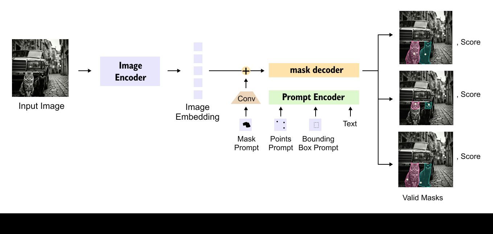
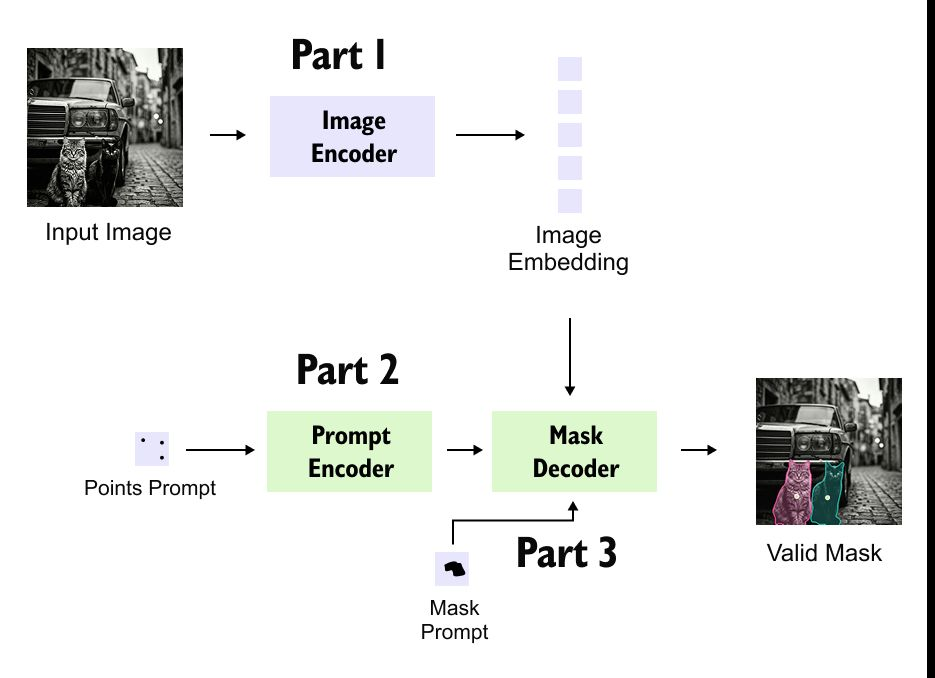
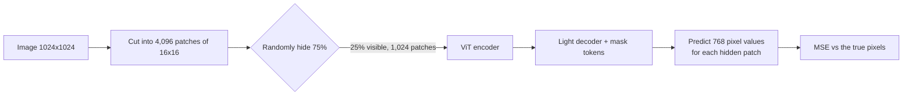
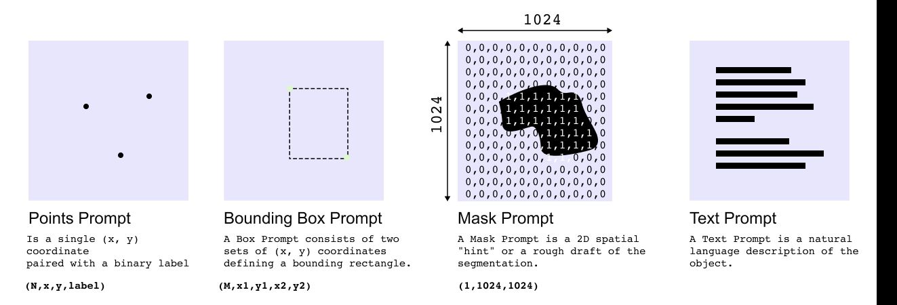
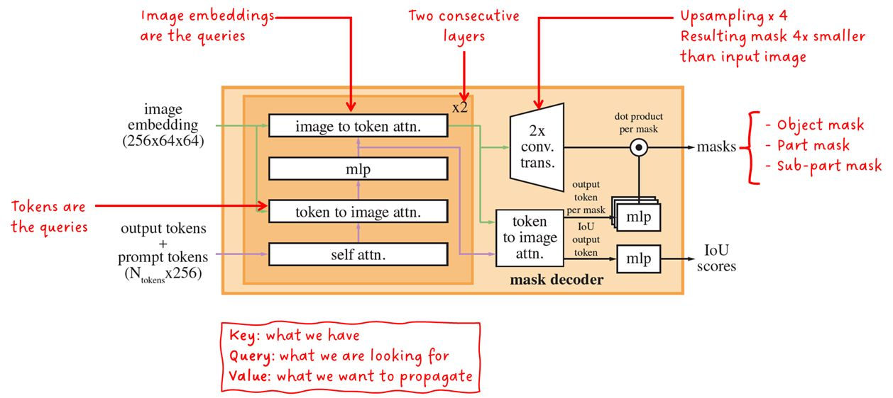
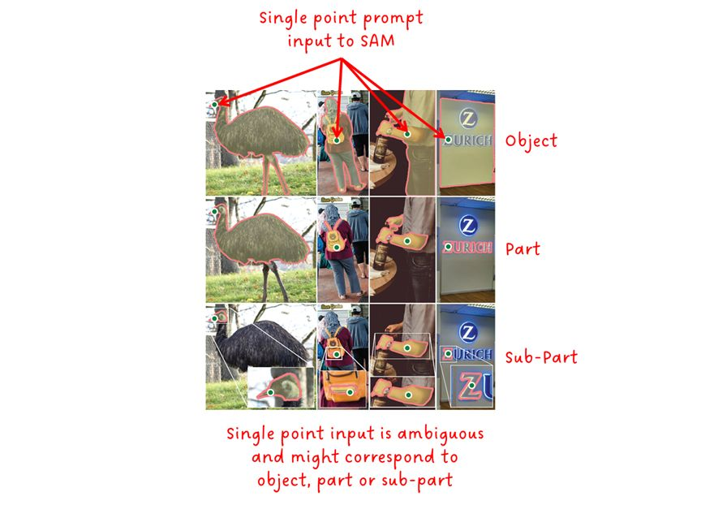
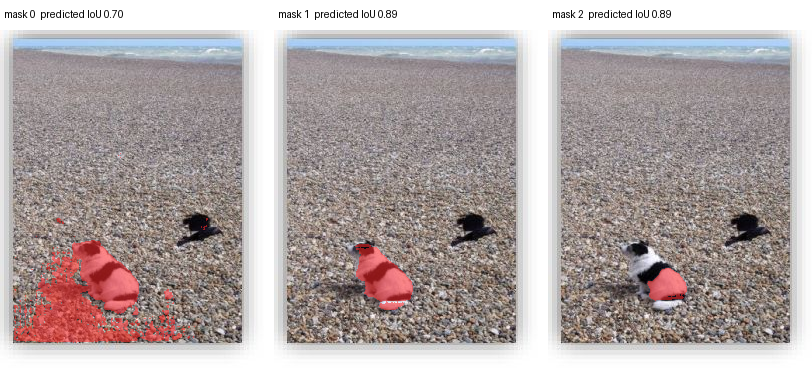
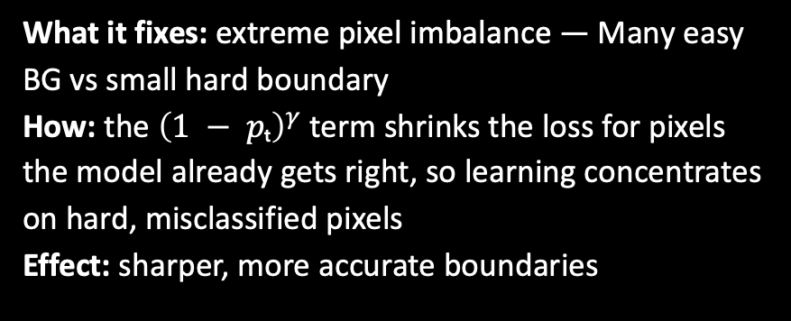
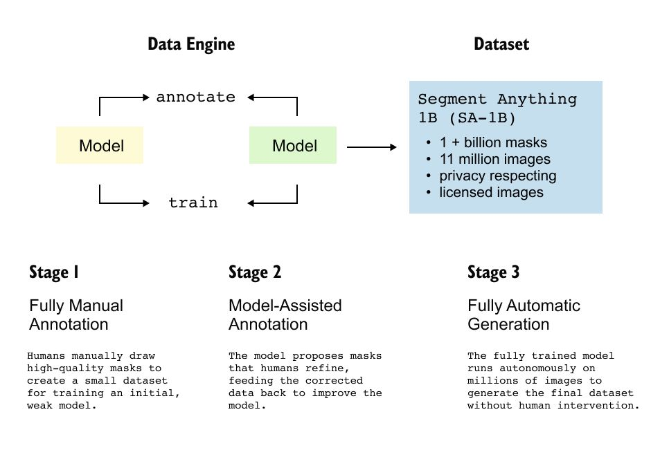
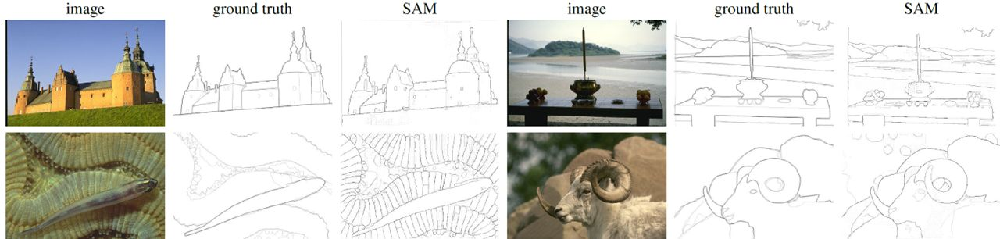

# Section 0 — SAM: The Segment Anything Model

> **Where this fits:** SAM carried over from Lecture 1, and the professor spent the first ~45 minutes finishing it ("we would not want to make that incomplete"). It is the fourth architecture in the CLIP → LLaVA → Qwen-VL → SAM set. It is also the odd one out: it outputs **pixels, not language**.
> **Slides:** 60–73 · **Transcript:** 00:17:55 – 01:03:18
> **Runnable code for this section:** [`code/s0_*.py`](code/). Every output below was produced by running these scripts on a laptop CPU (see [code/README.md](code/README.md)).


*Slide 61: the whole model on one slide. Everything in this section explains one of these boxes.*

---

## 0.A — Why segmentation needed a foundation model

### Core idea
NLP had foundation models that **generalise through prompting**. One GPT-style model handles many tasks because you change the prompt, not the weights. Segmentation had nothing like that. Each segmenter was trained on **one dataset, one narrow domain** (a birds model, a flowers model, a medical model) and had to be retrained to move to a new domain.

**SAM (Kirillov et al., Meta AI, 2023)** defines a new task, **promptable segmentation**:

> Given an **image** and a **prompt**, return a **valid mask** for whatever the prompt indicates.

A prompt can be a **point**, a **bounding box**, a **rough mask**, or (experimentally) **text**.

### What makes segmentation hard: objects within objects
The professor's analogy is **Arjuna and the bird**. There is a tree. Inside the tree is a bird. Inside the bird is its eye. Segmentation is **compositional**: man ⊃ shirt ⊃ button, and man ⊃ pant. A foundation segmenter has to produce any of these levels on request. Arjuna "prompts" it: *give me only the bird's eye*.

Segmentation is not a bounding box. It is the **exact set of pixels** belonging to the object, following its true edges.

### Box vs mask: how much a box over-counts
From [`code/s0_grounded_sam.py`](code/s0_grounded_sam.py) on the lecture's dog-on-the-beach photo:
```
SAM mask for 'a photo of a bird'    pixels=  672  (box area   1569)  predicted IoU=0.95
SAM mask for 'a photo of a dog'     pixels= 2438  (box area   4936)  predicted IoU=0.98
```
The dog occupies only **49%** of its own bounding box, and the bird **43%**. Anything that uses the box as "the object" (background removal, measuring area, counting pixels of damage) is wrong by roughly 2×.

### 🌍 Where promptable segmentation is used
| Product / domain | What the "prompt" is | Why a mask, not a box |
|---|---|---|
| Photoshop / Canva "Select subject", phone "lift subject from photo" | A tap on the object | Cut-outs need exact edges |
| E-commerce background removal | Auto-generated (the whole product) | The white background must hug the product |
| Radiology contouring (tumour, organ) | A few clicks by the radiologist | Treatment planning needs exact volume |
| Agriculture / drones | A box from a detector ("weed") | Spraying area = mask area |
| Video editing (rotoscoping with SAM 2) | A click on frame 1 | The mask follows the object across frames |

The old approach was one model per row. SAM's pitch is **one model for all of them, with only the prompt changing**.

> 💡 **Learning Thought:** SAM's key idea is less an architectural trick than a **task redefinition**. By making segmentation promptable, Meta could train one model at massive scale and get **zero-shot transfer**, the same way GPT did for text. "Define a promptable task, then scale data" is the recipe behind every foundation model.

📚 **Go deeper:** [Segment Anything paper (Kirillov et al., 2023)](https://arxiv.org/abs/2304.02643) (read §1–2 for the task definition) · [official repo + notebooks](https://github.com/facebookresearch/segment-anything) · [Hugging Face SAM docs](https://huggingface.co/docs/transformers/model_doc/sam) · live demo: segment-anything.com/demo (open in a browser; it blocks scripts)

---

## 0.B — The three components and the "heavy once, light many" design

```
 Image ─► [ Image Encoder ]  (heavy, run ONCE, ~0.15 s) ─► image embedding (cached)
                                                                  │
 Prompt ─► [ Prompt Encoder ] (lightweight, per prompt) ──────────┤
 (point / box / mask / text)                                      ▼
                                             [ Mask Decoder ] (~50 ms, 2-layer transformer,
                                                                two-way cross-attention)
                                                                  │
                                                  3 candidate masks + IoU/confidence scores
```

| Component | Weight | Runs | Job |
|---|---|---|---|
| Image encoder | **Heavy** (ViT-H) | **Once per image** | Pixels → reusable image embedding |
| Prompt encoder | Light | Once per prompt | Clicks/boxes/masks/text → prompt embeddings |
| Mask decoder | Light (2 layers) | Once per prompt | Fuse the two → masks + quality scores |

### Why split it this way? Interactivity.
The professor stressed that SAM "is not just an architecture, it is also something that makes you a quick interactive software", a direct competitor to Photoshop-style selection tools. Every design choice follows from that.

**Worked numbers.** A user clicks 10 times to refine a selection:

| Design | Cost |
|---|---|
| Naive: re-run everything per click | 10 × (0.15 + 0.05) = **2.0 s** |
| SAM: encode once, decode per click | 0.15 + 10 × 0.05 = **0.65 s**, and each click after the first returns in **50 ms** |

50 ms is below the ~100 ms threshold where people perceive a delay, so clicking feels instant. That is why SAM can run **in the browser**: the heavy embedding is precomputed on a server and the tiny decoder runs on the client.


*Slide 61: Part 1 (heavy, once per image) → Part 2 (light, per prompt) → Part 3 (light, per prompt).*

### 💻 See the split in code: cache the embedding, then click cheaply
[`code/s0_sam_point_prompt.py`](code/s0_sam_point_prompt.py) uses Hugging Face `transformers` and the smaller `sam-vit-base` checkpoint:
```python
from transformers import SamModel, SamProcessor
model = SamModel.from_pretrained("facebook/sam-vit-base").eval()
proc  = SamProcessor.from_pretrained("facebook/sam-vit-base")

# 1) HEAVY: run the image encoder once, keep the embedding
inputs = proc(image, return_tensors="pt")
with torch.no_grad():
    emb = model.get_image_embeddings(inputs["pixel_values"])      # (1, 256, 64, 64)

# 2) LIGHT: every click reuses `emb`; only the prompt encoder + mask decoder run
for name, point in {"dog body": [[118, 258]], "dog ear patch": [[92, 218]], "bird": [[200, 196]]}.items():
    p = proc(image, input_points=[[point]], return_tensors="pt")
    with torch.no_grad():
        out = model(image_embeddings=emb, input_points=p["input_points"], multimask_output=True)
```
Real output (MacBook CPU):
```
image encoder: 5.05s  embedding shape (1, 256, 64, 64)
dog body       click [118, 258]: decoder 0.108s | 3 masks, predicted IoU [0.697, 0.893, 0.887]
dog ear patch  click [92, 218]:  decoder 0.073s | 3 masks, predicted IoU [0.743, 0.82, 0.931]
bird           click [200, 196]: decoder 0.061s | 3 masks, predicted IoU [0.602, 0.897, 0.929]
```
**Read it:** the encoder costs **5 s**, each click **60–110 ms**, a ratio of about 50–80×. On a GPU the paper's figures are ~0.15 s vs ~50 ms. The absolute times differ, but the design lesson is the same: pay once, click many times. The embedding shape **(256, 64, 64)** is exactly the 64×64×256 grid described in 0.C.

> 💡 **Learning Thought:** This is **amortisation**, the same idea as a KV-cache or a precomputed vector index. Pay the expensive cost once and put it where it can be reused. Then keep the per-query path cheap. When you design any interactive ML system, ask what can be computed once and cached.

> ⚠️ **Trap (live Q&A):** *"Why is the image **decoder** the most costly part?"* It isn't. The **image encoder** is the expensive part. It is a huge ViT processing a 1024×1024 image as thousands of patch tokens with attention across all of them. The **mask decoder** has only 2 layers and works with a few prompt tokens against an embedding that is already computed.

🌍 **The same pattern elsewhere:** Google Photos computes each photo's embedding once at upload, and every later search ("dog on beach") is a cheap vector lookup. An LLM chat caches the KV of the system prompt, so each new turn is cheap. A web page is rendered once on the server and each click only fetches a small update.

📚 **Go deeper:** [SAM paper §3 (model design and the latency budget)](https://arxiv.org/abs/2304.02643) · [HF SAM docs: `get_image_embeddings` usage](https://huggingface.co/docs/transformers/model_doc/sam)

---

## 0.C — The image encoder: MAE-pretrained ViT-H/16

### Reading the name
- **ViT** = Vision Transformer
- **H** = **Huge** (~632M parameters, 32 layers, width 1280) 🔬
- **/16** = the image is cut into **16×16-pixel patches**, and each patch becomes a token

### Why it is heavy: the numbers
SAM takes a **1024×1024** input.

- Patches per side = 1024 / 16 = **64**, so **64 × 64 = 4,096 tokens**
- Self-attention compares every token with every other token: 4,096² ≈ **16.8 million pairs** per head per layer
- Compare a standard 224×224 ViT: 14 × 14 = 196 tokens → 196² = **38,416 pairs**
- Ratio: 16.8M / 38.4K ≈ **437× more attention work per layer**, repeated across 32 layers

Output: an image embedding of **64 × 64 × 256** 🔬 (a 256-dimensional vector for each of the 4,096 spatial positions). This embedding is **cached**.

🔬 *Beyond the slides:* to keep this manageable, SAM's ViT uses **windowed attention** (14×14 windows) in most blocks and **global attention** in only 4 blocks.

### Pretraining: the Masked Autoencoder (MAE)
Two stages: (1) **MAE self-supervised pretraining**, then (2) **fine-tuning for segmentation** on SA-1B.

**MAE works like BERT's masked language modelling, but on pixels:**

| | Masked Language Model (BERT) | Masked Autoencoder (MAE) |
|---|---|---|
| Input | "I sat on the **[MASK]**" | Image with ~75% of patches hidden |
| Predict | The missing word | The missing **pixel values** |
| Output | Probability distribution over a vocabulary | **Raw numbers**: 16×16×3 = **768 values per patch** |
| Loss | Cross-entropy | **Mean squared error** |
| Labels needed? | No | No, just images |

The professor describes it as **compression**. Map a 224×224 image down to a hidden representation, then back up to 224×224, and train so the reconstruction is as close to lossless as possible. If the network can fill in hidden patches, its internal representation must have learned what images look like.

> ⚠️ **Trap (live Q&A):** *"In MLM the output is a probability distribution over the vocabulary. What is it for images?"* There is **no pixel vocabulary**, so MAE doesn't classify at all. It **regresses** the actual pixel values of each masked patch: 768 numbers for a 16×16 RGB patch. The loss is **squared error, not cross-entropy**. Cross-entropy is for "pick one correct option from a list". Pixels are numbers, so you compare predicted and true values, square the difference (which keeps it positive and punishes big errors), and average.

**Worked MSE example.** A masked patch with 3 pixels (simplified) has true values [0.8, 0.2, 0.5]. The model predicts [0.7, 0.4, 0.5].
MSE = ((0.1)² + (0.2)² + 0²) / 3 = (0.01 + 0.04 + 0) / 3 = **0.0167**

### How MAE pretraining works

MAE has a hidden efficiency trick. The encoder **only sees the visible 25%**, so attention runs on 1,024 tokens instead of 4,096, which is 1/16 of the pairs. That is how pretraining a ViT-**H** becomes affordable.

### 💻 Code: patchify, mask, and the MAE loss
From [`code/s0_sam_math.py`](code/s0_sam_math.py):
```python
img = torch.rand(1, 3, 1024, 1024)                         # SAM's input size
patches = img.unfold(2, 16, 16).unfold(3, 16, 16)          # (1,3,64,64,16,16)
tokens = patches.permute(0, 2, 3, 1, 4, 5).reshape(1, 64 * 64, 3 * 16 * 16)

keep = torch.randperm(4096)[: 4096 // 4]                   # MAE: encoder sees only 25%

for side in (224, 1024):                                   # why ViT-H on 1024px is heavy
    n = (side // 16) ** 2
    print(f"{side}px -> {n} tokens -> {n*n:,} attention pairs")

patch = torch.rand(16, 16, 3); pred = patch + 0.1 * torch.randn_like(patch)
print(patch.numel(), F.mse_loss(pred, patch).item())       # 768 values, MSE loss (no vocabulary!)
```
```
image (1, 3, 1024, 1024) -> tokens (1, 4096, 768) (4096 tokens x 768 raw values)
visible tokens: 1024 of 4096  -> encoder cost ~0.062x of full attention
224px / 16px patches ->   196 tokens ->      38,416 attention pairs per head per layer
1024px / 16px patches ->  4096 tokens ->  16,777,216 attention pairs per head per layer
values to predict per patch: 768 | MSE: 0.0106
```

🌍 **Intuition:** MAE is a jigsaw puzzle with 75% of the pieces missing. To fill in a hidden patch of fur next to an eye, the model has to know what a cat's face looks like. Nobody labels anything. The image supervises itself.

📚 **Go deeper:** [ViT: "An Image is Worth 16x16 Words"](https://arxiv.org/abs/2010.11929) · [MAE: "Masked Autoencoders Are Scalable Vision Learners"](https://arxiv.org/abs/2111.06377) (see Fig. 2–3 for reconstructions) · [The Illustrated Transformer (Jay Alammar)](https://jalammar.github.io/illustrated-transformer/) if attention itself is rusty

---

## 0.D — The prompt encoder: sparse, dense, and text prompts


*Slide 64: points (x, y, fg/bg label), a box (two corners), a rough mask (1024×1024 grid), and text.*

| Prompt type | Kind | Encoding | Typical use |
|---|---|---|---|
| **Point** (fg/bg click) | Sparse | Positional encoding of (x, y) + learned fg/bg embedding | Fast interactive selection |
| **Box** | Sparse | Positional encoding of the **two corners** (x₁,y₁), (x₂,y₂), each + a learned corner embedding | Precise single-object segmentation |
| **Mask** | Dense | Downscaled, passed through **convolutions**, then **added element-wise to the image embedding** | Refining an existing rough mask |
| **Text** (experimental) | — | **CLIP's text encoder** → prompt embedding | Language-driven segmentation |

### Sparse prompts: why not just feed the raw coordinates?
A point prompt is a sequence of **(x, y, label)** triples, where the label is 1 for foreground ("include this") or 0 for background ("exclude this"). You could feed "512, 300" straight in as numbers, but the professor noted that "there are some issues with such number representation". Neural nets struggle with raw scalar coordinates: (512, 300) and (513, 300) look almost identical as magnitudes, and networks are poor at learning sharp functions of raw scalars.

Fix: map each coordinate to a **positional encoding vector** (🔬 SAM uses random **Fourier features**, sin/cos of the coordinates at many frequencies). Then **add a learned embedding** that says *what kind* of prompt this is (fg point, bg point, box top-left, box bottom-right). All of it is learnable. The professor sketched it as coordinates → vector w₁…w_d → MLP, with every parameter learned.

A box is handled the same way. It is just **two points** with different learned type-embeddings.

### 💻 Code: what a Fourier encoding does to a click
From [`code/s0_sam_math.py`](code/s0_sam_math.py). A click's (x, y), normalised to [0, 1], is projected onto random frequencies and passed through sin/cos:
```python
B = torch.randn(2, 8) * 10                      # random frequencies (SAM uses 128 -> 256-d vector)
def fourier(xy):
    proj = 2 * math.pi * xy @ B
    return torch.cat([proj.sin(), proj.cos()], -1)

a, b, far = torch.tensor([[0.500, 0.30]]), torch.tensor([[0.501, 0.30]]), torch.tensor([[0.9, 0.8]])
F.cosine_similarity(fourier(a), fourier(b)), F.cosine_similarity(fourier(a), fourier(far))
```
```
raw coords distance a-b: 0.001
fourier cos-sim a-b    : 0.9979
fourier cos-sim a-far  : 0.4011
```
Nearby clicks get **near-identical vectors** (0.998) and distant clicks get **clearly different** ones (0.40). A raw pair of numbers is a 2-D signal. The encoding spreads position across many dimensions and frequencies, which makes it easy for the attention layers to tell "the dog's ear" from "a pebble two pixels away".

### 💻 Code: point vs box prompt in the HF API
```python
# point prompt: one foreground click at (x=118, y=258)
proc(image, input_points=[[[118, 258]]], input_labels=[[1]], return_tensors="pt")
# box prompt: [x1, y1, x2, y2] (used in code/s0_grounded_sam.py)
proc(image, input_boxes=[[[71.3, 209.1, 139.2, 281.8]]], return_tensors="pt")
```
A box removes ambiguity (it says which object *and* roughly how big), so box-prompted calls use `multimask_output=False` and get one mask back. In the Grounded-SAM run that mask had predicted IoU **0.98**, compared with 0.69–0.89 for a single ambiguous click.

🌍 **Real-world UX:** in labelling tools such as CVAT and Label Studio (both have SAM plug-ins), annotators click **+** on the object and **−** on background it wrongly included. Those are exactly the fg/bg `input_labels` 1 and 0.

📚 **Go deeper:** [Fourier Features paper (Tancik et al.), on why raw coordinates fail](https://arxiv.org/abs/2006.10739)

### Dense prompts: masks
A mask prompt is a grid of the image's size: 1 where the object is, 0 elsewhere. The professor's image: *"You make a hole in a wall and only see that part"*. Convolutions shrink it to the embedding's 64×64 grid, and it is **summed element-wise** with the image embedding. It changes the image representation directly instead of becoming extra tokens.

> ⚠️ **Trap (live Q&A):** *"Is the prompt the question we ask about the picture?"* **No.** A SAM prompt is a way of **pointing** at what you want cut out. It is not "what is in this picture?" but "**this thing here, give me its exact outline**". The output is a **mask shape, not an answer**.

> ⚠️ **Trap (live Q&A):** *"Does SAM use a vocabulary like CLIP? Is a prompt mandatory?"* SAM has **no vocabulary** in its core operation: image → visual embedding + prompt → mask. The prompt is part of the design, but it can be **generated automatically** (the 32×32 point grid in 0.H). So a user doesn't always have to click.

---

## 0.E — The mask decoder: two-way attention

### What happens in one decoder block
The decoder works on two sets of things:
- **Tokens:** learned **output tokens** (one per mask to predict, plus one IoU token) concatenated with the **prompt tokens**
- **Image embedding:** the 4,096 cached image tokens

Each block runs four steps. There are **2 blocks** stacked.


*Slide 64, annotated live. Note the handwritten key: **Query = what we are looking for; Key = what we have; Value = what we want to propagate.***

| Step | Operation | Queries | Keys / Values | Purpose |
|---|---|---|---|---|
| 1 | Self-attention | tokens | tokens | Prompt/output tokens share information |
| 2 | **Token → image** cross-attention | **tokens** | **image** | Each token collects the image evidence it needs |
| 3 | MLP | tokens | — | Per-token update |
| 4 | **Image → token** cross-attention | **image** | **tokens** | The image representation is **sharpened by the prompt** |

Then SAM **upsamples** the image embedding, turns each output token into a vector with a small MLP, and takes a **dot product** between that vector and every upsampled pixel feature. That gives the mask at full resolution.

**Dot-product-to-mask, worked.** Suppose the output token becomes w = [1, −1].
- Pixel A has feature f_A = [2, 0] → w·f_A = 2 → sigmoid(2) = **0.88** → inside the mask
- Pixel B has feature f_B = [0, 2] → w·f_B = −2 → sigmoid(−2) = **0.12** → outside

Every pixel gets a value between 0 and 1. The professor described the output as "a 224×224 [grid] … values 0 to 1 for each pixel, and you also give confidence scores".

> ⚠️ **Trap (live Q&A):** *"Is this the same cross-attention used in machine translation?"* **Same mechanism, one addition.** In translation, decoder tokens attend to encoder tokens (one direction). SAM does that (prompt → image) **and the reverse** (image → prompt). The bidirectional pair is what "two-way attention" means.

> 💡 **Learning Thought:** Step 4 is the unusual one. In LLaVA the image tokens are fixed inputs that text reads from. In SAM the **image representation itself changes depending on the prompt**. The same pixels are encoded differently depending on whether you asked for "the shirt" or "the button". That is how one embedding can serve many different masks.

🌍 **Analogy:** a museum guide (the prompt) and a room of paintings (the image). In step 2 the guide walks the room and **collects** what's relevant to the visitor's question (token→image). In step 4 the room is **re-lit** according to the question: spotlights on the relevant paintings, the rest dimmed (image→token). After two rounds, the "lit" pixels are the mask.

### 💻 Code: a minimal two-way block in PyTorch
[`code/s0_two_way_block.py`](code/s0_two_way_block.py) is a simplified re-implementation. The real one is `TwoWayTransformer` in the [segment-anything repo](https://github.com/facebookresearch/segment-anything), which adds positional encodings and a downsampled attention width.
```python
class TwoWayBlock(nn.Module):
    def forward(self, tokens, image):
        tokens = self.norms[0](tokens + self.self_attn(tokens, tokens, tokens)[0])  # 1 self-attn
        attn, w = self.tok2img(tokens, image, image)                                # 2 Q=tokens, K/V=image
        tokens = self.norms[1](tokens + attn)
        tokens = self.norms[2](tokens + self.mlp(tokens))                            # 3 MLP
        image = self.norms[3](image + self.img2tok(image, tokens, tokens)[0])        # 4 Q=image, K/V=tokens
        return tokens, image, w

image  = torch.randn(1, 64 * 64, 256)            # cached image embedding, flattened
tokens = torch.cat([torch.randn(1, 5, 256),      # 4 mask tokens + 1 IoU token
                    torch.randn(1, 2, 256)], 1)  # prompt tokens (a click + padding)
for blk in [TwoWayBlock(), TwoWayBlock()]:
    tokens, image, w = blk(tokens, image)
logits = (image @ tokens[:, 1].unsqueeze(-1)).view(1, 64, 64)   # dot product -> mask
```
```
block 1: tokens (1, 7, 256)  image (1, 4096, 256)  token->image attn (1, 7, 4096)
block 2: tokens (1, 7, 256)  image (1, 4096, 256)  token->image attn (1, 7, 4096)
mask logits (1, 64, 64) -> probabilities in [0,1] via sigmoid
params per block: 1.842432 M
```
**Read the shapes:**
- The attention matrix is **7 × 4,096**. Only 7 tokens look at 4,096 pixels, so it's cheap. Compare the encoder's 4,096 × 4,096.
- The image tensor **comes out updated**. That is step 4, and it's why the decoder is "two-way".
- Each block has about 1.8M parameters, versus about 630M in the ViT-H encoder. That explains the ~50 ms.

### Upsampling: getting back to full resolution
The embedding is 64×64, but a mask must be pixel-precise. SAM uses **transposed convolutions** to upsample (🔬 64 → 256, i.e. 4×, then bilinear interpolation to the original image size). The professor showed on the whiteboard how the **same kind of kernel can shrink or grow** a grid.

**Downsampling (ordinary convolution).** Image 3×3, kernel 2×2, stride 1:

```
Image          Kernel
1 2 3          0 1
4 5 6          1 0
7 8 9
```
Each output = sum of (window × kernel). With this kernel that is top-right + bottom-left of each 2×2 window:
- top-left window [1 2; 4 5] → 1·0 + 2·1 + 4·1 + 5·0 = **6**
- top-right [2 3; 5 6] → 3 + 5 = **8**
- bottom-left [4 5; 7 8] → 5 + 7 = **12**
- bottom-right [5 6; 8 9] → 6 + 8 = **14**

Result: **3×3 → 2×2** = [[6, 8], [12, 14]]

**Upsampling (pad, then convolve).** Pad the 2×2 with a border of zeros to 4×4, then apply a 2×2 kernel:

```
0  0  0  0
0  6  8  0      ─ 2×2 kernel ─►     0   6   8
0 12 14  0                          6  20  14
0  0  0  0                         12  14   0
```
Result: **2×2 → 3×3**. The size is back. The values are **not** the original image. Upsampling is a *learned* expansion, not an inverse.

General size rule: output = (input − 1) × stride + kernel. Here (2 − 1) × 1 + 2 = 3 ✓

### 💻 Code: the whiteboard example in PyTorch
From [`code/s0_sam_math.py`](code/s0_sam_math.py):
```python
img  = torch.arange(1., 10.).reshape(1, 1, 3, 3)
kern = torch.tensor([[[[0., 1.], [1., 0.]]]])
down = F.conv2d(img, kern)              # 3x3 -> 2x2
up   = F.conv_transpose2d(down, kern)   # 2x2 -> 3x3
up4  = nn.ConvTranspose2d(256, 32, kernel_size=2, stride=2)(torch.randn(1, 256, 64, 64))
```
```
conv2d 3x3 -> 2x2:
 tensor([[ 6.,  8.],
        [12., 14.]])
conv_transpose2d 2x2 -> 3x3:
 tensor([[ 0.,  6.,  8.],
        [ 6., 20., 14.],
        [12., 14.,  0.]])
SAM-style stride-2 upsample: (1,256,64,64) -> (1, 32, 128, 128)
```
PyTorch reproduces the hand calculation exactly. The last line is what SAM does: a **stride-2** transposed conv doubles 64→128, and SAM applies two of them (64→128→256) while shrinking the channels 256→32 so the per-pixel dot product is cheap.

📚 **Go deeper:** [conv_arithmetic: animated GIFs of every conv/transposed-conv case](https://github.com/vdumoulin/conv_arithmetic) (look at "No padding, no strides, transposed")

> 💡 **Learning Thought:** A convolution is just a weight matrix shared across positions, "the same logic as a 256×1024 weight matrix" (professor). Whether it shrinks or grows a grid depends on stride and padding, not on the kernel. Transposed convolution is how segmentation, super-resolution, and diffusion U-Nets get back to full resolution.

---

## 0.F — Resolving ambiguity: three masks and an IoU head

A single click is **ambiguous**. Click on a person's shirt: do you mean the **person** (whole), the **shirt** (part), or the **button/tie** (subpart)? It is like a vague query, since the model can't know what the human wants.

SAM's answer: **predict 3 masks at once** (whole / part / subpart) and let the user pick, or pick automatically.

To pick automatically, an **IoU-prediction head** estimates each mask's quality. That is its guess of how well the mask would overlap the true object. The highest-scoring mask wins.

```
click on shirt ─► mask₁ (person)  predicted IoU 0.91  ◄── auto-selected
               ─► mask₂ (shirt)   predicted IoU 0.87
               ─► mask₃ (button)  predicted IoU 0.42
```


*Slide 66: one point → whole bird / part / sub-part.*

### 💻 Seeing it for real
Running [`code/s0_sam_point_prompt.py`](code/s0_sam_point_prompt.py) with **one click on the dog's body** gives three masks:



| Mask | What SAM proposed | Predicted IoU | Area |
|---|---|---|---|
| 0 | Dog **plus a spill of pebbles** (the "largest region" guess) | 0.70 | 8,554 px |
| 1 | Dog's body without the head | **0.89** | 2,279 px |
| 2 | Only the white fur patch around the click | **0.89** | 926 px |

**Read it:**
- The IoU head correctly **distrusts** mask 0 (0.70). It bled into the background.
- It rates masks 1 and 2 almost equally (0.893 vs 0.887), so `argmax` would pick mask 1, even though a human probably wanted the **whole dog including its head**. None of the three was perfect. That is why interactive tools let you add a **second click** (+ on the head) or a **box**. With the box from the detector in 0.I, SAM returned the whole dog with predicted IoU **0.98**.

```python
best = out.iou_scores[0, 0].argmax()          # auto-select the mask SAM trusts most
mask = masks[0][best]                          # (H, W) boolean
```

🔬 *Beyond the slides:* during training, SAM **backpropagates only the lowest loss of the three masks**. If the ground truth is the shirt, the "shirt" slot is trained on it and the other two slots aren't punished for proposing the person or the button. That lets each slot specialise in one level of detail. When several prompts are given (so there's no ambiguity), SAM uses a single separate output token.

> ⚠️ **Trap (live Q&A):** *"So SAM zooms in or crops what I selected?"* **No.** SAM doesn't crop or enlarge anything. It marks **which pixels belong** to the thing you touched and lays that outline over the **same image at the same size**. Think of it as tracing a boundary, not zooming. Because one click is ambiguous, it gives you three tracings.

---

## 0.G — The loss: Focal + Dice (+ MSE for the IoU head)



🌍 **Real-world example:** you're segmenting a **hairline crack in a turbine blade** for inspection. It covers 0.1% of the image. A model trained with plain per-pixel loss learns to say "no crack" everywhere and still reports **99.9% pixel accuracy**. The same thing happens with tumours in scans, power lines in drone images, and road cracks. Focal and Dice exist to stop this.

The professor's framing: *"These are numeric engines. They are blind. They can cheat if you are not penalising the incorrect thing."* A segmentation mask is **mostly background**, which gives the model two ways to cheat.

### Problem 1: pixel imbalance → Focal Loss
With ordinary per-pixel loss, a model that predicts "background everywhere" is already almost perfect, because background pixels are most of the image and easy to get right. Those millions of easy correct pixels drown out the few hard **boundary** pixels that matter.

**Focal loss** down-weights pixels the model already gets right:

  FL(p_t) = −(1 − p_t)^γ · log(p_t),  with γ = 2

where p_t is the probability the model gives to the *correct* label for that pixel. The factor **(1 − p_t)^γ** is the modulating term:

| Pixel | p_t | Cross-entropy −log p_t | (1 − p_t)² | Focal loss | Shrunk by |
|---|---|---|---|---|---|
| Easy background | 0.95 | 0.0513 | 0.0025 | **0.000128** | **400×** |
| Hard boundary | 0.30 | 1.204 | 0.49 | **0.590** | ~2× |

**Across a whole image.** A 1024×1024 image has 1,048,576 pixels. Take 1,000 hard object pixels (p_t = 0.30) and 1,047,576 easy background pixels (p_t = 0.95):

| | Background total | Object total | **Object's share of the loss** |
|---|---|---|---|
| Cross-entropy | 1,047,576 × 0.0513 ≈ 53,733 | 1,000 × 1.204 = 1,204 | **2.2%** |
| Focal | 1,047,576 × 0.000128 ≈ 134 | 1,000 × 0.590 = 590 | **81.5%** |

The same pixels and the same predictions, but the object's share of the learning signal goes from **2% to 81%**.

### Problem 2: object-size imbalance → Dice Loss
Even with focal loss, a **large** object has many pixels and a **tiny** one has few. Missing a tiny object barely registers in a per-pixel sum.

**The professor's extreme example.** The object is a single pixel. The model predicts "all background":
- Per-pixel loss ≈ 1/N = 1/1,048,576 ≈ **0.000001**. Essentially no penalty, so the model "won".
- Dice loss (below) = **1.0**, the maximum penalty.

**Dice** measures overlap between the predicted mask X and the ground truth Y **as a region**:

  Dice loss = 1 − 2|X ∩ Y| / (|X| + |Y|)

(The Dice coefficient is closely related to IoU: Dice = 2·IoU / (1 + IoU).)

**The professor's worked comparison.** In both cases the model finds exactly half of the object:

| | \|Y\| (truth) | \|X\| (predicted) | \|X ∩ Y\| | Dice coef | **Dice loss** |
|---|---|---|---|---|---|
| Large object | 10 | 5 | 5 | 2·5/15 = 0.667 | **0.333** |
| Small object | 4 | 2 | 2 | 2·2/6 = 0.667 | **0.333** |
| Tiny object, missed | 1 | 0 | 0 | 0 | **1.000** |

The **same fraction** detected gives the **same loss** whatever the object's size. Small objects can't be ignored.

### SAM's combined loss

  **L_mask = 20 · Focal + 1 · Dice**  and, separately,  **L_IoU = MSE(predicted IoU, actual IoU)**

- Focal handles **pixel-level** imbalance (easy background vs hard edges)
- Dice handles **region-level** shape and object-size imbalance
- The 20:1 weighting: focal values become tiny after down-weighting (see the table), so they are scaled up to carry weight next to Dice. *(This rationale is my inference; the paper gives the ratio, not the reason.)*
- MSE example for the IoU head: it predicts 0.90, the mask's true IoU is 0.72 → (0.18)² = **0.0324**

### 💻 Code: Focal and Dice in PyTorch, on a tiny object
[`code/s0_focal_dice.py`](code/s0_focal_dice.py) uses a 10×10 object in a 256×256 mask, which is 0.15% of the pixels:
```python
def focal_loss(logits, target, gamma=2.0, alpha=0.25):
    p = torch.sigmoid(logits)
    ce = F.binary_cross_entropy_with_logits(logits, target, reduction="none")
    p_t = p * target + (1 - p) * (1 - target)             # prob of the CORRECT label
    alpha_t = alpha * target + (1 - alpha) * (1 - target)
    return (alpha_t * (1 - p_t) ** gamma * ce).mean()

def dice_loss(logits, target, eps=1.0):                   # "soft" Dice: uses probabilities
    p, t = torch.sigmoid(logits).flatten(1), target.flatten(1)
    inter = (p * t).sum(-1)
    return (1 - (2 * inter + eps) / (p.sum(-1) + t.sum(-1) + eps)).mean()

loss = 20 * focal_loss(pred, target) + dice_loss(pred, target)   # SAM's weighting
```
Three predictions: *lazy* (background everywhere), *soft* (finds the object but stays 1.8% unsure everywhere else), and *confident*:
```
all-background    BCE=0.0243  Focal=0.001483  Dice=0.9964  SAM(20F+D)=1.0261
finds, but soft   BCE=0.0181  Focal=0.000004  Dice=0.8566  SAM(20F+D)=0.8566
finds, confident  BCE=0.0000  Focal=0.000000  Dice=0.0146  SAM(20F+D)=0.0146
```
**Three lessons from the numbers:**
1. **Plain BCE barely notices** the difference between missing the object (0.024) and finding it (0.018). That's the imbalance problem, measured.
2. **Dice punishes the lazy model** almost maximally (0.996).
3. **Soft Dice punishes diffuse uncertainty.** The "soft" model found the object, yet Dice is still 0.86, because σ(−4) ≈ 1.8% spread over 65,436 background pixels adds up to about 1,180 "phantom" predicted pixels, swamping the 100 real ones in |X|. Dice therefore pushes the model to be **sharp**: near 0 on background, near 1 on the object. That's what gives SAM its crisp edges.

`torchvision` ships a production focal loss: `torchvision.ops.sigmoid_focal_loss(inputs, targets, alpha=0.25, gamma=2, reduction="mean")`.

📚 **Go deeper:** [Focal Loss paper (Lin et al., RetinaNet)](https://arxiv.org/abs/1708.02002), where it was invented for object detection · [`torchvision.ops.sigmoid_focal_loss` docs](https://pytorch.org/vision/main/generated/torchvision.ops.sigmoid_focal_loss.html) · [SAM paper, Appendix A (training losses)](https://arxiv.org/abs/2304.02643)

> ⚠️ **Trap (live Q&A):** *"How does SAM handle Focal and Dice separately?"* They work at **different granularities**. Focal works **per pixel** and shifts learning toward hard boundaries and ambiguous edges. Dice looks at the **whole shape** and scores overlap, so the model stays sensitive to tiny and huge objects alike. They are added together, not alternated.

> 💡 **Learning Thought:** Whenever a metric can be satisfied by predicting the majority class (fraud detection, rare disease, segmentation), the model **will** take that shortcut. Focal loss reweights **examples by difficulty**. Dice changes the **unit of evaluation** from pixel to region. Remember both techniques; they apply well beyond vision.

---

## 0.H — The data engine and SA-1B

A model has two parts "without which an architecture is incomplete": the **loss** and the **dataset**. For SAM, building the dataset was the hard part. You can't hire people to hand-trace a billion masks, so **the model helps annotate its own training data**, in three stages:

| Stage | Who does what | Effect |
|---|---|---|
| **1. Assisted-manual** | Professional annotators label masks with SAM's **real-time help**. The model is **retrained periodically** on the new data. | Annotation speeds up, and SAM improves |
| **2. Semi-automatic** | SAM **proposes confident masks automatically**. Annotators only **add objects it missed** (e.g. 10 right, 1 wrong → the fix becomes a new label). | Boosts mask **diversity** |
| **3. Fully automatic** | SAM is prompted with a regular **32×32 grid of points** per image. Only **confident and stable** masks are kept, and **near-duplicates removed**. | Produced **the vast majority** of SA-1B |


*Slide 68: the Model → annotate → Model → train loop that the class debated (see the Trap below).*

**Stage 3, worked:** 32 × 32 = **1,024 point prompts** per image × 3 masks each = **3,072 candidate masks**. Filtering keeps the confident ones (the professor's example keeps a 0.9-score mask and drops a 0.6-score one), then removes duplicates, leaving about **~100 masks per image**.

🔬 *Beyond the slides (SAM paper):* Stage 1 ≈ 120K images / 4.3M masks. Stage 2 ≈ 180K images / 5.9M more masks. Stage 3 = 11M images / 1.1B masks, so ~99% of SA-1B is fully automatic. "Stable" means the mask barely changes when the probability threshold is nudged up or down.

### SA-1B at a glance
| **11M** | **1.1B** | **3** |
|---|---|---|
| Licensed, privacy-respecting images | High-quality masks (~100 per image) | Data-engine stages |

At release it was **by far the largest segmentation dataset ever**, and it is the reason SAM transfers zero-shot.

### 💻 Code: Stage 3 in miniature, a point grid with filtering
The Hugging Face `mask-generation` pipeline is SAM's "automatic mask generator". It prompts a point grid (32×32 by default), then keeps masks that pass a **predicted-IoU** threshold and a **stability** threshold, and removes near-duplicates with NMS. That is the Stage-3 recipe. From [`code/s0_auto_mask_grid.py`](code/s0_auto_mask_grid.py):
```python
from transformers import pipeline
gen = pipeline("mask-generation", model="facebook/sam-vit-base", device="cpu")
out = gen(image, points_per_batch=64,
          pred_iou_thresh=0.88,          # "confident": keep only masks SAM rates highly
          stability_score_thresh=0.92)   # "stable": mask barely changes if the threshold moves
print(len(out["masks"]), "masks kept")
```
```
16 masks kept after IoU/stability filtering + NMS  (52s on CPU)
largest mask areas (px): [67014, 6674, 4647, 4528, 3322, 1809, 679, 340]
```
1,024 grid points × 3 masks gave about 3,000 candidates, and **16** survived. The image has only ~89K pixels, so the 67K-px mask can only be the pebble beach. The rest are the smaller regions and objects (sea strip, dog, bird, and their parts). Dump `out["masks"]` to images to see which is which. Scale this to 11M images and you have SA-1B. The 52 s on CPU also shows why Meta ran Stage 3 on large GPU clusters.

**What "stability" means, in numbers:** threshold the mask's logits at 0 − δ and at 0 + δ, and compute the IoU of the two binary masks. If a mask is 1,000 px at one threshold and 990 px at the other, stability ≈ 0.99 and it's kept. A blurry blob might be 1,000 vs 600 px, stability 0.6, and it's dropped.

🌍 **The same flywheel elsewhere:** Tesla's autopilot data engine (model flags hard clips → humans label them → retrain), and LLM post-training (model drafts answers → humans rank them → RLHF).

> ⚠️ **Trap (live Q&A):** *"Is the arrow on the Model → Annotate → Train slide correct?"* Read it as a **cycle**, not as two arrows pointing at one box. The model helps annotate, the new masks become training data, the model is retrained, and the better model annotates faster. The two "Model" boxes are the same model at different stages: weak in Stage 1, strong enough to run alone by Stage 3.

> 💡 **Learning Thought:** The data engine is a **model-in-the-loop flywheel**. Each round of annotation makes the model better, and a better model makes the next round cheaper. When labelled data is the bottleneck, the question isn't "how do I label a billion items?" but "how do I make my model label for me while humans correct it?" The same pattern appears in LLM synthetic data and RLHF.

---

## 0.I — Zero-shot transfer, SAM in the bigger picture, limitations

### Zero-shot results

*Slide 70: image | human ground truth | SAM. SAM draws contours the annotators left out.*

- **Edge detection:** competitive even though SAM was never trained for it. It often finds contours that the ground truth **missed**. This is what made SAM famous.
- **Object proposals / instance segmentation:** strong when a **separate detector supplies boxes**
- **Text-to-mask (experimental):** through the CLIP text path
- **Interactivity:** ~50 ms decoder → real-time point-and-click in the browser

### Why it mattered
Before SAM, interactive segmenters were trained on one dataset and one domain, and moving from **medical to satellite** imagery meant retraining. SAM's scale (SA-1B) plus its promptable design transfer **zero-shot across domains** it never saw labelled masks for.

### SAM in the bigger picture
- **Relationship to CLIP / LLaVA / Qwen-VL:** SAM has a **very limited notion of semantic class or language**. It knows *where* a boundary is, not *what* the object is.
- **Composability, e.g. Grounded-SAM:** a grounding/detection VLM **locates and names** the object, and SAM **produces the pixel-precise mask**. Their strengths complement each other.
- **Mask × image → VLM:** a mask is just 0/1 per pixel, so you can **multiply it with the image** to black out everything else and give the VLM a focused view. The professor's research example is **contrastive region guidance** for chess pieces. Give the VLM the original board *and* a version with the pawn masked, and contrasting the two helps it detect small, fine-grained objects that VLMs usually miss.
- **SAM 2:** extends promptable segmentation to **video**, using a **streaming memory attention** module and a **memory bank** to carry masks across frames. (SAM 3 and interactive video versions followed.)

### 💻 Code: a mini Grounded-SAM, text → box → mask
[`code/s0_grounded_sam.py`](code/s0_grounded_sam.py) chains an open-vocabulary detector (**OWLv2**, which knows *what*) into SAM (which knows *where exactly*):
```python
# 1) detector: text queries -> boxes
det_proc = Owlv2Processor.from_pretrained("google/owlv2-base-patch16-ensemble")
det = Owlv2ForObjectDetection.from_pretrained("google/owlv2-base-patch16-ensemble")
inp = det_proc(text=[["a photo of a dog", "a photo of a bird"]], images=image, return_tensors="pt")
res = det_proc.image_processor.post_process_object_detection(det(**inp), threshold=0.2,
                                                             target_sizes=torch.tensor([[side, side]]))[0]
# 2) SAM: boxes -> exact masks (a box is unambiguous, so ask for ONE mask)
p = sam_proc(image, input_boxes=[[dog_box, bird_box]], return_tensors="pt")
o = sam(**p, multimask_output=False)
```
```
detector: 'a photo of a bird'    score=0.49 box=[176.3, 182.8, 223.0, 216.4]
detector: 'a photo of a dog'     score=0.31 box=[71.3, 209.1, 139.2, 281.8]
SAM mask for 'a photo of a bird'    pixels=  672  (box area   1569)  predicted IoU=0.95
SAM mask for 'a photo of a dog'     pixels= 2438  (box area   4936)  predicted IoU=0.98
```
The detector found the **bird**, which LLaVA's caption on the slide omitted and which a small VLM called "two dogs" (Section 2.E). Once composed, the result has **names from the detector** and **pixels from SAM**, with predicted IoU 0.95–0.98, far more confident than any single-click mask in 0.F.

### Limitations
- Struggles with **very thin structures** and **tiny objects**
- Produces masks **with no class label attached**

📚 **Go deeper:** [SAM 2 paper (video, memory bank)](https://arxiv.org/abs/2408.00714) · [SAM 2 repo](https://github.com/facebookresearch/sam2) · [Grounded SAM paper](https://arxiv.org/abs/2401.14159) · [Grounded-Segment-Anything repo](https://github.com/IDEA-Research/Grounded-Segment-Anything) (Grounding DINO + SAM, with demos)

> ⚠️ **Trap (live Q&A):** *"A document has a wet signature. Which model detects it **and** gives its exact segmentation?"* **Neither alone.** Use a VLM (Qwen-VL/LLaVA) to **detect and locate** the signature, then pass that location as a **point or box prompt to SAM** for the pixel-precise mask. That is Grounded-SAM applied to documents.

> ⚠️ **Trap (live Q&A):** *"Do image ideas carry over to video?"* Largely, yes. Frames are images, so ViT patches, cross-attention and captioning all apply. What's new is **time**: temporal attention across frames, which is what SAM 2's memory bank provides. Video also costs **far more tokens**, so pipelines subsample to **0.5–2 fps or a fixed budget of 8–32 frames**, drop redundant frames, and compress with spatio-temporal (3D) tokenisation or token pooling. Example: a 5 s clip at 30 fps is 150 frames, which gets subsampled to ~8–16.

---

## 🎯 Interview Questions

**Q1. Explain SAM's architecture and why it is split into a heavy encoder and a light decoder.**
> Three parts: an MAE-pretrained ViT-H/16 image encoder, a lightweight prompt encoder, and a 2-layer two-way-attention mask decoder. The encoder turns a 1024² image into a 64×64×256 embedding. It is expensive (~0.15 s, 4,096 tokens with attention between all of them) but runs **once per image** and is cached. Each prompt then costs only a prompt-encoder pass plus the ~50 ms decoder. The point is **interactivity**: amortise the heavy cost so every click feels instant, even in the browser.

**Q2. What is two-way attention, and why does SAM need both directions?**
> Token→image cross-attention (queries are prompt/output tokens, keys/values are image tokens) lets each token collect relevant image evidence. Image→token cross-attention (queries are image tokens) lets the prompt **reshape the image representation**, so the same pixels are encoded differently depending on what was asked for. Ordinary encoder-decoder attention only does the first. With the second, one cached embedding can serve many different masks.

**Q3. Why does SAM output three masks? How does it choose between them, and how is that trained?**
> A single point is ambiguous (whole / part / subpart). SAM predicts all three, and an IoU-prediction head (trained with MSE against the true IoU) scores each so the best is picked automatically. In training only the lowest-loss mask is backpropagated, so each output slot specialises in one level of detail instead of all collapsing to an average.

**Q4. Why combine focal loss and dice loss? What would go wrong with plain per-pixel BCE?**
> Masks are mostly background, so BCE is dominated by millions of easy background pixels. A model predicting "all background" scores well and misses the object. Focal's (1−p_t)^γ term cuts the loss on easy pixels by up to ~400× (p_t = 0.95, γ = 2), shifting the signal to hard boundary pixels. Dice measures region overlap, so half of a 4-pixel object costs the same as half of a 10-pixel object, and a missed tiny object costs the maximum (loss = 1) instead of ~1/N. SAM uses 20·Focal + Dice, plus MSE for the IoU head.

**Q5. How was SA-1B built, and what's the general lesson?**
> A three-stage data engine: assisted-manual (humans label with SAM's help, frequent retraining), semi-automatic (SAM proposes, humans add missed objects), fully automatic (a 32×32 point grid per image, keep confident and stable masks, remove duplicates). 11M images → 1.1B masks, ~99% automatic. The lesson: when labels are the bottleneck, build a model-in-the-loop flywheel where the model does the labelling and humans correct it.

**Q6. You need to segment "every red car" in drone footage. Design the system.**
> SAM alone can't: it has no class labels. Use a grounding VLM or open-vocabulary detector for "red car" → boxes per frame, feed the boxes as SAM prompts → masks, and use SAM 2's memory bank to propagate masks across frames instead of re-detecting on every frame. Subsample frames for cost. Watch the known weak points: small, distant cars are exactly where SAM struggles, so consider tiling or high-resolution crops.

**Q7. What does MAE predict, and why MSE instead of cross-entropy?**
> MAE masks ~75% of patches and regresses the raw pixel values of the hidden ones, 768 numbers per 16×16×3 patch. Pixels are continuous values, not choices from a vocabulary, so squared error is the natural loss. Cross-entropy needs a discrete set of classes. No labels are needed, which is why MAE works as self-supervised pretraining.

---

## ✅ Self-check
- [ ] I can draw SAM's three boxes and label which is heavy, which runs once, and which runs per click
- [ ] I can compute 1024/16 → 4,096 tokens and explain why that makes the encoder expensive
- [ ] I can say what each of the four steps in a decoder block does, with Q/K/V roles
- [ ] I can show that a 2×2 kernel can downsample 3×3→2×2 and upsample 2×2→3×3
- [ ] I can compute focal loss for p_t = 0.95 and p_t = 0.30 and explain the difference
- [ ] I can show why Dice gives the same loss for half of a large object and half of a small one
- [ ] I can explain the data-engine loop and the 32×32 grid
- [ ] I can explain why SAM + a VLM is a pattern, not a workaround
