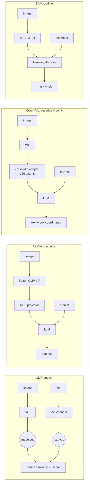

# Section 1 — Architecture Synthesis and the Application Map

> **Where this fits:** This section links Lecture 1 (what's inside the models) to Lecture 2 (what to use them for). It is short in the deck, but everything later depends on it. Each application section below comes back to one question: *which of these four paradigms fits this task?*
> **Slides:** 2 (Application Map), 76–77 (Synthesis), 78–79 (Recap) · **Transcript:** 01:01 – 01:03, 03:31 – 03:35

---

## 1.A — Cross-model comparison: CLIP vs LLaVA vs Qwen-VL vs SAM

| | **CLIP** | **LLaVA** | **Qwen-VL** | **SAM** |
|---|---|---|---|---|
| **Paradigm** | Contrastive | Generative (chat) | Generative + **grounded** | Promptable segmentation |
| **Vision backbone** | ResNet / ViT (trained from scratch) | **Frozen** CLIP ViT-L/14 | ViT initialised from OpenCLIP ViT-bigG | **MAE**-pretrained ViT-H |
| **Fusion mechanism** | Shared embedding space (no fusion; separate towers) | Linear / MLP projector | Cross-attention adapter (compresses to **256** tokens) | **Two-way** cross-attention decoder |
| **Output** | Similarity score / label | Free-form text | Text + **bounding boxes** | Segmentation **mask** + IoU |
| **Core training signal** | 400M web (image, text) pairs | 158K GPT-4-generated instructions | 1.4B pairs + multi-task + instruction tuning | 1.1B masks (SA-1B) via data engine |

### How to read the table (the professor's commentary)
- **Fusion gets richer from left to right.** CLIP keeps image and text completely separate until a final dot product, so a lot of **fine-grained semantics is lost**. LLaVA's linear/MLP projector "works well", but Qwen-VL's cross-attention adapter "works much better".
- **Output gets richer too:** score → free text → text + **boxes** (a key step, because now the model can *point*) → pixel mask.
- **Generative training costs some abilities.** Going generative loses things like precise OCR, and Qwen-VL's multi-task training is an effort to "get it back".
- **SAM takes a different route.** "The vision part comes to the forefront." It uses the **largest ViT** of the four, making it the most vision-heavy model, with almost no language ability. The line between SAM and the other three is "a hard line, but an important line".

### The four pipelines side by side


### 💻 One photo, four kinds of output
The lecture's dog-on-the-beach photo, run through each paradigm ([`code/s1_one_image_four_paradigms.py`](code/s1_one_image_four_paradigms.py), [`s0_grounded_sam.py`](code/s0_grounded_sam.py), [`s2_s3_vlm_probes.py`](code/s2_s3_vlm_probes.py)):

| Paradigm | Real output |
|---|---|
| **CLIP** (match) | `{'a dog on a beach': 0.22, 'a bird on a beach': 0.097, 'a dog and a bird on a beach': 0.683, 'a cat on a sofa': 0.0}` |
| **Detector** (point) | bird box `[176, 183, 223, 216]` score 0.49 · dog box `[71, 209, 139, 282]` score 0.31 |
| **SAM** (outline) | bird mask 672 px · dog mask 2,438 px (predicted IoU 0.95 / 0.98) |
| **Small VLM** (describe) | *"The two dogs are sitting on the ground."* (SmolVLM-256M) |

Each output answers a different question, and each has its own failure. CLIP can only rank **the captions you wrote**. The detector can only find **the classes you named**. SAM **doesn't know** which blob is the bird. The VLM writes fluent text that **turned the bird into a second dog**.

> 💡 **Learning Thought:** Read the table as four answers to one question: **what do we do with what we saw?** CLIP **matches**, LLaVA **describes**, Qwen-VL **describes and points**, SAM **outlines**. Choosing a model mostly means choosing the output you need.

📚 **Go deeper:** [CLIP](https://arxiv.org/abs/2103.00020) · [LLaVA, "Visual Instruction Tuning"](https://arxiv.org/abs/2304.08485) · [Qwen-VL](https://arxiv.org/abs/2308.12966) → [Qwen2-VL (dynamic resolution)](https://arxiv.org/abs/2409.12191) → [Qwen2.5-VL report](https://arxiv.org/abs/2502.13923) · [SAM](https://arxiv.org/abs/2304.02643) · [Hugging Face "Vision Language Models Explained" blog](https://huggingface.co/blog/vlms), the best single overview of the model family

---

## 1.B — The shared thread: ViT as a universal visual backbone

Every one of these models turns pixels into a token sequence with a **Vision Transformer**:

| Model | How it gets its ViT |
|---|---|
| CLIP | Trains its ViT **from scratch** with contrastive supervision |
| LLaVA | **Reuses CLIP's ViT, frozen** |
| Qwen-VL | **Initialises from OpenCLIP** |
| SAM | **MAE-pretrained** ViT |

This **"pretrain once, adapt everywhere"** pattern is the same one BERT/GPT backbones created in NLP. The professor: *"That was not there at one point of time."*

### 💻 Code: read each model's ViT straight from its config
[`code/s1_vision_backbones.py`](code/s1_vision_backbones.py) downloads only the config JSON, no weights:
```python
from transformers import AutoConfig
AutoConfig.from_pretrained("openai/clip-vit-base-patch32").vision_config
AutoConfig.from_pretrained("llava-hf/llava-1.5-7b-hf").vision_config
AutoConfig.from_pretrained("facebook/sam-vit-huge").vision_config
AutoConfig.from_pretrained("Qwen/Qwen2.5-VL-3B-Instruct").vision_config
```
```
openai/clip-vit-base-patch32      patch=32  depth=12  width=768   image=224  -> 49 patch tokens
llava-hf/llava-1.5-7b-hf (CLIP-L) patch=14  depth=24  width=1024  image=336  -> 576 patch tokens
facebook/sam-vit-huge             patch=16  depth=32  width=1280  image=1024 -> 4096 patch tokens
Qwen/Qwen2.5-VL-3B-Instruct       patch=14  depth=32  width=1280  image=dynamic (spatial_merge=2 -> 1 token per 28px square)
```
**Read it:**
- **Same architecture family everywhere.** They differ only in patch size, depth and width.
- **Detail budget:** CLIP-B/32 sees an image as just **49 tokens** (7×7), LLaVA-1.5 as **576**, SAM as **4,096**, and Qwen2.5-VL as **however many the image needs**. That spread is the "fine-grained detail" story of the next sections, shown in numbers. A 10-pt digit can't survive being one of 49 tokens.
- SAM-H and Qwen2.5-VL's vision tower have the **same depth and width** (32 × 1280). The difference is what's attached afterwards: a mask decoder versus an LLM.

What **differs** between models isn't *how they see* but:
1. **What they do with what they saw:** match, describe, ground, or segment
2. **Where fusion happens**
3. **How they are trained**

### The downside: shared weaknesses
> "Since we are building on top of transformer, on top of ViT, on top of CLIP, on top of LLMs, **just like we inherit all their strengths, we also inherit their weaknesses.**" — professor

The main inherited weakness: ViTs pretrained at low resolution (224/336 px) with contrastive objectives **sacrifice fine-grained detail**. That is why OCR, small objects, counting and documents come up as problems again and again in the sections that follow.

> 💡 **Learning Thought:** When one backbone underpins everything, its failure modes show up everywhere. The weaknesses that recur across this lecture (weak OCR, small objects, counting, handwriting) are **backbone weaknesses**, not four separate problems. A fix at the encoder level (higher resolution, a document-specific encoder like DAVE in Section 4) helps several applications at once.

🌍 **A weakness you can measure:** on the lecture's motorcycle photo, CLIP ViT-B/32 gives "a satellite dish" a raw cosine similarity of **0.194**, identical to "a dog" (0.194), which isn't in the photo at all, even though a large dish is clearly being carried (Section 2.C). One global vector over 49 patches captures the **main subject** and drops secondary objects.

📚 **Go deeper:** [ViT paper](https://arxiv.org/abs/2010.11929) · [S², "When Do We Not Need Larger Vision Models?"](https://arxiv.org/abs/2403.13043), which shows that running a small ViT at **multiple resolutions** can beat a bigger ViT, direct evidence that resolution, not size, is often the bottleneck

---

## 1.C — The application map: task → model

| Application | Core task | Primary model | Prompting strategy |
|---|---|---|---|
| **SAM + architectures** | Promptable, pixel-precise segmentation | SAM | Point / box / mask prompts |
| **Image understanding** | Describe and tag what's in an image | LLaVA-style / CLIP | Zero-shot, **scoped and length-constrained** |
| **Visual Q&A** | Answer open-ended questions about an image | LLaVA-style / Qwen-VL | Zero-shot, or **CoT** for counting/comparison |
| **Document intelligence** | Extract structured fields from documents | **Qwen-VL** | **Explicit JSON schema** |
| **Visual reasoning** | Multi-step inference beyond surface content | LLaVA-style / Qwen-VL | **CoT**, decomposed into explicit steps |
| **Chart & data QA** | Read and reason over charts and graphs | Qwen-VL / high-res LLaVA | **Extract values first, then reason**, plus honesty about uncertainty |

### The rules of thumb, as a decision flow

```
What output do you need?
├── A tag or category ─────────────────────────────► CLIP (cheap, zero-shot)
├── A pixel-exact outline ─────────────────────────► SAM (+ a VLM if you need to know WHAT it is)
└── Language
    ├── General description / general question ────► LLaVA-style or Qwen-VL
    ├── Needs reading text (OCR) or pointing at a region ► Qwen-VL
    ├── Structured fields from a document ──────────► Qwen-VL (bulk plain text only? dedicated OCR)
    └── Multi-step reasoning ───────────────────────► the strongest LLM backbone you can afford
```

### 🌍 Real requests, routed
| Request | Output needed | Pick | Why not the others |
|---|---|---|---|
| "Tag 2M product photos as shoe / bag / watch" | Label | **CLIP** | A VLM runs a billion-parameter decoder token by token to write a sentence you'd throw away. CLIP is one forward pass of a ~150M model |
| "Alt-text for a news site" | Sentence | **LLaVA / Qwen-VL** | CLIP can't generate text |
| "What does the error dialog in this screenshot say?" | Text read from pixels | **Qwen-VL** | Needs OCR, and LLaVA-1.5's 336 px input blurs small UI text |
| "Blur every face in this video" | Pixel masks | **Detector + SAM 2** | A VLM can't output pixels |
| "Pull the GSTIN and total from these invoices" | Structured fields | **Qwen-VL + JSON schema** | Plain OCR loses which number belongs to which label |
| "Is this construction site compliant with the PPE rules?" | Multi-step verdict | **Strongest LLM-backbone VLM**, CoT | Reasoning quality tracks the LLM |

The professor on current practice: *"There is no hard and fast rule … but overall the community and the leaderboards more or less think Qwen is quite good. Even we, when we start with a baseline, generally start with Qwen."*

> ⚠️ **Trap (live Q&A):** *"Which is most popular: CLIP, LLaVA or SAM?"* **It depends on the task.** CLIP is the most widely used as a **foundational component** (similarity, zero-shot classification, retrieval, and inside other systems). LLaVA is popular for **conversational VQA / multimodal chat**. SAM is the default **segmentation tool**. They produce different outputs, so there's no single "most popular".

---

## 1.D — The 11-step template for analysing any application

The professor used the **same structure for every application** and asked students to leave able to apply it themselves:

> "We have the same structure for every application. We start with describing the application, then we talk about prompting, the nuances of the prompting, the datasets, and the training."

| # | Step | Question it answers |
|---|---|---|
| 1 | **What it is** | What's the input/output, and where is it used? |
| 2 | **Which model fits** | Which paradigm, and why? |
| 3 | **How to prompt** | What's the simplest thing that works? |
| 4 | **Worked example** | What does success look like? |
| 5 | **Common pitfalls** | How does the simple approach fail? |
| 6 | **Why it's hard** | Where does the difficulty *come from*? |
| 7 | **Datasets** | How is this skill measured? |
| 8 | **How SOTA is trained** | Is anything beyond the base VLM recipe needed? |
| 9 | **Performance** | How good is it, and how much can the numbers be trusted? |
| 10 | **Remaining challenges** | What's still unsolved? |
| 11 | **Quick check** | Can I explain it back? |

Two meta-lessons the professor repeated:
- **"The training part is very small."** For most applications the SOTA recipe is the LLaVA/Qwen recipe from Lecture 1 plus task data (SFT/instruction tuning) and possibly preference tuning. You train only when you need a new architecture. Otherwise, use the model.
- **"But while using the model, always remember its nuances."** Prompting is the easy part. Knowing *where it breaks* is where the understanding lies.

### 🌍 The template applied to a new problem: receipt scanning in an expense app
| Step | Answer |
|---|---|
| What it is | Photo of a paper receipt → {merchant, date, total, tax, category} |
| Model | Qwen-VL class (OCR + layout). CLIP only if all you need is a *category* |
| Prompt | JSON schema with types; `null` if missing; ISO date; numeric total |
| Worked example | Café receipt → `{"merchant": "Blue Tokai", "date": "2026-09-05", "total": 420.0, ...}` |
| Pitfalls | Crumpled or thermal-faded paper, tips handwritten in, totals vs subtotals confused |
| Why hard | Tiny print, curved paper, many layouts, handwriting |
| Datasets | SROIE, CORD (receipt-specific), plus your own labelled 300 |
| Training | Probably none. LoRA on your own receipts if accuracy plateaus |
| Performance | Measure **exact match per field**, not ANLS |
| Open challenges | Faded thermal ink, multi-currency, cross-page receipts |

> 💡 **Learning Thought:** Use this template for any new AI application: agents, speech, video. Steps 5, 6 and 10 (pitfalls, sources of difficulty, open problems) are where interview answers and production decisions are won. Anyone can write the prompt. Fewer people can say in advance how it will fail.

---

## 1.E — Skill → Task → Dataset → Metric: where "solved" claims go wrong

The professor's closing point, and one of the most important ideas in the lecture:

```
 SKILL            →   TASK              →   DATASET        →   METRIC        →   LEADERBOARD
 (object recog.,      ("given image +       (VQAv2, COCO…)     (accuracy,        ("SOTA: 96%!")
  grounding,           question, answer")                       CIDEr, ANLS…)
  language…)
        ▲ simplification  ▲ simplification     ▲ bias             ▲ imperfect
```

> "In every step there is a jump. There is a simplification. The tasks are not always perfect. The datasets are not always unbiased. The metric is not always perfect. That is why when somebody sees the leaderboard, a researcher or teacher comes in and says: no, the **skill** is not yet solved."

Examples from this lecture:
- **Task ≠ skill:** VQA probes understanding, but a model can answer correctly while looking at the wrong region (Section 3.E)
- **Dataset bias:** VQA v1 had to become VQAv2 because models could answer from question priors alone (Section 3.H)
- **Metric failure:** BLEU scores a correct but differently phrased caption at ~9/100 (Section 2.F), strict VQA accuracy penalises GPT-4V's verbose but correct answers (Section 3.J), and ANLS gives partial credit for a wrong invoice number (Section 4.H)
- **Contamination:** most of these datasets are now in pretraining data, so gains may be memorisation (Sections 2.G, 5.E)

The pre-read puts it this way: *"A benchmark number tells you what a model could do on that specific test, not what it will reliably do on **your** documents, **your** images, or **your** questions."*

### 💻 Code: the same two models, ranked in opposite orders by two metrics
[`code/s1_metric_flips_ranking.py`](code/s1_metric_flips_ranking.py): a *terse* model that gets 1 of 3 answers wrong, and a *verbose* model that gets all 3 right:
```python
gold          = {"What is the man doing?": "walking", "What color is the bus?": "red", "How many dogs?": "2"}
model_terse   = {... "walking", ... "blue", ... "2"}
model_verbose = {... "The man is walking along the street.", ... "The bus is red with white stripes.",
                 ... "There are 2 dogs playing."}
exact    = lambda p, t: float(norm(p) == norm(t))
contains = lambda p, t: float(norm(t) in norm(p))
```
```
terse (1 wrong)      exact-match=0.67   answer-contained=0.67
verbose (all right)  exact-match=0.00   answer-contained=1.00
```
By exact match the *wrong* model wins 0.67 to 0.00. By a lenient metric the right model wins 1.00 to 0.67. **The leaderboard you publish depends on which metric you chose.** This is the GPT-4V-vs-VQA-accuracy story from Section 3.J in six lines of code.

> 💡 **Learning Thought:** For any claim that "X is solved", walk back down the chain. Which **metric**? On which **dataset**? Does that dataset represent **the task**? Does the task capture **the skill I need**? The answer is almost always "not quite", and the gap is where your own evaluation set earns its keep.

📚 **Go deeper:** ["Making the V in VQA Matter" (VQAv2)](https://arxiv.org/abs/1612.00837), the dataset-bias story (and the origin of the professor's "make the V in VLM matter" motto) · [VQA evaluation code and metric definition](https://visualqa.org/evaluation.html)

---

## 🎯 Interview Questions

**Q1. Compare CLIP, LLaVA, Qwen-VL and SAM in one minute.**
> All four use a ViT to turn pixels into tokens. They differ in what they do next. CLIP is contrastive: separate image and text encoders in a shared space, output is similarity, trained on 400M pairs, good for tagging and retrieval. LLaVA connects a frozen CLIP ViT to an LLM through an MLP projector and outputs free text, trained on 158K GPT-4-generated instructions. Qwen-VL uses a cross-attention adapter and multi-task training on 1.4B pairs, outputs text *and* boxes, and is strong at OCR and grounding. SAM uses an MAE ViT-H with a two-way-attention decoder to output masks, and has no language. Pick by the output you need: score, sentence, sentence + location, or outline.

**Q2. A PM says "our VLM scores 94% on DocVQA, so let's auto-process invoices." How do you respond?**
> Walk back down skill → task → dataset → metric. DocVQA's ANLS gives partial credit for near-miss strings, which is fine for QA but not for an invoice number. DocVQA documents may not look like our vendors' layouts or scan quality, and the benchmark may be in pretraining data. Build a labelled set of a few hundred of *our* invoices, measure exact-match per field, and send low-confidence or high-value fields to human review.

**Q3. Why do weak OCR and counting show up in almost every VLM application?**
> They are inherited from the shared backbone. ViTs pretrained at low resolution with contrastive or generative objectives keep global semantics and throw away fine detail. Every model built on them inherits that. Fixes therefore come at the encoder level (dynamic/high resolution, document-specific encoders), and one fix helps several applications.

**Q4. When would you *not* use a generative VLM?**
> When you only need a label (CLIP is cheaper and faster, and zero-shot), when you need pixel-precise boundaries (SAM), when you're doing bulk plain-text extraction without layout reasoning (dedicated OCR is faster and cheaper), and when you're matching text against text once extraction is done (embeddings + reranker + an LLM judge; see the design-document question in Section 7).

---

## ✅ Self-check
- [ ] I can fill in the 4×5 comparison table from memory
- [ ] I can state the "tag → CLIP, sentence → generative, OCR/pointing → Qwen-VL, outline → SAM" rules
- [ ] I can list the 11 steps of the application template
- [ ] I can explain the skill → task → dataset → metric chain with one example of a broken link
