# Section 2 — Image Understanding & Captioning

> **Where this fits:** The first and simplest application. Captioning data is already in every VLM's pretraining mix, so "life is simpler now: you just prompt". The point of this section is the **nuances**: why captions go wrong and why it is so hard to even measure "good".
> **Slides:** 8–20 · **Transcript:** 01:03:19 – 01:30:38 · **Notebook:** captioning cells (see Section 6.C)
> **Runnable code:** [`code/s2_*.py`](code/). Outputs below are real, from CLIP ViT-B/32 and **SmolVLM-256M** (a 256M-parameter VLM that runs on a laptop CPU). A tiny model hallucinates more than Qwen-7B, which makes the failure modes easy to *see*.

---

## 2.A — What captioning is

> *"Imagine a computer that could look at an arbitrary scene … and produce a verbal description. This is a problem of overwhelming difficulty … I suspect that scene analysis will be one of the last cognitive tasks to be performed well by computers."*
> — **Azriel Rosenfeld**, one of the founders of computer vision (1998)

The professor, who worked on captioning at the start of his PhD, calls the prediction "partially true, partially false": we can caption now, but it isn't solved.

**Definition:** given an image, generate a **short, precise sentence** that captures its **salient** aspects: objects, attributes, scene and overall context.

- It is **not answering a specific question** (that's VQA).
- It is **distinct from classification**: the output is **free-form language**, not a fixed label.

### Why one caption is secretly many vision tasks
The professor's example caption: *"A tabby cat leaning on a wooden table, with one paw on a laser mouse and the other on a black laptop."*

| The training pair | What a good captioner implicitly learns |
|---|---|
| 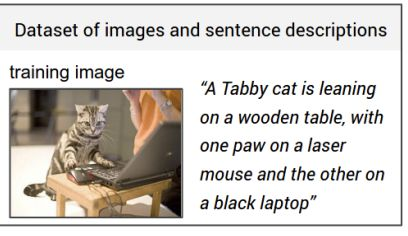 | 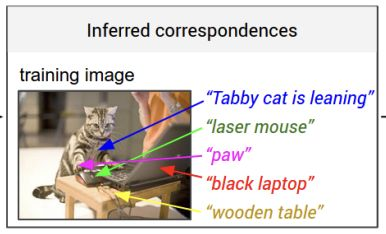 |

*Slide 8: each phrase corresponds to a **region**. Nobody labels these links. The model has to infer them from millions of (image, sentence) pairs.*

| Fragment | Vision skill it requires |
|---|---|
| "cat" | Object detection |
| "**tabby** cat" | **Fine-grained** recognition (type of cat) |
| "leaning on" | **Action** recognition |
| "wooden table" | Object + **texture** attribute |
| "one **paw** on" | **Part** of an object |
| "**laser** mouse" | Fine-grained object |
| "**black** laptop" | Object + **colour** attribute |
| "on", "the other on" | **Spatial relations** |

Objects, properties, actions and spatial relations are exactly what downstream reasoning needs ("Is the person going to fall?"). That's why captioning mattered so much historically: to caption well you have to do most of vision at once.

**Where it's used:** accessibility alt-text, product cataloguing, content moderation, social-media captioning, image-search indexing. The professor notes that early Google Images reverse search ran largely on captions.

🌍 **Real deployments:**
- Screen readers (VoiceOver, TalkBack) auto-describe unlabeled photos for blind users.
- Facebook and Instagram generate automatic alt-text.
- Amazon-scale catalogues generate product descriptions from photos.
- Photo apps index your gallery so "beach sunset" finds pictures you never tagged.

In each case the caption is read by **someone who can't see the image**, which is why a hallucination does real harm.

---

## 2.B — History: from CNN+RNN to VLMs

The professor covered this because "it is one of the things that snowballed this entire evolution".

| Era | Idea | How it works |
|---|---|---|
| **Show & Tell** (2015; Karpathy's work at Stanford is in the same line) | Put a pretrained **CNN** image vector in as the **initial hidden state h₀ of an RNN**, and train the RNN to generate words | Image encoder → one vector → text decoder |
| **Show, Attend & Tell** | Don't squash the image into one vector. **Attend to different regions** of the CNN feature grid while generating each word | "While generating *mouse*, look at this patch" (attention before the Transformer) |
| **Pretrain the decoder too** | Pretrain the language side as well | — |
| **Now: VLMs** | Vision encoder + LLM, and **you just prompt** | "Now your life is simpler. You don't have to worry about architectures." |

The professor's backstory: RNNs had just started working and made **language generation** tractable, which had been "a nightmare before the RNN era". Output has to be grammatical and use the right words, not just identify objects. Connecting a CNN to an RNN "and things started working fantastically".

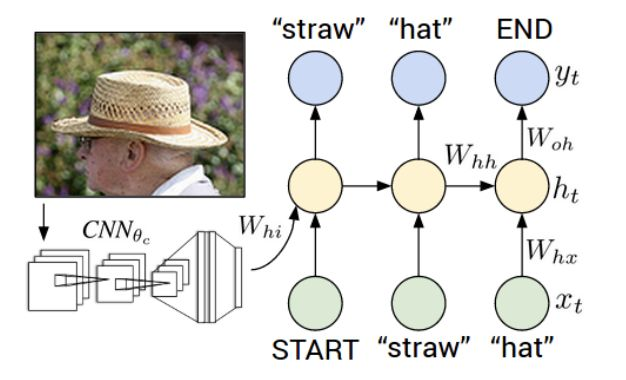
*Slide 9: the CNN's vector enters the RNN once, and then the RNN generates START → "straw" → "hat" → END.*

### 💻 Code: Show & Tell in about 25 lines
[`code/s2_show_and_tell_toy.py`](code/s2_show_and_tell_toy.py). Look at how small the "fusion" is: the image becomes **h₀** and that's it.
```python
class ShowAndTell(nn.Module):
    def __init__(self, vocab=1000, d=256):
        super().__init__()
        cnn = torchvision.models.resnet18(weights=None)   # weights="DEFAULT" for real ImageNet features
        cnn.fc = nn.Identity()                            # drop the class head -> 512-d image vector
        self.cnn, self.img2h = cnn, nn.Linear(512, d)
        self.embed, self.lstm, self.out = nn.Embedding(vocab, d), nn.LSTM(d, d, batch_first=True), nn.Linear(d, vocab)

    def forward(self, image, caption_ids):
        h0 = self.img2h(self.cnn(image)).unsqueeze(0)    # image -> initial hidden state
        x, _ = self.lstm(self.embed(caption_ids), (h0, torch.zeros_like(h0)))
        return self.out(x)                                # next-word logits

logits = model(img, caption[:, :-1])                      # teacher forcing: predict word t+1 from words <= t
loss = F.cross_entropy(logits.reshape(-1, 1000), caption[:, 1:].reshape(-1))
```
```
logits (2, 11, 1000) | teacher-forced next-word loss 6.94 | ln(1000) = 6.91
```
(With `torch.manual_seed(0)`, so the result is reproducible.) The untrained loss is **≈ ln(vocab) = 6.91**, a uniform guess over 1,000 words. That's the sanity check for any language-generation model. Training pushes this down.

**What changed in 10 years:** the CNN became a ViT, the LSTM became a 7B LLM, and "h₀" became hundreds of **image tokens** the LLM can attend to at every step. That last change is Show, *Attend* & Tell's idea, scaled up. The training objective (next-word cross-entropy) is **the same**.

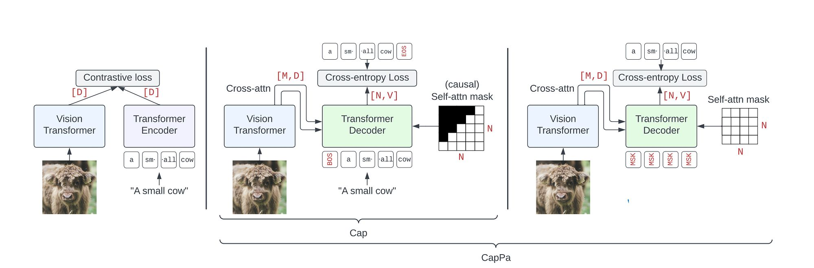
*Slide 9: left, contrastive (CLIP); middle, autoregressive captioning (Cap); right, CapPa (parallel prediction).*

📚 **Go deeper:** [Show and Tell](https://arxiv.org/abs/1411.4555) · [Show, Attend and Tell](https://arxiv.org/abs/1502.03044) (Fig. 1 shows the attention maps word by word) · [CapPa, "Image Captioners Are Scalable Vision Learners Too"](https://arxiv.org/abs/2306.07915)

### "Improving CLIP to Cap" (the CapPa slide)
The slide compares two ways of **pretraining a vision encoder**:
- **Contrastive (CLIP, left):** vision transformer encoder + text transformer encoder, trained to match pairs
- **Autoregressive captioning, "Cap" (middle):** vision transformer encoder + **transformer decoder** that generates the caption token by token

Notation: **D** = model width, **M** = number of image tokens, **N** = number of text tokens, **V** = vocabulary size. The Cap decoder predicts N tokens, each a distribution over V words, conditioned on M image tokens.

Takeaway: **training a vision encoder by captioning** is a competitive alternative to contrastive training. Generating a caption forces the encoder to keep details that a single matching score can ignore.

---

## 2.C — Which model fits, and why

| Need | Model | Why |
|---|---|---|
| **A sentence** | LLaVA / Qwen-style **generative** VLM (the default) | Vision encoder + LLM → natural, fluent descriptions |
| **A tag or category** | **CLIP** | Zero-shot classification is **cheaper and faster**. CLIP can't generate a caption; it can only *match* an image against text you provide |

**Rule of thumb:** *need a sentence → generative model; need a tag → contrastive model.*

**How CLIP tagging works, with numbers.** Embed the image and each candidate label ("a photo of a {label}"), take cosine similarities, scale by CLIP's logit scale (~100), and apply softmax:

| Label | Cosine sim | × 100 | Softmax |
|---|---|---|---|
| a photo of a **tabby cat** | 0.31 | 31 | **0.982** |
| a photo of a laptop | 0.27 | 27 | 0.018 |
| a photo of a dog | 0.22 | 22 | 0.0001 |

(e⁰ : e⁻⁴ : e⁻⁹ = 1 : 0.018 : 0.0001, normalised.) This is one forward pass per label and no generation, so it's much cheaper than a 7B VLM writing a sentence. But it can only choose from **your** label list.

### 💻 Code: CLIP zero-shot tagging, run for real
[`code/s2_clip_zero_shot.py`](code/s2_clip_zero_shot.py) on the lecture's motorcycle photo (below, in 2.E), which shows a couple on a motorbike carrying a large satellite dish:
```python
from transformers import CLIPModel, CLIPProcessor
model = CLIPModel.from_pretrained("openai/clip-vit-base-patch32")
proc  = CLIPProcessor.from_pretrained("openai/clip-vit-base-patch32")

labels = ["a motorcycle", "a car", "a bicycle", "a satellite dish", "a dog", "a laptop"]
inputs = proc(text=[f"a photo of {l}" for l in labels], images=image, return_tensors="pt", padding=True)
out = model(**inputs)
probs = out.logits_per_image.softmax(dim=-1)[0]          # logits = logit_scale(100) x cosine similarity
```
```
 0.979  a motorcycle          raw cosine 0.269
 0.018  a bicycle             raw cosine 0.229
 0.001  a car                 raw cosine 0.197
 0.001  a laptop              raw cosine 0.195
 0.001  a dog                 raw cosine 0.194
 0.001  a satellite dish      raw cosine 0.194
logit scale: 100.0
```
**Two lessons that aren't on the slide:**
1. **Softmax forces a single winner.** "Satellite dish" gets 0.1% even though a big dish is in the photo, because labels **compete**. For multi-label tagging, don't use softmax. Score each label independently, or phrase the combinations you care about as captions (on the dog photo, *"a dog and a bird on a beach"* won with 0.68; Section 1.A).
2. **Raw cosines are compressed:** 0.194–0.269. The ×100 logit scale is what turns small cosine gaps into confident-looking probabilities. And the dish (0.194) scores **the same as "a dog"**, which isn't there at all. CLIP's single global vector barely registers secondary objects. That's the fine-grained weakness from Section 1.B, measured.

📚 **Go deeper:** [CLIP paper](https://arxiv.org/abs/2103.00020) (§3.1.4, "prompt engineering and ensembling": why "a photo of a {label}" beats a bare "{label}") · [HF CLIP docs](https://huggingface.co/docs/transformers/model_doc/clip)

---

## 2.D — Prompting for consistent captions

1. **Zero-shot templated prompts** work well for general description.
2. **Constrain scope and length explicitly:** *"one sentence, under 125 characters, describing only what is visually present"*
3. **For cataloguing at scale, fix the template across every call.** *Consistency matters more than any single caption's creativity.*

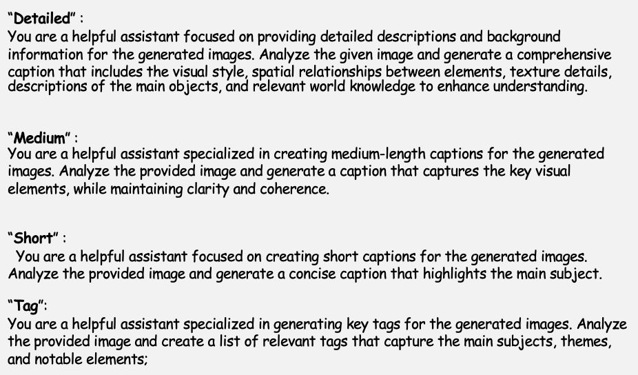
*Slide 10: the four system-prompt styles.*

The professor also showed paper-style system prompts. Longer, more restrictive, formatted prompts tend to give better captions:
- *Detailed:* "You are a helpful assistant focused on providing detailed descriptions and background information. Analyse the given image. Generate a comprehensive caption that includes the visual style, spatial relationships, textural details, description of the main objects…"
- *Short:* "You are a helpful assistant focused on creating short captions for generic images. Generate a concise caption that highlights the main object…"

### Worked example
> **Prompt:** "Write a one-sentence caption describing only what is visually present in this image."
> **Output:** "A snow-capped mountain range under a clear sky, with the sun low on the horizon."

"Describing **only what is visually present**" is a **hallucination guard** written into the prompt. The notebook's captioning system prompt does the same: *"Do not infer hidden information or add details that are not visually supported by the image."* (Section 6.C). As the notebook shows, this helps but **doesn't eliminate** hallucination.

### 💻 Code: four prompt styles, one image, a real small VLM
[`code/s2_prompt_styles.py`](code/s2_prompt_styles.py) uses the helper [`code/vlm_small.py`](code/vlm_small.py), which wraps SmolVLM-256M with the same chat-template pattern as the course notebook. The image is the slide's **dog on a pebble beach with a black bird** (2.E).
```python
styles = {
  "short":    "Generate a concise caption that highlights the main subject.",
  "detailed": "Generate a comprehensive caption including the main objects, their spatial relationships, and textural details.",
  "tags":     "List 5 comma-separated tags for the main subjects and scene.",
  "catalog":  "One sentence, under 125 characters, describing only what is visually present.",
}
for name, p in styles.items():
    print(name, ask(img, p, max_new_tokens=70))
```
```
[short   ] Two dogs are sitting on the ground.
[detailed] Here is the description:
           - The image features two dogs on a gravelly, rocky beach.
           - The dogs are black and white, with the black and white ones being the larger breed and the white ones being smaller.
           - The gravel is scattered across the ground, with some pebbles and small rocks mixed in. ...
[tags    ] 1. dog and cat. 2. sitting on the ground. 3. outside. 4. on the beach. 5. photograph.
[catalog ] This is a photograph.
```
**Read it (every pitfall from 2.E in one run):**
- *short* and *detailed*: the black **bird became a second dog**. The *detailed* style then **elaborates the hallucination** ("the larger breed… the white ones smaller"). More words mean more room to invent.
- *tags*: invents a **cat**, and it ignored the format request (a numbered list instead of commas).
- *catalog*: the strictest constraint produced **"This is a photograph."**, the **over-generic** failure. A small model that's told "only what is visible, under 125 characters" plays it safe by saying nothing.

The prompt changes *which* failure you get. It doesn't remove failure. A larger model (Qwen2.5-VL-3B in the notebook, Section 6.C) is much better, but it still hallucinated a snowy scene on one image.

### 💻 Code: freeze and version the template (the "at scale" rule)
```python
CAPTION_PROMPT_V3 = {                      # bump the version on ANY change; log it with each caption
    "version": "caption-v3-2026-09-05",
    "system": "You are an e-commerce cataloguer.",
    "user": "One sentence, under 125 characters, describing only what is visually present: "
            "product type, colour, material. No guesses about brand or price.",
}
def caption(img):
    text = ask(img, CAPTION_PROMPT_V3["user"], system=CAPTION_PROMPT_V3["system"])
    return {"caption": text[:125], "prompt_version": CAPTION_PROMPT_V3["version"]}
```
When a caption goes wrong in production, `prompt_version` tells you which template produced it, the same way a git SHA tells you which code did.

> 💡 **Learning Thought:** At scale, a caption is **data**, not prose. A product catalogue of 1M items is only searchable if every caption follows the same template. Variation between captions is noise for downstream search and moderation. Tune the template once, freeze it, and version it like code.

---

## 2.E — Common pitfalls, with real model outputs

| Pitfall | What it looks like |
|---|---|
| **Hallucination** | Describing objects or details that aren't there |
| **Over-generic** | "A photo of a scene" is *correct* and tells you nothing |
| **Missing the salient detail** | Describing the background ("an urban scene") instead of the subject |
| **Inherited bias** | Reflects skew in the training data. E.g. a doctor is described as "a **male** doctor" |

### Hallucination examples from the lecture
- LLaVA-1.5, asked "Is there a chair?": "**Yes**, there is a chair … in front of the group of people." (There isn't.)
- LLaVA, captioning a dog on a beach: "…The dog is **looking at his owner**." There is no owner, but the sentence is *statistically plausible*, so **the language model takes over**.
- LLaVA-1.5 on a street scene: invents extra traffic lights, "two people in the scene", and car positions. The more complex the image, the more it hallucinates.
- Mitigation research: Google's **HALVA** (contrastive tuning against hallucination).

| "Is there a chair in the image?" | The image | "Generate a short caption" | The image |
|---|---|---|---|
| 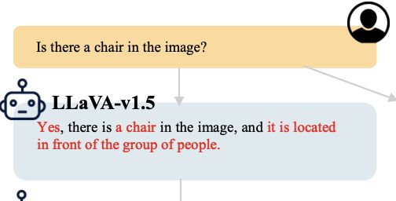 | 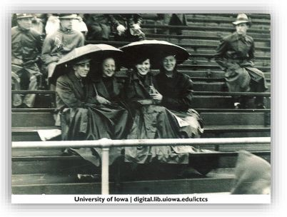 | 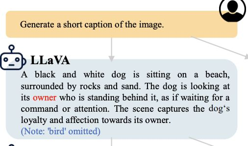 | 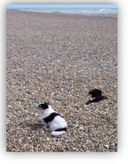 |

*Slide 12: note the slide's own annotation, "(Note: 'bird' omitted)". The caption invents an owner and misses a bird that's really there.*

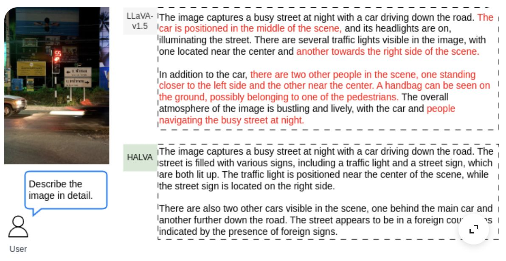
*Slide 12: red text = hallucinated content. LLaVA-1.5 (top) vs HALVA (bottom) on the same image.*

### 💻 Reproducing the failures with a small VLM
[`code/s2_s3_vlm_probes.py`](code/s2_s3_vlm_probes.py), SmolVLM-256M on the same dog photo:
```python
print(ask(dog, "Write a one-sentence caption describing only what is visually present."))
print(ask(dog.filter(ImageFilter.GaussianBlur(25)), "Write a one-sentence caption ..."))
```
```
CAPTION : The two dogs are sitting on the ground.
BLURRED : A gray, blurred image with a white border.
```
Big models (LLaVA) drop the bird. Small models **turn it into a dog**. The same image breaks every model differently. At least this one is **honest about blur** (Section 3.E shows LLaVA isn't always).

📚 **Go deeper:** [HALVA paper, "Mitigating Object Hallucination in MLLMs via Data-augmented Phrase-level Alignment"](https://arxiv.org/abs/2405.18654) · [Google Research blog on HALVA](https://research.google/blog/halva-hallucination-attenuated-language-and-vision-assistant/)

The professor's research motto: *"Making the **V** in VLM matter."*

### The motorcycle comparison: one image, three models
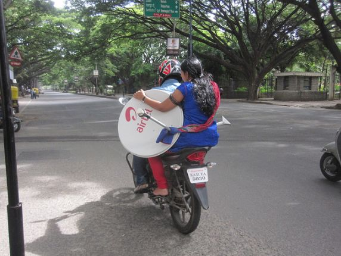

The image is an Indian street scene (the professor places it in **Karnataka** from the Kannada signboards). A couple rides a motorcycle carrying a **satellite dish**.

| Model | Got right | Got wrong |
|---|---|---|
| **Qwen-VL 2B** | Motorcycle, **satellite dish**, tree-lined street, helmet | "Couple" is assumed. "**Blue shirt and red pants**": she's in Indian attire. "Quiet and empty" street |
| **LLaVA-1.5 7B** | Two riders, trees | "Both wearing helmets", "motorcycle is **parked**" (contradicts *riding*), "**handbag on the ground**" (invented), "fun outing" (unsupported mood). **Misses the satellite dish entirely** |
| **LLaVA-1.6 13B** | Satellite dish, helmets, suburban road. Fewer hallucinations | Licence plate read as "**KASI EA 5030**". Karnataka plates start "KA 51…", so the **OCR is poor** |

None of the three notices the regional context (Kannada script). Its training data is mostly Western, which is the long-tail problem in 2.F.

> 💡 **Learning Thought:** Bigger and newer (1.5-7B → 1.6-13B) reduced hallucination but **didn't fix OCR**. That is the professor's reason "why people had to use more OCR techniques for Qwen" and it leads into Document Intelligence. Scaling fixes some failure modes and not others. Find out *which kind* of failure you have before you reach for a bigger model.

---

## 2.F — Why captioning is hard, and why measuring it is harder

| Difficulty | Explanation |
|---|---|
| **Fine-grained distinctions** | Detecting "cat" is easy; *tabby* vs *ginger* vs a specific breed is not. When it matters (agriculture, species), people end up training separate specialist models |
| **Compositionality** | Describing **relationships** between objects, not just listing them. Needs spatial, sometimes causal, and **commonsense** reasoning. E.g. a queue outside a blue-and-white door suggests *a bank* even though no bank is visible. A shadow means an object exists **out of frame** |
| **Salience is subjective** | What's worth mentioning versus clutter has no single right answer |
| **Evaluation** | Subjectivity makes metrics hard (below) |
| **Long-tail concepts** | "**Lay's vs Lijjat**": web data knows Lay's chips but not Lijjat papad. Rare objects and non-Western scenes are underrepresented |
| **Subjectivity** | The right level of detail depends on the use case |

### Caption metrics and how they fail

| Metric | Type | Idea |
|---|---|---|
| **BLEU / ROUGE / METEOR** | n-gram | Word-sequence overlap with reference captions |
| **CIDEr** | n-gram, TF-IDF weighted | Consensus with the 5 human references. Rare, informative n-grams count more. **The standard captioning score** |
| **SPICE** | Scene graph | Parse the caption into (object, attribute, relation) tuples and compare those instead of words. Evaluated on **COMPOSITE** (Aditya et al. 2015, the professor's own "self-plug") |
| **CLIPScore** | Embedding | Use CLIP to score image–caption compatibility **without references** |

**Worked failure of n-gram metrics** (the professor's example). Both captions describe this lecture correctly:
- Reference: "a teacher is speaking to students"
- Candidate: "agentic AI is being taught"

Shared unigrams: only "**is**" → unigram precision 1/5 = 0.2. Shared bigrams: **none**. *Unsmoothed* BLEU-4 is a geometric mean over the 1- to 4-gram precisions, so a single zero makes the whole score **0**.

### 💻 Code: what a real BLEU implementation says
[`code/s2_bleu_paraphrase.py`](code/s2_bleu_paraphrase.py) uses **sacreBLEU**, the standard implementation:
```python
import sacrebleu
refs = [["a teacher is speaking to students"]]
for cand in ["agentic AI is being taught", "a teacher is talking to students", "a teacher is speaking to students"]:
    b = sacrebleu.corpus_bleu([cand], refs)
    print(b.score, b.precisions)
```
```
BLEU=  8.75  precisions=[20.0, 12.5, 8.3, 6.2]  <- 'agentic AI is being taught'
BLEU= 37.99  precisions=[83.3, 60.0, 25.0, 16.7] <- 'a teacher is talking to students'
BLEU=100.00  precisions=[100.0, 100.0, 100.0, 100.0] <- 'a teacher is speaking to students'
```
⚠️ **Correction to the hand calculation:** sacreBLEU **smooths** zero n-gram counts by default (the 12.5 / 8.3 / 6.2 precisions are smoothed values, not real matches), so the correct paraphrase gets **8.75**, not 0. The lesson stands: a correct caption scores **8.75/100**, while changing one word of the reference ("speaking" → "talking") scores 38. BLEU rewards **copying the reference's words**, not being right.

### 💻 Code: CLIPScore, and what it misses
[`code/s2_clipscore.py`](code/s2_clipscore.py). CLIPScore = 2.5 × max(cos(image, caption), 0), with no reference captions needed:
```python
caps = ["A black and white dog sits on a pebble beach near a black bird.",        # correct
        "The two dogs are sitting on the ground.",                                 # SmolVLM's hallucination
        "A black and white dog is sitting on a beach looking at his owner.",       # LLaVA's invented owner
        "A photo of a scene."]                                                     # over-generic
score = 2.5 * (image_emb @ text_emb.T).clamp(min=0)
```
```
CLIPScore 0.859  A black and white dog sits on a pebble beach near a black bird.
CLIPScore 0.662  The two dogs are sitting on the ground.
CLIPScore 0.828  A black and white dog is sitting on a beach looking at his owner.
CLIPScore 0.609  A photo of a scene.
```
CLIPScore correctly ranks the right caption first and punishes the generic one. But LLaVA's **hallucinated "owner"** caption scores **0.828**, almost as high as the correct one (0.859), because its words ("black and white dog", "beach") match the image strongly and one invented phrase barely moves a single global embedding. **Every automatic metric has a blind spot**, and for CLIPScore it is exactly the hallucination this section is about.

That is why SPICE "forgot about the language" and compared only **objects and relations**, and why CapArena (below) went back to humans.

📚 **Go deeper:** [CIDEr](https://arxiv.org/abs/1411.5726) · [SPICE](https://arxiv.org/abs/1607.08822) · [CLIPScore](https://arxiv.org/abs/2104.08718) · [sacreBLEU](https://github.com/mjpost/sacrebleu) · [CapArena (2025)](https://arxiv.org/abs/2503.12329)

> 💡 **Learning Thought:** If a BLEU of 0.85 vs 0.82 (or 0.74 vs 0.70) is the only thing deciding between models, you know very little. The professor: *"Rather than evaluating the caption, you have to evaluate **parts** of the caption."* Are the objects right? Are the relations right? Anything hallucinated? Break the output down and check each piece.

---

## 2.G — Popular datasets

| Dataset | Scale | Notes |
|---|---|---|
| **COCO Captions** (2014, Microsoft "Common Objects in Context") | 330K images, **5 captions each** | Gold-standard benchmark, human-written (crowdsourced on Amazon Mechanical Turk) |
| **Flickr30K** (2014, Yahoo/Flickr) | 31K images, 5 captions each | Smaller, similar style to COCO |
| **Conceptual Captions** (CC3M / CC12M, 2018) | 3M–12M pairs | **Noisy web alt-text**, used for pretraining |
| **Visual Genome** (2016) | 108K images, **dense regions** | Every region captioned. Objects, attributes, relationships |
| **LAION-5B** (2022) | 5B+ pairs | Web-scale and noisy. Powers foundation-model pretraining |
| **CapArena** (2025) | — | A **platform** where two models caption the same image and **humans judge which is better** (precise, informative, not hallucinating). It changes *how* evaluation is done, not just the data |

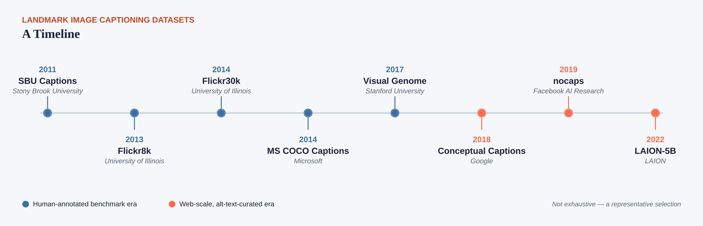
*Slide 14: SBU (2011) → Flickr8k (2013) → Flickr30k and MS COCO (2014) → Visual Genome (2017) → Conceptual Captions (2018) → nocaps (2019) → LAION-5B (2022). Note the colour change: **blue = human-annotated benchmark era**, **orange = web-scale, alt-text-curated era**. Around 2018 the field moved from small, clean, human-written data to huge, noisy web data. That's the shift that made foundation VLMs possible, and it's also why hallucination and bias came in with them.*

📚 **Go deeper:** [COCO Captions paper](https://arxiv.org/abs/1504.00325) · [cocodataset.org](https://cocodataset.org/) (browse by category) · [Conceptual Captions](https://github.com/google-research-datasets/conceptual-captions) · [Visual Genome](https://arxiv.org/abs/1602.07332) · [LAION-5B](https://arxiv.org/abs/2210.08402)

> ⚠️ **Note:** "By the way, captioning is **not** thought of as a fine-tuning task. It is done in the pretraining data." Most of these datasets are already inside every VLM's training mix, which is part of why new evaluation methods like CapArena are needed.

---

## 2.H — Training, performance, and remaining challenges

### How SOTA captioners are trained (the same as the Lecture 1 recipe)
1. **Broad pretraining:** contrastive or generative, on noisy web pairs (LAION, CC12M) → broad visual–language association (**alignment**)
2. **Curated fine-tuning:** SFT on human-written captions (COCO) → fluent, accurate style
3. **Instruction tuning:** instruction + image → caption, exactly the LLaVA/Qwen recipe → conversational captioning

**Data-quality technique, BLIP-style bootstrapping (CapFilt):** train a **captioner** to write synthetic captions for web images and a **filter** to drop noisy captions (original or synthetic), then retrain on the cleaned data. It's the same flywheel idea as SAM's data engine, applied to text.

### Performance (directional trends)
| Model generation | COCO CIDEr | NoCaps CIDEr |
|---|---|---|
| Pre-transformer baselines (~2015–18) | ~110–120 | — |
| Early VLM captioners (BLIP-2 class) | ~140+ | ~120 |
| Recent open models (InternVL3 class) | ~143 (zero-shot) | ~126 |

**NoCaps** (Novel Object Captioning at Scale, ICCV 2019): **train on COCO, test on images with novel objects.** It measures whether captioning generalises beyond COCO's 80 categories.

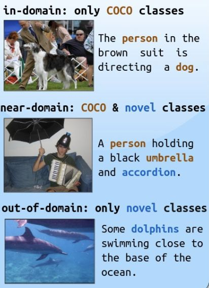
*Slide 16: **in-domain** (only COCO classes: person, dog), **near-domain** (COCO + novel: accordion), **out-of-domain** (only novel classes: dolphins). Scores drop from left to right. That drop is the long-tail problem, measured.*

📚 **Go deeper:** [NoCaps paper](https://arxiv.org/abs/1812.08658) · [BLIP (CapFilt bootstrapping)](https://arxiv.org/abs/2201.12086) · [BLIP-2](https://arxiv.org/abs/2301.12597)

### Remaining challenges
- **Hallucination is still unsolved.** Even SOTA models describe plausible but absent objects.
- **Automatic metrics correlate poorly** with human judgement of usefulness
- **Bias:** captions reflect and amplify demographic and cultural skew
- **Style control:** matching a tone or brand voice still needs heavy prompt engineering or fine-tuning
- **Cross-lingual / cross-cultural** generalisation lags English. The professor notes early efforts (e.g. multilingual, multicultural QA work from CMU) and hopes for Indian efforts (Sarvam and others), "but they have not caught up yet".

> ⚠️ **Trap (live Q&A):** *"How much training data and RAM does captioning need?"* **Don't train from scratch.** That is research scale (hundreds of millions of pairs). To fine-tune an existing VLM for a captioning **style**, **a few thousand** image–caption pairs is usually enough, and **20–50K** for a harder domain. Memory (rough): **2B model** ≈ 6–8 GB GPU to run, 16–24 GB to fine-tune with LoRA. **7B model** ≈ 16 GB to run, 24–40 GB to fine-tune with LoRA. Quantisation lowers these.

### 💻 Code: what "fine-tune with LoRA" actually trains
[`code/s2_lora_setup.py`](code/s2_lora_setup.py) wraps a real VLM with LoRA adapters and counts the parameters:
```python
from peft import LoraConfig, get_peft_model
model = AutoModelForImageTextToText.from_pretrained("HuggingFaceTB/SmolVLM-256M-Instruct")
cfg = LoraConfig(r=8, lora_alpha=16, lora_dropout=0.05, bias="none",
                 target_modules=["q_proj", "v_proj"],     # classic choice, no duplicates (see Section 6.G trap)
                 task_type="CAUSAL_LM")
model = get_peft_model(model, cfg)
model.print_trainable_parameters()
```
```
trainable params: 755,712 || all params: 257,240,640 || trainable%: 0.2938
```
Only **0.29%** of the weights train. The base model stays frozen, and only small rank-8 matrices beside each q/v projection learn your caption style. That's why "a few thousand pairs" is enough and why the GPU needs are modest. From here, training is a standard `transformers`/`trl` SFT loop over (image, prompt, target caption) examples.

📚 **Go deeper:** [HF TRL: SFT trainer, "Vision Language Models" section](https://huggingface.co/docs/trl/sft_trainer) · [TRL guide: training VLMs with SFT](https://huggingface.co/docs/trl/main/en/training_vlm_sft) · [SmolVLM blog](https://huggingface.co/blog/smolvlm), about small VLMs you can fine-tune on a single GPU

---

## ✅ Quick Check (from the deck; answers below)
1. What distinguishes image understanding from classification?
2. When is CLIP preferable to a generative captioner?
3. Why fix a single prompt template for large-scale cataloguing?
4. Which is a common pitfall in captioning?
5. What's the best fix for an overly generic caption?

<details><summary>Answers</summary>

1. **Output is free-form language**, not a fixed label
2. When you **only need a tag or category**: cheaper and faster
3. **Consistency matters more than per-caption creativity**
4. **Over-generic, uninformative captions**
5. **Add scope/detail constraints** to the prompt

*(In the live quiz the options were shuffled, e.g. "free-form language" was option D and "add scope constraints" was option A, but the answers are the same.)*
</details>

---

## 🎯 Interview Questions

**Q1. You're building alt-text for 5M product images. Walk me through model choice, prompt and QA.**
> A generative VLM (Qwen-VL/LLaVA class), because alt-text must be a sentence. If only categories are needed for filters, CLIP tagging is cheaper. A **frozen** templated prompt: "One sentence, under 125 characters, describing only what is visually present; mention product type, colour, and material." Version it. QA: sample captions for hallucination (check each object against the image), over-genericness, and bias. Don't rely on BLEU/CIDEr. Use human or LLM-judge pairwise review CapArena-style. For a brand voice, fine-tune with LoRA on a few thousand approved captions.

**Q2. Why do VLMs hallucinate objects in captions?**
> The language model has strong co-occurrence priors (beach + dog → "owner", street → "traffic lights"), and the visual signal often doesn't override them, especially in cluttered images or small models. The decoder generates what is *statistically plausible* given the text so far. Mitigations: "only what is visually present" constraints, bigger or better-grounded models, contrastive or preference tuning against hallucinated captions (HALVA-style), and object-level verification after generation.

**Q3. Why is BLEU a bad captioning metric, and what are the alternatives?**
> It measures n-gram overlap with references. A correct paraphrase ("agentic AI is being taught" vs "a teacher is speaking to students") shares no bigrams: unsmoothed BLEU-4 = 0, and sacreBLEU (smoothed) gives 8.75/100, while a one-word edit of the reference scores 38. Alternatives: CIDEr (TF-IDF consensus over 5 references, still n-gram), SPICE (compares scene-graph tuples, so it's robust to wording), CLIPScore (reference-free image–text compatibility), and human pairwise judgement (CapArena). In practice, evaluate parts: object recall/precision and hallucination rate.

**Q4. What does NoCaps measure that COCO doesn't?**
> Generalisation to novel objects. Models are trained on COCO's ~80 categories and tested on images with objects outside them. It exposes models that memorised COCO's distribution, which is the long-tail problem ("Lay's vs Lijjat").

**Q5. Captioning vs VQA vs classification: define each in one line.**
> Classification: image → one label from a fixed set. Captioning: image → free-form description of what's salient, with no question. VQA: image + question → answer targeted at the question, where everything else can be ignored.

---

## ✅ Self-check
- [ ] I can break a caption into the vision skills it requires
- [ ] I can explain Show & Tell → Show, Attend & Tell in two sentences
- [ ] I can compute a CLIP zero-shot softmax from similarities
- [ ] I can list 4 captioning pitfalls with an example of each
- [ ] I can show why BLEU scores a correct paraphrase near 0 (and explain smoothing)
- [ ] I can explain why CLIPScore failed to catch the "owner" hallucination
- [ ] I have run `s2_clip_zero_shot.py` and `s2_prompt_styles.py` and read the outputs
- [ ] I can name 5 captioning datasets and what makes each distinct
- [ ] I can say how much data and GPU memory a captioning fine-tune needs
