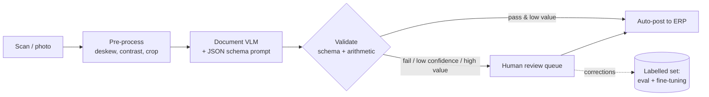
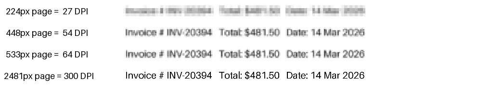
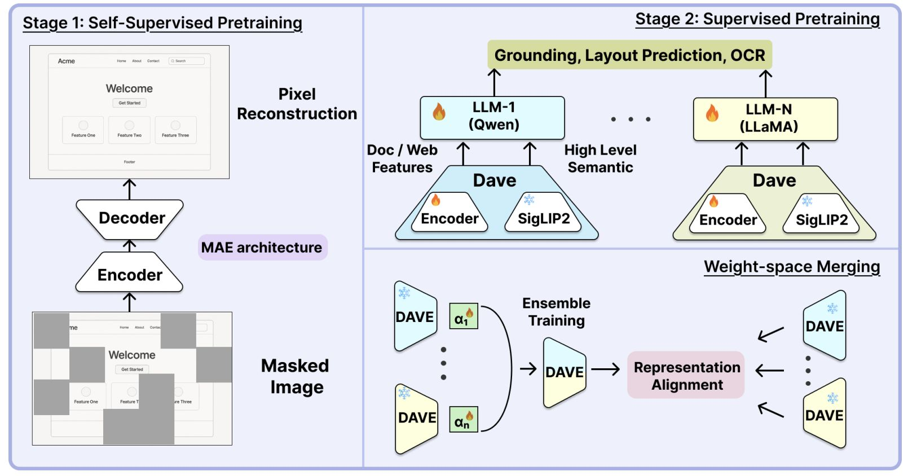
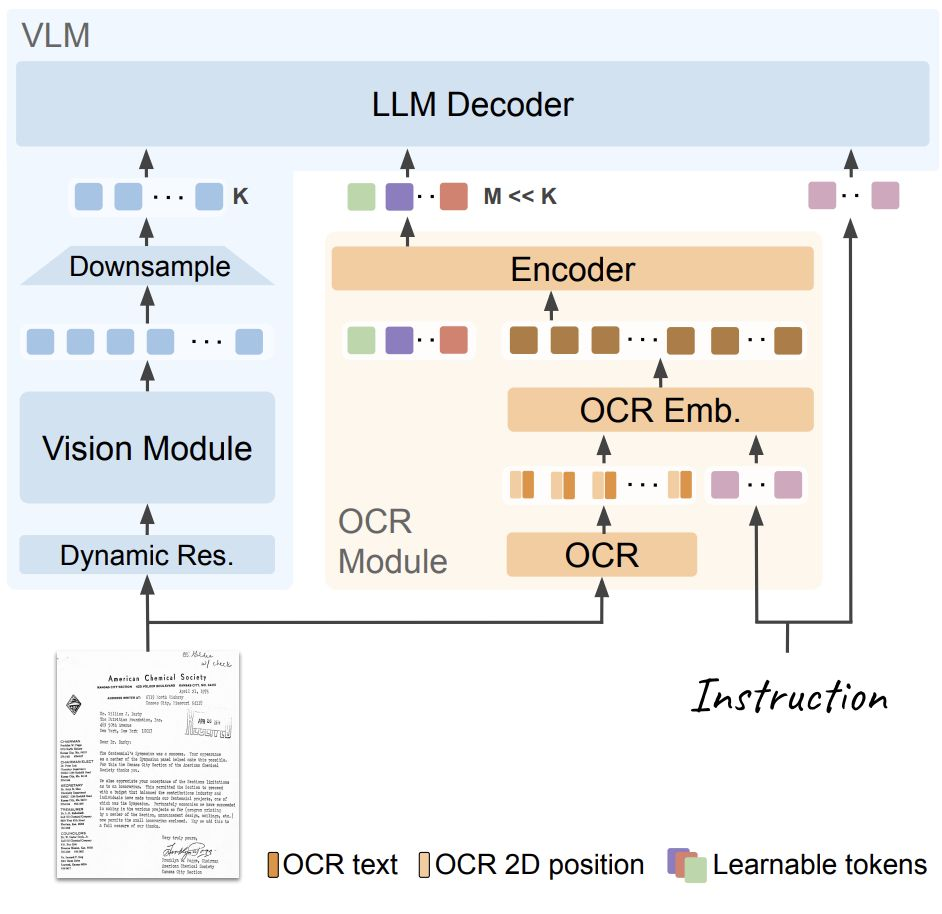
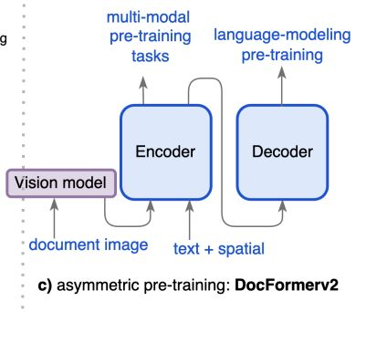

# Section 4 — Document Intelligence

> **Where this fits:** The most enterprise-relevant application. "Any enterprise depends on processing documents … we have gone from physical files to electronic files, but automated document processing has not improved hugely. VLMs to the rescue." It is also where the backbone's weaknesses (resolution, fine detail) matter most, and where a single wrong digit costs real money.
> **Slides:** 35–47 (+ DAVE and DocVLM case-study slides) · **Transcript:** 02:30 – 02:55 · **Notebook:** DocVQA + document-understanding cells (Section 6.E–F)
> **Runnable code:** [`code/s4_*.py`](code/). Every output below is real.

---

## 4.A — What document intelligence is

**Definition:** extract **structured information** from documents (invoices, forms, receipts, contracts, tax forms) by combining **OCR** (reading characters) with **layout understanding** (knowing where things are and how they relate).

**The output isn't prose. It's specific fields a downstream system can consume.**

**Where it's used:** invoice processing, expense automation, contract review, form digitisation, and (the professor's experience) **risk analytics**. Insurance and risk-management firms assess a person's risk from tax forms and claim documents. The professor also worked at Adobe, whose Document Cloud business works on exactly this.

### Why tax forms are the hard case (the professor's story)
Working with a US risk-management firm on tax forms, he found:
- **Huge variety.** No fixed set of tables, columns change from form to form, and every vendor, year and state differs.
- **Scan variation.** Rotations, translations, skew.
- **Getting a table out perfectly** is hard even when a human can read it easily.

### 🌍 Where this runs today
| Industry | Documents | Downstream system |
|---|---|---|
| Accounts payable | Vendor invoices | ERP (SAP, Tally), where extracted totals trigger payments |
| Lending / KYC (India) | PAN, Aadhaar, bank statements, salary slips | Loan-decision engine |
| Insurance | Claim forms, hospital bills, discharge summaries | Claims adjudication |
| Tax / GST | GST invoices, Form 16, ITR forms | Filing and reconciliation |
| Legal | Contracts, NDAs | Clause-extraction and risk flags |

In every row the output feeds **a machine, not a human reader**. That's why the output has to be a **schema**, not prose (4.D).


*The production shape. Every box after the VLM exists because of a failure mode described in this section.*

---

## 4.B — Which model fits: VLM vs OCR pipeline

| Approach | Strength | Weakness |
|---|---|---|
| **Qwen-VL** (the natural fit) | **Native OCR + grounding**: reads dense text **and** locates where each field sits | Slower and more expensive. Limited resolution |
| **Dedicated OCR pipeline** (open-source OCR, then text) | **Faster and cheaper** for pure text extraction | **Weak at layout** and at relationships between fields |

**Rule of thumb:** structured, **layout-aware** extraction → **VLM**. Simple **bulk text** extraction → **dedicated OCR**.

### Why "OCR first, then give the text to an LLM" loses information
The professor's example is a W-2-style table. Many real forms have **no ruling lines**, just evenly spaced numbers:

```
What's on the page:                 What flat OCR outputs:
  Income   Overheads   Interest     "Income Overheads Interest 10 20 30 40 50 60"
    10        20          30
    40        50          60
```

From the flat string, does 30 belong to *Interest* or is it the start of row 2? You'd have to **map every value back to its column** using x-coordinates, which is a separate problem in itself. OCR gives you the **characters** but loses the **2D arrangement** that gives them meaning. "*10 and 30 are field values for row 1 and row 2. These are correspondences, and you need to understand these correspondences.*"

### 💻 Code: flat text vs coordinates
Real OCR engines (Tesseract, PaddleOCR, cloud OCR) return **words with bounding boxes**, not just text. [`code/s4_ocr_layout_reconstruct.py`](code/s4_ocr_layout_reconstruct.py) shows what the boxes buy you:
```python
words = [("Income", 40, 10), ("Overheads", 160, 10), ("Interest", 300, 10),
         ("10", 60, 50), ("20", 190, 50), ("30", 320, 50),
         ("40", 60, 90), ("50", 190, 90), ("60", 320, 90)]        # (text, x_left, y_top)

print("FLAT TEXT :", " ".join(w for w, _, _ in words))
rows = {}
for w, x, y in words: rows.setdefault(y, []).append((x, w))      # group into rows by y
header_y, *data_ys = sorted(rows)
headers = sorted(rows[header_y])
for y in data_ys:                                                  # each value -> nearest header by x
    rec = {min(headers, key=lambda h: abs(h[0] - x))[1]: int(w) for x, w in rows[y]}
```
```
FLAT TEXT : Income Overheads Interest 10 20 30 40 50 60
TABLE     : [{'Income': 10, 'Overheads': 20, 'Interest': 30}, {'Income': 40, 'Overheads': 50, 'Interest': 60}]
Interest total: 90
```
The heuristic works on this clean grid. On real forms it breaks on merged cells, right-aligned numbers, wrapped headers, and multi-line rows. That's the "separate problem" the professor meant, and why a model that **sees** the layout (a VLM) or **encodes the coordinates** (DocVLM, 4.G) does better than hand-written rules.

📚 **Go deeper:** [DocFormerV2, "Local Features for Document Understanding"](https://arxiv.org/abs/2306.01733) (text + 2D boxes as input) · [FUNSD (form key–value dataset)](https://arxiv.org/abs/1905.13538)

> 💡 **Learning Thought:** A document is a **2D object pretending to be text**. Meaning lives in position: same column, same row, label to the left of its value. Any pipeline that turns it into a 1D string first has to rebuild that structure afterwards, and usually does it badly. That's why document-specific models (DocVLM, below) feed OCR **with bounding-box coordinates**, not just text.

---

## 4.C — Why documents need more innovation: the resolution problem

> "Most image-processing tasks achieve good performance at **low resolution**: 224×224, 448×448. They work on higher-level semantics. **Not documents.**"

A cat is still a cat at 224 px. A 10-point digit is not still a digit.

**Worked numbers:** an A4 page is 8.27 × 11.69 inches. A 10-pt font's line height is 10/72 in ≈ 0.139 in.

| Image width for the page | Effective DPI | 10-pt text height in pixels | Readable? |
|---|---|---|---|
| 224 px (classic ViT) | 224 / 8.27 ≈ **27** | 0.139 × 27 ≈ **3.8 px** | ❌ smudge |
| 448 px (Qwen-VL v1) | ≈ **54** | ≈ **7.5 px** | ⚠️ barely |
| 533 px (notebook's `max_pixels` budget, see below) | ≈ **64** | ≈ **8.9 px** | ⚠️ marginal for small print |
| 2,481 px (a 300-DPI scan, the OCR industry standard) | **300** | ≈ **42 px** | ✅ |

The notebook caps images at max_pixels = 512 × 28 × 28 = 401,408 px. A 300-DPI A4 scan has 2,481 × 3,508 = 8,703,348 px, so it's scaled by √(401,408 / 8,703,348) ≈ 0.215 → about **533 × 753 px**, roughly 64 DPI.

And the cost of going up: at Qwen2.5-VL's **28×28 pixels per visual token**, the full 300-DPI page would be (2,481/28) × (3,508/28) ≈ 89 × 125 ≈ **11,000 visual tokens**, compared with ~512 at the notebook's cap.

### 🖼️ See it: the same invoice line at four page widths
Generated by [`code/s4_resolution_strip.py`](code/s4_resolution_strip.py). It renders a 10-pt line at 300 DPI, downsamples it to what the vision encoder receives, then enlarges it so you can see the pixels:



At **27 DPI** (a classic 224 px ViT) "INV-20394" and "$481.50" are **smudges**. No model can read what isn't in the pixels. At 54–64 DPI clean synthetic text is readable but soft, and a real scan (noise, faint thermal ink, a stamp overlapping the text) is where "4" vs "9" and "O" vs "0" errors start.

### 💻 Code: DPI and Qwen token calculator
[`code/s4_anls_resolution_tokens.py`](code/s4_anls_resolution_tokens.py):
```python
def qwen_tokens(w, h, max_pixels=512*28*28, min_pixels=256*28*28):
    scale = 1.0
    if w * h > max_pixels: scale = math.sqrt(max_pixels / (w * h))     # shrink to fit the budget
    if w * h < min_pixels: scale = math.sqrt(min_pixels / (w * h))     # or grow up to the minimum
    W, H = max(28, round(w * scale / 28) * 28), max(28, round(h * scale / 28) * 28)
    return W, H, (W // 28) * (H // 28)
```
```
  224px wide ->   27.1 DPI -> 10pt text is   3.8px tall
  448px wide ->   54.2 DPI -> 10pt text is   7.5px tall
  533px wide ->   64.4 DPI -> 10pt text is   9.0px tall
 2481px wide ->  300.0 DPI -> 10pt text is  41.7px tall

A4 @300DPI, notebook budget -> (532, 756, 513)
after thumbnail((400,400)) -> (392, 504, 252)          <- the notebook bug in Section 6.G
A4 @300DPI, no cap         -> (2492, 3500, 11125)
```
*(The real Qwen processor's `smart_resize` rounds slightly differently, so token counts can differ by a few. The orders of magnitude are what matter.)*

📚 **Go deeper:** [Qwen2-VL paper, "Naive Dynamic Resolution"](https://arxiv.org/abs/2409.12191) (§2.1) · [Qwen2.5-VL repo: `min_pixels`/`max_pixels` usage](https://github.com/QwenLM/Qwen2.5-VL)

**Two ways out:**
1. **Raise the resolution** (Qwen-VL: 224 → 448 → **dynamic resolution**). This is "the single largest driver of document-task gains", but tokens grow with pixel count.
2. **Run OCR outside and feed it to the VLM.** But plain text "**loses spatial layout information**". Architectures like **DocVLM** and **DAVE** address this (4.F, 4.G).

> 💡 **Learning Thought:** "Just increase the resolution" is an underrated lever (pre-read discussion Q2), but it has a direct cost: attention grows with the **square** of the token count. Document AI is a constant trade-off between **pixels, tokens and latency**. Cropping to the region that matters is often the cheapest win.

---

## 4.D — Prompting for structured extraction

1. **State the exact output schema in the prompt.** Don't describe the fields, **show the JSON shape**.
2. **Name every field explicitly.** Don't rely on the model to guess which fields matter.
3. For multi-field documents, ask for **one JSON object per document**, not free text summarising the fields.

### Worked example (slide)
```
INVOICE
Vendor:     Acme Supplies Ltd.
Invoice #:  INV-20394
Date:       14 Mar 2026
Total:      $481.50
```
> **Prompt:** "Extract vendor, invoice number, date, and total. Respond only as JSON: {vendor, invoice_number, date, total}"
```json
{"vendor": "Acme Supplies Ltd.", "invoice_number": "INV-20394", "date": "2026-03-14", "total": "481.50"}
```

**Look closely.** The model **silently transformed** two values:
- "14 Mar 2026" → "**2026-03-14**" (reformatted the date)
- "$481.50" → "**481.50**" (dropped the currency; kept it as a string)

Here the changes are helpful, but they weren't requested, so they're **unspecified behaviour**. On the next invoice the model might output "14/03/2026", or drop "€" and lose which currency it was. A production schema pins these down:

```
Respond ONLY with this JSON. Use null for any field not present in the document; never guess.
{
  "vendor":         string,
  "invoice_number": string   // exactly as printed
  "date":           string   // ISO 8601, YYYY-MM-DD
  "total":          number   // no currency symbol
  "currency":       string   // ISO 4217, e.g. "USD"
}
```

> ✅ **Why a schema?** (live quiz) "The main purpose of a JSON schema is to help **our code** extract the outputs from the model's outputs." A downstream parser needs a predictable shape. Showing the exact shape "removes ambiguity about field names and structure."

### 💻 Code: the slide's invoice, a real VLM, and schema validation
1. [`code/s4_make_invoice.py`](code/s4_make_invoice.py) renders the slide's Acme invoice as an image (this is also how **synthetic document data** is made; see 4.I).
2. [`code/s4_invoice_schema.py`](code/s4_invoice_schema.py) asks SmolVLM-256M for JSON with an explicit format, then **validates** the result with pydantic:
```python
class Invoice(BaseModel):                 # the contract your downstream code relies on
    vendor: str
    invoice_number: str
    date: datetime.date                   # must be a real date
    total: float                          # must be a number

prompt = ('Extract vendor, invoice number, date, and total from this invoice. '
          'Respond ONLY with one flat JSON object with exactly these keys: '
          '{"vendor": string, "invoice_number": string, "date": "YYYY-MM-DD", "total": number}')
raw = ask(img, prompt, max_new_tokens=200)
inv = Invoice.model_validate_json(raw[raw.index("{"): raw.rindex("}") + 1])
```
```
RAW: {
    "vendor": "Acme Supplies Ltd.",
    "invoice_number": "INV-20394",
    "date": "14 Mar 2026",
    "total": "$481.50"
}
REJECTED ->
   ('date',)  | Input should be a valid date or datetime, invalid character in year | got: '14 Mar 2026'
   ('total',) | Input should be a valid number, unable to parse string as a number | got: '$481.50'
```
**Read it:**
- **The OCR was perfect.** Every character is right.
- **The format was ignored.** The prompt said "YYYY-MM-DD" and "number", and the model copied the page as printed.
- **Validation caught both violations before they reached the ERP.** Without it, "$481.50" as a string would crash a payment job or, worse, be silently parsed wrongly somewhere downstream.

An earlier run with a vaguer prompt and `max_new_tokens=80` produced **nested, truncated JSON** (a `"vendor": {...}` object and a cut-off end), which `json.loads` rejected. Budget enough tokens for the full JSON.

**Production pattern:** schema in the prompt → `model_validate_json` → on failure, **retry once** with the validation error pasted back in ("Your `total` was `'$481.50'`; return a number") → still failing → human queue. Larger models (Qwen2.5-VL, GPT-4-class) follow formats far better, and **constrained decoding** (e.g. JSON-schema-guided generation in vLLM or `outlines`) makes invalid JSON impossible to generate. Validation is still needed, because constrained decoding guarantees the **shape**, not the **truth**.

📚 **Go deeper:** [pydantic models and validation](https://docs.pydantic.dev/latest/concepts/models/)

---

## 4.E — Pitfalls, and why it's hard

### Common pitfalls
| Pitfall | Example / mitigation |
|---|---|
| **Layout variability** | A prompt tuned on one invoice template fails on another. **Tax documents** are the classic case |
| **Low-quality scans** | Skew, blur, low resolution, **stamps or prints covering fields** all degrade OCR |
| **Hallucinated fields** | A field is **missing** and the model fills in a **plausible-looking value**. Mitigation: explicit `null` / "I couldn't find it" guardrails |
| **High-stakes documents** | **Don't auto-approve** financial or legal fields. Route them through **human verification** |

### Why this task is hard
- **Three skills combined:** OCR precision + layout understanding + reasoning about **relationships between fields**, all at once
- **Extreme layout diversity** across document types, vendors, regions, languages
- **Real-world scan quality:** skew, noise, handwriting, low resolution, multi-column layouts
- **High stakes:** financial and legal use cases leave very little room for silent error
- *(Transcript)* **Forged documents**: "if the forging is very nicely done … that is quite difficult"

### 💻 Code: clean the scan before the model sees it
[`code/s4_preprocess_scan.py`](code/s4_preprocess_scan.py). Cheap image operations remove whole classes of OCR error:
```python
def preprocess(img, skew_deg=0.0, min_width=1600):
    g = ImageOps.grayscale(img)
    g = ImageOps.autocontrast(g, cutoff=1)                       # stretch faded ink
    if skew_deg:
        g = g.rotate(-skew_deg, expand=True, fillcolor=255)      # deskew (angle from a Hough-line estimate)
    g = g.filter(ImageFilter.MedianFilter(3))                    # remove salt-and-pepper scanner noise
    bbox = ImageOps.invert(g).getbbox()                          # crop to where the ink is
    g = g.crop(bbox) if bbox else g
    if g.width < min_width:                                      # give small print enough pixels
        g = g.resize((min_width, round(g.height * min_width / g.width)), Image.LANCZOS)
    return g
```
```
scan (664, 404) -> cleaned (1600, 1187)
```
Cropping to the ink is the cheapest resolution win (4.C). Every pixel of empty margin you drop is budget spent on text instead.

> ⚠️ **Live-quiz note from the TA:** "If there's a missing field, the model will start hallucinating. This happens because of **lack of context**, and we'll solve it in the next class with **RAG**, which provides additional context to our models."

---

## 4.F — Case study: DAVE (ICLR 2026), a vision encoder for documents and web agents

The professor: *"This is slightly advanced. Don't worry about all the details. What we want to say is that vanilla models like Qwen are good but have limitations, and this is what people are doing to overcome them."*

### The problem
| Encoder family | Has | Lacks |
|---|---|---|
| **CLIP / SigLIP** (contrastive) | High-level **semantics** (aligned with language) | Low-level **structural and spatial** features documents and UIs need |
| **DINO-style** (self-supervised) | Those **fine-grained structural** features | **Transfers poorly** outside natural images |

### DAVE's idea
Build a **purpose-built vision encoder** that learns structural and spatial features from **unlabelled document and web images**, then **fuse it with a frozen generalist encoder** (SigLIP2) for semantics.

### Training pipeline

*DAVE Figure 1 (Huang et al., ICLR 2026), shown on the slide. Left: MAE on masked web pages. Top right: one DAVE copy per LLM decoder (Qwen … LLaMA) doing grounding, layout and OCR tasks, each alongside SigLIP2. Bottom right: ensemble training and weight-space merging into one encoder.*

```
Stage 1: Self-supervised MAE pretraining on unlabelled document/web images
         (modified: reconstruct RAW pixels, not per-patch-normalised pixels)
                                  │
Stage 2: Supervised multi-task pretraining — one copy of the encoder per LLM decoder
         ┌── encoder copy₁ + Qwen decoder  → weights W₁
         ├── encoder copy₂ + Llama decoder → weights W₂
         └── encoder copy₃ + Phi decoder   → weights W₃
         each ensembled (concatenated) with frozen SigLIP2
                                  │
Stage 3: Learned weight-space MERGING  → one decoder-agnostic DAVE encoder
```

### Mechanism 1: why reconstruct raw pixels instead of normalised ones?
Standard MAE normalises each patch's target: (x − μ) / σ. Document and web images have **low inter-patch variance**: large areas of nearly blank white.

**Worked example:** a "blank" white patch whose pixels are [0.98, 0.99, 0.98, 0.99] (the difference is just scanner noise)
- μ = 0.985, σ = 0.005
- Normalised target = [−1, +1, −1, +1]

Normalisation has **blown up invisible noise into a full-scale ±1 pattern** that the model is now asked to predict. Across the thousands of white patches on a page, training becomes unstable. Predicting **raw values** keeps the target at a near-flat 0.98–0.99, which is what it actually is.

### Mechanism 2: model merging with learned coefficients
Each stage-2 encoder copy was trained next to a different LLM (Qwen, Llama, Phi), so each has different weights W₁, W₂, W₃. Merging combines them in **weight space**:

  **W_DAVE = α₁W₁ + α₂W₂ + α₃W₃**, where the **α's are learned** (not simple averaging at α = 1/3)

Illustration: learned α = (0.5, 0.3, 0.2) vs naive (0.33, 0.33, 0.33). The learned mix can favour whichever copy picked up the most transferable features. The result works with **any** decoder.

**Ablation:** merging is **the single biggest driver**: **55.6% → 63.4%** accuracy.

### 💻 Code: both tricks in miniature
[`code/s4_dave_mechanisms.py`](code/s4_dave_mechanisms.py):
```python
patch = torch.tensor([0.98, 0.99, 0.98, 0.99])                          # white paper + scanner noise
norm_target = (patch - patch.mean()) / (patch.std(unbiased=False) + 1e-6)

copies = [nn.Linear(8, 8) for _ in range(3)]                             # encoder copies (Qwen / Llama / Phi)
alpha_logits = nn.Parameter(torch.zeros(3))                              # LEARNED merge coefficients
def merged_weight():
    a = torch.softmax(alpha_logits, 0)                                   # positive, sum to 1
    return sum(ai * c.weight for ai, c in zip(a, copies)), a
# toy objective: pretend copy #0 transfers best, so fit alphas to reproduce its features
target = (x @ copies[0].weight.T).detach()
loss = ((x @ merged_weight()[0].T) - target).pow(2).mean()               # optimise only alpha_logits
```
```
raw target       : [0.98, 0.99, 0.98, 0.99]              (float32 digits rounded for display)
normalised target: [-1.0, 1.0, -1.0, 1.0]  <- noise blown up to +/-1

initial alphas (= plain averaging): [0.333, 0.333, 0.333]
learned alphas                   : [0.961, 0.019, 0.02]
merged weight shape: (8, 8) -> ONE encoder, usable with any decoder
```
- **Part 1** is the whole argument for DAVE's modified MAE in two lines: normalisation turns invisible noise into maximum-contrast targets.
- **Part 2** shows the key idea of *learned* merging. It starts as plain averaging (⅓ each) and gradient descent moves the weight onto the copy that serves the objective. In DAVE the objective is real task performance and the "copies" are full vision encoders, but the mechanism is the same (only at full ViT scale): **merge weights, not predictions**, so inference cost stays that of one encoder.

🌍 **Merging elsewhere:** "model soups" (averaging fine-tuned checkpoints) and community LLM merges (combining a coding fine-tune with a chat fine-tune of the same base) use the same weight-space idea. It only works when the copies **share an initialisation**, which DAVE ensures by cloning one Stage-1 encoder.

📚 **Go deeper:** [DAVE paper (arXiv 2512.17221)](https://arxiv.org/abs/2512.17221)

### Mechanism 3: ensemble training
**Concatenate** the frozen generalist encoder (SigLIP2) with the specialised encoder, i.e. features = [SigLIP2(x) ; DAVE(x)]. That **preserves general semantics** while specialising in structure and spatial layout.

### Results
- **SOTA on DocBank / DocLayNet** (layout analysis)
- **+10.5%** average over SigLIP2 on document/web vision-language benchmarks
- **+5%** over the best baseline on **Mind2Web** (web-agent tasks)
- **Without losing general VQA ability**

*(The professor described the decoders more loosely as "N decoders, each doing one task: OCR, bounding-box detection, spatial layout". The slides define them as different **LLM decoders** (Qwen/Llama/Phi). The principle is the same: specialise separately, then merge.)*

> 💡 **Learning Thought, the professor's main takeaway:** *"Often we say all problems are solved and there's one magical model that does everything. But often we go back and say: let's do **one task at a time**, and then **merge**. The user still wants one model that does everything, but in the middle I have multiple versions of the same model, and then I merge."* Document intelligence is **several tasks** (OCR, layout, grounding, semantics), so the frontier is about **combining the parts of models that are each good at one**.

---

## 4.G — Case study (optional): DocVLM

(On the slide but skipped live: "DocVLM is something I think we do not want to go to.")

| Component | What it does |
|---|---|
| **OCR encoder** | A **DocFormerV2-based T5 encoder** (344M params, encoder-only). Encodes OCR text tokens **plus their 2D layout / bounding-box positions**. Its own visual branch is **dropped** to avoid duplicating the VLM's vision encoder |
| **Query compression** | **64 learnable queries** are processed jointly with the OCR + instruction embeddings, **distilling** OCR and layout into a compact, **instruction-aware** representation |
| **Fusion into the VLM** | Compressed query outputs are projected to the VLM's hidden size and **concatenated with the visual tokens** → fed to the **frozen** LLM. No LLM architecture changes |
| **Model-agnostic** | **Plugs into any VLM**. The base VLM stays **frozen** throughout |

| DocVLM architecture | DocFormerV2 pretraining (source of the OCR encoder) |
|---|---|
|  |  |

*Slides: left, DocVLM's OCR module (OCR text + OCR 2-D position + learnable tokens → encoder → M ≪ K compressed tokens) beside the normal vision path. Right, DocFormerV2's asymmetric pretraining, which gives the OCR encoder its layout awareness.*

**Why 64 queries matter:** a dense page can produce well over a thousand OCR text tokens. Compressing them into **64** tokens gives you OCR precision **and** layout information without the resolution cost described in 4.C. It fixes the "OCR outside loses layout" problem by keeping the **coordinates** in the encoding.

### 💻 Code: 1,200 OCR tokens → 64 query tokens
[`code/s4_docvlm_queries.py`](code/s4_docvlm_queries.py) is a shape-level sketch. The real DocVLM runs the queries **through** the T5 encoder jointly with the OCR tokens. Here a single cross-attention shows the compression:
```python
ocr_tokens = ocr_text + nn.Linear(4, d_ocr)(boxes)           # WHAT the word is + WHERE it is (x1,y1,x2,y2)
queries = nn.Parameter(torch.randn(1, 64, d_ocr))             # 64 learnable queries
compressed, _ = nn.MultiheadAttention(d_ocr, 8, batch_first=True)(queries, ocr_tokens, ocr_tokens)
to_llm = nn.Linear(d_ocr, d_llm)(compressed)                  # project to the frozen LLM's width
llm_input = torch.cat([visual_tokens, to_llm], dim=1)         # just more tokens: no LLM changes
```
```
OCR tokens 1200 -> compressed (1, 64, 2048); LLM input (1, 576, 2048)
extra tokens added to the LLM: 64 instead of 1200 (19x fewer)
```
This is the same **learnable-query bottleneck** as Qwen-VL's 256-token cross-attention adapter (Section 1.A) and BLIP-2's Q-Former. A fixed number of queries "ask" a long input what matters and return a short summary.

📚 **Go deeper:** [DocVLM paper](https://arxiv.org/abs/2412.08746) · [BLIP-2 (Q-Former, the original learnable-query bridge)](https://arxiv.org/abs/2301.12597)

---

## 4.H — Datasets and the ANLS metric

| Dataset | Scale | Notes |
|---|---|---|
| **DocVQA** | ~50K questions, 12K+ documents | The standard document-VQA benchmark, scored with **ANLS** |
| **InfographicVQA** | Infographic-style documents | Dense visual + text layout. Harder than plain scans |
| **RVL-CDIP** | 400K documents, 16 classes | Document-**type classification** |
| **FUNSD** | ~200 noisy scanned forms | **Form understanding**: key-value / entity extraction |

The professor: many of the most realistic document collections are **in-house and never released** ("many of you work in companies … you have document collections that are not released").

### ANLS: Average Normalised Levenshtein Similarity
For each question: NL = edit distance(pred, truth) / max(len(pred), len(truth))

  **score = 1 − NL if NL < 0.5, otherwise 0**, averaged over questions

It gives **partial credit for near-miss OCR**, which is sensible for a benchmark and **dangerous for business**:

| Truth | Prediction | Edits / length | ANLS | Business impact |
|---|---|---|---|---|
| INV-20394 | INV-2**O**394 (letter O) | 1 / 9 = 0.111 | **0.889** | Wrong invoice ID, and the payment is mismatched |
| 481.50 | 48**6**.50 | 1 / 6 = 0.167 | **0.833** | Wrong amount paid |
| June 7, 1998 | June 7, 19**8**8 | 1 / 12 = 0.083 | **0.917** | Wrong decade |

### 💻 Code: ANLS vs exact match
[`code/s4_anls_resolution_tokens.py`](code/s4_anls_resolution_tokens.py):
```python
def levenshtein(a, b):                       # classic dynamic programming edit distance
    prev = list(range(len(b) + 1))
    for i, ca in enumerate(a, 1):
        cur = [i]
        for j, cb in enumerate(b, 1):
            cur.append(min(prev[j] + 1, cur[j-1] + 1, prev[j-1] + (ca != cb)))
        prev = cur
    return prev[-1]

def anls(pred, truth, tau=0.5):
    nl = levenshtein(pred.lower(), truth.lower()) / max(len(pred), len(truth))
    return 1 - nl if nl < tau else 0.0
```
```
ANLS=0.889  exact=False   truth='INV-20394' pred='INV-2O394'
ANLS=0.833  exact=False   truth='481.50' pred='486.50'
ANLS=0.917  exact=False   truth='June 7, 1998' pred='June 7, 1988'
ANLS=1.000  exact=True   truth='481.50' pred='481.50'
```
Three **business-wrong** answers average **0.88 ANLS**. Report ANLS to compare with papers, and **gate production on exact match per field**.

📚 **Go deeper:** [DocVQA paper (defines ANLS)](https://arxiv.org/abs/2007.00398) · [InfographicVQA](https://arxiv.org/abs/2104.12756) · [DocVQA on Hugging Face](https://huggingface.co/datasets/lmms-lab/DocVQA) · [RVL-CDIP paper](https://arxiv.org/abs/1502.07058)

> 💡 **Learning Thought:** ANLS is designed to forgive OCR noise in QA. Your invoice pipeline must not forgive any of it. The same benchmark number can be "96% ANLS" and still get **every third invoice total wrong by one digit**. For money, IDs and dates, measure **exact match per field** on your own documents.

---

## 4.I — How SOTA models are trained, and how fast they're improving

### Training levers
1. **Resolution is the biggest lever.** Qwen-VL's progression **224 → 448 → dynamic resolution** is the single largest driver of document gains. Keep everything else fixed and raise resolution, and it helps.
2. **Joint multi-task pretraining:** mix OCR, layout-QA, and grounding data (Qwen-VL's Stage 2 from Lecture 1). As DAVE shows, "mixing" can also mean **separate models then ensembling or merging**. The professor: "Ensembles are a very popular technique in traditional ML. You might want to revise that."
3. **Synthetic document generation:** rendered text, tables and forms at scale make up for limited real annotated data. [`code/s4_make_invoice.py`](code/s4_make_invoice.py) is the smallest possible example: the labels come free because **you** wrote the text you rendered. Scale it up with random vendors, amounts, fonts, layouts, rotations, blur and stamps, and you have unlimited (image, ground-truth JSON) pairs.
4. **Domain fine-tuning:** production systems add invoice- or receipt-specific fine-tuning on top. How: **convert extraction into QA**. Document image + question → annotated answer. "No other loss function you need to learn."

### Performance
| Model | DocVQA (ANLS) | ChartQA (Acc) | Year |
|---|---|---|---|
| Qwen-VL (original) | 65.1 | 65.7 | 2023 |
| Qwen2-VL-7B | 94.5 | 83.0 | 2024 |
| Current leading models | ~96%+ | ~89%+ | 2025 |

Document understanding has seen **some of the fastest year-over-year gains of any VLM task**, driven largely by **resolution** and **OCR-focused training data**. The pre-read adds a caution: "*A benchmark number tells you what a model could do on that specific test, not what it will reliably do on your documents.*" On real scanned documents, the professor says "there is still a long way to go for open-source models".

---

## 4.J — Remaining challenges

- **Handwriting** recognition is still meaningfully weaker than print. The professor: "Tagore's scribbles were so beautiful they became poems and were preserved. Our scribbles are quite ugly and malformed."
- **Multi-page documents** and **cross-page reasoning**
- **Table structure**: merged cells, nested headers
- **Numerical precision** matters enormously, and models **don't reliably flag low-confidence reads**
- **Low-resource languages and non-Latin scripts** lag English and Chinese
- The professor: these are **inherited** weaknesses (numeric precision, scripts) of the Transformer/ViT/LLM stack, "because of data, because of architectural issues"

> ⚠️ **Trap (live Q&A):** *"Can OCR tell handwritten from printed text with this model?"* **Yes, but not with SAM.** A VLM like Qwen-VL can, because it reads the text **and** sees its visual style. *"But both are just pixels?"* Yes, but the **patterns differ**. Print has identical letter shapes, even spacing, straight baselines and uniform stroke thickness. Handwriting varies in all of these, with connected, slanted strokes. The model learned these features from millions of examples, "exactly like it learns to tell a cat from a dog".

> ⚠️ **Trap (live Q&A):** *"How do I improve handwritten text recognition?"* In order: (1) **improve the input**: higher-resolution scans, deskew, crop to the writing region, raise contrast, denoise ("many recognition errors originate from poor image quality"); (2) **fine-tune** on representative labelled samples of *your* domain's handwriting; (3) use **confidence scores** and send low-confidence fields to **manual review** instead of accepting every prediction.

---

## ✅ Quick Check (from the deck; answers below)
1. What output format should a document-extraction prompt request?
2. Why is Qwen-VL preferred over a dedicated OCR pipeline for this task?
3. What's the risk of a missing field in the source document?
4. What should happen with high-stakes extracted fields (e.g. financial totals)?
5. Why might a prompt that works on one invoice template fail on another?

<details><summary>Answers</summary>

1. **An explicit, named JSON schema**
2. It **combines OCR with layout/grounding reasoning**
3. The model **may hallucinate a plausible-looking value**
4. **Route through human verification**
5. **Layout variability** across templates
</details>

---

## 🎯 Interview Questions

**Q1. Design an invoice-extraction system for 50K invoices/month from 2,000 vendors.**
> Pre-process (deskew, denoise, enough resolution, around 300 DPI, crop regions) → a document VLM (Qwen-VL class) with a **strict JSON schema** (types, ISO formats, `null` for missing, "never guess") → schema validation (types, totals equal the sum of line items, the date is plausible) → confidence routing (low confidence, high value, or failed validation goes to human review) → an evaluation set of a few hundred labelled invoices across vendor layouts, scored with **exact match per field**, not ANLS. Fine-tune with LoRA on your vendors' documents converted to QA pairs if accuracy plateaus. Dedicated OCR is fine for bulk plain-text archival. Use the VLM where layout matters.

**Q2. Why not just run Tesseract and give the text to GPT?**
> OCR flattens a 2D layout into a 1D string. Tables without ruling lines lose which value belongs to which column and row, and label–value adjacency is lost. You'd have to rebuild structure from coordinates. VLMs, or OCR-with-layout encoders like DocVLM, keep the spatial relationships. OCR-then-LLM is fine for prose-heavy documents and bulk text.

**Q3. Why is resolution such a big deal for documents but not for photos?**
> Photo semantics survive downsampling: a cat at 224 px is still a cat. Document meaning is in small glyphs. At 224 px across an A4 page (~27 DPI), 10-pt text is ~4 px tall and unreadable. Qwen-VL's 224 → 448 → dynamic resolution was the biggest single driver of DocVQA gains (65 → 94.5). The cost is tokens: a 300-DPI page at 28 px/token is ~11K visual tokens, and attention scales quadratically.

**Q4. Explain DAVE's three key mechanisms.**
> (1) MAE pretraining on document/web images that reconstructs **raw** pixels, because per-patch normalisation divides by a near-zero σ on blank patches and amplifies noise. (2) **Learned weight-space merging**: one encoder copy trained per LLM decoder (Qwen/Llama/Phi), combined as Σ αᵢWᵢ with learned α into one decoder-agnostic encoder. That's the biggest gain (55.6 → 63.4). (3) **Ensembling** with a frozen SigLIP2 by concatenating features, keeping general semantics while adding structure. Result: +10.5% over SigLIP2 on doc/web benchmarks and +5% on Mind2Web, without losing VQA ability.

**Q5. Your extraction model reports 96% ANLS on DocVQA. Is it ready for accounts payable?**
> Not from that number. ANLS gives 0.83 to "486.50" when the truth is "481.50". Partial credit for a wrong amount is unacceptable in finance. DocVQA layouts and scans may not match ours, and the benchmark may be contaminated. Measure exact match per field on our own labelled invoices, add arithmetic validation, and keep human review for high-value fields.

**Q6. How would you handle a field that's genuinely missing from a document?**
> Make absence a first-class output: `null` in the schema, plus an explicit instruction ("If the field is not visibly present, return null; never infer"). That's a **guardrail**. Test it deliberately with documents that have fields removed, and track the false-fill rate. Longer term, retrieve context (RAG) when the value should come from another source rather than be guessed.

---

## ✅ Self-check
- [ ] I can explain why OCR-then-LLM loses information, using the unlined-table example
- [ ] I can compute effective DPI and text pixel height for a page at a given width
- [ ] I can write a production-grade JSON extraction prompt with types, formats and nulls
- [ ] I can spot the silent transformations in the Acme invoice output
- [ ] I can explain DAVE's raw-pixel MAE, learned merging and ensembling
- [ ] I can explain what DocVLM's 64 queries do
- [ ] I can compute ANLS and explain why it's the wrong metric for finance
- [ ] I can list 5 remaining challenges and 3 ways to improve handwriting recognition
- [ ] I can explain why the SmolVLM invoice output was rejected even though its OCR was perfect
- [ ] I can rebuild a table from OCR word boxes, and say when the heuristic breaks
