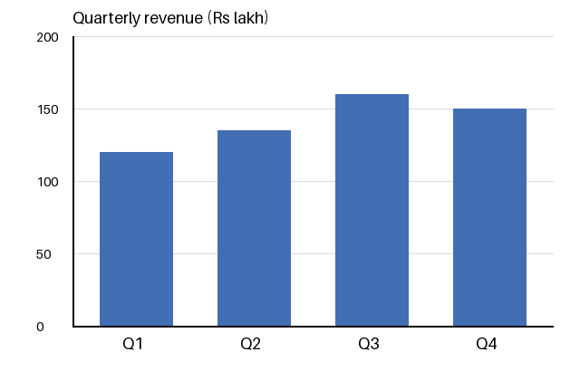

# Section 5 — Visual Reasoning, and Chart & Data QA

> **Where this fits:** Visual reasoning was **optional and skipped live**. "One of the things I did not cover is visual reasoning … it is becoming very, very important, also one of my research topics." Chart QA appears only in the application map and the recap table. This section is built from the **slides and pre-read**, with links to the other sections. It is still worth studying: the professor calls it "arguably the single largest capability gap left in this field".
> **Slides:** 48–60 (visual reasoning), 2 + 78 (chart QA) · **Pre-read:** Deep Dive 4
> **Runnable code:** [`code/s5_*.py`](code/). Real outputs from SmolVLM-256M on a generated chart and the lecture's motorcycle photo.

---

## 5.A — What visual reasoning is

**Definition:** **multi-step inference** that goes beyond surface recognition: **spatial relationships, counting, comparison, cause and effect**.

**How it differs from VQA:** the answer requires **combining multiple observations**, not reading one fact off the image.

| Basic VQA | Visual reasoning |
|---|---|
| "What colour is the car?" (one observation) | "Can the car fit through that gate?" (car width + gate width + comparison) |
| "Is there a sign?" | "Is it safe to park here?" (every sign + every marking + the rules → a decision) |

**Where it's used:** quality inspection, safety audits, complex diagram interpretation, comparative analysis.

---

## 5.B — Which model fits: the LLM backbone decides

- **Reasoning strength tracks the LLM backbone.** A stronger language model reasons better, **whatever vision encoder feeds it**.
- **LLaVA-style and Qwen-VL are both viable.** Qwen-VL has an edge when the reasoning must **reference a specific region**.
- **Rule of thumb:** *the vision encoder gets you the pixels; the LLM does the actual reasoning.*

> 💡 **Learning Thought:** This mirrors the finding in 3.E, in the other direction. There, a strong LLM **overpowering** weak visual evidence was the *problem* (hallucination). Here, a strong LLM is the *solution* (reasoning). Both follow from the same fact: in a LLaVA-style VLM the **LLM does most of the work**. Upgrading the LLM improves reasoning. Making it actually *use* the pixels is the harder part.

---

## 5.C — Prompting with chain-of-thought, and self-verification

1. **Decompose explicitly:** ask the model to list relevant observations *before* answering
2. **Pattern:** *"First identify every relevant object, then reason step by step to the answer."*
3. **Why:** intermediate reasoning becomes **auditable**, and errors are easier to catch than in a single confident jump

### Before and after (slide)
| Direct prompt | Chain-of-thought prompt |
|---|---|
| "Is it safe to park here?" | "First list every visible sign and marking, then decide if parking is allowed." |
| → high risk of a **confident but wrong yes/no** | → surfaces the evidence (**a visible "No Parking" sign**) *before* answering |

### Add a self-check pass
CoT alone isn't enough. Reasoning **can look rigorous while being wrong**. Add a verification step:

```
1. List every relevant observation.
2. Reason step by step to an answer.
3. Re-examine the image: does each observation you listed actually appear? Correct any that don't.
4. Give the final answer. If any required observation is uncertain, say so.
```

This is the notebook's counting prompt in general form ("After counting all instances, verify the count by reviewing the image again"; Section 6.D).

### 💻 Code: a real safety-rule check, direct vs CoT
[`code/s5_vlm_chart_and_reasoning.py`](code/s5_vlm_chart_and_reasoning.py) uses the lecture's motorcycle photo (Section 2.E). The rider wears a helmet. **The passenger doesn't.** In Karnataka, as across India, both riders must.
```python
ask(moto, "Are all the people on the motorcycle wearing helmets? Answer yes or no.")
ask(moto, "First, list each person on the motorcycle and say whether that person is wearing a helmet. "
          "Then answer: are all of them wearing helmets?")
```
```
DIRECT : Yes.
COT    : Yes, the first person on the motorcycle is wearing a helmet.
```
**Both are wrong, and the CoT output shows why.** The model listed only **one** person and never enumerated the passenger. Chain-of-thought can't reason about an object it never perceived. The "list every person" step was skipped, and nothing forced it. That's the 5.D pitfall "no self-check", seen for real. Mitigations that would catch it:
- **Count first, as a separate call:** "How many people are on the motorcycle?". If the answer is 2, require two entries in the list.
- **Structured output:** `[{"person": 1, "helmet": true}, {"person": 2, "helmet": ...}]`, validated so it has as many entries as the count.
- **A detector/SAM step** to find the people, then ask about each crop separately (the composition pattern from Section 0.I).
- **A stronger model.** Tiny models skip steps. Qwen2.5-VL-7B-class models follow enumeration instructions far more reliably, but you should still validate.

🌍 **Real deployments of this exact task:** traffic-enforcement cameras that flag helmetless riders, construction-site PPE monitoring, and factory safety audits. All of them decompose into **detect every person → check each person → aggregate**, not one yes/no question.

📚 **Go deeper:** [Chain-of-Thought prompting](https://arxiv.org/abs/2201.11903) · [Self-Consistency](https://arxiv.org/abs/2203.11171)

---

## 5.D — Pitfalls, and why it's hard

### Pitfalls
| Pitfall | Meaning |
|---|---|
| **Compounding errors** | One wrong intermediate observation carries through to a wrong final answer |
| **False confidence** | The steps *look* rigorous and are still wrong |
| **No self-check** | Without asking the model to verify its own steps, errors go unnoticed |

### Compounding errors, with numbers
If each reasoning step is independently right with probability p, a chain of n steps is fully right with probability pⁿ:

| Per-step accuracy | 1 step | 3 steps | 5 steps | 10 steps |
|---|---|---|---|---|
| 95% | 0.95 | 0.86 | **0.77** | 0.60 |
| 90% | 0.90 | 0.73 | **0.59** | 0.35 |

```python
for p in (0.95, 0.90):
    print(p, [round(p ** n, 2) for n in (1, 3, 5, 10)])      # code/s5_chains_and_charts.py
# 0.95 [0.95, 0.86, 0.77, 0.6]
# 0.9  [0.9, 0.73, 0.59, 0.35]
```

A model that's 90% right on each observation is right **only 59% of the time** on a 5-step problem. That's why multi-step reasoning is so much harder than single-fact VQA, and why **per-step verification** pays off: it raises p at each step, and the effect compounds.

### Why it's hard
- **Multi-step inference:** chaining several observations, not one perception step
- **Compounding errors** (above)
- **External knowledge:** physics, maths, domain expertise beyond what's visible
- **Hard to verify:** it's difficult to tell "*reasoned correctly*" from "*pattern-matched a similar training example*"

---

## 5.E — Datasets, training, performance, challenges

### Datasets
| Dataset | Scale | What it tests |
|---|---|---|
| **MMMU** | ~11.5K college-level questions | **Expert-level** multimodal reasoning across disciplines |
| **MathVista** | Math-focused | Visual perception + **mathematical** problem solving |
| **ScienceQA** | ~21K questions with diagrams | Grade- to high-school **science** reasoning |
| **NLVR2** | Image pairs | Compositional/relational reasoning **across two images** |
| **Winoground** | Compositional | Famously hard. **Near-random** for many models (e.g. telling "a mug in grass" from "grass in a mug") |

### How SOTA models are trained
- **Reasoning tracks the LLM backbone:** a strong reasoning LLM trained with CoT data transfers that strength once it's vision-grounded (the Lecture 1 point)
- **Explicit rationale data:** instruction tuning increasingly includes **step-by-step reasoning traces**, not just final answers
- **Reasoning-specific preference tuning:** RL-style optimisation for multimodal reasoning, **mirroring text-only reasoning LLMs**
- **Curriculum mixing:** general VQA + maths + science + diagram data combined during fine-tuning, not trained separately

### Performance
- **MMMU:** open models ~low-50s% in early 2024. Leading open and closed models reached the **low-to-mid 60s%** by mid-2024
- **MathVista:** similar, with leading models in the high 50s–60s%, **far below the human baseline**
- **Framing:** visual reasoning is among the **largest gaps**, both between open and closed models and between any model and human experts

### Remaining challenges
- **Multi-step arithmetic or geometric** reasoning grounded in an image is still unreliable
- **Knowing when they don't know:** confident wrong answers on hard questions
- **Counterfactual / hypothetical** visual reasoning ("what would happen if…")
- **Benchmark contamination:** some reported gains may be **memorisation**, not reasoning

📚 **Go deeper:** [MMMU](https://arxiv.org/abs/2311.16502) · [MathVista](https://arxiv.org/abs/2310.02255) · [ScienceQA, "Learn to Explain"](https://arxiv.org/abs/2209.09513) · [NLVR2](https://arxiv.org/abs/1811.00491) · [Winoground](https://arxiv.org/abs/2204.03162) (browse its examples; they make compositionality concrete)

---

## 5.F — Chart & Data QA

**Task:** read and reason over **charts and graphs**. **Model:** Qwen-VL / **high-resolution** LLaVA. **Strategy:** **extract values first, then reason, plus honesty about uncertainty.**

### Why charts need both document and image understanding
> ⚠️ **Trap (live Q&A):** *"Is reading graphs a combination of document and image understanding?"* **Yes. A chart needs both.**
> - The **image side** gives the **shape**: the trend, which bar is taller, where lines cross.
> - The **document side** gives the **text**: axis labels, tick values, legend, title (OCR-style reading).
>
> "Shape without labels has no meaning, and text without the visual relationship doesn't tell you what the data does." That's why chart QA needs **high resolution**, and why models **still struggle to read exact values off a plot**.

### The extract-then-reason pattern, worked
Here is a real chart, generated by [`code/s5_make_chart.py`](code/s5_make_chart.py) so the true values are known. Question: *"Which quarter had the largest growth over the previous quarter?"*



**Step 1: extract.** Force the model to write out the data table first. The gridlines are every 50, so only a bar that ends *on* a line can be read exactly:
| Quarter | Revenue (read from chart) | Confidence |
|---|---|---|
| Q1 | 120 | medium (between the 100 and 150 lines) |
| Q2 | 135 | medium (between lines) |
| Q3 | 160 | medium (just above 150) |
| Q4 | 150 | **high** (bar top sits on the 150 line) |

**Step 2: reason over the table** (now a text and arithmetic problem, best done in **code**):
Q2 − Q1 = +15 · Q3 − Q2 = **+25** · Q4 − Q3 = −10 → **Q3**

**Step 3: be honest about reading error.** Each growth is the difference of **two** readings, so a ±5 reading error becomes ±10 on the growth. Q3's growth could be as low as 15, and Q2's as high as 25. **The answer "Q3" is the best estimate but is not guaranteed.** An honest answer says: *"Most likely Q3 (+25), but Q2 (+15) is within reading error; exact values would settle it."*

### 💻 Code: steps 2 and 3 in plain Python
[`code/s5_chains_and_charts.py`](code/s5_chains_and_charts.py):
```python
extracted = {"Q1": 120, "Q2": 135, "Q3": 160, "Q4": 150}          # step 1 output from the VLM
qs = list(extracted)
growth = {qs[i]: extracted[qs[i]] - extracted[qs[i-1]] for i in range(1, len(qs))}
best = max(growth, key=growth.get)                                 # step 2: code does the maths
uncertainty = 5                                                    # step 3: +/-5 per reading
worst_best = growth[best] - 2 * uncertainty
rivals = {q: g + 2 * uncertainty for q, g in growth.items() if q != best}
print("robust?", all(worst_best > g for g in rivals.values()))
```
```
growth: {'Q2': 15, 'Q3': 25, 'Q4': -10} -> largest growth: Q3
Q3 growth could be as low as 15; rivals' best case: {'Q2': 25, 'Q4': 0}
answer robust to +/-5 reading error? False
```
*(My first draft of these notes claimed Q3 was safe. Running the robustness check showed it isn't, which is exactly why step 3 exists.)*

### 💻 Code: a real VLM, direct vs extract
[`code/s5_vlm_chart_and_reasoning.py`](code/s5_vlm_chart_and_reasoning.py) with SmolVLM-256M on the chart above:
```python
ask(chart, "Which quarter had the largest growth over the previous quarter?")
ask(chart, "Read the chart. List each quarter and its approximate value, one per line, like 'Q1: 100'.")
```
```
DIRECT : Q3.
EXTRACT: There are three quarters and their approximate values are as follows:
         - Q1: 100
         - Q2: 100
         - Q3: 150
```
This is the most important result in the section. The **direct answer is right**, but the extraction shows the model **misread every value and missed Q4 entirely**. A right answer built on a wrong reading is **luck**, and without step 1 you'd never know. Extract-then-reason doesn't just improve accuracy. It shows you **whether the model can read the chart at all**, which tells you whether to trust the answer.

Why this beats asking directly: (1) the extraction is **auditable**, so you can check the numbers against the chart; (2) the arithmetic is done on explicit numbers instead of "eyeballed"; (3) reading-precision uncertainty is **stated, not hidden**, which matters given 4.J's point that models don't flag low-confidence reads.

### Performance
ChartQA accuracy: **65.7** (Qwen-VL, 2023) → **83.0** (Qwen2-VL-7B, 2024) → **~89%+** (leading models, 2025). It is improving, but it's still well below DocVQA, because charts add a **visual estimation** step that text documents don't have.

🌍 **Real use:** analysts asking a copilot "which region grew fastest?" about a slide deck, finance teams pulling numbers from charts in annual reports, and dashboard screenshots in support tickets. In all of these, a confidently wrong number is worse than "I can't read that precisely".

📚 **Go deeper:** [ChartQA benchmark](https://arxiv.org/abs/2203.10244)

### In the hands-on lab
The document-understanding demo (Section 6.F) happened to pick a **"Financial Highlights" page with several bar charts**. Qwen2.5-VL-3B described what each chart showed (gross income, segment revenues, the X and Y axes, which year was highest) but **can't reproduce the chart itself**, because its decoder only outputs language. That's extraction without an explicit table. You'd add the extract-then-reason prompt above to get reliable numbers.

---

## ✅ Quick Check (from the deck; answers below)
1. What distinguishes visual reasoning from basic VQA?
2. What determines a model's reasoning strength?
3. Why does chain-of-thought help with reasoning tasks?
4. What's a risk specific to multi-step reasoning?
5. What's a good mitigation for reasoning errors?

<details><summary>Answers</summary>

1. It **requires combining multiple observations**, not reading one off the image
2. **Largely the underlying LLM backbone**
3. It **makes intermediate steps auditable**, catching errors earlier (it does **not** guarantee a correct answer)
4. **Compounding errors** from one wrong intermediate step
5. **Ask the model to verify its own intermediate steps**
</details>

---

## 🎯 Interview Questions

**Q1. For a safety-audit product ("does this factory photo violate any rule?"), how would you structure prompting?**
> Decompose: (1) list every relevant observation (PPE on each person, signage, obstructions, spills), each with a location; (2) check each observation against the explicit rule list, given in the prompt; (3) a self-verification pass (re-check that each observation is really in the image); (4) the final verdict with the cited evidence, plus "uncertain" where visibility is poor. Use a VLM with a strong LLM backbone, and Qwen-VL if you need region references. Send "uncertain" and violation cases to human review. Evaluate per-observation, not just the verdict.

**Q2. Why does reasoning ability depend on the LLM more than the vision encoder?**
> The encoder turns pixels into tokens once. All the multi-step inference (chaining, comparison, arithmetic, bringing in knowledge) happens in the LLM's layers. A stronger or CoT-trained LLM transfers its reasoning once vision-grounded. The encoder sets the ceiling on what can be *perceived*. The LLM decides what's done with it.

**Q3. Quantify why a 90%-per-step model fails on 5-step visual problems, and how you'd fix it.**
> Chain accuracy ≈ 0.9⁵ ≈ 0.59. Fixes: shorten chains by extracting structured observations first, verify each step (raising p per step compounds), use self-consistency across samples, and use tools for sub-steps the VLM is bad at (a detector for counting, code for arithmetic).

**Q4. How would you get reliable numbers from charts?**
> Use a high-resolution-capable model (Qwen-VL). Prompt extract-then-reason: first output a data table with per-value confidence, then compute over the table (ideally with code, not in-model arithmetic). Validate against printed labels when present, and state uncertainty for values estimated between gridlines. Charts need both OCR (labels, ticks) and visual estimation (bar heights), and the estimation is where errors come from.

**Q5. A new model jumps 8 points on MMMU. What makes you sceptical?**
> Contamination: public benchmarks leak into web-scale training data, so gains may be memorisation. Check on held-out or freshly made questions, look at gains on perturbed versions of benchmark items, and test whether its reasoning traces actually support its answers (the "verify the chain of thought" research direction).

---

## ✅ Self-check
- [ ] I can explain VQA vs visual reasoning with one example pair
- [ ] I can state "encoder = pixels, LLM = reasoning" and link it to 3.E
- [ ] I can write a CoT + self-verification prompt
- [ ] I can compute pⁿ chain accuracy and explain why verification compounds
- [ ] I can name 5 reasoning datasets and what each tests
- [ ] I can explain why charts need document + image understanding
- [ ] I can apply extract-then-reason to a chart question, including the ±2× reading-error check
- [ ] I can explain why a correct direct chart answer from SmolVLM was still untrustworthy
- [ ] I can explain why CoT failed the helmet check, and give two fixes that don't rely on prompt wording
