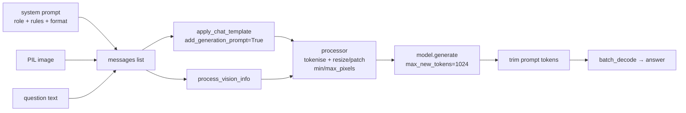

# Section 6 — Hands-On Lab: Captioning, CoT Counting and Document Intelligence with Qwen2.5-VL

> **Notebook:** [`../VLM_Applications_UpGrad_Tutorial_Week2_Qwen_Student_ver.ipynb`](../VLM_Applications_UpGrad_Tutorial_Week2_Qwen_Student_ver.ipynb) (Colab link in `…Colab-notebook-5th-Sept.pdf`)
> **Runtime:** Colab **T4 GPU** · **Model:** `Qwen/Qwen2.5-VL-3B-Instruct` · **Transcript:** 02:55 – 03:31
> **Focus:** **inference only.** The previous Saturday's session covered the inference basics, and this one builds on them with four task-specific system prompts.
> **No GPU?** [`code/vlm_small.py`](code/vlm_small.py) uses the **same chat-template → processor → generate → trim** pattern with SmolVLM-256M, which runs on a laptop CPU. Every Section 2–5 demo is built on it, so you can practise the notebook's workflow offline.



---

## 6.A — Setup and the pixel budget

```python
!pip install -q datasets
!pip install -q -U git+https://github.com/huggingface/trl.git bitsandbytes peft qwen-vl-utils

from transformers import Qwen2_5_VLForConditionalGeneration, AutoProcessor
from qwen_vl_utils import process_vision_info

model = Qwen2_5_VLForConditionalGeneration.from_pretrained(
    "Qwen/Qwen2.5-VL-3B-Instruct", dtype=torch.bfloat16,
    attn_implementation="sdpa", device_map="auto")

min_pixels = 256*28*28
max_pixels = 512*28*28
processor = AutoProcessor.from_pretrained(model_id, min_pixels=min_pixels, max_pixels=max_pixels, use_fast=True)
```

### Why these choices
| Choice | Reason |
|---|---|
| **3B**, not 7B/32B | Fits and loads reasonably on free Colab. The TA: with LLaVA-1.6-7B "it would take me more than 30 minutes to do the same thing" |
| **Instruct** variant | Instruction-tuned, so it **follows system-prompt roles**. Every task below depends on this |
| `qwen_vl_utils.process_vision_info` | Pulls images and videos out of the chat messages and prepares them for the processor |
| **Processor** | Wraps **the tokenizer** (text) **and the image processor** (resizing + patching) |

### Decoding `min_pixels` / `max_pixels`
Qwen2.5-VL cuts images into **14×14 patches** and merges each **2×2 group** into one token, so **one visual token = a 28×28 pixel area**. Hence the `×28×28`:

| Setting | Pixels | ≈ Square size | Visual tokens |
|---|---|---|---|
| `min_pixels = 256·28·28` | 200,704 | ~448 × 448 | **256** |
| `max_pixels = 512·28·28` | 401,408 | ~634 × 634 | **512** |

Every image is resized (keeping aspect ratio) to fit **between 256 and 512 visual tokens**. The TA: raising max_pixels (e.g. to 1024·28·28) "will take more time to process". That is the resolution-versus-cost trade-off from Section 4.C, controlled by one line.

> 💡 **Learning Thought:** `max_pixels` is a **resolution knob** for documents. At 512 tokens an A4 page is ~64 DPI (Section 4.C). If DocVQA answers look wrong, **turn this up** before changing the model.

---

## 6.B — Anatomy of `generate()`

The same function is used for every task. Only the message format changes.

```python
def generate(system_prompt, image):
    messages = format_message(system_prompt, image)          # 1. build chat messages
    text = processor.apply_chat_template(                    # 2. render to model's chat format
        messages, tokenize=False, add_generation_prompt=True)
    image_inputs, video_inputs = process_vision_info(messages)   # 3. extract visuals
    inputs = processor(text=[text], images=image_inputs,     # 4. tokenise text + patch image
                       videos=video_inputs, padding=True, return_tensors="pt").to(model.device)
    generated_ids = model.generate(**inputs, max_new_tokens=1024)   # 5. decode
    generated_ids_trimmed = [out[len(inp):] for inp, out in zip(inputs.input_ids, generated_ids)]  # 6. drop the prompt
    return processor.batch_decode(generated_ids_trimmed, skip_special_tokens=True)[0]
```

| Step | What's happening |
|---|---|
| 1 | Messages: `{"role": "system", "content": <task prompt>}` + `{"role": "user", "content": [{"type": "image", ...}, ({"type": "text", "text": question})]}` |
| 2 | `add_generation_prompt=True` appends the "assistant, your turn" marker so the model writes the reply rather than continuing the user turn |
| 4 | The image becomes 256–512 visual tokens inside the text sequence |
| 5 | No `do_sample` is passed, so it uses the model's default generation settings. `max_new_tokens=1024` limits length (long document transcriptions are slow because every token is generated one at a time) |
| 6 | `generate()` returns **prompt + answer**. Slicing off `len(input_ids)` keeps only the new tokens |

**The pattern the TA stressed: role-based prompting.** The system prompt tells the model *what it is* for this task: "You are an image captioning model", "…a multimodal visual reasoning assistant specialised in object counting", "…a document intelligence assistant specialised in OCR". Same weights, different job.

### 💻 The same pattern, CPU-sized ([`code/vlm_small.py`](code/vlm_small.py))
```python
MODEL = "HuggingFaceTB/SmolVLM-256M-Instruct"
proc = AutoProcessor.from_pretrained(MODEL)
model = AutoModelForImageTextToText.from_pretrained(MODEL, dtype=torch.float32).eval()

def ask(image, question, system=None, sample=False, max_new_tokens=60):
    msgs = []
    if system:
        msgs.append({"role": "system", "content": [{"type": "text", "text": system}]})
    msgs.append({"role": "user", "content": [{"type": "image"}, {"type": "text", "text": question}]})
    prompt = proc.apply_chat_template(msgs, add_generation_prompt=True)          # step 2
    inputs = proc(text=prompt, images=[image], return_tensors="pt")              # step 4
    ids = model.generate(**inputs, max_new_tokens=max_new_tokens, do_sample=sample,
                         temperature=0.8 if sample else None)                    # step 5
    return proc.batch_decode(ids[:, inputs["input_ids"].shape[1]:],              # step 6: trim the prompt
                             skip_special_tokens=True)[0].strip()
```
Steps 2, 4, 5 and 6 map one-to-one onto the notebook's `generate()`. SmolVLM's processor handles images directly, so there's no separate `process_vision_info` step. Swap `MODEL` for `Qwen/Qwen2.5-VL-3B-Instruct` on a GPU and the structure stays the same.

📚 **Go deeper:** [Qwen2.5-VL-3B-Instruct model card](https://huggingface.co/Qwen/Qwen2.5-VL-3B-Instruct) (official usage snippets, including `min_pixels`) · [Qwen2.5-VL GitHub](https://github.com/QwenLM/Qwen2.5-VL) · [HF guide: multimodal chat templates](https://huggingface.co/docs/transformers/main/en/chat_templating_multimodal) · [SmolVLM-256M model card](https://huggingface.co/HuggingFaceTB/SmolVLM-256M-Instruct)

---

## 6.C — Captioning (dataset: `dutta18/miniVQAv2DatasetForCollab`, 100 rows)

The dataset has three columns: `question`, `image`, `multiple_choice_answer` (verified by loading it with [`code/s3_peek_vqav2.py`](code/s3_peek_vqav2.py). The TA said "multiple answers", but this mini split keeps only the single most common human answer). Captioning uses only the image.

```text
You are an image captioning model. Your task is to generate a long and descriptive caption …
Describe the main subjects, their actions, the setting, and important visual details that are clearly visible.
Do not infer hidden information or add details that are not visually supported by the image.
```
The last line is the **hallucination guard** (Section 2.D).

### What happened live
| Image | Result |
|---|---|
| "Index 5" per the TA (described as an indoor scene) | ❌ *"In a snowy landscape, several people are engaging in winter activities…"* with snowboards. **Completely hallucinated** |
| Index 81 (city street, saved output in the notebook) | ✅ Crosswalk, red arrow, white car, **silver SUV**, red car, **traffic lights with one red**, glass skyscraper, billboards. "Exactly accurate" |

> 🔎 **Checked afterwards:** row **5** of `miniVQAv2DatasetForCollab` is actually the lecture's **Karnataka motorcycle-and-satellite-dish photo** (question: "What is she riding on?" → "motorcycle"), not an indoor scene. Either a different index was shown live or the TA misdescribed the image. The transcript can't settle it. Run `idx = 5` yourself: you'll be captioning the same photo the slides compared LLaVA-1.5, LLaVA-1.6 and Qwen-VL on (Section 2.E), which makes a good exercise.

The TA's conclusion: *"Even this instruction is not enough to completely zero out hallucination … since the model is pretty small, hallucination chances are higher."*

---

## 6.D — Chain-of-thought counting (dataset: `dutta18/Quantity-Reasoning-VQA-23K`, `val[:100]`, derived from **TDIUC**)

The system prompt is long and carefully built. It's worth studying as a template:

| Part | Content |
|---|---|
| **Role** | "multimodal visual reasoning assistant specialised in object counting" |
| **Method** | "Reason step by step … break the image into meaningful groups or regions and keep track of the objects already counted" |
| **Worked example** (1-shot) | "1. I see 2 blue apples on the left. 2. I see 3 oranges in the centre. 3. I see 4 bananas on the right. 4. Total = 2+3+4 = 9. Hence, the final answer is 9." |
| **Rules / guardrails** | Identify exactly what to count · avoid double counting · distinguish look-alikes · partially visible only if clearly identifiable · **verify the count by reviewing the image again** · don't infer objects not visible · **no external knowledge** · **if ambiguous, say so rather than guessing** |
| **Output format** | Numbered observations → "N. combine counts" → "Hence, the final answer is ⟨n⟩." |

This one prompt combines **CoT + few-shot + self-verification + abstention + a fixed format**, i.e. every technique from Sections 3.D and 5.C.

### What happened live
| Case | Question | Model output | Verdict |
|---|---|---|---|
| Index 17 (positive) | "How many hands are holding glasses?" | "I see two hands holding glasses… one hand is holding a glass, the other hand is holding another glass" → **2** | ✅ and **auditable** |
| Index 35 (positive, saved output) | zebras | "1. I see 3 zebras. 2. They are grazing… 3. No other animals visible. Therefore, the final answer is 3." | ✅ |
| Failure case | "How many people are in the photo?" (truth: **3**) | "There are **no people visible**… [then] they may show **a person operating a robotic device**… therefore the final answer is **0**" | ❌ The steps **contradict each other** and the answer is wrong |

Marked in the notebook: **failure cases 16, 27, 30** · **positive cases 17, 25, 35**.

> 💡 **Learning Thought:** The failure case shows **why CoT is useful even when it fails**. You can *see* the contradiction ("no people" / "a person operating…"). A bare "0" would have given no warning. CoT doesn't make the model right. It makes it **auditable** (the live quiz answer: "forces an auditable intermediate list"). The TA: "now you trust the model, because you see how it is thinking internally."

---

## 6.E — Document intelligence / DocVQA (dataset: `lmms-lab-encoder/DocVQA`, `test[:100]`)

```text
You are a document intelligence assistant specialized in OCR and document understanding.
… analyze the provided image of a document, extract its textual content using OCR, understand the
document's structure and semantics, and answer the user's question …
Perform the following steps internally:
1. Identify and read all relevant text (headings, paragraphs, tables, labels, numbers, dates …)
2. Understand the layout and structure (sections, rows, columns, tables)
3. Use the extracted text + visual structure to find the relevant information
4. Provide a clear, accurate, and detailed answer.
```

### What happened live
| Doc | Question | Answer | Verdict |
|---|---|---|---|
| Index 90 (saved output) | "What is the table number?" | "The table number is **4**." | ✅ (header reads "Table #4") |
| Index 12 | "What is the date when the approval form was filled?" | "…June 7, **1988**" | ⚠️ See below |

**The 1988 / 1998 moment.** The TA first read the form as "June 7, **1998**" while the model said "**1988**". Zooming in, they read "date filled is 1998 … June 7th, 1988 … so you're getting it right." The transcript doesn't settle which digit was actually printed. That is exactly the point: a one-digit year error is easy to miss **even for a human reviewing live**, and ANLS would score "1988" vs "1998" at **0.917** (Section 4.H). This is the **numerical-precision** pitfall happening in real time.

### What the prompt is missing
The TA described **guardrails** ("if the phone number isn't in the document, say *I couldn't find it* instead of hallucinating") as the technical term for telling the model what to do when something is missing. But **the notebook's `doc_system_prompt` doesn't include one**. Exercise 1 below adds it.

---

## 6.F — Document understanding: transcribe everything

A different prompt for **no question, just extract everything**: "describe all the information that is visibly present… perform OCR… present its contents in a clear, organised manner. Include all readable text, structure, tables (rows/columns/headers/cells), lists, forms, fields, visual relationships. **Preserve names, numbers, dates, quantities and monetary values accurately. Do not invent, infer, or assume** information not visibly present. **If text is unclear or unreadable, explicitly indicate that** rather than guessing."

### What happened live
| Doc | Result |
|---|---|
| Index 85 (memorandum, saved output) | Reconstructed **title, date (November 5, 1977), To (3 recipients), From, body, footer "/rab"**, plus a structure summary and "No tables, lists, forms…". Some parts were rendered in LaTeX-like formatting. Very close to a full transcription |
| Index 20 ("Financial Highlights", several bar charts) | Described each chart (gross income, segment revenues, axes, which year was highest). **It can't reproduce the chart**, because the decoder only outputs language (see the chart-QA link in Section 5.F) |

The TA's verdict: "Qwen has beautiful OCR capabilities, an established fact … in spite of being only a 3-billion model."

Also linked for comparison: `llava-hf/llava-v1.6-mistral-7b-hf` and `llava-hf/llava-v1.6-vicuna-13b-hf`.

---

## 6.G — Notebook bugs and gotchas ⚠️

These are real issues in the student notebook. Knowing them saves debugging time and makes a good interview story.

### 1. `thumbnail()` shrinks the image the model sees
```python
image.thumbnail((500, 700))      # captioning
cot_image.thumbnail((400, 400))  # counting
doc_image.thumbnail((400, 400))  # documents!
```
PIL's `thumbnail()` **resizes in place**. It was meant to make the *display* smaller, but the same object is then passed to `generate()`. A typical DocVQA page (~1700×2200) becomes **~309×400 ≈ 124K pixels**. That's below `min_pixels` (200,704), so the processor **upscales it again**. Detail is thrown away and then blurred back up. For OCR this directly contradicts "resolution is the biggest lever" (Section 4.I).

*(Token maths from [`code/s4_anls_resolution_tokens.py`](code/s4_anls_resolution_tokens.py): the 309×400 thumbnail is scaled back up to about 392×504 ≈ **252 visual tokens**, the minimum budget, filled with upscaled blur. Without the thumbnail the same page would get the full **~512**. See the legibility figure in Section 4.C.)*
**Fix:** make the thumbnail from a **copy** and pass the original to `generate()`. (`thumbnail()` returns `None`, so it can't be chained.)
```python
preview = doc_image.copy(); preview.thumbnail((400, 400)); display(preview)
generate(doc_system_prompt, doc_question, doc_image)   # full-resolution original
```

### 2. `generate` is redefined four times, and the last one ignores its argument
| Cell | Signature | Message builder |
|---|---|---|
| 18 | `generate(system_prompt, image)` | `format_message` |
| 29 | `generate(system_prompt, question, image)` | `format_message_cot_vqa` |
| 44 | `generate(system_prompt, question, image)` | `format_message_docvqa` |
| 55 | `generate(system_prompt, image)` | `format_message_doc_understanding(`**`doc_understanding_system_prompt`**`, image)`: **hard-coded global, ignores `system_prompt`** |

After running the whole notebook, if you **go back and re-run the captioning cell**, `generate(captioning_system_prompt, image)` calls the cell-55 version, which **silently uses the document prompt**. You get a "Document Description" instead of a caption, with no error.
**Fix:** give each function its own name (`generate_caption`, `generate_vqa`, …) and actually use the `system_prompt` parameter.

### 3. The markdown heading is wrong
"#### Import Qwen 2 VL 2B" but the code loads **Qwen2.5-VL-3B-Instruct**. The TA corrected this live: "It's not Qwen 2, it's Qwen 2.5, and it's not 2B, it's a 3-billion model."

### 4. `dataset['image'][idx]` decodes the whole column
`dataset['image']` materialises **all 100 images**, then indexes one. `dataset[idx]['image']` decodes just one. It doesn't matter at 100 rows but will at 100K.

### 5. bf16 on a T4
The T4 (Turing) has **no native bfloat16** tensor-core support, so `torch.float16` is usually faster on T4. bf16 is native on A100/L4.

### 6. The Hugging Face token
The instructor's copy used a personal HF token for faster downloads. In the student version "include your token". Without it the notebook still works, it just downloads more slowly. Use Colab **Secrets** (`HF_TOKEN`) and never paste a token into a shared cell.

> ⚠️ **Trap (live Q&A, from the previous session's LoRA notebook):**
> ```python
> target_modules=["q_proj", "v_proj", "v_proj", "o_proj"]
> ```
> *"Why does `v_proj` appear twice?"* It's a **typo**, and the duplicate is redundant. Don't automatically change it to `k_proj`, though. Which modules to target is a **design choice**: `["q_proj", "v_proj"]` (the classic LoRA setup) or `["q_proj", "k_proj", "v_proj", "o_proj"]` (all attention projections) are both valid. Check the assignment notebook and model docs.
>
> ⚠️ *"Can the QLoRA graded assignment run on an A100 instead of a T4?"* Yes, unless the instructions explicitly require a T4 for reproducibility. QLoRA isn't tied to T4, and A100 is faster with more headroom. Keep the model, package versions and training config the same.

---

## 6.H — Exercises (do these after the walkthrough)

**Ex 1: add the missing guardrail and test for hallucinated fields.**
Append to `doc_system_prompt`:
```text
If the information needed to answer is not visibly present in the document, reply exactly:
"NOT FOUND". Never guess or infer values such as phone numbers, dates, or amounts.
```
Ask a question the document can't answer ("What is the fax number?") on 10 documents, with and without the guardrail. Count invented answers.

**Ex 2: structured extraction with a JSON schema.**
Pick 5 DocVQA forms. Prompt: *"Respond ONLY with JSON: {"title": string, "date": "YYYY-MM-DD" or null, "organisation": string or null, "signatory": string or null}."* Parse with `json.loads`, count parse failures, and check each field by hand. (Section 4.D)

**Ex 3: the resolution experiment.**
Remove the `thumbnail` call before `generate`, then try `max_pixels` = 512·28·28 vs 1280·28·28 on the same 10 DocVQA questions. Record accuracy **and** latency. That is the Section 4.C trade-off measured.

**Ex 4: self-consistency on the failure cases (16, 27, 30).**
```python
model.generate(**inputs, max_new_tokens=512, do_sample=True, temperature=0.7)  # run K=5 times
```
Parse "the final answer is N" from each, take the majority, and see whether voting fixes any failures and whether low agreement flags them. (Section 3.D)

**Ex 5: presupposition test.**
On a VQAv2 image with no cat, ask "What colour is the cat?". Then add to the system prompt "If the question assumes something not in the image, say so." Compare. (Section 3.F)

**Ex 6: "Is it even looking?" (replicating 3.E).**
```python
from PIL import ImageFilter
blurred = image.filter(ImageFilter.GaussianBlur(25))
```
Caption the original and the blurred version. How much of the caption survives with no visual information? Whatever survives came from the language prior.

**Ex 7: model comparison.**
Run 5 captioning images through `llava-v1.6-mistral-7b-hf` (use an A100 or 4-bit loading). Compare hallucinations with Qwen2.5-VL-3B, as in the motorcycle comparison in Section 2.E.

---

## 🎯 Interview Questions

**Q1. Walk me through what happens between `messages` and the decoded answer in a Qwen-VL inference call.**
> The chat template renders system + user turns (with image placeholders) and, with add_generation_prompt, the assistant marker. process_vision_info pulls out the images. The processor resizes each image within the min/max pixel budget, patches it into 14×14 patches merged 2×2 (28 px per token), and tokenises the text. generate() decodes autoregressively up to max_new_tokens. The output contains the prompt, so you slice off len(input_ids) and batch_decode with special tokens skipped.

**Q2. Your DocVQA accuracy is poor on small print. What do you check first?**
> The effective resolution the model actually sees. Look for in-place thumbnails or resizes in preprocessing, then the processor's max_pixels. At 512 tokens an A4 page is ~64 DPI. Raise max_pixels, crop to the region of interest, or tile, and measure latency against accuracy. Only then consider a bigger model.

**Q3. Why did the counting CoT prompt still produce "no people … a person operating a robot … answer 0"?**
> A 3B model's perception failed and its reasoning contradicted itself. CoT doesn't fix perception. It makes the failure visible. Mitigations: self-consistency voting, a larger model, a detector for counting, and automatic consistency checks (flag when the steps mention objects but the final count is 0).

**Q4. What's a "guardrail" in a prompt, and give one for document QA.**
> An explicit instruction for what the model must not do, or what to do in the edge case, especially when information is missing. For document QA: "If the answer isn't visibly present, respond 'NOT FOUND'; never infer phone numbers, dates, or amounts." It turns hallucination into a detectable null.

---

## ✅ Self-check
- [ ] I can compute visual tokens from `min_pixels` / `max_pixels`
- [ ] I can explain each of the 6 steps of `generate()`
- [ ] I can name the parts of the CoT counting prompt and the technique each applies
- [ ] I can explain why `thumbnail()` quietly hurts OCR
- [ ] I can explain the `generate` shadowing bug and how it shows up
- [ ] I have run at least Exercises 1, 3 and 4
