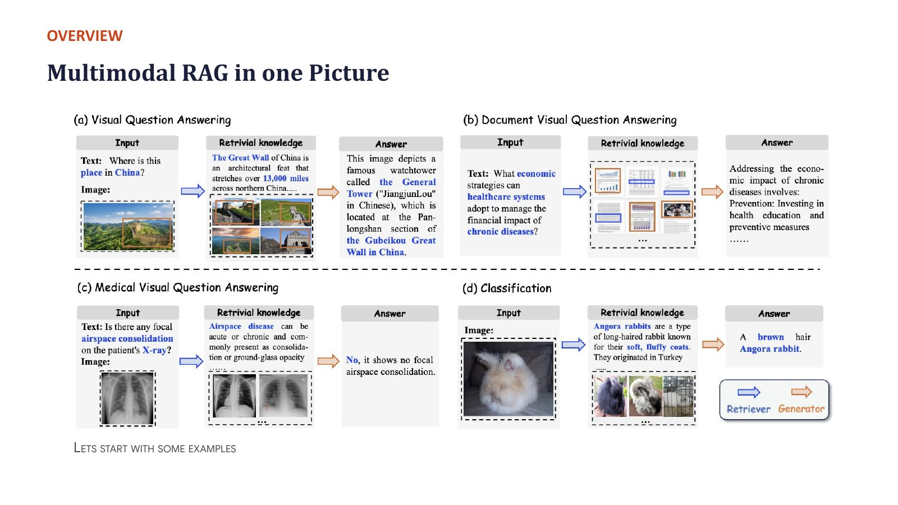
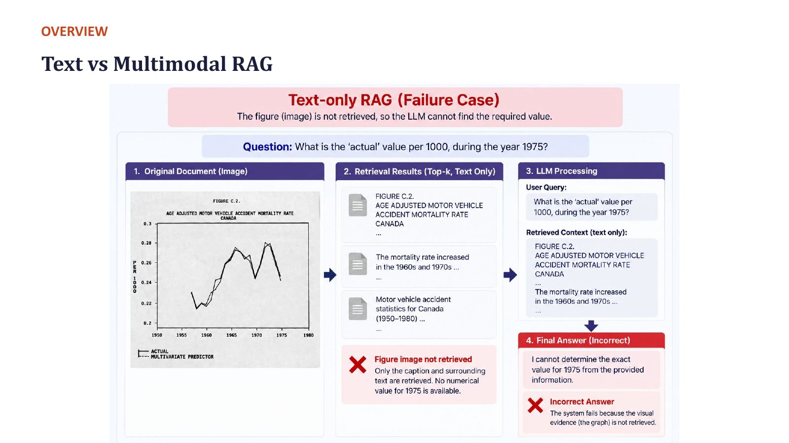
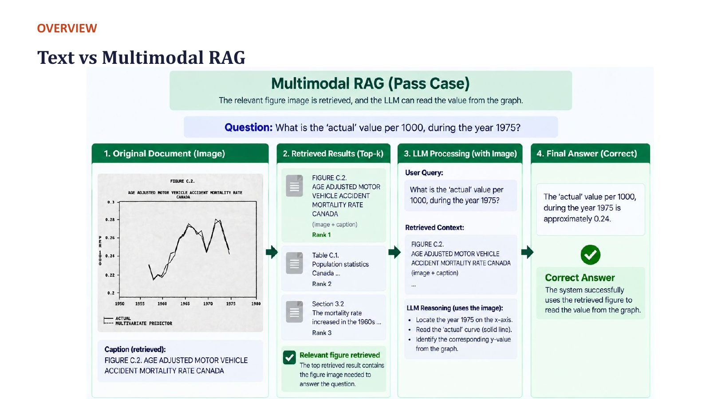
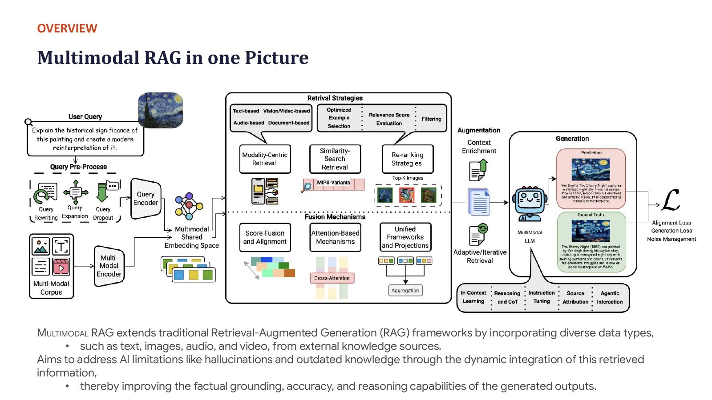

# Section 0 — Why Multimodal RAG? Motivation and the Big Picture

> **Where this fits:** Before any theory, the professor showed *why* text-only retrieval breaks on real content, then walked through one large architecture diagram that names every piece the rest of the lecture fills in. Treat this section as the **map**. Every later section zooms into one box on it.
> **Slides:** 1–2 (Overview, "Text vs Multimodal RAG", "Today's Landscape") · **Transcript:** 00:16:24 – 00:28:47

---

## 0.A — What multimodal RAG is

### Core idea
**RAG (Retrieval-Augmented Generation)** = *retrieve* relevant content for a query, then *generate* an answer **grounded** in that content, instead of relying only on what the model memorised during training.

**Multimodal RAG** extends this so that both the knowledge base and the retrieved evidence can be **text, images, tables, charts, audio, video, or whole document pages**.

From the slide:
> Multimodal RAG extends traditional RAG by incorporating diverse data types (text, images, audio, video) from external knowledge sources. It aims to address AI limitations like **hallucinations** and **outdated knowledge** by dynamically integrating the retrieved information, improving the **factual grounding, accuracy, and reasoning** of the generated outputs.

### The three tasks of the lecture

| Task | Core idea | Key technique |
|---|---|---|
| **Text search** | Find relevant text passages for a query | Dense embeddings + vector search |
| **Image search** | Find relevant images for a text or image query | Shared embedding space (CLIP-style) |
| **Multimodal RAG for QA** | Retrieve mixed text/visual content, then generate a grounded answer | Retrieval + generation over real documents |

### Build the intuition: the open-book exam
A plain LLM is a student taking a **closed-book exam**. It answers from memory, so it can be out of date, and when it doesn't know it may bluff confidently. RAG turns it into an **open-book exam**: before answering, the student looks up the relevant pages and answers *from them*, pointing to the page used. Multimodal RAG is an open-book exam where the book also has **charts, tables, photos and diagrams**, and the student is allowed to look at them, not just read the paragraphs.

```
PLAIN LLM (closed book)                 RAG (open book)
Question ─► LLM memory ─► answer        Question ─► search the library ─► relevant pages
            (frozen at training time)                         │
                                         Question + pages ─► LLM ─► answer + "see page 12"
```

**Real-world examples you have probably used:**
- **Perplexity / ChatGPT search / Google AI Overviews**: search the web (retrieve), then write an answer with citations (generate). That's text RAG.
- **Uploading a PDF to ChatGPT or Claude and asking about its charts**: retrieval over the pages, then a VLM reads the page images. That's multimodal RAG.
- **Google Lens "search what you see"**: an image as the query, retrieving products and web pages. That's the image-search half of this lecture.
- **Bank or insurance chatbots over policy PDFs**: the answer is often in a table of charges or a coverage chart, so text-only extraction misses it.

### Code: the smallest possible RAG loop (runs on CPU)
Every RAG system, however complex, reduces to this shape. Sections 1–8 improve each line.
```python
# pip install sentence-transformers
from sentence_transformers import SentenceTransformer
import numpy as np

knowledge = [  # the "library": in real systems, millions of chunks or pages
    "The 2023 Cricket World Cup was won by Australia.",
    "RAG combines a retriever with a generator.",
    "ColPali embeds document page images directly.",
]
enc = SentenceTransformer("sentence-transformers/all-MiniLM-L6-v2")
K = enc.encode(knowledge, normalize_embeddings=True)            # OFFLINE: index once

def retrieve(question, k=1):                                    # ONLINE: per question
    scores = K @ enc.encode(question, normalize_embeddings=True)
    return [knowledge[i] for i in np.argsort(-scores)[:k]]

question = "Who won the 2023 cricket world cup?"
context = retrieve(question)
prompt = (f"Answer ONLY from the context. If it is not there, say 'Not found'.\n"
          f"Context: {context}\nQuestion: {question}")
print(prompt)            # send this prompt to any LLM/VLM; that call is the "generation" half
```
The model's weights never needed the 2023 result. Knowledge lives in `knowledge`, which you can edit at any time. That is the "non-parametric memory" idea in 0.D.

> 📚 **Go deeper**
> - The original RAG paper, Lewis et al. 2020: https://arxiv.org/abs/2005.11401
> - The survey this lecture's diagrams come from, *Ask in Any Modality* (Abootorabi et al., 2025): https://arxiv.org/abs/2502.08826
> - Hands-on: Hugging Face cookbook, *Multimodal RAG using document retrieval and VLMs*: https://huggingface.co/learn/cookbook/en/multimodal_rag_using_document_retrieval_and_vlms
> - Short course: DeepLearning.AI, *Building Multimodal Search and RAG*: https://www.deeplearning.ai/short-courses/building-multimodal-search-and-rag/

> 💡 **Learning Thought:** RAG splits one hard problem ("know everything") into two easier ones: **find** (retrieval) and **read** (generation). Every failure you will ever debug in a RAG system is in one half or the other, or in the handoff between them. Keep that split in mind throughout the lecture.

---

## 0.B — Four real-world examples: where the knowledge is split across modalities

The professor opened with four cases from the multimodal-RAG survey (Abootorabi et al., 2025). Each shows a different reason text-only retrieval fails.


*Slide: each panel reads Input → Retrieval knowledge → Answer. The retrieved knowledge mixes a text snippet and an image. That mix is the whole point.*

| # | Query | What must be retrieved | Why text alone fails |
|---|---|---|---|
| 1 | *"Where is this place in China?"* (image with a bounding box) | A caption **and** a similar image, e.g. a book passage about the Great Wall with a matching photo | The answer is split: the *image* identifies the structure and the *text* names it. You need both. |
| 2 | *"What economic strategies can healthcare systems adopt?"* (document VQA) | Healthcare text, a table on financial impact, plots, charts and captions from **many places** | You have to **connect the dots** across modalities and pages |
| 3 | *"Is there focal airspace consolidation on the patient's X-ray?"* (medical) | Similar X-ray images from a medical textbook plus the text describing airspace disease | Training one classifier per finding doesn't scale ("how many classifiers would you learn?"). Retrieving similar labelled cases does. |
| 4 | *"What type of rabbit is this?"* (fine-grained) | Reference knowledge on breeds, e.g. *angora rabbit, soft fluffy coat…* | Fine-grained species form an **open set**. When a new species is discovered, you can't retrain a closed-set classifier, but you **can add a document** to the knowledge base. |

### Each example, unpacked with a real-world analogue
1. **"Where is this place in China?"** Neither the photo alone (it's just a long wall on hills) nor a text search ("famous wall China") is enough. A traveller's photo app (Google Photos' landmark detection, Google Lens) does the same thing: match the photo to **reference photos** that carry **names**, then read the name from the text attached to the match.
2. **Health-economics document VQA.** Picture a policy analyst asking a question over a 200-page WHO report. The answer is spread over a paragraph (the strategy), a table (costs) and a chart (trend). No single chunk answers it, so the system must retrieve **several** pieces from different modalities and **combine** them. This is the multi-hop problem again in Section 6.D.
3. **Medical X-ray.** Hospitals store millions of labelled scans in PACS archives. Training one classifier per finding ("focal consolidation", "pleural effusion", …) means hundreds of models, each needing labelled data. Retrieval-based diagnosis support instead finds the **most similar past scans** plus their **radiology reports** and textbook passages, and lets a VLM compare them. This is the idea behind systems like MMed-RAG (Section 7.A).
4. **"What type of rabbit?"** Think of iNaturalist or a plant-ID app. New species and local breeds keep appearing, so no closed label set is ever complete. Retrieval over a **reference library** (images + descriptions) handles any entry in the library, including ones added yesterday.
 Retrieval turns a **closed-set** model into an **open-set** system. Knowledge lives in an index you can edit instead of in weights you must retrain. That is also why RAG handles "outdated knowledge" (0.D): updating the index is cheap and retraining is not.

---

## 0.C — Text-only RAG vs multimodal RAG: the "1975" chart

**Query:** *"What is the actual value per 1000 during the year 1975?"*

The answer sits in a **line chart** inside a document.

```
TEXT-ONLY RAG                                 MULTIMODAL RAG
Query ─► retrieve text only                   Query ─► retrieve text AND the chart image
        (caption, nearby paragraphs)                  (ranked top-k: #1 chart page, #2…, #3…)
      ─► LLM sees "Figure 3: actual vs               ─► VLM reads the plotted line at x = 1975
         expected rate, 1960–1990"
      ─► ✗ cannot read the value                     ─► ✓ ≈ 0.24 per 1000
```

The caption *describes* the chart but doesn't *contain* the number. If the image isn't retrieved, **no generator can recover the answer.**


*Slide "Text vs Multimodal RAG (Failure Case)": the retriever returns only the caption and nearby text ("FIGURE C.2 Age-adjusted motor vehicle accident mortality rate, Canada…"). The LLM correctly says it cannot determine the 1975 value. That's an honest abstention, but still a failure.*


*Slide "(Pass Case)": the figure image is retrieved as rank 1 (image + caption). The VLM locates 1975 on the x-axis, reads the "actual" line, and answers ≈ 0.24. Correct.*

### Why this happens: what each system actually "sees"
```python
# What a text-only pipeline hands the LLM for this page (OCR + caption):
text_only_context = """FIGURE C.2 Age-adjusted motor vehicle accident mortality rate, Canada.
Actual vs predicted, 1950-1990. Rate per 1000."""
# ...and the chart's y-values are NOT in the text: OCR sees tick labels ("0.1 0.2 0.3")
# but never the position of the line at x = 1975.

# What a multimodal pipeline hands the VLM:
multimodal_context = [
    {"type": "image", "image": "page_37.png"},   # the pixels: the line is visible
    {"type": "text",  "text": text_only_context},
]
# A VLM can map x=1975 → the curve → the y-axis ≈ 0.24. No text representation contained that fact.
```

**Real-world parallel:** asking a text-only chatbot "which month had the highest sales?" about a PowerPoint export. The text layer holds titles and axis labels, but the bar heights exist only as drawn shapes.

> 🔗 **Notebook link:** this exact question is the first entry in the lab's `DEMO_QUERIES` (ground truth *"Approximately 0.24 per 1000"*). See Section 8. It is a good test of whether your pipeline actually "sees" charts.

> 💡 **Learning Thought:** *"Querying a document requires you to retrieve those parts of the document which actually have the answer."* The unit you retrieve has to **contain** the evidence, not just be *about* it. This idea comes back later as the ViDoRe benchmark's design principle and as the "topically relevant but doesn't answer" evaluation problem.

---

## 0.D — Why RAG at all: hallucination, stale knowledge, parametric vs non-parametric memory

### Two limitations of a plain LLM/VLM
1. **Outdated knowledge.** A model trained on 2012–2014 data, asked "Who is the President of the USA?", confidently says Obama. The same goes for "who won the World Cup / Davis Cup". The weights are frozen at the training cutoff.
2. **Hallucination.** Even for facts it has seen, the model generates what is *statistically plausible*, which is not always *true*. The professor's example from the RAG paper: *"Barack Obama was born in Hawaii"* is a claim you should **fact-check against public documents**, not "depend on some probabilistic parametric knowledge".

### Parametric vs non-parametric memory

| | Parametric memory | Non-parametric memory |
|---|---|---|
| Where knowledge lives | Model **weights** | An external **index** of documents |
| How you update it | Retrain or fine-tune (expensive) | Add, edit or delete documents (cheap) |
| Can it cite a source? | No | Yes, the retrieved document |
| Failure mode | Hallucination, staleness | Retrieval misses, irrelevant context |

RAG = **parametric generator + non-parametric retriever**.

### Real-world example: the knowledge cutoff
A model with training data up to 2023, asked in 2026 "what's the latest iPhone?", names whatever was latest in 2023, **confidently**. The model isn't lying. Its weights simply hold nothing newer, and it's trained to always produce a fluent answer. A RAG system searches a current product catalogue first, so the answer follows **today's** data. Update the catalogue and the answer changes, with no retraining.

### Code: updating knowledge = editing the index, not the weights
```python
# Continuing the mini-RAG from 0.A:
knowledge.append("As of 2026, the newest iPhone model is the iPhone 18.")  # hypothetical new fact
K = enc.encode(knowledge, normalize_embeddings=True)                    # re-index: seconds, not GPU-weeks
print(retrieve("What is the newest iPhone?"))
# Deleting a wrong or outdated fact is equally easy: remove it and re-index.
# Removing a fact from model WEIGHTS ("machine unlearning") is an open research problem.
```

> 📚 **Go deeper**
> - Why LLMs hallucinate, with a taxonomy and mitigations: *A Survey on Hallucination in LLMs* (Huang et al., 2023): https://arxiv.org/abs/2311.05232
> - REALM, which introduced the "retrieval as non-parametric memory" pretraining idea: https://arxiv.org/abs/2002.08909

> ⚠️ **Trap (live Q&A):** *"What is the meaning of non-parametric?"* Non-parametric means the method does **not assume a fixed number or form of parameters** for the data. Nearest-neighbour retrieval is non-parametric: it **looks up stored examples** instead of compressing them into learned weights. The retriever's *encoder* still has parameters. What is non-parametric is the **memory**: the index grows with the data.

---

## 0.E — The end-to-end architecture map

The professor walked through one large diagram (from the survey) and said *"you do not need to think too much about it"*. The point is to **name the main parts**:

```
                ┌───────────────────── OFFLINE (indexing) ─────────────────────┐
 Knowledge:     │ text · images · documents · videos                           │
                │        │                                                     │
                │        ▼                                                     │
                │  Multimodal encoder ──► shared embedding space (e.g. CLIP)   │
                │                         or captions→text, or separate spaces │
                │        │                                                     │
                │        ▼                                                     │
                │  Vector index / vector database                              │
                └──────────────────────────────────────────────────────────────┘
                ┌───────────────────── ONLINE (querying) ──────────────────────┐
 User query ──► │ Query processing (rewriting, expansion)                      │
                │        │                                                     │
                │        ▼                                                     │
                │ RETRIEVAL STRATEGY                                           │
                │   • unimodal (text→text, image→image) or cross-modal         │
                │   • similarity search over millions of items (ANN)           │
                │   • RE-RANKING (the first-pass retrieval can be "blind")     │
                │        │  top-k items                                        │
                │        ▼                                                     │
                │ GENERATION (VLM / LLM)                                       │
                │   • in-context learning: put top-k in the prompt             │
                │   • reasoning / CoT, iterative refinement over each doc      │
                │   • instruction tuning, source attribution                   │
                │   • agentic: one agent per document ─► central agent collates│
                └──────────────────────────────────────────────────────────────┘
                         │
                         ▼
                   Grounded answer (+ citations)
```


*Slide "Multimodal RAG in one Picture". Read it left to right. **Query pre-processing** (rewriting, expansion, decomposition) → **multimodal encoder / shared embedding space** → **retrieval strategies** (modality-centric retrieval, similarity search, re-ranking) → **fusion mechanisms** (score fusion, attention-based, unified frameworks) → **augmentation** (context enrichment, adaptive/iterative retrieval) → **generation** (in-context learning, reasoning, instruction tuning, source attribution, agentic) → trained with alignment + generation losses. Don't memorise the boxes. Use the table below as your map.*

The four pieces the professor listed are **(1) query encoder, (2) multimodal encoder, (3) retrieval strategy, (4) generation**. The rest of the lecture follows that order:

| Map box | Where it is covered |
|---|---|
| Encoders and shared spaces | Section 1 (text), Section 3 (image), Section 4.E (storage designs) |
| Similarity search at scale | Section 1.E (FAISS, HNSW) |
| Re-ranking and late interaction | Sections 1.D and 2.E–G |
| Document retrieval in vision space | Sections 4 and 5 (ColPali) |
| Generation, citation, agents | Sections 6 and 7 |

### Retrieval routes in multimodal RAG
- **Purely text-based:** turn images and videos into **captions**, then use ordinary text search. Familiar and simple, but only as good as the captions (Section 3.B).
- **Purely vision-based:** image→image search.
- **Cross-modal:** text→image or image→text. The professor called this the part *"we are not familiar with"*, and it is where most of the new difficulty lies.

### What "query processing / rewriting" means in practice
A user types `"revenue q3 vs last yr?? chart"`. Before retrieval, a small LLM can rewrite it into a clean, retrievable form, e.g. `"Q3 2024 revenue compared with Q3 2023 (bar chart)"`, and optionally **expand** it into several variants ("third-quarter sales", "quarterly revenue growth"). Each variant is searched, and the results are fused (RRF, Section 8.G). This is cheap and often gives a large recall gain on messy real queries.

### Code: the architecture as a skeleton you can grow
Each method maps to one box on the diagram. Later sections swap in real components.
```python
from dataclasses import dataclass, field

@dataclass
class MultimodalRAG:
    index: list = field(default_factory=list)          # vector store: (vector, metadata)

    # ---------- OFFLINE ----------
    def ingest(self, item, modality):                   # text chunk | image | page | video clip
        vec = self.encode(item, modality)               # Section 1 (text), 3 (image), 5 (page: ColPali)
        self.index.append((vec, {"item": item, "modality": modality}))

    # ---------- ONLINE -----------
    def answer(self, query):
        q = self.rewrite(query)                         # query processing (rewriting / expansion)
        candidates = self.search(q, k=50)               # ANN similarity search (Section 1.E)
        top = self.rerank(q, candidates)[:5]            # re-ranking (Sections 1.D, 2.G)
        return self.generate(q, top)                    # grounded, cited answer (Section 6)

    # Placeholders you fill in as you study each section:
    def encode(self, item, modality): ...
    def rewrite(self, query): return query
    def search(self, q, k): ...
    def rerank(self, q, cands): return cands
    def generate(self, q, evidence): ...
```

> 📚 **Go deeper**
> - Survey figure source and taxonomy: https://arxiv.org/abs/2502.08826 (Sections 3–6 follow this diagram box by box)
> - How production systems add context to chunks before embedding: Anthropic, *Contextual Retrieval*: https://www.anthropic.com/news/contextual-retrieval

> 💡 **Learning Thought:** The agentic variant (one LLM per retrieved document, then a central aggregator) is **map-reduce over evidence**. It avoids stuffing all top-k documents into one context window, and each document gets focused attention. The cost is k+1 model calls, and the aggregator can still miss cross-document links.

---

## 0.F — Why retrieval needs reasoning: abductive retrieval

This was one of the professor's more unusual points. **Retrieval is not always a lookup. Sometimes it is inference.**

### Three kinds of reasoning (P ∧ Q ⇒ R)

| Mode | Given | Find | Example |
|---|---|---|---|
| **Deduction** | P, Q | R | *All men are mortal* (P) + *Socrates is a man* (Q) ⇒ *Socrates is mortal* (R) |
| **Abduction** | P, R | the **most plausible Q** | Given *all men are mortal* and *Socrates is mortal*, retrieve the missing link: *Socrates is a man* |

In abductive retrieval, the document you need is the **missing premise**. Look at the keyword overlap between the query (*"all men are mortal … Socrates is mortal"*) and the needed document (*"Socrates is a man"*). The only shared words are "man/men" and "Socrates". The document is essential to the reasoning, yet it is **lexically weak** and may not even be **semantically close** to the query.

### The consequence: re-ranking
First-pass retrieval "may be very blind". The query alone may not carry enough signal to rank the right document first. So production systems **retrieve broadly, then re-rank** based on what the query actually *needs*.

### A related pattern: answer-conditioned retrieval (fact verification)
From later in the transcript (01:24): for a claim like *"India will support Russia in the war"*, the system:
1. Forms candidate answers (**true** / **false**)
2. Retrieves using **query + candidate answer**, pulling both **supporting** and **refuting** documents
3. Weighs the two sets to reach a verdict

In ordinary RAG you retrieve with the **query only**. In fact verification you also **condition on a hypothesised answer**.

### A real-world example of abductive retrieval
A support engineer asks: *"The payment service returns 502s. Our config says timeouts are 30 s. Why?"* The document that explains it is a changelog line: *"Load-balancer idle timeout reduced to 10 s in release 4.2."* That line never mentions "payment" or "502". It is the **missing premise** that connects the facts, not a paraphrase of the question. Good engineers find it by **reasoning about what would explain** the symptom, then searching for that. RAG systems need the same step (query rewriting, multi-hop or agentic retrieval).

### Code: watch keyword retrieval pick the wrong premise
```python
# pip install rank_bm25 sentence-transformers
from rank_bm25 import BM25Okapi
from sentence_transformers import SentenceTransformer
import numpy as np

corpus = ["Socrates is a man.",                                   # the missing premise we NEED
          "Mortality rates in ancient Athens were high during the plague.",
          "Socrates was a Greek philosopher who taught Plato.",
          "Every mortal creature eventually dies."]
query = "All men are mortal. Why is Socrates mortal?"

bm25 = BM25Okapi([c.lower().strip(".").split() for c in corpus])
enc = SentenceTransformer("sentence-transformers/all-MiniLM-L6-v2")
dense = enc.encode(corpus, normalize_embeddings=True) @ enc.encode(query, normalize_embeddings=True)
for name, s in [("BM25", bm25.get_scores(query.lower().replace("?", "").replace(".", "").split())),
                ("Dense", dense)]:
    order = np.argsort(-s)
    print(f"{name:5s}:", [(corpus[i][:28], round(float(s[i]), 2)) for i in order])
```
Actual output:
```
BM25 : [('Every mortal creature eventu', 1.92), ('Socrates is a man.', 1.04), ('Mortality rates in ancient A', 0.0), ('Socrates was a Greek philoso', 0.0)]
Dense: [('Socrates is a man.', 0.73), ('Socrates was a Greek philoso', 0.52), ('Every mortal creature eventu', 0.5), ('Mortality rates in ancient A', 0.35)]
```
BM25 puts the generic "mortal" sentence **above** the premise we need, because it matches the word "mortal". The dense model gets it right on this 4-sentence corpus. In a real corpus with thousands of "Socrates …" sentences, the premise has to beat many semantically similar distractors, which is why **re-ranking with a reasoning-capable model** is added on top.

> 📚 **Go deeper**
> - Abductive reasoning, the concept: https://en.wikipedia.org/wiki/Abductive_reasoning
> - Retrieval that decides when and what to retrieve (a step toward reasoning-driven retrieval): Self-RAG: https://arxiv.org/abs/2310.11511

> 💡 **Learning Thought:** Similarity search finds documents that *look like* the query. Reasoning often needs documents that *complete* the query. That gap is why re-rankers, query rewriting, multi-hop retrieval and agentic retrieval exist. When a RAG system fails on "why" questions, suspect this first.

---

## 0.G — Roadmap and the "delta" framing

| Block | Content | Time planned |
|---|---|---|
| Session 1 | Text search → image search | 40 min |
| Quiz & review | Group review | 10 min |
| Break | — | 10 min |
| Session 2 | Multimodal RAG for QA (ColPali deep dive) | 80 min |
| Hands-on lab | Build a query, choose a strategy, ground an answer | 30 min |
| Q&A & wrap-up | — | 10 min |

The professor's framing, repeated several times: *"Multimodal RAG is just a delta on top of text search and image search."* And about ColPali: *"these architectures are introduced so you understand **what challenges people are solving**… so that when you choose the next base model, you choose based on who employs that idea."*

### The "delta" framing as a picture
```
TEXT SEARCH ──(swap text encoder for an image encoder, same space)──► IMAGE SEARCH
     │                                                                   │
     └──(add a generator that reads what was found)──► TEXT RAG          │
                                                          │              │
            (the retrieval unit becomes a whole PAGE IMAGE; late interaction) ◄──┘
                                                          ▼
                                                  MULTIMODAL (DOCUMENT) RAG
```
Each arrow is one new idea. If one section feels hard, go back to the arrow before it.

> 💡 **Learning Thought:** Study the architectures as **answers to specific problems**, not as things to memorise. Ask of each one: *which failure of the previous approach does this fix, and what does it cost?* That habit turns a list of model names into judgement you can use.

---

## ✅ Quick Check (self-made; the deck has no quiz for the overview)
1. Name the two LLM limitations RAG is designed to address.
2. Why does text-only RAG fail on *"What is the actual value per 1000 in 1975?"*
3. Why does retrieval help with fine-grained, open-set recognition (the rabbit example)?
4. In abductive retrieval, given P and R, what do you retrieve?
5. What is the difference between ordinary RAG retrieval and fact-verification retrieval?

<details><summary>Answers</summary>

1. **Hallucination** and **outdated knowledge**
2. The number is only in the **chart image**. The caption and text describe the chart but don't contain the value.
3. New categories can be handled by **adding documents to the index** instead of retraining a closed-set classifier.
4. The **most plausible missing premise Q** such that P ∧ Q ⇒ R
5. Fact verification retrieves using **query + a candidate answer**, collecting both supporting and refuting evidence. Ordinary RAG retrieves with the query alone.
</details>

---

## 🎯 Interview Questions

**Q1. What problem does RAG solve that fine-tuning doesn't?**
> Fine-tuning puts knowledge into **weights**. It is expensive to update, can't cite a source, and still hallucinates. RAG keeps knowledge in an **external index** (non-parametric memory). Updates are cheap, since you add or delete documents. Answers can be **cited and verified**. Freshness is limited only by how fast you can re-index. Fine-tuning is still the right tool for **behaviour** (format, tone, domain vocabulary, task skill). RAG is the right tool for **facts that change or must be traceable**.

**Q2. Why isn't text-only RAG enough for enterprise documents?**
> Enterprise documents such as financial reports, manuals and medical records carry key facts in **charts, tables, diagrams and layout**. A text-only pipeline keeps only extracted text, so the number in a bar chart or the spatial relation in a diagram is lost. The system retrieves text that is *about* the answer but doesn't *contain* it. Multimodal RAG retrieves the visual evidence itself, so a VLM can read it.

**Q3. Walk me through the components of a multimodal RAG system.**
> **Offline:** ingest the multimodal corpus → encode it (a shared CLIP-style space, captions-to-text, or per-modality encoders) → store the vectors in an ANN index. **Online:** process or rewrite the query → encode it → retrieve (unimodal or cross-modal) → **re-rank** → pass the top-k evidence to a VLM/LLM → generate a **grounded, cited** answer, with abstention when the evidence is missing. Optional: agentic variants (one agent per document, then an aggregator) and iterative or multi-hop retrieval.

**Q4. Give an example where semantic similarity search retrieves the wrong thing even with a perfect embedding model.**
> Abductive or multi-hop questions. The needed document is a **missing premise**, not a paraphrase of the query. For example, answering *why* Socrates is mortal needs *"Socrates is a man"*, which shares little with the query. Other cases: a document that *refutes* a claim is semantically close to the claim but has the opposite meaning, and negation in general. Fixes: query rewriting, re-ranking with a cross-encoder, multi-hop or agentic retrieval, and answer-conditioned retrieval.

**Q5. How does RAG turn a closed-set problem into an open-set one?**
> A classifier can only output labels seen in training. A retrieval system compares the input with reference items in an index and returns whatever is most similar, including items added after training. A new species, product or medical finding needs a **new index entry, not a new model**.

---

## ✅ Self-check
- [ ] I can define RAG and multimodal RAG in one sentence each
- [ ] I can explain the four motivating examples and what each shows
- [ ] I can explain the "1975 chart" failure of text-only RAG
- [ ] I can contrast parametric and non-parametric memory
- [ ] I can sketch the offline/online architecture from memory and label the 4 main pieces
- [ ] I can explain abductive retrieval and why it motivates re-ranking
- [ ] I can say what "multimodal RAG is a delta" means
