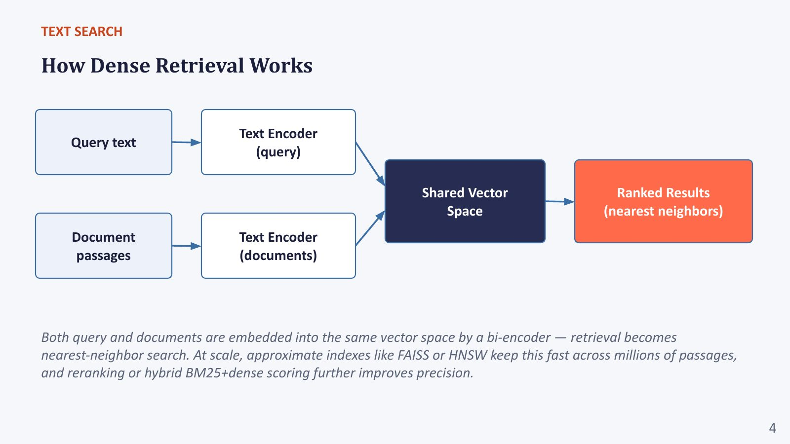

# Section 1 — Text Search: From Keywords to Dense Retrieval

> **Where this fits:** Text search is *"the first half of every RAG pipeline"*. The professor spent more time here than planned, because everything later (image search, ColPali) reuses these ideas: *"everything else is just using these things."* Once embed → index → nearest-neighbour is solid, image search and multimodal RAG are small deltas.
> **Slides:** 3–7 (+ quiz 8–10) · **Transcript:** 00:28:47 – 00:39:01 and 00:48:48 – 00:52:07

---

## 1.A — What text search is, and the unit of retrieval

### Core idea
> Given a **query** (a piece of text), find the most relevant **passages** from a large corpus.

This field is **Information Retrieval (IR)**, which is decades older than LLMs. Two things set it apart from generation:
- The output is a **ranked list of existing text**, not newly written text. (This was quiz Q1.)
- Quality is about **ranking**: the best evidence should come first.

### The unit of retrieval is a design choice
*"What is the unit of retrieval? That is also something to be defined by the modeller."* It can be a **sentence**, a **passage/chunk**, a **page**, or a **whole document** (Google web search returns documents). The choice drives **chunking** (1.H, and Section 4.G). Later, ColPali's answer is: **the page**.

### Real-world example: the same corpus, three retrieval units
An HR policy handbook (80 pages). Question: *"How many casual leaves do I get per year?"*
| Unit | What gets returned | Problem |
|---|---|---|
| Whole document | "HR_Handbook_2025.pdf" | Correct but useless: the user still has to read 80 pages |
| Page | Page 23 (Leave policy) | Good for citation; a VLM can read the page's leave table |
| Sentence | "Employees are entitled to 12 days." | Which leave type? The table header "Casual leave" sits in a different sentence |

### Code: the unit is just how you split before indexing
```python
import re
doc = """Leave policy. Casual leave: employees are entitled to 12 days per year.
Sick leave: 10 days per year, requires a medical certificate after 2 days.

Travel policy. Economy class for flights under 4 hours."""

by_paragraph = [p.strip() for p in doc.split("\n\n") if p.strip()]
by_sentence  = [s.strip() for s in re.split(r"(?<=[.!?])\s+", doc) if s.strip()]
print(len(by_paragraph), "paragraph units;", len(by_sentence), "sentence units")
print(by_sentence[2])   # "Sick leave: 10 days per year, requires..." fine alone
print(by_sentence[1])   # "Casual leave: employees are entitled to 12 days per year." fine alone
# but "Economy class for flights under 4 hours." lost the "Travel policy" heading.
# A common fix: prefix each chunk with its heading, e.g. "[Travel policy] Economy class ..."
```

> 📚 **Go deeper**
> - The classic IR textbook, free online: Manning, Raghavan & Schütze, *Introduction to Information Retrieval*: https://nlp.stanford.edu/IR-book/
> - Adding document context to each chunk before embedding: https://www.anthropic.com/news/contextual-retrieval

> 💡 **Learning Thought:** Choosing the retrieval unit is the first and most underrated RAG decision. Too small and the unit loses the context needed to make sense. Too large and the relevant part is diluted by everything else. There is no universally right size (Section 6.F), only the right size for your documents and questions.

---

## 1.B — Keyword search: TF-IDF → BM25

### The intuition, as the professor built it
Query = {W1, W2, W3}. Document = [W2, W3, W4, W5, W3].
Count the overlap, like a set intersection with counts: **tf(W1) = 0, tf(W2) = 1, tf(W3) = 2.**

Two refinements follow:

1. **Term frequency (TF):** *"Which document is more important for the query RAG: one that mentions RAG ten times, or one that mentions it once in the conclusion?"* The ten-times one. So the score should grow with how often a query term appears.
2. **Inverse document frequency (IDF):** query *"the RAG"*. "The" appears in essentially every document, so matching it says nothing. "RAG" is rare, so matching it says a lot. **Weight each term by how rare it is across the corpus.**

$$\text{TF-IDF}(t, d) = \text{tf}(t, d) \times \log\frac{N}{\text{df}(t)}$$

where N = number of documents and df(t) = number of documents containing t.

### Worked example: TF-IDF
Corpus N = 1,000,000 documents. Query: **"the RAG"**.
- df("the") = 1,000,000 → idf = log₁₀(1,000,000 / 1,000,000) = log₁₀(1) = **0**
- df("RAG") = 1,000 → idf = log₁₀(1,000,000 / 1,000) = log₁₀(1,000) = **3**

| | tf("RAG") | tf("the") | TF-IDF score |
|---|---|---|---|
| Doc A | 10 | 50 | 10×3 + 50×0 = **30** |
| Doc B | 1 | 80 | 1×3 + 80×0 = **3** |

"The" contributes **nothing**, however often it appears. That is IDF doing its job.

### BM25: TF-IDF with two fixes (🔬 formula beyond the slides)
Plain TF-IDF says Doc A is **10×** more relevant than Doc B. Is the 10th mention really worth as much as the 1st? No. BM25 adds:
1. **TF saturation:** extra mentions give diminishing returns (controlled by k₁ ≈ 1.2)
2. **Length normalisation:** a long document mentions everything more often, so penalise length (controlled by b ≈ 0.75)

$$\text{BM25}(t, d) = \text{idf}(t) \cdot \frac{\text{tf}\,(k_1+1)}{\text{tf} + k_1\left(1 - b + b\,\frac{|d|}{\text{avgdl}}\right)}$$

**Worked (k₁ = 1.2, b = 0.75, idf("RAG") = 3):**

*Both documents at average length (|d| = avgdl), so the length term = 1 and the denominator is tf + 1.2:*
- Doc A, tf = 10: 10 × 2.2 / (10 + 1.2) = 22 / 11.2 = **1.964** → × 3 = **5.89**
- Doc B, tf = 1: 1 × 2.2 / (1 + 1.2) = 2.2 / 2.2 = **1.000** → × 3 = **3.00**

TF-IDF gave a 10× gap. BM25 gives **≈ 2×**. And as tf → ∞, the term score approaches k₁ + 1 = 2.2, so the score is **capped at 3 × 2.2 = 6.6** however often "RAG" repeats (keyword stuffing doesn't pay).

*Now make Doc A four times the average length (|d| = 4 · avgdl):*
- Length term = 1.2 × (1 − 0.75 + 0.75 × 4) = 1.2 × 3.25 = 3.9
- 10 × 2.2 / (10 + 3.9) = 22 / 13.9 = 1.583 → × 3 = **4.75** (down from 5.89)

### How keyword search is fast: the inverted index
Search engines don't scan every document per query. Offline, they build an **inverted index**: for each word, the list of documents (and counts) containing it. Like the index at the back of a textbook.
```
Documents:                              Inverted index (term → postings: doc:tf)
 A: "rag rag rag the retrieval ..."      "rag"       → A:4, B:1
 B: "the the rag appears once ..."       "the"       → A:3, B:6, C:2, D:2
 C: "the cat sat on the mat"             "retrieval" → A:1
 D: "the weather is nice ..."            "cat"       → C:1
Query "the rag" → read only the postings for "the" and "rag" → score only docs A–D that appear there
```
For rare terms the posting lists are short, which is why BM25 over billions of documents answers in milliseconds.

### Code: TF-IDF and BM25 from scratch (pure Python)
```python
import math
from collections import Counter

docs = {
    "A": "rag rag rag the the retrieval augmented generation uses rag the",
    "B": "the the the the rag appears once in the conclusion the the",
    "C": "the cat sat on the mat",
    "D": "the weather is nice the sun is out",
}
tok = {k: v.split() for k, v in docs.items()}
N = len(tok)
df = Counter(t for words in tok.values() for t in set(words))    # document frequency
avgdl = sum(len(w) for w in tok.values()) / N

def idf(t):            # log10(N/df): 0 when the term is in every doc
    return math.log10(N / df[t]) if df[t] else 0.0

def tfidf(query, d):
    tf = Counter(tok[d]); return sum(tf[t] * idf(t) for t in query.split())

def bm25(query, d, k1=1.2, b=0.75):
    tf = Counter(tok[d]); dl = len(tok[d]); s = 0.0
    for t in query.split():
        f = tf[t]
        s += idf(t) * f * (k1 + 1) / (f + k1 * (1 - b + b * dl / avgdl))
    return s

q = "the rag"
print("idf(the) =", round(idf("the"), 3), "| idf(rag) =", round(idf("rag"), 3))
for d in docs:
    print(f"doc {d}: TF-IDF={tfidf(q, d):.3f}  BM25={bm25(q, d):.3f}")
```
Actual output:
```
idf(the) = 0.0 | idf(rag) = 0.301
doc A: TF-IDF=1.204  BM25=0.493
doc B: TF-IDF=0.301  BM25=0.268
doc C: TF-IDF=0.000  BM25=0.000
doc D: TF-IDF=0.000  BM25=0.000
```
Read it this way: "the" contributes **nothing** (idf = 0). TF-IDF says A is **4×** B (4 mentions vs 1). BM25 says only **~1.8×**, because of saturation plus A being a longer document.

**Production version:** `pip install rank_bm25`, then `BM25Okapi([doc.split() for doc in corpus]).get_scores(query.split())`. Or use Elasticsearch/OpenSearch, whose default scoring **is** BM25.

### Strengths and weaknesses
| ✅ Strengths | ❌ Weaknesses |
|---|---|
| Very fast (inverted index) | **Misses synonyms and paraphrases** (quiz Q2) |
| Interpretable: you can see *why* a document matched | "RAG" won't match "retrieval-augmented generation" |
| No training, no GPU | "canceling a subscription" won't match "end my plan" |
| Still a **strong baseline** that new methods are compared against | Blind to word order and meaning |

> 📚 **Go deeper**
> - TF-IDF weighting, IR book chapter: https://nlp.stanford.edu/IR-book/html/htmledition/tf-idf-weighting-1.html
> - BM25 formula and variants: https://en.wikipedia.org/wiki/Okapi_BM25
> - `rank_bm25` library: https://github.com/dorianbrown/rank_bm25

> 💡 **Learning Thought:** *"This keyword-based search has so much intelligence that even today, whenever we create new search techniques, we compare with this."* BM25 is hard to beat on **exact identifiers**: product codes, error messages, names, legal section numbers. Dense retrievers often fail on exactly these. That is why hybrid search (1.D) exists.

---

## 1.C — Semantic search and bi-encoder dense retrieval

### Core idea
Map text to vectors so that **meaning, not wording**, determines closeness. "RAG", "retrieval-augmented generation" and "agents reading documents" land near each other even with no shared words.

### Intuition: meaning as a location on a map
Imagine every sentence placed on a huge map where **nearby = similar meaning**. "Cancel my subscription", "end my plan" and "stop auto-renewal" sit in one neighbourhood, and "track my delivery" sits far away. An **embedding model** is the function that places a sentence on this map, as a list of numbers (coordinates) with 384–1024 dimensions instead of 2. Search becomes "find the points nearest to my query's point".

**Real-world example:** on a food-delivery app you type *"something spicy and light for dinner"*. No dish is named that, so BM25 finds nothing useful. A dense retriever puts the query near "Szechuan clear soup" and "chilli paneer salad", whose descriptions *mean* spicy + light.


*Slide "How Dense Retrieval Works": query text and document passages go through text encoders into one **shared vector space**, and ranked results are the nearest neighbours. At scale, FAISS/HNSW indexes and BM25+dense hybrids improve speed and precision.*

### How dense retrieval works (the bi-encoder)
```
OFFLINE (once, before any query):
  Document passages ─► Text encoder (documents) ─► vectors ─► stored in a vector index

ONLINE (per query):
  Query text ─► Text encoder (query) ─► query vector ─► nearest-neighbour search ─► ranked results
                                                        (in the SAME shared space)
```

- **Bi-encoder** = query and document are encoded **separately** (quiz Q3), into the **same vector space**. The two encoders can share weights or not. What matters is that the outputs are comparable.
- Because documents are encoded **independently of the query**, they can all be **pre-computed offline**. This is the key efficiency property.
- The encoder can be BERT-style (encoder-only) or a decoder model with **pooling**: collapse the per-token vectors into one vector per text (mean pooling, or the [CLS] token).
- Retrieval = **nearest-neighbour search** by cosine similarity or dot product.

### Worked example: cosine similarity ranking
Unit-length 2-D vectors (real ones have 384–1024 dimensions):
- Query q = [0.6, 0.8]
- d₁ = [0.8, 0.6] → q·d₁ = 0.48 + 0.48 = **0.96**
- d₂ = [1.0, 0.0] → q·d₂ = **0.60**
- d₃ = [0.0, 1.0] → q·d₃ = **0.80**

Ranking: **d₁ (0.96) > d₃ (0.80) > d₂ (0.60)**. Since all vectors have length 1, the dot product **is** the cosine.

### The slide's worked example
Query: *"How do I reset my password?"*

| Rank | Passage | Score |
|---|---|---|
| 1 | "To reset your password, go to Settings…" | 0.91 |
| 2 | "Account recovery options include…" | 0.84 |
| 3 | "If you forgot your login credentials…" | 0.79 |

Passages 2 and 3 share **no keywords** with the query. *"The match is on meaning, not keywords."*

### Code: BM25 vs dense retrieval on a query with no shared words (CPU)
```python
# pip install rank_bm25 sentence-transformers faiss-cpu
from rank_bm25 import BM25Okapi
from sentence_transformers import SentenceTransformer
import faiss, numpy as np

docs = ["To reset your password, go to Settings > Security.",
        "Account recovery options include email and SMS verification.",
        "If you forgot your login credentials, contact support.",
        "Our office is closed on public holidays.",
        "Delete your account permanently from the privacy page."]
query = "I can't log in"

bm25 = BM25Okapi([d.lower().split() for d in docs])
print("BM25  :", np.round(bm25.get_scores(query.lower().split()), 2))

enc = SentenceTransformer("sentence-transformers/all-MiniLM-L6-v2")        # bi-encoder, 384-d
D = enc.encode(docs, normalize_embeddings=True).astype("float32")          # OFFLINE: embed corpus
index = faiss.IndexFlatIP(D.shape[1]); index.add(D)                       # exact inner-product index
q = enc.encode([query], normalize_embeddings=True).astype("float32")      # ONLINE: embed query
scores, ids = index.search(q, 3)
print("Dense :", [(docs[i][:35], round(float(s), 2)) for s, i in zip(scores[0], ids[0])])
```
Actual output:
```
BM25  : [0. 0. 0. 0. 0.]
Dense : [('If you forgot your login credential', 0.55), ('To reset your password, go to Setti', 0.49), ('Delete your account permanently fro', 0.32)]
```
**BM25 scores every document 0.** "log in" ≠ "login", and no other word overlaps. The dense model ranks the right passages first. It also puts "Delete your account" third, a **near-miss** of the kind that hard-negative training (1.F) and rerankers (1.D) are designed to push down.

> 📚 **Go deeper**
> - DPR, the bi-encoder behind the original RAG: https://arxiv.org/abs/2004.04906
> - Sentence-Transformers semantic search guide: https://sbert.net/examples/sentence_transformer/applications/semantic-search/README.html
> - Strong modern embedders: E5 (https://arxiv.org/abs/2212.03533), BGE-M3 (https://arxiv.org/abs/2402.03216); compare them on the MTEB leaderboard: https://huggingface.co/spaces/mteb/leaderboard
> - How BERT-style encoders work (visual): https://jalammar.github.io/illustrated-bert/

> 🔗 **Notebook link:** `text_retrieve()` in Block 3 is exactly this: `all-mpnet-base-v2` (768-d) encodes captions + OCR, embeddings are **L2-normalised**, and `faiss.IndexFlatIP` does exact inner-product search. The inner product equals cosine *because* of the normalisation (Section 8.C).

---

## 1.D — Hybrid search and reranking

### Hybrid search
*"Modern systems often combine both."* Keyword signals catch exact terms and dense signals catch meaning. The professor noted that Google combines *"hundreds or even thousands of strategies and signals."*

Two common ways to combine:
- **Weighted score sum:** α · BM25_norm + (1 − α) · dense. You must normalise the scores first, because BM25 is unbounded and cosine lies in [−1, 1].
- **Reciprocal Rank Fusion (RRF):** combine **ranks** instead of scores, so no normalisation is needed. The lab uses this. Worked in Section 8.G.

### Reranking (two-stage retrieval)
1. **Stage 1 (recall):** a cheap retriever (BM25 / bi-encoder + ANN) fetches the top ~100–1000 candidates.
2. **Stage 2 (precision):** a slower, more accurate model re-scores only those candidates. Usually a **cross-encoder**, which reads query and document **together** with full attention.

Cheap-and-broad followed by expensive-and-narrow is the standard pattern. Section 2.G compares bi-encoder, late interaction and cross-encoder.

### Real-world example: e-commerce search
On Amazon or Flipkart, a query like *"iPhone 15 case MagSafe"* needs **exact** tokens ("iPhone 15", "MagSafe"), which keyword search is good at, **and** meaning ("case" ≈ "cover"), which dense search is good at. Hybrid retrieval pulls ~1000 candidates from both, and a learned ranker (a cross-encoder plus click and sales signals) orders the top results you actually see.

### The funnel as a diagram
```
      10,000,000 docs
            │  BM25 (inverted index)  ┐
            │  Dense (ANN index)      ┘ ~5–20 ms, cheap per doc
            ▼
      ~1,000 candidates ── fuse (RRF) ──►  ~100
            │  Cross-encoder reranker: reads (query, doc) TOGETHER
            ▼  ~30–100 ms, expensive per doc, so only on the short list
         top 5–10 ──► shown to the user, or passed to the LLM
```

### Code: rerank the dense results with a cross-encoder
```python
# (continues the 1.C example; pip install sentence-transformers)
from sentence_transformers import CrossEncoder
ce = CrossEncoder("cross-encoder/ms-marco-MiniLM-L-6-v2")      # trained on MS MARCO relevance labels
pairs = [(query, docs[i]) for i in ids[0]]                    # the dense top-3
print(sorted(zip(np.round(ce.predict(pairs), 2), [docs[i][:35] for i in ids[0]]), reverse=True))
```
Actual output:
```
[(-4.71, 'If you forgot your login credential'), (-11.14, 'To reset your password, go to Setti'), (-11.23, 'Delete your account permanently fro')]
```
The cross-encoder's scores are **logits** (unbounded, so compare them only within one query). The gap is much sharper than the bi-encoder's (0.55 / 0.49 / 0.32): it is far more confident that "forgot your login credentials" is *the* answer.

> 📚 **Go deeper**
> - Retrieve & re-rank tutorial: https://www.sbert.net/examples/applications/retrieve_rerank/README.html
> - Cross-encoder usage: https://sbert.net/examples/cross_encoder/applications/README.html
> - Reciprocal Rank Fusion, the original paper (Cormack et al., 2009): https://plg.uwaterloo.ca/~gvcormac/cormacksigir09-rrf.pdf

> 💡 **Learning Thought:** Retrieval quality is a **precision–recall budget** spread across stages. Stage 1 must not *miss* the right document, because nothing later can bring it back. Stage 2 must put it *first*. Diagnose the stages separately: measure recall@100 of stage 1 on its own before you tune the reranker.

---

## 1.E — Scaling: exact search vs approximate nearest neighbour (ANN)

### Why exact search doesn't scale
Exact search computes q·d₁, q·d₂, …, q·d_N, then takes the top-k.

**Worked cost:** N = 100 million documents, d = 768 dimensions:
- Compute per query: 100M × 768 ≈ **7.7 × 10¹⁰ multiply-adds**
- Memory for float32 vectors: 100M × 768 × 4 bytes ≈ **307 GB**

That is far too slow for interactive search, and too big for one machine's RAM. (Quiz Q4: *exact search doesn't scale to millions of documents.*)

### FAISS and clustering (IVF): the professor's intuition
**FAISS** (Facebook AI Similarity Search) *"avoids comparing every single document vector one by one. Instead it builds an index that organises vectors ahead of time, and search only touches a subset."*

The professor's picture: documents cluster by topic (sports, politics, sports+politics, education).
1. **Offline:** cluster the document vectors (k-means) and keep each cluster's **centroid** (mean).
2. **Online:** compare the query with the **centroids** only, pick the closest cluster(s), then search **inside** them.

**His numbers:** 4 centroids + ~10K documents in the sports cluster ≈ 10,004 comparisons instead of 100 million.

**Realistic version (🔬 FAISS `IndexIVFFlat`):** nlist = 10,000 clusters of ~10,000 documents each, nprobe = 10 (search the 10 nearest clusters):
- 10,000 centroid comparisons + 10 × 10,000 document comparisons = **110,000**
- vs 100,000,000 → **≈ 900× fewer** comparisons

**Why it's approximate:** if the true nearest neighbour sits just across a cluster boundary, in a cluster you didn't probe, **you miss it**. *"This is also error-prone… you will miss maybe one or two, but it is not so important."* **nprobe** is the speed/recall knob: probe more clusters for higher recall at lower speed.

### IVF as a picture
```
 OFFLINE: k-means splits space into cells          ONLINE: query q, nprobe = 2
 ┌───────────┬───────────┬───────────┐            ┌───────────┬───────────┬───────────┐
 │ ·  ·  ·   │   ·  ·    │  ·   ·    │            │           │   ░░░░░░  │           │
 │  ·(c1) ·  │ · (c2) ·  │ ·(c3)  ·  │            │           │ ░░(c2)░░  │           │
 │ ·   ·     │   ·   ·   │   ·  ·    │            │           │ ░░░ q ░░  │           │
 ├───────────┼───────────┼───────────┤            ├───────────┼───────────┼───────────┤
 │  ·  ·     │  ·   ·  · │ ·  ·   ·  │            │           │ ░░░░░░░░  │           │
 │ ·(c4)  ·  │ ·(c5) ·   │  (c6) ·   │            │           │ ░░(c5)░★  │  ★ true   │
 │   ·   ·   │   ·   ·   │ ·    ·    │            │           │ ░░░░░░░░  │ neighbour?│
 └───────────┴───────────┴───────────┘            └───────────┴───────────┴───────────┘
 each point stored in its nearest cell             search ONLY cells c2 and c5 (░).
                                                   A neighbour just across a border (★ in c6)
                                                   is missed: that's the "approximate".
```

### Code 1: IVF from scratch (NumPy), to see the speed/recall knob
```python
import numpy as np
rng = np.random.default_rng(0)
N, d, nlist = 20_000, 32, 100
centers = rng.normal(size=(200, d))                           # real embeddings cluster by topic
X = (centers[rng.integers(0, 200, N)] + 1.2 * rng.normal(size=(N, d))).astype("float32")
X /= np.linalg.norm(X, axis=1, keepdims=True)

C = X[rng.choice(N, nlist, replace=False)]                    # OFFLINE: k-means (Lloyd's)
for _ in range(10):
    assign = np.argmax(X @ C.T, axis=1)
    C = np.stack([X[assign == c].mean(0) if np.any(assign == c) else C[c] for c in range(nlist)])
    C /= np.linalg.norm(C, axis=1, keepdims=True)
assign = np.argmax(X @ C.T, axis=1)

def search_ivf(q, k=10, nprobe=5):                             # ONLINE
    cells = np.argsort(-(C @ q))[:nprobe]                      # 1) compare to centroids only
    cand = np.where(np.isin(assign, cells))[0]                 # 2) take points in those cells
    return cand[np.argsort(-(X[cand] @ q))[:k]], len(cand)     # 3) exact search inside them

Q = (centers[rng.integers(0, 200, 200)] + 1.2 * rng.normal(size=(200, d))).astype("float32")
Q /= np.linalg.norm(Q, axis=1, keepdims=True)
for nprobe in (1, 5, 20):
    rec, comps = [], []
    for q in Q:
        exact = set(np.argsort(-(X @ q))[:10])
        approx, n = search_ivf(q, nprobe=nprobe)
        rec.append(len(exact & set(approx)) / 10); comps.append(n + nlist)
    print(f"nprobe={nprobe:2d}: recall@10={np.mean(rec):.2f}, comparisons≈{int(np.mean(comps)):,} vs {N:,} exact")
```
Actual output:
```
nprobe= 1: recall@10=0.54, comparisons≈303 vs 20,000 exact
nprobe= 5: recall@10=0.77, comparisons≈1,116 vs 20,000 exact
nprobe=20: recall@10=0.94, comparisons≈4,124 vs 20,000 exact
```
**nprobe is the dial:** 5× fewer comparisons than exact search at 94% recall, or 66× fewer at 54%.

### Code 2: the same with the real FAISS library (Flat vs IVF vs HNSW)
```python
# pip install faiss-cpu numpy
import faiss, numpy as np, time
rng = np.random.default_rng(0)
d, N = 128, 200_000
centers = rng.normal(size=(1000, d))
X = (centers[rng.integers(0, 1000, N)] + rng.normal(size=(N, d))).astype("float32"); faiss.normalize_L2(X)
Q = X[rng.choice(N, 500, replace=False)] + 0.05 * rng.normal(size=(500, d)).astype("float32"); faiss.normalize_L2(Q)

flat = faiss.IndexFlatIP(d); flat.add(X)                                   # exact, the ground truth
t = time.time(); _, gt = flat.search(Q, 10); t_flat = time.time() - t
ivf = faiss.IndexIVFFlat(faiss.IndexFlatIP(d), d, 1024, faiss.METRIC_INNER_PRODUCT)
ivf.train(X); ivf.add(X)                                                   # train = k-means
hnsw = faiss.IndexHNSWFlat(d, 32, faiss.METRIC_INNER_PRODUCT); hnsw.add(X) # 32 links per node

recall = lambda I: np.mean([len(set(a) & set(b)) / 10 for a, b in zip(I, gt)])
print(f"Flat (exact)      : {t_flat*1000/len(Q):.2f} ms/query, recall@10 = 1.00")
for nprobe in (1, 8, 32):
    ivf.nprobe = nprobe; t = time.time(); _, I = ivf.search(Q, 10)
    print(f"IVF1024 nprobe={nprobe:<3d}: {(time.time()-t)*1000/len(Q):.2f} ms/query, recall@10 = {recall(I):.2f}")
for ef in (16, 64):
    hnsw.hnsw.efSearch = ef; t = time.time(); _, I = hnsw.search(Q, 10)
    print(f"HNSW efSearch={ef:<3d} : {(time.time()-t)*1000/len(Q):.2f} ms/query, recall@10 = {recall(I):.2f}")
```
Output on a laptop CPU (your timings will differ):
```
Flat (exact)      : 1.75 ms/query, recall@10 = 1.00
IVF1024 nprobe=1  : 0.02 ms/query, recall@10 = 0.98
IVF1024 nprobe=8  : 0.03 ms/query, recall@10 = 1.00
IVF1024 nprobe=32 : 0.07 ms/query, recall@10 = 1.00
HNSW efSearch=16  : 0.01 ms/query, recall@10 = 0.73
HNSW efSearch=64  : 0.04 ms/query, recall@10 = 0.94
```
Both ANN indexes are **~25–175× faster** than exact search here. Each has a recall knob: `nprobe` for IVF, `efSearch` for HNSW. At 200K vectors exact search is still fine. At 100M it isn't.

### HNSW as a picture
```
Layer 2 (few nodes, long jumps):   A ─────────────── F                 start at the top entry point,
                                                     │                 greedily move to the neighbour
Layer 1 (more nodes):              A ──── C ──── F ── H                closest to q, drop a layer when
                                                     │                 no neighbour is closer…
Layer 0 (all nodes, short links):  A─B─C─D─E─F─G─H─I─J─(q is near I)   …and finish with a local search.
                                                                       ~log N hops instead of N comparisons
```
It works like an express highway, then main roads, then local streets.

### Other ANN families (🔬 mostly beyond the slides)
| Index | Idea | Trade-off |
|---|---|---|
| **IVF** (inverted file) | Cluster, then probe the nearest clusters | Simple; recall depends on nprobe |
| **HNSW** (Hierarchical Navigable Small World) | A layered proximity graph. Start at a sparse top layer, **greedily hop** toward the query, descend layers. About log N hops | Excellent recall/speed; memory-heavy (stores the graph) |
| **PQ** (Product Quantisation) | Compress each vector into a few bytes of codebook IDs | Huge memory savings (307 GB → a few GB); some accuracy loss |
| **DiskANN** (Microsoft Research) | Graph index kept on **SSD** with a small in-RAM cache | Billion-scale on one machine. *The professor described it as "hardware-based"; more precisely, it is designed around SSD access.* |

### MIPS
The RAG paper frames retrieval as **Maximum Inner Product Search**: find the document vector with the **largest dot product** with the query.

> ⚠️ **Trap (live Q&A):** *"What is MIPS?"* MIPS finds the database vector with the **largest inner product** with the query. It equals cosine search **only if vectors are normalised**. Otherwise long vectors win: with q = [0.6, 0.8], an unnormalised d₄ = [3, 0] scores 1.8 and beats d₁'s 0.96, even though d₁ points in almost the same direction as q. Always check whether your embedding model expects normalisation.

> ⚠️ **Trap (live Q&A):** *"How does clustering work for **dynamic** data, where an item could move from one cluster to another?"* The slides don't cover it. In practice, new vectors are assigned to their nearest **existing** centroid. As the data drifts, clusters become unbalanced and recall drops, so you **periodically re-train the centroids and re-assign** (full re-index), or use online/streaming k-means or re-clustering over sliding windows. Graph indexes like HNSW handle inserts more gracefully, but deletions are awkward for them too.

> 📚 **Go deeper**
> - Pinecone's free FAISS series, the best visual explanations of IVF, PQ and HNSW: https://www.pinecone.io/learn/series/faiss/ (see the HNSW chapter https://www.pinecone.io/learn/series/faiss/hnsw/ and product quantization https://www.pinecone.io/learn/series/faiss/product-quantization/)
> - FAISS wiki, getting started and choosing an index: https://github.com/facebookresearch/faiss/wiki/Getting-started · https://github.com/facebookresearch/faiss/wiki/Faiss-indexes
> - *The Faiss library* paper (2024): https://arxiv.org/abs/2401.08281
> - HNSW paper (Malkov & Yashunin): https://arxiv.org/abs/1603.09320
> - DiskANN (SSD-resident billion-scale ANN): https://github.com/microsoft/DiskANN

> 💡 **Learning Thought:** ANN is **pre-computation plus accepting small errors**: organise the corpus once so each query touches a tiny fraction of it. It is the same amortisation idea as SAM's "heavy encoder once, light decoder many" (Lecture 2). In retrieval, "approximate" is usually a good deal: recall@10 of 0.95 at 1000× the speed is almost always preferable to 1.0 recall that is too slow to serve.

---

## 1.F — How SOTA retrievers are trained: contrastive learning + hard negatives

### Contrastive training
Training data: (query, correct passage) pairs. Objective: **pull matching pairs together, push non-matching pairs apart**. *"The same core idea as CLIP, applied to text."*

**InfoNCE loss** (🔬 exact form beyond the slides): for a query q with positive p⁺ and negatives p₁⁻ … p_n⁻, where s = similarity and τ = temperature:

$$\mathcal{L} = -\log \frac{e^{s(q,p^+)/\tau}}{e^{s(q,p^+)/\tau} + \sum_j e^{s(q,p_j^-)/\tau}}$$

It is a softmax cross-entropy where the "correct class" is the positive passage. **In-batch negatives:** the other queries' positives in the same batch serve as free negatives.

### Worked example: why hard negatives matter
τ = 0.1, s(q, p⁺) = 0.8.

**Easy negatives** (s = 0.3 and 0.5, clearly different topics):
- e^(0.8/0.1) = e⁸ = 2981.0 · e³ = 20.1 · e⁵ = 148.4
- p(positive) = 2981.0 / (2981.0 + 20.1 + 148.4) = 2981.0 / 3149.5 = **0.9465**
- Loss = −ln(0.9465) = **0.055**. The model thinks it's done and learns almost nothing.

**Replace the 0.3 negative with a hard negative** (s = 0.75, a near-miss such as "Account *deletion* options…" for a password-reset query):
- e^7.5 = 1808.0
- p(positive) = 2981.0 / (2981.0 + 1808.0 + 148.4) = 2981.0 / 4937.4 = **0.604**
- Loss = −ln(0.604) = **0.505**, about **9× larger**

The gradient on the positive score is (p − 1)/τ: **−0.54** with easy negatives vs **−3.96** with the hard one, about **7× stronger** push.

### Intuition: a teacher showing look-alikes
Teaching a child to tell a wolf from a dog: showing a wolf next to a **goldfish** teaches almost nothing, because they're too different. Showing a wolf next to a **husky** forces the child to learn the details that actually matter. Hard negatives are the huskies.

### Code: InfoNCE with easy vs hard negatives
```python
import numpy as np

def info_nce(s_pos, s_negs, tau=0.1):
    logits = np.array([s_pos] + list(s_negs)) / tau
    p = np.exp(logits - logits.max()); p /= p.sum()           # softmax (numerically stable)
    return -np.log(p[0]), p[0], (p[0] - 1) / tau              # loss, p(positive), dLoss/ds_pos

for name, negs in [("easy negatives", [0.3, 0.5]), ("with a hard negative", [0.75, 0.5])]:
    loss, p, g = info_nce(0.8, negs)
    print(f"{name:22s} p(pos)={p:.4f}  loss={loss:.3f}  grad on s_pos={g:.2f}")
```
Actual output:
```
easy negatives         p(pos)=0.9465  loss=0.055  grad on s_pos=-0.54
with a hard negative   p(pos)=0.6037  loss=0.505  grad on s_pos=-3.96
```

### Code: fine-tune an embedder with hard negatives (sentence-transformers)
```python
# pip install sentence-transformers datasets accelerate
from sentence_transformers import SentenceTransformer, SentenceTransformerTrainer, losses
from datasets import Dataset

model = SentenceTransformer("sentence-transformers/all-MiniLM-L6-v2")
train = Dataset.from_dict({            # (anchor = query, positive, negative = HARD negative)
    "anchor":   ["how do I reset my password", "cancel my subscription", "revenue did not grow"],
    "positive": ["To reset your password, open Settings > Security.",
                 "You can end your plan anytime from Billing.",
                 "Sales were flat compared with last year."],
    "negative": ["Delete your account from the privacy page.",       # same topic, wrong answer
                 "Upgrade your plan to Premium from Billing.",
                 "Revenue grew 12% compared with last year."],
})
loss = losses.MultipleNegativesRankingLoss(model)   # InfoNCE: in-batch negatives + your hard negative
SentenceTransformerTrainer(model=model, train_dataset=train, loss=loss).train()
model.save("minilm-finetuned")
```
Tested: this trains in about 16 s on a laptop CPU. Real fine-tunes use thousands of pairs. Mine hard negatives by running BM25 or your current model and taking highly ranked **wrong** passages.

> 📚 **Go deeper**
> - Lilian Weng, *Contrastive Representation Learning*, the best single overview: https://lilianweng.github.io/posts/2021-05-31-contrastive/
> - InfoNCE's origin, CPC (van den Oord et al.): https://arxiv.org/abs/1807.03748
> - E5, large-scale contrastive pretraining of text embedders: https://arxiv.org/abs/2212.03533

**Hard negative mining** = deliberately finding such near-misses (e.g. BM25's top results that aren't the answer) and training against them. (Quiz Q5: *it improves precision against near-miss wrong answers.*)

> 💡 **Learning Thought:** A model learns only from examples it gets **wrong or nearly wrong**. Random negatives are solved almost immediately, so the loss goes to zero and learning stops. Hard negatives keep the gradient alive exactly on the distinctions that matter in production: *reset* vs *delete*, *grew* vs *did not grow*. This idea returns in ColPali's loss (the "hardest in-batch negative", Section 5.D).

> ⚠️ **Trap (live Q&A):** *"For training a RAG text-search model, is the target to get **all** correct documents? And do we even need training? Earlier we used text search in RAG without training."* Usually **no training is needed**: you use a **pretrained** embedding model off the shelf. The goal is to retrieve context that **answers the query**, not every relevant document. Train or fine-tune the retriever only when it underperforms on your domain (domain shift, 1.H), using (query, relevant passage) pairs plus hard negatives.

---

## 1.G — Benchmarks and metrics

### Benchmarks
| Benchmark | What it measures |
|---|---|
| **MS MARCO** | Passage ranking on real Bing queries. The standard training corpus. |
| **BEIR** | **Zero-shot** generalisation across 18 heterogeneous retrieval tasks (bio-medical, finance, argument, fact-checking…) |
| **MTEB** | 56+ tasks: retrieval, reranking, clustering, classification, STS… |

A benchmark = queries + the correct documents for each (Q1→D2, Q2→D2, …) + a corpus. Lecture figures: leading models average **≈ 74 on full MTEB** and **≈ 72 on the retrieval subset**. *"These numbers climb almost every quarter"*, so check the live leaderboard. The professor: MTEB keeps adding multilingual, multicultural and multimodal tasks. *"Just take a look at the MTEB leaderboard if you want to find the best retriever."*

### Metrics: precision, recall, F1
The professor left this as an exercise: *"How do you write precision in terms of TP and FP?"*

$$\text{Precision} = \frac{TP}{TP + FP} \quad(\text{of what I retrieved, how much is correct?})$$
$$\text{Recall} = \frac{TP}{TP + FN} \quad(\text{of everything correct, how much did I retrieve?})$$
$$F_1 = \frac{2PR}{P + R} \quad(\text{harmonic mean})$$

**Worked:** the corpus has **5** relevant passages for a query. You retrieve **10**, and **3** of them are relevant.
- TP = 3, FP = 7, FN = 2
- Precision = 3/10 = **0.30**
- Recall = 3/5 = **0.60**
- F1 = 2 × 0.30 × 0.60 / (0.30 + 0.60) = 0.36 / 0.90 = **0.40**

These are usually computed **at a cutoff**: P@10, R@5.

**Recall@K when each query has a single correct document** is a hit rate: *is the correct item anywhere in the top K?* Four queries with the correct document at ranks **1, 3, 7, 2**:
- Recall@1 = 1/4 = **0.25**
- Recall@5 = 3/4 = **0.75** (ranks 1, 3, 2)
- Recall@10 = 4/4 = **1.00**
- 🔬 MRR (mean reciprocal rank) = (1 + 1/3 + 1/7 + 1/2) / 4 = 1.976 / 4 = **0.494**

### Real-world intuition for precision vs recall
- **Legal e-discovery** (find *every* email about a contract): **recall** matters most, since missing one document can lose a case. Reviewers tolerate junk.
- **A RAG context window** (5 passages go to the LLM): **precision** matters, because each irrelevant passage takes up space and can mislead the generator (Section 6.E).

### Code: all the metrics, runnable
```python
import numpy as np

def precision_recall_f1(retrieved, relevant):
    tp = len(set(retrieved) & set(relevant))
    p, r = tp / len(retrieved), tp / len(relevant)
    return p, r, (2 * p * r / (p + r) if p + r else 0.0)

retrieved = [f"d{i}" for i in range(10)]              # we returned 10 docs
relevant  = ["d1", "d4", "d7", "x1", "x2"]            # 5 truly relevant; 3 of them retrieved
print("P=%.2f R=%.2f F1=%.2f" % precision_recall_f1(retrieved, relevant))

ranks = np.array([1, 3, 7, 2])                         # rank of the correct doc for 4 queries
for k in (1, 5, 10):
    print(f"Recall@{k} = {(ranks <= k).mean():.2f}")
print(f"MRR = {(1 / ranks).mean():.3f}")
```
Actual output:
```
P=0.30 R=0.60 F1=0.40
Recall@1 = 0.25
Recall@5 = 0.75
Recall@10 = 1.00
MRR = 0.494
```

> 📚 **Go deeper**
> - MS MARCO: https://arxiv.org/abs/1611.09268 · BEIR: https://arxiv.org/abs/2104.08663 · MTEB: https://arxiv.org/abs/2210.07316
> - Live leaderboard: https://huggingface.co/spaces/mteb/leaderboard
> - IR evaluation, IR book ch. 8: https://nlp.stanford.edu/IR-book/

> 💡 **Learning Thought:** Precision, recall and F1 treat results as a **bag**: *"the rank does not matter, only whether it is within the top K."* But users read from the top, and a RAG generator's attention is limited, so **rank matters**. That is why document retrieval uses **nDCG** (Section 5.H), which rewards putting the right page *first*.

---

## 1.H — Remaining challenges in text search

| Challenge | What goes wrong | Example / mitigation |
|---|---|---|
| **Long documents / chunking** | One embedding can't faithfully represent a long document. Every chunking choice is a trade-off: *"you will have some loss of information, or you will have to increase compute heavily."* | Too small → lost context; too large → diluted signal. Chunk by the document's own structure (sections, subsections for papers). |
| **Domain shift** | A model trained on web search underperforms on legal, medical or scientific text | *"Companies always call us and ask how to train these with the small amount of data we have."* They rarely have (query, document) annotations. Fine-tune with synthetic queries or domain pairs. |
| **Negation and numbers** | "Revenue grew" ≈ "revenue did not grow" in embedding space | Professor: *"not Virat Kohli, but Sachin"*. Many retrievers return both, because the embedding keeps the topic (cricketers) and drops the logic ("not"). |
| **Evaluation** | A passage can be **topically relevant without answering** the question. Relevance ultimately depends on the human's intent. | For RAG, the query is usually well-formed, which helps: *"we can put a pin in that."* |

### Code: see the negation problem with your own eyes
```python
from sentence_transformers import SentenceTransformer
enc = SentenceTransformer("sentence-transformers/all-MiniLM-L6-v2")
pairs = [("Revenue grew in Q3.", "Revenue did not grow in Q3."),
         ("Revenue grew in Q3.", "Quarterly sales increased."),
         ("Not Virat Kohli, but Sachin scored the century.", "Virat Kohli scored the century.")]
for a, b in pairs:
    ea, eb = enc.encode([a, b], normalize_embeddings=True)
    print(f"{float(ea @ eb):.2f}  '{a}'  vs  '{b}'")
```
Actual output:
```
0.82  'Revenue grew in Q3.'  vs  'Revenue did not grow in Q3.'
0.55  'Revenue grew in Q3.'  vs  'Quarterly sales increased.'
0.94  'Not Virat Kohli, but Sachin scored the century.'  vs  'Virat Kohli scored the century.'
```
The sentence with the **opposite** meaning (0.82) is *closer* than a true paraphrase (0.55), and the professor's Virat/Sachin example scores 0.94. The embedding captures **topic and wording**, not **logic**. This is why the fixes below are needed.

> 📚 **Go deeper**
> - Domain shift in numbers: BEIR shows how models trained on MS MARCO drop on other domains: https://arxiv.org/abs/2104.08663

> ⚠️ **Trap (live Q&A):** *"How do we address the missing-negation problem?"* Not with a bigger bi-encoder alone. (1) **Rerank** with a cross-encoder, which reads query and passage together and *can* attend to "not". (2) **Train with negation hard negatives**: pairs like *revenue grew* vs *revenue did not grow* labelled as non-matching. (3) Use **hybrid** retrieval plus a **reasoning step** in the generator to check the retrieved claim against the question.

---

## ✅ Quick Check (from the deck; answers below)
1. What does a text search system return, in contrast to a generative model?
2. What is the main weakness of pure keyword search like BM25?
3. What does a bi-encoder architecture do?
4. Why do production systems use approximate nearest-neighbour search?
5. What does hard negative mining improve?

<details><summary>Answers</summary>

1. **A ranked list of existing passages.** Retrieval surfaces existing content; it doesn't generate.
2. **It misses synonyms and paraphrases.**
3. **Encodes query and documents separately into the same vector space.** This shared space is what makes nearest-neighbour search meaningful.
4. **Exact search doesn't scale to millions of documents.** ANN trades a little accuracy for large speed gains.
5. **The model's precision against near-miss wrong answers.**

*(In the live quiz the options were shuffled, e.g. the bi-encoder answer was option D, but the answers are the same.)*
</details>

---

## 🎯 Interview Questions

**Q1. BM25 vs dense retrieval: when does each win, and what do you ship?**
> BM25 wins on **exact tokens**: IDs, codes, names, error strings, rare jargon. It needs no training, is fast, interpretable and robust to domain shift. Dense retrieval wins on **paraphrase and meaning** ("cancel subscription" ↔ "end my plan") but can blur exact identifiers, negation and numbers. Ship **hybrid**: run both, fuse with RRF (rank-based, no score normalisation needed), then **cross-encoder rerank** the top ~50–100. Tune on a labelled dev set with recall@100 (stage 1) and nDCG@10 (final).

**Q2. Explain IDF and BM25's two improvements over TF-IDF.**
> IDF = log(N/df) down-weights terms that appear everywhere ("the" → 0) and boosts rare, informative terms. BM25 adds (1) **TF saturation** via k₁: the 10th occurrence adds far less than the 1st, and the term score is capped at idf·(k₁+1), which defeats keyword stuffing. (2) **Length normalisation** via b: long documents are penalised, since they contain more of every word. Example: tf 10 vs 1 gives a 10× gap under TF-IDF but only ~2× under BM25 (k₁ = 1.2).

**Q3. How does FAISS IVF make search fast, and where does it lose accuracy?**
> Offline, k-means clusters the vectors into nlist cells. Online, it compares the query to the centroids and searches only the nprobe nearest cells. With 100M vectors, nlist = 10K and nprobe = 10, that's ~110K comparisons instead of 100M (~900× fewer). It loses accuracy when the true neighbour lies in an unprobed cell near a boundary. Raising nprobe trades speed for recall. Combine with PQ to cut memory from ~300 GB to a few GB.

**Q4. Why do hard negatives matter in contrastive training? Give numbers.**
> With easy negatives the softmax already puts ~95% on the positive, so the loss (~0.05) and gradients are tiny and the model stops learning. Add one near-miss negative (similarity 0.75 vs the positive's 0.8, τ = 0.1) and p(positive) drops to ~0.60, the loss rises ~9×, and the gradient on the positive is ~7× stronger. The model learns precisely the fine distinctions that break production retrieval.

**Q5. A domain team says "the embedding model retrieves the wrong contracts." How do you debug it?**
> (1) Build a small labelled set of queries with correct documents. (2) Measure **recall@k of retrieval alone**, to separate retrieval failure from generation failure. (3) Check chunking: is the answer split across chunks, or drowned in huge chunks? (4) Compare against BM25. If BM25 wins, the problem is domain vocabulary or exact terms, so go hybrid. (5) Inspect failures for negation, numbers and clause references. (6) If it is still weak, fine-tune the embedder on in-domain pairs with hard negatives (synthetic queries generated by an LLM from the contracts work well), and/or add a cross-encoder reranker.

**Q6. Is dot product the same as cosine similarity?**
> Only for **L2-normalised** vectors. Otherwise the dot product = |q||d|cos θ rewards long vectors, which MIPS indexes will then favour. Normalise before indexing when the model was trained with cosine (as the lab does before `IndexFlatIP`).

---

## ✅ Self-check
- [ ] I can compute TF-IDF by hand and explain why "the" scores 0
- [ ] I can show BM25's saturation (tf 10 vs 1) and length penalty with numbers
- [ ] I can explain what makes an encoder a *bi*-encoder, and why that allows offline indexing
- [ ] I can explain hybrid search and two-stage reranking
- [ ] I can estimate exact-search cost and explain how IVF cuts it (and where it errs)
- [ ] I know the difference between MIPS and cosine search
- [ ] I can compute InfoNCE for easy vs hard negatives and explain the result
- [ ] I can compute P, R, F1 and Recall@K from a small example
- [ ] I can list 4 remaining challenges with an example of each
