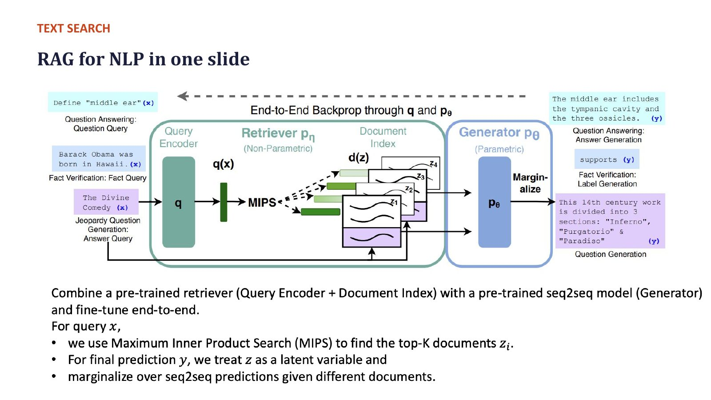
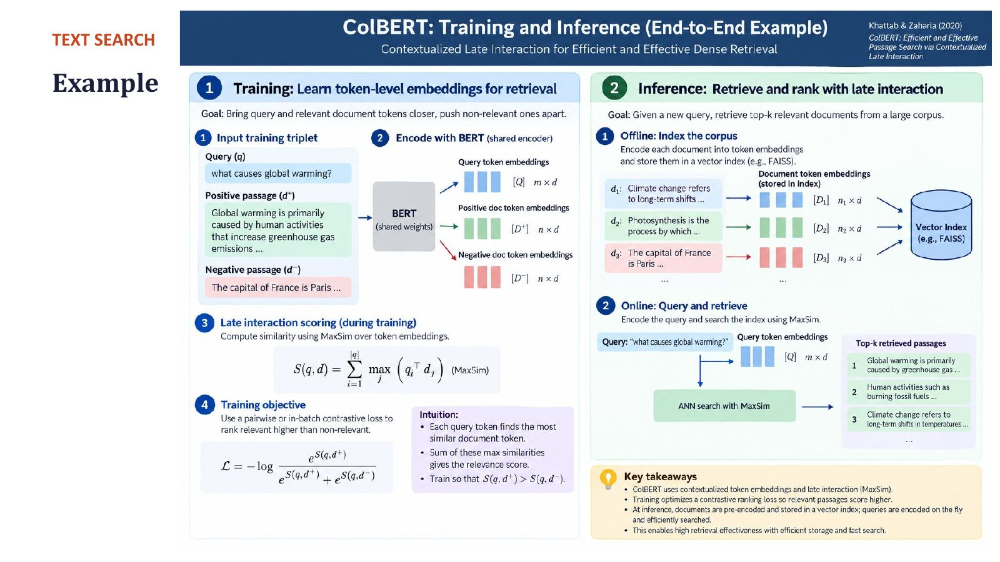

# Section 2 — RAG Foundations and ColBERT: Latent Retrieval and Late Interaction

> **Where this fits:** Between text search and image search, the professor went to the whiteboard for two papers that are **not on the slides** but hold up the rest of the lecture:
> 1. **The original RAG paper**: how retrieval is treated as a *hidden variable*, which explains the "EM-style" training slide later on (slide 29).
> 2. **ColBERT**: *late interaction*, which is "the same mechanism ColPali uses". He said: *"You see me repeating this many, many times so that it gets ingrained. This is one of the fundamental things you are learning in the multimodal space."*
>
> **Slides:** "RAG for NLP in one slide" (text-search block), 28–29, 32 · **Transcript:** 00:39:01 – 00:48:48, 01:30:04 – 01:36:02

---

## 2.A — The original RAG paper (Lewis et al., NeurIPS 2020)

### What it combined
> A **pre-trained retriever** (query encoder + document index) with a **pre-trained seq2seq generator**, fine-tuned **end to end**.

```
 x (query) ──► Query encoder q(x) ──► MIPS over document index ──► top-k docs z₁…z_k
                                        (Wikipedia, ~21M passages)        │
                                                                          ▼
                                             Generator p_θ(y | x, z)   (BART)
                                                                          │
                                         marginalise over z₁…z_k  ◄───────┘
                                                                          ▼
                                                                          y
```


*Slide "RAG for NLP in one slide" (the RAG paper's Figure 1). On the left, the inputs: "Define 'middle ear'" (question answering), "Barack Obama was born in Hawaii" (fact verification), "The Divine Comedy" (Jeopardy question generation). In the middle, the **retriever p_η** (query encoder q(x) + document index d(z), searched by **MIPS**), then the **generator p_θ**, then **marginalise**. On the right, the outputs. The dashed arrow on top, "End-to-End Backprop through q and p_θ", is the key: gradients reach the **query encoder** and the generator, not the document index.*

### Intuition: a researcher with a library card
Think of the generator as a smart writer, and the retriever as a librarian who hands over the 5 books most likely to help. RAG's twist: the writer's **success or failure feeds back to the librarian**. If the answer came out right after reading book #2, the librarian learns to rank book #2 higher for questions like this. Nobody ever told the librarian which book was "correct".

🔬 *Details from the paper:* the retriever is **DPR** (Dense Passage Retrieval), a BERT bi-encoder. The index is ~21M Wikipedia passages of 100 words each, stored in FAISS. The generator is **BART-large**.

### The two examples the professor pointed to (the figure's left and right sides)
| Input x | Task | What retrieval adds |
|---|---|---|
| *"Define middle ear"* | Open-domain QA | Retrieves a medical passage: *"The middle ear includes the tympanic cavity and the three ossicles."* Without it the LM answers from parameters, which "may or may not be wrong". |
| *"Barack Obama was born in Hawaii."* | **Fact verification** | Retrieves public documents about Obama's birth, then outputs **supports / refutes**. *"You have to fact-check it rather than depend on probabilistic parametric knowledge."* |

> 💡 **Learning Thought:** The RAG paper's contribution was not "put retrieved text in the prompt". People did that before. It was treating the retrieved document as a **latent variable** and training the **retriever and generator jointly** from answer supervision alone, without ever being told which document was correct. That framing is what later lets *any* retriever be tuned by the quality of the final answer.

---

## 2.B — MIPS as the retriever

The retriever scores each document by an inner product:

$$p_\eta(z \mid x) \propto \exp\big(\mathbf{d}(z)^\top \mathbf{q}(x)\big)$$

- **d(z)** = document encoder output (pre-computed, stored in the index)
- **q(x)** = query encoder output
- Finding the top-k is **Maximum Inner Product Search** (MIPS), served by an ANN index (Section 1.E)

*"Maximum inner product search: this is the dot product. We take the dot product of each document with the query, get the maximum, get the top-k."*

The **softmax over the top-k scores** is the important part. It turns retrieval scores into a **probability distribution** over documents, so the retriever becomes a probabilistic model that gradients can reach.

---

## 2.C — Retrieval as a latent variable: marginalisation, worked by hand

### The problem the professor raised
*"This is a non-differentiable thing."* The pipeline is: x → black box returns top-k documents → LLM → ŷ. Each part can be trained on its own, **but if the retrieved documents are all wrong, the answer is wrong, and a separately trained retriever never gets the signal that "for this x you should have retrieved something else."*

### The trick: never pick one document; sum over them
We never observe *which* document is correct, so we treat it as a **hidden (latent) variable z** and **marginalise it out**:

$$p(y \mid x) = \sum_{z \in \text{top-}k} \underbrace{p_\eta(z \mid x)}_{\text{retriever}} \cdot \underbrace{p_\theta(y \mid x, z)}_{\text{generator}}$$

*"Retriever, which is a separate parameter, and generator, which is a separate parameter. We never receive a signal for D, but if you do this and take a loss, you know exactly how to train the entire model. This is a common latent-variable trick whenever we have a middle step."*

### Worked example
Query x, correct answer y. Top-3 retrieved documents:

| Doc | Retriever p(z\|x) | Generator p(y\|x,z) | Product |
|---|---|---|---|
| d₁ (contains the answer) | 0.6 | 0.9 | 0.54 |
| d₂ (topically related) | 0.3 | 0.2 | 0.06 |
| d₃ (off-topic) | 0.1 | 0.1 | 0.01 |
| **Sum = p(y\|x)** | | | **0.61** |

Loss = −log p(y|x) = −ln 0.61 = **0.494**

### Where does the retriever's learning signal come from?
Compute the **posterior**: given that the answer was y, which document probably produced it?

$$p(z \mid x, y) = \frac{p(z\mid x)\,p(y\mid x,z)}{p(y\mid x)}$$

| Doc | Prior p(z\|x) | Posterior p(z\|x,y) |
|---|---|---|
| d₁ | 0.60 | 0.54 / 0.61 = **0.885** |
| d₂ | 0.30 | 0.06 / 0.61 = **0.098** |
| d₃ | 0.10 | 0.01 / 0.61 = **0.016** |

The gradient of the loss pushes the retriever's prior **toward this posterior**. d₁ goes up from 0.60 toward 0.885, and d₂ and d₃ go down. **The generator's success on d₁ is what teaches the retriever that d₁ was the right document.** Nobody labelled it.

### Code: retriever softmax → marginalisation → posterior → gradient
```python
import numpy as np
q = np.array([1.0, 0.5])                                     # query vector q(x)
docs = {"d1 (has answer)": [2.0, 1.0], "d2 (related)": [1.2, 1.1], "d3 (off-topic)": [0.2, 0.9]}
scores = np.array([q @ np.array(v) for v in docs.values()])  # MIPS scores d(z)·q(x)
p_z = np.exp(scores) / np.exp(scores).sum()                  # retriever p(z|x): softmax over top-k
p_y_given_z = np.array([0.9, 0.2, 0.1])                      # generator p(y|x,z) for the gold answer y

p_y = (p_z * p_y_given_z).sum()                              # marginalise the latent document
posterior = p_z * p_y_given_z / p_y                          # p(z|x,y): "which doc explains y?"
for name, a, b in zip(docs, p_z, posterior):
    print(f"{name:16s} prior={a:.3f}  posterior={b:.3f}")
print(f"p(y|x) = {p_y:.3f}, loss = {-np.log(p_y):.3f}")
print("dLoss/dscore =", np.round(p_z - posterior, 3))        # negative → gradient descent RAISES that score
```
Actual output:
```
d1 (has answer)  prior=0.614  posterior=0.891
d2 (related)     prior=0.290  posterior=0.094
d3 (off-topic)   prior=0.096  posterior=0.016
p(y|x) = 0.620, loss = 0.478
dLoss/dscore = [-0.277  0.196  0.081]
```
The last line is the whole idea in one vector. The gradient of the loss with respect to each retrieval score is **prior − posterior**. Doc 1 helped more than the retriever expected (posterior > prior), so its score is pushed **up**. Docs 2 and 3 are pushed down. (Numbers differ slightly from the hand-worked 0.6/0.3/0.1 table above, because here the prior comes from an actual softmax.)

🔬 **RAG-Sequence vs RAG-Token.** RAG-Sequence uses one document for the whole answer (the formula above). RAG-Token can marginalise **per generated token**, so different parts of the answer can draw on different documents.

---

## 2.D — End-to-end training and the EM-style view

### The EM analogy (slide 29)
The professor: *"They do it like an EM sort of algorithm."*

| EM step | In RAG training |
|---|---|
| **E-step** | Score and retrieve documents with the current model; compute how much each one explains the answer (the posterior above) |
| **M-step** | Update the parameters so the correct answer becomes more likely given what was retrieved: generator on (x, z) → y, retriever toward the useful documents |

*"Retriever and generator improve each other in a loop: better retrieval makes generation easier to train, and generation feedback reshapes what the retriever learns to prioritise."*

### What is actually differentiable? (🔬 precise version)
- The **top-k selection** itself is not differentiable. A document outside the top-k gets no gradient in that step.
- The **scores of the retrieved k documents** *are* differentiable, through the softmax p(z|x), which is how the gradient reaches the **query encoder**.
- **RAG keeps the document encoder and index frozen.** Updating the document encoder would mean **re-embedding 21M passages** after every update. Only the query encoder and generator are fine-tuned.
- **REALM** (Guu et al., 2020) did update the document encoder, **re-indexing asynchronously** every few hundred steps, at large compute cost.

> ⚠️ **Trap (professor's wording):** *"MIPS formulations help make this entire thing differentiable."* More precisely, **the softmax over inner-product scores** makes the retriever a differentiable probability model. MIPS is only the fast *search* procedure that finds which k documents to score. The search is not differentiable. The scores are.

### In practice (slide 29)
*"Most production systems approximate this with a simpler two-stage recipe: pretrain the retriever and generator separately, then fine-tune jointly on task-specific data."* In most enterprise RAG you **don't train either**. You pick a strong off-the-shelf embedder and LLM (Section 7.F).

### EM in one everyday example
You find grocery receipts (the answers y) but don't know **which family member** (latent z) did each shop. Guess each person's shopping habits (the model). **E-step:** for each receipt, estimate the probability each person made it. **M-step:** update each person's habits using receipts weighted by those probabilities. Repeat. RAG does the same with "which document produced this answer".

> 📚 **Go deeper**
> - RAG paper (Lewis et al., 2020): https://arxiv.org/abs/2005.11401 · DPR retriever: https://arxiv.org/abs/2004.04906
> - REALM, which updates the document encoder with asynchronous re-indexing: https://arxiv.org/abs/2002.08909
> - Expectation–Maximisation, a clear reference: https://en.wikipedia.org/wiki/Expectation%E2%80%93maximization_algorithm

> 💡 **Learning Thought:** Whenever a pipeline has a **hidden intermediate choice** with no label (which document, which cluster, which topic, which alignment), the answer is: *treat it as a latent variable, marginalise or estimate a posterior, and let the downstream loss train the upstream choice.* It's the same idea as **Gaussian mixtures** (which cluster generated this point?), **HMMs** (which hidden state?), **topic models**, and **VAEs**. (This answers the pre-read's discussion question 4.)

---

## 2.E — ColBERT: contextualised late interaction

### The problem with one vector per text
CLIP and standard bi-encoders **pool** everything into a **single vector** per query and per document. The professor: *"We have seen that this is problematic."*

His whiteboard example: an image of **a house and a sun**, captioned *"the house and the sun"*.
- **Single vector:** one image vector and one caption vector. They are close, fine. But everything about *which part matches which* has been averaged away.
- **What you really want:** the tokens "the house" should align with the **house patches**, and "the sun" with the **sun patch**. *"We try to map different portions of the text to different portions of the image, not just a high-level image–text alignment."*

### ColBERT's answer (Khattab & Zaharia, SIGIR 2020)
Keep **one vector per token** on both sides and let them interact **late**, only at scoring time:

```
Query  ─► BERT ─► [q₁, q₂, …, q_N]  (one 128-d vector per query token)
Doc    ─► BERT ─► [d₁, d₂, …, d_M]  (one 128-d vector per doc token)   ← pre-computed offline

Score(q, D) = Σᵢ  maxⱼ  qᵢ · dⱼ          ("MaxSim")
```

*"I take all the query tokens and get the maximum similarity among the document tokens. I do not merge it into a single vector. Query tokens remain separate, document tokens remain separate. I take the maximum similarity and then sum it up."*


*Slide "ColBERT: Training and Inference (End-to-End Example)". **Left (training):** a triplet (query "what causes global warming?", a positive passage, a negative passage) is encoded **token by token** with BERT. Each token gets its own vector, and the late-interaction score S(q,d) = Σᵢ maxⱼ qᵢ·dⱼ is trained with a softmax cross-entropy so the positive beats the negative. **Right (inference):** documents are encoded offline into token embeddings and stored in a vector index (e.g. FAISS). A query's token embeddings retrieve candidates, which are ranked with MaxSim.*

### Intuition: matching a checklist, not a summary
A recruiter screens CVs for "Python + Kubernetes + fintech". **Single-vector** matching is like comparing a one-line summary of the job with a one-line summary of each CV. **Late interaction** is a checklist: for *each* requirement, find the best-matching line anywhere in the CV, score it, and add up the scores. A CV that clearly covers all three requirements wins, even if most of it talks about something else.

**Why "late"?**
| Interaction | When query and document meet | Example |
|---|---|---|
| **None / pooled** | Only as two final vectors (one dot product) | Bi-encoder, CLIP |
| **Late** | Token vectors computed **independently**; interact only at scoring via MaxSim | ColBERT, ColPali |
| **Early / full** | Concatenated **before** the transformer; every layer attends across both | Cross-encoder reranker |

Late interaction keeps the bi-encoder's key property: **documents can be encoded offline**. It also recovers much of the cross-encoder's fine-grained matching.

**Training** (as the professor described): contrastive triples (query, positive passage, negative passage), all encoded with BERT, scored with late interaction, and trained so the positive beats the negative.

**Storage:** *"You store the document token embeddings. Not just one embedding: N₁ embeddings, N₂ embeddings, N₃ embeddings in the vector database."* Per query-document pair you now compute **N × M dot products** instead of one.

🔬 *Details beyond the lecture:* ColBERT pads queries to 32 tokens with [MASK] tokens (**query augmentation**, which gives the model soft "expansion" slots). It projects to **128-d**, the same D that ColPali later uses. ColBERTv2 and PLAID compress token vectors with residual quantisation to make the index manageable.

> ⚠️ **Trap (professor's dating):** he said ColBERT was published *"2021–22 or so"*. It was **SIGIR 2020**. ColBERTv2 came in 2021–22.

---

## 2.F — MaxSim worked by hand, and why it beats pooling

Query: 2 tokens. q₁ = [1, 0] ("revenue"), q₂ = [0, 1] ("2023").

**Document A** has one token that is very "revenue", one that is very "2023", and one generic token:
a₁ = [0.9, 0.1], a₂ = [0.2, 0.8], a₃ = [0.5, 0.5]

**Document B** has two lukewarm, generic tokens:
b₁ = [0.7, 0.7], b₂ = [0.6, 0.4]

### MaxSim
| | vs a₁ | vs a₂ | vs a₃ | max |
|---|---|---|---|---|
| q₁ | 0.9 | 0.2 | 0.5 | **0.9** |
| q₂ | 0.1 | 0.8 | 0.5 | **0.8** |
| **Score A** | | | | **1.7** |

| | vs b₁ | vs b₂ | max |
|---|---|---|---|
| q₁ | 0.7 | 0.6 | **0.7** |
| q₂ | 0.7 | 0.4 | **0.7** |
| **Score B** | | | **1.4** |

**MaxSim ranks A first.** A has a *specific* token for *each* query term.

### Single pooled vector (mean pooling)
- Query mean = [0.5, 0.5]
- A mean = [(0.9+0.2+0.5)/3, (0.1+0.8+0.5)/3] = [0.533, 0.467] → dot = 0.267 + 0.233 = **0.50**
- B mean = [(0.7+0.6)/2, (0.7+0.4)/2] = [0.65, 0.55] → dot = 0.325 + 0.275 = **0.60**

**Pooling ranks B first**, which is wrong. Averaging washed out A's sharp, specific matches into something generic, and B's "vaguely about everything" profile won.

### Code 1: the worked example above, in NumPy
```python
import numpy as np
def maxsim(Q, D):                       # Q: [n_q, dim], D: [n_d, dim]
    return (Q @ D.T).max(axis=1).sum()  # for each query token: best doc token; then sum

Q = np.array([[1, 0], [0, 1]], float)                     # "revenue", "2023"
A = np.array([[0.9, 0.1], [0.2, 0.8], [0.5, 0.5]])        # specific tokens
B = np.array([[0.7, 0.7], [0.6, 0.4]])                    # generic tokens
print("MaxSim : A=%.2f  B=%.2f" % (maxsim(Q, A), maxsim(Q, B)))
print("Pooled : A=%.2f  B=%.2f" % (Q.mean(0) @ A.mean(0), Q.mean(0) @ B.mean(0)))
print("similarity matrix Q·Aᵀ =\n", Q @ A.T)
```
Actual output:
```
MaxSim : A=1.70  B=1.40
Pooled : A=0.50  B=0.60
similarity matrix Q·Aᵀ =
 [[0.9 0.2 0.5]
 [0.1 0.8 0.5]]
```
Look at the matrix: MaxSim takes the **row maxima** (0.9, 0.8) and adds them.

### Code 2: real token vectors from a real encoder
```python
# pip install sentence-transformers
import torch
from sentence_transformers import SentenceTransformer
enc = SentenceTransformer("sentence-transformers/all-MiniLM-L6-v2")

def token_vecs(text):     # one vector PER TOKEN (what ColBERT stores) instead of one pooled vector
    t = enc.encode(text, output_value="token_embeddings")     # [n_tokens, 384]
    return torch.nn.functional.normalize(t, dim=-1)

def maxsim(q, d): return (q @ d.T).max(dim=1).values.sum().item()

query = "house next to the sun"
docs = ["A small house under a bright sun in a clear sky.",
        "The annual report discusses housing market trends and solar energy investments.",
        "A cat sleeping on a sofa."]
q = token_vecs(query); pooled_q = enc.encode(query, normalize_embeddings=True)
for d in docs:
    print(f"MaxSim={maxsim(q, token_vecs(d)):6.2f}   pooled cos={float(enc.encode(d, normalize_embeddings=True) @ pooled_q):.2f}   {d[:50]}")
print("query tokens:", enc.tokenizer.tokenize(query), "->", q.shape)
```
Actual output:
```
MaxSim=  5.03   pooled cos=0.72   A small house under a bright sun in a clear sky.
MaxSim=  3.66   pooled cos=0.47   The annual report discusses housing market trends
MaxSim=  1.31   pooled cos=0.09   A cat sleeping on a sofa.
query tokens: ['house', 'next', 'to', 'the', 'sun'] -> torch.Size([7, 384])
```
Notes: 5 words → **7** vectors, because [CLS] and [SEP] get vectors too. MaxSim values aren't bounded like cosine (up to 7 here, one per query token). MiniLM wasn't *trained* for late interaction, so this shows the **mechanics**. Real ColBERT models are trained with this score, and their token vectors are much sharper.

> 📚 **Go deeper**
> - ColBERT (SIGIR 2020): https://arxiv.org/abs/2004.12832 · ColBERTv2 (compression): https://arxiv.org/abs/2112.01488 · PLAID (fast serving engine): https://arxiv.org/abs/2205.09707
> - Official ColBERT code: https://github.com/stanford-futuredata/ColBERT

> 💡 **Learning Thought:** Pooling is **lossy compression before comparison**. Late interaction **compares first and compresses after** (max, then sum). For long or visually dense documents (a page with a chart, a table, and three paragraphs), a single vector must represent all of it at once, and any specific query gets diluted. MaxSim lets each query term **find its own evidence** anywhere in the document. That is exactly why ColPali uses it on pages.

### Properties of MaxSim worth remembering
- **Asymmetric:** it sums over **query** tokens and maxes over **document** tokens. Swapping the roles gives a different number.
- **Not normalised:** the score grows with the number of query tokens. Compare scores **only across documents for the same query**.
- **Order-free within a document:** where the best match sits in the document doesn't matter, which is good for layouts.
- **Cost:** N × M dot products per (query, document) pair. For 32 query tokens × 180 document tokens that's 5,760 dot products of 128-d, versus 1 for a bi-encoder.

---

## 2.G — Bi-encoder vs late interaction vs cross-encoder

```
 BI-ENCODER                    LATE INTERACTION                  CROSS-ENCODER
 query      doc                query        doc                  [CLS] query [SEP] doc [SEP]
   │         │                   │           │                              │
 [BERT]   [BERT]              [BERT]      [BERT]                     [BERT, all layers
   │         │                 q1 q2 q3   d1 d2 … dM                  attend across both]
 pool      pool                  └─ MaxSim ─┘                               │
   └── dot ──┘                  Σ_i max_j q_i·d_j                      relevance score
 1 number                       1 number, from N×M dot products        1 number, from a full pass
 doc side precomputable ✅       doc side precomputable ✅                nothing precomputable ❌
```

| | Bi-encoder | Late interaction (ColBERT/ColPali) | Cross-encoder |
|---|---|---|---|
| Representation | 1 vector per text | 1 vector **per token / patch** | No stored vectors; joint pass |
| Offline indexing | ✅ | ✅ | ❌ (needs the query) |
| Scoring cost | 1 dot product | N × M dot products | Full transformer pass per pair |
| Index size | Smallest | **~10²–10³× larger** | none |
| Fine-grained matching | ❌ | ✅ token-level | ✅✅ full attention |
| Typical use | Stage-1 retrieval over millions | Retrieval or reranking over thousands to millions | Rerank top 50–100 |

> ⚠️ **Trap (live Q&A):** *"ColBERT seems similar to reranking in RAG, where we do cross-attention between the query and the top-k docs?"* They are related, since both do **fine-grained query–document interaction**, but the mechanism differs. A cross-encoder reranker processes query and document **jointly** through every transformer layer: expensive, and nothing can be pre-computed. ColBERT encodes them **separately** (document vectors pre-computed) and interacts only through **cheap dot products + max + sum**. Cost order: **bi-encoder < ColBERT late interaction < cross-encoder**. A common production stack uses all three in sequence.

---

## ✅ Quick Check (self-made; the deck has no quiz for this)
1. In RAG, what is the latent variable, and how is it removed?
2. Retriever p(z|x) = [0.5, 0.5], generator p(y|x,z) = [0.8, 0.2]. What is p(y|x), and what is the posterior on doc 1?
3. Which parts does the original RAG paper keep frozen, and why?
4. Write the ColBERT MaxSim score.
5. Why does late interaction still allow offline indexing but a cross-encoder doesn't?

<details><summary>Answers</summary>

1. **Which document was used.** It is marginalised: p(y|x) = Σ_z p(z|x) p(y|x,z) over the top-k.
2. p(y|x) = 0.4 + 0.1 = **0.5**. Posterior on doc 1 = 0.4 / 0.5 = **0.8**.
3. The **document encoder and index**. Updating them would require re-embedding millions of passages at every step. REALM did it with asynchronous re-indexing, at large cost.
4. **S(q, D) = Σᵢ maxⱼ qᵢ·dⱼ**
5. In late interaction, document token vectors are computed **without seeing the query**, so they can be stored. A cross-encoder must see the query and document **together** in every layer.
</details>

---

## 🎯 Interview Questions

**Q1. How can you train a retriever when you have no labels for which document is relevant?**
> Treat the document as a **latent variable** and marginalise: p(y|x) = Σ_{z∈top-k} p(z|x) p(y|x,z), with p(z|x) a softmax over retrieval scores. Minimising −log p(y|x) sends gradient into the retriever's scores. The effective target is the posterior p(z|x,y), so documents that helped the generator produce the right answer get their retrieval probability raised. This is the RAG/REALM approach, and it behaves like EM: the E-step infers which documents were useful, the M-step updates the retriever and generator.

**Q2. Why does RAG freeze the document encoder? What's the cost of not freezing it?**
> If the document encoder changes, every stored vector is stale, and you must re-embed the whole corpus (21M passages in RAG) to keep the index consistent. Freezing it and training only the query encoder avoids that. REALM updated both and re-indexed asynchronously every few hundred steps, which gave better alignment at huge compute cost. The same concern applies in production: **changing your embedding model means a full re-index.**

**Q3. Explain ColBERT late interaction to a backend engineer.**
> Instead of storing one vector per document, store one small vector (128 floats) per token. At query time, embed each query token too. For each query token, find its single best-matching document token (max dot product), then add up those best scores. Document vectors don't depend on the query, so they're pre-computed, just like a normal vector index. You get word-level matching precision at dot-product cost, paid for with a much larger index.

**Q4. When would mean-pooled single vectors rank the wrong document first? Give an example.**
> When the relevant document has **sharp, specific** matches to each query term mixed with unrelated content, and a distractor is **vaguely similar to everything**. Pooling averages the sharp matches away. In my worked example, MaxSim scores the specific document 1.7 vs 1.4, while pooled cosine scores it 0.50 vs 0.60, the reverse. Long pages with mixed content (charts plus unrelated text) hit this case all the time.

**Q5. Bi-encoder, ColBERT, cross-encoder: design a retrieval stack with a latency budget of 100 ms over 50M passages.**
> Stage 1: BM25 + bi-encoder over an HNSW or IVF-PQ index → top 1000 (~10–20 ms). Stage 2: ColBERT MaxSim over those 1000 candidates using their stored token vectors → top 100 (~10–30 ms). Stage 3: cross-encoder on the top 20–50 (~30–50 ms batched on GPU). Fuse or cut at each stage. Measure recall@1000 of stage 1, since nothing downstream can recover a document it missed.

**Q6. Name three other latent-variable models and connect them to RAG.**
> Gaussian mixture models (latent = cluster ID; EM alternates responsibilities and parameter updates), HMMs (latent = hidden state sequence; Baum-Welch is EM), VAEs (latent = continuous code; trained with a variational bound). RAG's latent is the discrete choice of document, handled by exact marginalisation over the top-k.

---

## ✅ Self-check
- [ ] I can draw the RAG architecture (DPR + index + BART) and explain both example tasks
- [ ] I can compute p(y|x) by marginalisation and the posterior over documents by hand
- [ ] I can explain what is and isn't differentiable in RAG, and why the document encoder is frozen
- [ ] I can map RAG training onto E-step / M-step
- [ ] I can explain the house-and-sun motivation for token-level matching
- [ ] I can compute MaxSim by hand and show a case where pooling ranks wrongly
- [ ] I can compare bi-encoder, late interaction and cross-encoder on cost, index size and precision
