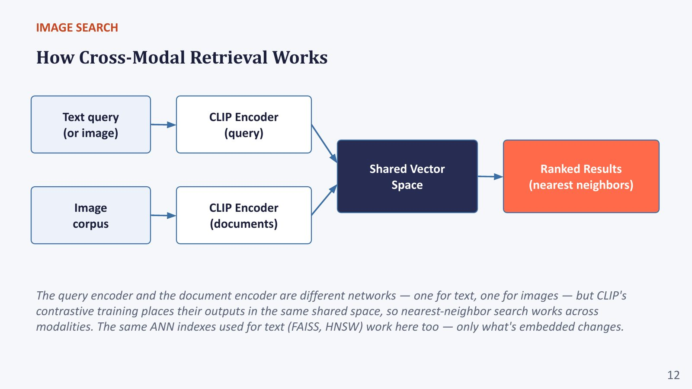

# Section 3 — Image Search: Cross-Modal Retrieval with Shared Embedding Spaces

> **Where this fits:** The professor went through image search quickly, on purpose: *"Once you understand text search, these are just small deltas."* The delta is: **replace the text document encoder with an image encoder, and make sure both encoders output into the same space.** The FAISS/HNSW index, the nearest-neighbour search and the Recall@K evaluation all stay the same. *"Only what's embedded changes."*
> **Slides:** 11–15 (+ quiz 16–18) · **Transcript:** 00:52:07 – 01:03:00

---

## 3.A — The two directions of image search

| Direction | Input → output | Typical uses |
|---|---|---|
| **Text → image** (most common) | Type a description → matching images | E-commerce product search, stock-photo libraries, content moderation at scale |
| **Image → image** | Give an example image → visually similar images | Reverse image search, fashion "shop the look", near-duplicate detection, medical case matching |
| *(and the reverse, image → text)* | Image → matching captions or documents | Auto-tagging, retrieving the passage that describes a picture |

Both directions rely on **the same shared embedding space** (quiz Q1).

### Real-world examples you have used
- **Text → image:** typing "red running shoes" on Myntra or Amazon; searching "dog at the beach" in **Google Photos / iPhone Photos**. Your personal photos have no captions, so the phone matches your words against image embeddings computed on the device.
- **Image → image:** **Google Lens** / Pinterest Lens ("find similar products"), reverse image search to check whether a photo is fake or reused, **duplicate-listing detection** on marketplaces.
- **Image → text:** automatic alt-text; retrieving the product description that matches a photo a seller uploaded.

---

## 3.B — History: when image search was really text search

*"At one point Google Image search was the source of a plethora of online jokes rather than of any use at all. Image search had nothing to do with the images. It only looked at tags or human-provided descriptions and used text search as a **proxy** for image search."*

### The caption-proxy approach (still usable today)
```
Image ─► VLM captioner ─► "a dog running on a beach" ─► text index (BM25 / dense)
Query "puppy at the seaside" ─► text search ─► finds the caption ─► returns the image
```

It works, and it's the "unified text representation" design from Section 4.E. But:

> *"It is very, very hard to convert an image into a caption in a **necessary and sufficient** manner. Can it actually give a proper, relevant plus thorough description of an image?"*

- **Necessary:** the caption must mention what users will search for. A caption saying "a street" loses the red bicycle a user asks about.
- **Sufficient:** it must carry enough detail to tell this image apart from similar ones.

A caption is a **lossy, query-independent summary** made *before* anyone asks anything.

**Real-world example:** a stock-photo site auto-captions an image as *"a woman working on a laptop in a cafe"*. A buyer searches *"woman with red scarf, laptop, rainy window"*. The scarf and the rain are in the pixels but not in the caption, so the photo is never found.

### Code: the caption-proxy pipeline (from the lab notebook, Cells 2-B and 3-A)
```python
# Captioning with Florence-2 (as in the lab). Needs a GPU for speed; runs on CPU slowly.
from transformers import AutoProcessor, Florence2ForConditionalGeneration
proc  = AutoProcessor.from_pretrained("florence-community/Florence-2-base-ft")
model = Florence2ForConditionalGeneration.from_pretrained("florence-community/Florence-2-base-ft")

def caption(image, task="<DETAILED_CAPTION>"):          # Florence-2 is steered by task tokens
    inputs = proc(text=task, images=image, return_tensors="pt")
    ids = model.generate(**inputs, max_new_tokens=80, num_beams=3)
    text = proc.batch_decode(ids, skip_special_tokens=False)[0]
    return proc.post_process_generation(text, task=task, image_size=image.size)[task]

# Then the image is represented ONLY by its caption, and search is plain text search:
#   captions = [caption(im) for im in images] → SentenceTransformer.encode → FAISS
# Whatever the caption didn't mention can never be found.
```
> 📚 Florence-2 model card: https://huggingface.co/microsoft/Florence-2-base-ft You never know in advance which detail a future query will need.

> 💡 **Learning Thought:** Any "convert to text first" pipeline (captioning, OCR, parse-then-embed) makes an **early, irreversible compression decision without knowing the query**. Embedding the raw modality delays that decision to query time. The same argument, applied to document pages, is the whole case for ColPali (Section 4.D).

---

## 3.C — CLIP recap: why a shared space is exactly what search needs

### How CLIP is trained (from Lecture 1)
- **Two encoders:** an image encoder (ViT/ResNet) and a text encoder (transformer). They are **different networks**.
- Trained on **~400M (image, caption) pairs** from the web.
- **Contrastive objective:** in a batch of N pairs, build the N × N similarity matrix. Push the diagonal (matching pairs) up and everything off-diagonal down, **symmetrically** (image→text and text→image cross-entropy).

### Worked example: a 3×3 batch (τ = 0.1)
Cosine similarities (rows = images, columns = captions):

| | cap₁ | cap₂ | cap₃ |
|---|---|---|---|
| img₁ | **0.30** | 0.10 | 0.05 |
| img₂ | 0.12 | **0.28** | 0.08 |
| img₃ | 0.02 | 0.06 | **0.25** |

Row 1 as logits (÷ τ): [3.0, 1.0, 0.5] → exp: [20.09, 2.72, 1.65] → sum 24.45
p(cap₁ | img₁) = 20.09 / 24.45 = **0.822** → loss for this row = −ln 0.822 = **0.196**

Training raises the diagonal and lowers the rest, for every row and every column.

```
             cap₁   cap₂   cap₃          In a real batch N = 32,768:
   img₁   [ ✔↑    ✘↓    ✘↓ ]             the diagonal = 32,768 true pairs,
   img₂   [ ✘↓    ✔↑    ✘↓ ]             off-diagonal ≈ 1 billion "free" negatives.
   img₃   [ ✘↓    ✘↓    ✔↑ ]             Bigger batches = more negatives = better embeddings.
   row-wise softmax = image→text loss;  column-wise = text→image loss;  average both.
```

### Code: the symmetric CLIP loss on this 3×3 batch
```python
import numpy as np
S = np.array([[0.30, 0.10, 0.05],     # rows = images, cols = captions (cosine similarities)
              [0.12, 0.28, 0.08],
              [0.02, 0.06, 0.25]])
tau = 0.1
def xent(logits):                     # cross-entropy with the diagonal as the correct class
    logits = logits - logits.max(1, keepdims=True)
    logp = logits - np.log(np.exp(logits).sum(1, keepdims=True))
    return -np.diag(logp)
L_i2t = xent(S / tau); L_t2i = xent(S.T / tau)
print("per-image loss:", np.round(L_i2t, 3))
print("CLIP loss (symmetric mean):", round((L_i2t.mean() + L_t2i.mean()) / 2, 3))
```
Actual output:
```
per-image loss: [0.197 0.291 0.223]
CLIP loss (symmetric mean): 0.239
```
Row 1's loss (0.197) matches the hand calculation above.

> 📚 **Go deeper**
> - CLIP paper (Radford et al., 2021): https://arxiv.org/abs/2103.00020
> - Open-source CLIP implementations and hundreds of pretrained checkpoints: https://github.com/mlfoundations/open_clip
> - Contrastive learning overview: https://lilianweng.github.io/posts/2021-05-31-contrastive/

### Why this gives you image search for free
After training, "a photo of a dog on a beach" (text) and the actual dog-on-beach photo (image) land **near each other**. So:
- **Zero-shot classification** = compare an image against a *handful of label prompts* and pick the best
- **Image search** = compare a text query against *a whole corpus of images* and **rank** them

It's the **same operation**: rank by cosine in a shared space. *"No separate retrieval-specific training needed. Retrieval is a direct beneficiary of image–text alignment."*

> ⚠️ **Trap (quiz Q2):** CLIP works for image search **not** because it has a special retrieval head, but because its **shared embedding space lets a text query and an image be compared directly**. There is no translation step (no captioning).

---

## 3.D — How cross-modal retrieval works

```
OFFLINE:  Image corpus ─► CLIP image encoder ─► vectors ─► FAISS / HNSW index
ONLINE:   Text query   ─► CLIP text encoder  ─► query vector ─► nearest neighbours ─► ranked images
          (or an image query ─► CLIP image encoder ─► same index)
```

*"The query encoder and the document encoder are different networks, one for text and one for images, but CLIP's contrastive training places their outputs in the same shared space, so nearest-neighbour search works across modalities. The same ANN indexes used for text (FAISS, HNSW) work here too. Only what's embedded changes."* (Quiz Q3: **the same ANN vector indexes**.)


*Slide "How Cross-Modal Retrieval Works": text query (or image) → CLIP encoder (query); image corpus → CLIP encoder (documents); both land in one shared vector space, and ranked results are nearest neighbours. Compare it with the dense-text slide in Section 1.C: **same picture, different encoders.***

### Code: text → image search with open_clip (CPU, self-contained)
```python
# pip install open_clip_torch pillow
import torch, open_clip
from PIL import Image, ImageDraw

def img(shape, color):     # tiny synthetic "corpus", so the demo needs no image downloads
    im = Image.new("RGB", (224, 224), "white"); d = ImageDraw.Draw(im)
    (d.ellipse if shape == "circle" else d.rectangle)([40, 40, 184, 184], fill=color); return im
corpus = {"red circle": img("circle", "red"), "blue square": img("square", "blue"),
          "green circle": img("circle", "green"), "red square": img("square", "red")}

model, _, preprocess = open_clip.create_model_and_transforms("ViT-B-32", pretrained="laion2b_s34b_b79k")
tokenizer = open_clip.get_tokenizer("ViT-B-32"); model.eval()
with torch.no_grad():
    I = model.encode_image(torch.stack([preprocess(im) for im in corpus.values()]))  # OFFLINE: index
    I = I / I.norm(dim=-1, keepdim=True)
    for query in ["a red circle", "a blue square", "something green"]:
        t = model.encode_text(tokenizer([query])); t = t / t.norm(dim=-1, keepdim=True)  # ONLINE
        sims = (t @ I.T)[0]
        best = sims.argsort(descending=True)[:2]
        print(f"{query:16s} ->", [(list(corpus)[i], round(sims[i].item(), 3)) for i in best])
```
Actual output:
```
a red circle     -> [('red circle', 0.356), ('red square', 0.285)]
a blue square    -> [('blue square', 0.366), ('red square', 0.256)]
something green  -> [('green circle', 0.281), ('red circle', 0.195)]
```
Two lessons: (1) the rankings are right, even for the vague query "something green". (2) The **absolute** similarities are only **0.28–0.37**, which is the calibration trap below. To scale up, replace the list with a FAISS index (Section 1.E), unchanged.

### The slide's worked example
Query: *"snow-capped mountains at sunset"* → Rank 1 score 0.88, Rank 2 score 0.81.
> *"No caption or tag was attached to either image beforehand. The match comes purely from CLIP's shared embedding space, computed at query time."*

> ⚠️ **Trap (calibration):** raw CLIP cosine similarities between text and images are usually **small** (≈ 0.2–0.35), because the two modalities occupy different regions of the shared space (the "modality gap"). Scores like 0.88 are illustrative or rescaled. **Only the ranking is meaningful, not the absolute number.** Never set one fixed "relevance threshold" across models or across queries without calibrating it.

> ⚠️ **Trap (live Q&A, applies here too):** *"If I use a different model for query embedding, how is it ensured the vector dimension matches?"* **Matching dimensions isn't enough.** Two independently trained 512-d spaces are unrelated coordinate systems, so their cosine is meaningless. Query and corpus must be embedded by encoders **trained together** into one space (CLIP's two towers, or the same model for both).

---

## 3.E — Modern visual encoders: DINOv2/v3 and SigLIP-2

The slide: *"Best visual encoders are DINOv2, DINOv3, SigLIP-2."* The professor: *"As of now, I think the best model is DINOv3."*

| Encoder | Training | Has a text encoder? | Best at |
|---|---|---|---|
| **CLIP** | Contrastive image–text (softmax) | ✅ | Text ↔ image, zero-shot |
| **SigLIP / SigLIP-2** | Image–text with a **sigmoid** loss: each pair is an independent yes/no, no batch-wide softmax | ✅ | Text ↔ image; stronger and more efficient to train than CLIP |
| **DINOv2 / DINOv3** | **Self-supervised, images only** (self-distillation; no captions) | ❌ | **Image → image** similarity, fine-grained visual features, dense features |


*Slide "Example": an image-to-image search demo (DINOv2 embeddings + FAISS over MS-COCO, from https://www.bistaumanga.com.np/category/demo.html). The query photo (bottom left, a plate of rice and vegetables) retrieves visually and semantically similar food photos.*

### Intuition: why DINO sees differently from CLIP
- **CLIP** learned from captions, so it knows what people *write* about images ("a dog", "sunset"). It ignores details captions rarely mention, such as exact textures, the grain of rice, or the shape of a handbag clasp.
- **DINO** learned from images alone, by making two random crops of the same photo agree ("self-distillation"). It had to learn **visual detail** with no words at all, which is great for "find me *this exact kind* of thing" and useless for text queries.
- **SigLIP** is CLIP with a better loss: each (image, caption) pair is scored as an independent yes/no (sigmoid), so it doesn't need huge batches to get many negatives.

### Code: image → image with DINOv2 (via transformers)
```python
# pip install transformers torch torchvision pillow   (recent transformers needs torchvision here)
import torch
from transformers import AutoImageProcessor, AutoModel
from PIL import Image

proc = AutoImageProcessor.from_pretrained("facebook/dinov2-small")
model = AutoModel.from_pretrained("facebook/dinov2-small").eval()

def embed(images):
    with torch.no_grad():
        out = model(**proc(images=images, return_tensors="pt"))
    v = out.last_hidden_state[:, 0]                     # [CLS] token = global image descriptor
    return torch.nn.functional.normalize(v, dim=-1)

catalogue = [Image.open(p).convert("RGB") for p in ["shoe1.jpg", "shoe2.jpg", "bag1.jpg"]]  # your images
index = embed(catalogue)                                # OFFLINE
query = embed([Image.open("my_photo.jpg").convert("RGB")])  # ONLINE: a photo, not text
print((query @ index.T).squeeze().tolist())             # highest = most visually similar
```
Tested with synthetic images: an **orange circle** query against [red circle, blue square, green circle] gave similarities **[0.98, 0.69, 0.96]**. DINO matches on **shape and structure** first and colour second, which is what you want for "find this kind of object". (Swap the image paths for your own files. `last_hidden_state[:, 1:]` gives per-patch features, useful for local or dense matching.)

> 📚 **Go deeper**
> - DINOv2 paper: https://arxiv.org/abs/2304.07193 · code: https://github.com/facebookresearch/dinov2
> - DINOv3 paper: https://arxiv.org/abs/2508.10104 · project page: https://ai.meta.com/dinov3/
> - SigLIP (sigmoid loss): https://arxiv.org/abs/2303.15343 · SigLIP 2: https://arxiv.org/abs/2502.14786

### The professor's demo (image → image with DINOv2, MS-COCO)
Query: a plate of food. Retrieved images showed *"a bowl of rice and some vegetables… you can also see broccoli"* and even the **type** of rice (*"both look like sticky rice"*). The result captures both **coarse semantics** ("food on a plate") and **fine-grained detail** (sticky rice, broccoli). There were some near-negatives (cups, glasses in frame).

*"Take this example with a pinch of salt."* Demo quality depends on **what database you search**. A 50K-image corpus (COCO) is a reasonable test; real capability shows only at millions of images.

> ⚠️ **Trap (live Q&A):** *"What exactly is the DINO model doing? We have a set of images and a query image. Is DINO embedding the images so similarity search works well?"* **Yes, exactly.** DINO is the **feature extractor**: it maps every database image and the query image into vectors where visually or semantically similar images are close, and then ordinary nearest-neighbour search ranks them. Remember that **DINO has no text encoder**, so it can't do text→image by itself. For that you need CLIP or SigLIP.

> 💡 **Learning Thought:** Pick the encoder by the **query modality**. Text queries need a model trained on **image–text alignment** (CLIP, SigLIP). Image queries can use the **strongest pure visual features** (DINO), which often beat CLIP at image-to-image, because they weren't forced to squeeze images into what captions describe.

---

## 3.F — Datasets, training and performance

### Benchmarks
| Dataset | Content | Retrieval test split |
|---|---|---|
| **Flickr30K** | ~31K images × 5 captions | 1K test images |
| **MS COCO** (retrieval split) | ~123K images × 5 captions | 5K test images |

Scored with **Recall@1 / @5 / @10** in both directions (image→text and text→image).

### Recall@K, worked (quiz Q4: *whether the correct result appears in the top K*)
5 text queries. The correct image appears at ranks: **1, 4, 2, 12, 1**.
- R@1 = 2/5 = **0.40** (queries 1 and 5)
- R@5 = 4/5 = **0.80** (ranks 1, 4, 2, 1)
- R@10 = 4/5 = **0.80** (rank 12 is still outside)

### Training
*"The same contrastive recipe as CLIP from Lecture 1. No separate retrieval-specific training needed; **scale** drives most of the gain."*

### Performance (directional, zero-shot Flickr30K image→text R@1)
- Base CLIP-scale models: **≈ 51%**
- Larger, modern VLM-scale encoders: **≈ 85%**
- *"Exact scores vary by model and protocol."* The professor pointed to the **MTEB** leaderboard, which increasingly includes multimodal retrieval.

### Code: Recall@K for a retrieval run
```python
import numpy as np
# sims[i, j] = similarity of text query i to image j; the correct image for query i is image i
rng = np.random.default_rng(1)
sims = rng.normal(size=(1000, 1000)) + 3.0 * np.eye(1000)      # a decent but imperfect model
ranks = (sims > sims[np.arange(1000), np.arange(1000)][:, None]).sum(1) + 1   # rank of the correct image
for k in (1, 5, 10):
    print(f"R@{k} = {(ranks <= k).mean():.3f}")
```
Actual output: `R@1 = 0.418`, `R@5 = 0.668`, `R@10 = 0.765`. Recall always rises with K. The gap between R@1 and R@10 tells you how often the right image is *close* to the top but not first, and that gap is exactly what a reranker can recover.

This is exactly how Flickr30K/COCO retrieval numbers are computed. On the real 1K-image Flickr30K test set, `sims` is the 5000 × 1000 caption–image similarity matrix.

> 📚 **Go deeper**
> - How CLIP-style zero-shot retrieval is benchmarked (CLIP paper, Section 3): https://arxiv.org/abs/2103.00020
> - open_clip's results table (retrieval scores per checkpoint): https://github.com/mlfoundations/open_clip

### Speed at scale
Even with a good encoder, *"we have to solve fast search"*: approximate nearest-neighbour search, *"approximate by definition, so you will always make some mistakes."* He mentioned **DiskANN** (Microsoft Research). See Section 1.E.

---

## 3.G — Remaining challenges

| Challenge | Example | Why CLIP-style embeddings struggle |
|---|---|---|
| **Fine-grained queries** | "a red car" ✅ vs "the specific red sedan facing left in the third row" ❌ | Needs **detection, orientation, counting, spatial position**: *"this actually requires reasoning."* One global vector can't encode all that. |
| **Compositional queries** (quiz Q5) | "a house, a farmer and a boat", and worse, "**not** a boat" | Each constraint dilutes the others. 🔬 CLIP behaves partly like a **bag of words**: "a horse eating grass" and "grass eating a horse" embed almost identically (Yuksekgonul et al., ICLR 2023). Negation is especially weak. |
| **Bias in corpus and training data** | The professor's example: boats in Kerala and Bengal look different. Query the Bengali word **"nouka" (boat)** and you may get false positives. | Web-scraped pairs over-represent some regions, languages, aesthetics and demographics, so "most relevant" reflects that skew |
| **Long, detailed queries** | A multi-sentence product description | 🔬 CLIP's text encoder has a **77-token limit** and was trained on short alt-text captions, so long queries get truncated or poorly represented |

### Code: probe CLIP's bag-of-words behaviour yourself
```python
# (reuses model/tokenizer from the open_clip example above)
with torch.no_grad():
    t = model.encode_text(tokenizer(["a horse eating grass", "grass eating a horse",
                                     "a photo with a boat", "a photo with no boat", "a red sports car"]))
    t = t / t.norm(dim=-1, keepdim=True)
print("word-order swap :", round((t[0] @ t[1]).item(), 3))
print("negation        :", round((t[2] @ t[3]).item(), 3))
print("unrelated ref   :", round((t[2] @ t[4]).item(), 3))   # baseline for comparison
```
Actual output (open_clip ViT-B-32, LAION-2B):
```
word-order swap : 0.956
negation        : 0.793
unrelated ref   : 0.432
```
Swapping who eats whom barely changes the embedding (0.956), and "with a boat" vs "with **no** boat" stays very close (0.793), far above an unrelated caption (0.432).
If two captions with opposite meanings embed almost identically, **no image ranking** can tell them apart. That's the compositional/negation weakness, measured directly.

> 📚 **Go deeper**
> - *When and why VLMs behave like bags-of-words* (ARO benchmark): https://arxiv.org/abs/2210.01936

> 💡 **Learning Thought:** One global embedding is a **summary**, and summaries drop **structure**: who does what to whom, where, how many, and whether something is *absent*. When queries contain structure, move to **token/patch-level matching** (late interaction), a **reranker that reasons** (a VLM judging each candidate), or **structured filters** (detected objects and attributes stored as metadata). This is the same move text search made from pooled vectors to ColBERT and cross-encoders.

---

## ✅ Quick Check (from the deck; answers below)
1. What are the two directions of image search?
2. Why does CLIP work well for image search specifically?
3. What infrastructure does image search reuse from text search?
4. What does Recall@5 measure?
5. What's a known weak point of CLIP-style retrieval?

<details><summary>Answers</summary>

1. **Text-to-image and image-to-image.** Both rely on the same shared embedding space.
2. **Its shared embedding space lets text and image queries be compared directly.** No translation step.
3. **The same ANN vector indexes (FAISS, HNSW).** Only what's embedded changes.
4. **Whether the correct result appears in the top 5.**
5. **Compositional queries combining several constraints at once.**

*(Live quiz shuffled options: CLIP's answer was option A, Recall@5 was D, and compositional was C.)*
</details>

---

## 🎯 Interview Questions

**Q1. Design text-to-image search for a 50M-product catalogue.**
> Embed each product image offline with a CLIP/SigLIP image encoder (optionally fuse with a text embedding of title + attributes). Store the vectors in an ANN index (HNSW, or IVF-PQ to fit memory), sharded if needed. At query time embed the text with the paired text encoder, retrieve the top ~500, then apply structured filters (category, price, availability) and **rerank**: a cross-modal reranker or a small VLM for the top 50, plus business signals. Evaluate with Recall@K and nDCG on logged queries with clicks or purchases. Watch for compositional queries ("red dress **without** sleeves"): extract attributes from the query into hard filters instead of trusting the embedding.

**Q2. Why can't you just caption every image and use text search?**
> You can, and it's a valid baseline that reuses text infrastructure, but captions are a query-independent, lossy summary produced before any query is known. They are rarely both necessary (mention everything users will ask about) and sufficient (enough detail to tell near-duplicates apart). Colours, counts, layout, style and small objects get dropped. Embedding the image itself defers the decision to query time. In practice, **combine both**: caption/OCR text plus image embeddings, fused with RRF, which is exactly what the lab does.

**Q3. CLIP vs SigLIP vs DINOv2: which for what?**
> CLIP/SigLIP for **text↔image**, since both have aligned text and image towers. SigLIP's sigmoid loss treats each pair independently, trains more efficiently and usually retrieves better. DINOv2/v3 are self-supervised, image-only encoders with excellent **fine-grained visual features**, best for **image→image** (reverse search, near-duplicates, visual similarity), but they can't take a text query.

**Q4. Why are compositional queries hard for CLIP, and how would you mitigate it?**
> Contrastive training on noisy captions rewards matching the *set* of concepts, not their relations. The embedding acts partly like a bag of words, so "horse eating grass" ≈ "grass eating horse", and negation ("no boat") is barely represented. Mitigations: decompose the query into constraints and verify each with a detector or VLM on the top-k; rerank with a VLM that reasons over the image; use models trained on hard compositional negatives; use patch-level late interaction; convert negations into metadata filters.

**Q5. Your image search shows good R@10 but users complain. What might be wrong?**
> R@10 only checks whether the labelled item appears in the top 10. It ignores **position** (users look at the first 2–3, so use nDCG or MRR), **diversity** (ten near-duplicates), **bias** (what counts as "relevant" skewed by the training data), long or detailed queries truncated by the text encoder, and a **benchmark–production gap** (COCO captions vs real user phrasing). Fix: evaluate on logged real queries with rank-aware metrics, add diversity, rerank.

---

## ✅ Self-check
- [ ] I can name both directions of image search with a use case for each
- [ ] I can explain the caption-proxy approach and its "necessary and sufficient" weakness
- [ ] I can compute one row of CLIP's contrastive loss by hand
- [ ] I can explain why zero-shot classification and image retrieval are the same operation
- [ ] I know which encoders support text queries (CLIP, SigLIP) and which don't (DINO)
- [ ] I can compute Recall@K from a list of ranks
- [ ] I can explain 4 remaining challenges, including why negation and composition fail
