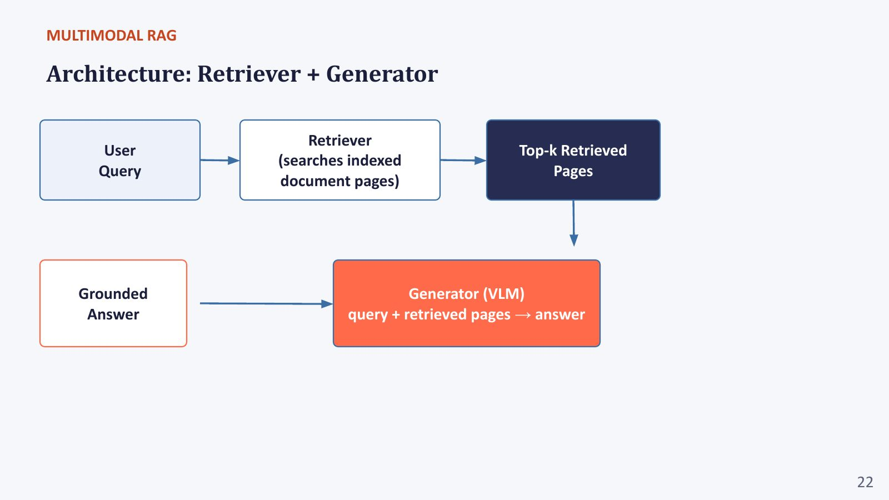
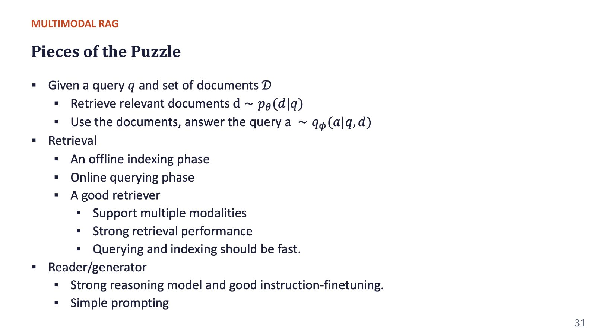
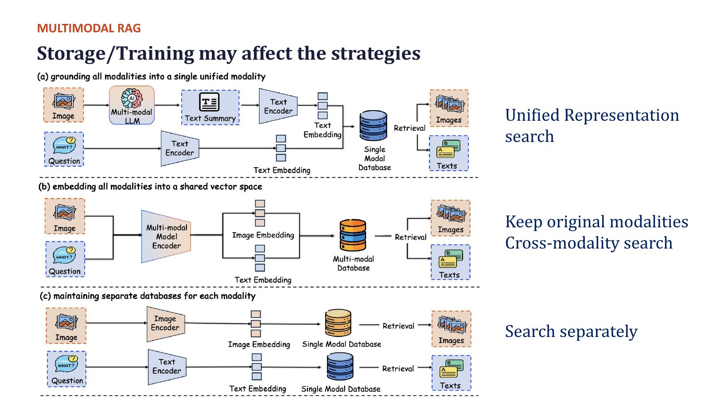

# Section 4 — Multimodal RAG: Architecture and Retrieval Strategies

> **Where this fits:** This is the start of Session 2. With text search and image search in place, the professor built multimodal RAG as a **delta**: the same retriever + generator, but the corpus is **real documents** (pages with text, tables, charts and layout), and the key question becomes *how do you represent and index a page?* This section covers the design choices. Section 5 covers the specific answer, ColPali.
> **Slides:** 20–22, 30–32, 34 · **Transcript:** 01:19:33 – 01:36:02, 01:51:03 – 01:54:12

---

## 4.A — What multimodal RAG is, and why real documents need it

### Recap and extension
- **RAG:** retrieve relevant content for a query, then generate an answer **grounded** in it, *"rather than relying purely on the model's memorised knowledge."* The professor's example: *"What is the colour of the graph?"* The model may have a parametric guess, but the **image shows something specific**.
- **Multimodal extension:** the retrieved content can be **images, tables, charts, or entire document pages**.

### Why documents specifically
| Document | Where the answer lives |
|---|---|
| Financial report | The key number is in a **chart**, not a sentence |
| Technical manual | The critical detail is a **diagram**, not a paragraph |
| Scanned archive (old books, typewritten papers, monographs) | There is **no text layer at all**, only pixels, so you need OCR or vision |

*"Traditional RAG pipelines extract only the text, discarding exactly the visual information that carries the answer."* This is **the document-intelligence problem from Lecture 2, reapplied at the scale of a whole retrieval system**.

### Real-world example: an insurance claims desk
An insurer has 50,000 policy PDFs. An agent asks: *"Is flood damage to a ground-floor car covered under the Gold plan in Mumbai?"* The answer needs (1) a **coverage table** (rows = perils, columns = plans, cells = ✓/✗), (2) a **footnote** on geographic exclusions, and (3) a **diagram** defining "ground floor/basement". A text-only pipeline flattens the table into a jumble of ✓ and ✗ characters with no row/column link, drops the diagram, and may separate the footnote from its table. Multimodal RAG retrieves the **page image** and lets a VLM read the table as a table.

> 💡 **Learning Thought:** Lecture 2 asked *"can a VLM read this page?"* Lecture 3 asks *"can the system **find** the right page among 100,000, fast, before anyone reads it?"* Reading and finding are different skills, and they fail in different ways.

---

## 4.B — Architecture: retriever + generator

```
 User query ──► RETRIEVER (searches indexed document pages) ──► top-k retrieved pages
                                                                        │
                                                                        ▼
 Grounded answer ◄── GENERATOR (VLM): query + retrieved pages → answer ◄┘
```


*Slide "Architecture: Retriever + Generator": User Query → Retriever (searches indexed document pages) → Top-k Retrieved Pages → Generator (VLM): query + retrieved pages → answer → Grounded Answer.*

### Code: the full two-stage pipeline (GPU, ~10 GB VRAM; not run on this laptop)
Retrieval uses the ColPali API recommended by its authors (**Sentence Transformers ≥ 6**, since `colpali-engine` is now deprecated in favour of it). Generation uses a small open VLM that **actually sees the page images**.
```python
# pip install -U "sentence-transformers[image]>=6.0.0" transformers qwen-vl-utils pymupdf
import pymupdf
from sentence_transformers import MultiVectorEncoder

# ---------- OFFLINE: render PDF pages → multi-vector page index ----------
pages = [p.get_pixmap(dpi=100).pil_image() for p in pymupdf.open("annual_report.pdf")]
retriever = MultiVectorEncoder("vidore/colpali-v1.3")        # or "vidore/colqwen2-v1.0"
page_embs = retriever.encode_document(pages)                  # ~1030 vectors × 128-d per page

# ---------- ONLINE: retrieve top-k pages ----------
question = "What was Q3 revenue growth?"
scores = retriever.similarity(retriever.encode_query([question]), page_embs)[0]   # MaxSim per page
top = scores.argsort(descending=True)[:2].tolist()

# ---------- ONLINE: generate from the page IMAGES ----------
import torch
from transformers import Qwen2VLForConditionalGeneration, AutoProcessor
from qwen_vl_utils import process_vision_info
vlm = Qwen2VLForConditionalGeneration.from_pretrained("Qwen/Qwen2-VL-2B-Instruct",
                                                      torch_dtype=torch.float16, device_map="auto")
proc = AutoProcessor.from_pretrained("Qwen/Qwen2-VL-2B-Instruct")
messages = [{"role": "user", "content":
             [{"type": "image", "image": pages[i]} for i in top] +
             [{"type": "text", "text": f"Answer ONLY from these pages and cite the page number. "
                                      f"If absent, say 'Not found'.\nQuestion: {question}"}]}]
text = proc.apply_chat_template(messages, tokenize=False, add_generation_prompt=True)
images, _ = process_vision_info(messages)
inputs = proc(text=[text], images=images, return_tensors="pt").to(vlm.device)
out = vlm.generate(**inputs, max_new_tokens=128)
print(proc.batch_decode(out[:, inputs.input_ids.shape[1]:], skip_special_tokens=True)[0])
```
Every later section refines one part of this: retrieval quality (Section 5), prompting and verification (Section 6), fusion with text retrieval (Section 8).

> 📚 **Go deeper**
> - Hugging Face cookbook, the same pipeline step by step on Colab: https://huggingface.co/learn/cookbook/en/multimodal_rag_using_document_retrieval_and_vlms
> - Sentence Transformers docs (MultiVectorEncoder, and migrating from colpali-engine): https://www.sbert.net/

### The math: the same as text RAG
*"Whatever the modality of the document, answer or question, from a mathematical perspective: first we retrieve the document based on the query, then we generate."*

$$p(a \mid q) = \sum_{d \in \text{top-}k} p(d \mid q)\, p(a \mid q, d)$$

Here d can be a page image, a chart, a text chunk or a video clip. The probabilistic structure is unchanged from Section 2.C.

### Variant: answer-conditioned retrieval (fact verification)
*"Sometimes we do have the answer."* For a claim such as *"India will support Russia in the war"*:
1. Take the query and a **candidate answer** (true / false)
2. Retrieve with **query + candidate** → **supporting** documents and **refuting** documents
3. Aggregate into the final verdict

Normal RAG: q → d → a. Fact verification: (q, â) → d⁺, d⁻ → a.

> 💡 **Learning Thought:** The post-read makes the key architectural point: *"The retriever finds the right pages; the generator reads them. A failure in either step degrades the final answer. They are **independent failure modes** that must both be addressed."* When you debug, measure them separately: retrieval recall@k on its own, and generation accuracy when handed the gold page.

---

## 4.C — Offline indexing vs online querying; what makes a good retriever and reader

### The two phases
| Phase | When | What happens | Must be… |
|---|---|---|---|
| **Offline indexing** | Before any query; again when documents change | Parse or encode every page → store vectors (+ metadata) | Fast enough to process the whole corpus, and re-process updates |
| **Online querying** | Per user request | Encode the query → search → retrieve → generate | Fast enough for interactive latency (tens of ms for retrieval) |

*"Why are these important? Offline indexing has to be fast, online querying also has to be fast. For a multimodal document, some parts may be fast and some may be slow. If you use OCR tools, that may be very, very slow… bounding boxes, etc. These add up in your offline indexing, or even your online querying."*

> ⚠️ **Trap (live Q&A):** *"Why is standard retrieval / ColPali encoding called **offline**, and similarity scoring **online**?"* **Offline = preparing the searchable knowledge** (it doesn't depend on any query, so you can do it ahead of time in batch). **Online = searching that knowledge for the current query** (it can only happen once the query arrives). Anything that doesn't need the query should be moved offline.


*Slide "Pieces of the Puzzle": retrieve d ~ p_θ(d|q), answer a ~ q_φ(a|q,d). The retriever has an offline indexing phase and an online querying phase, and must support multiple modalities, retrieve well, and be fast. The reader needs strong reasoning and instruction following, with simple prompting.*

### Real-world example: a restaurant kitchen
**Offline = mise en place.** Chop, marinate and prepare sauces before service. It takes hours and nobody is waiting. **Online = cooking an order**, which must take minutes while the customer waits. A good kitchen moves everything it can into the prep phase. Likewise, a good RAG system does all query-independent work (OCR, rendering, embedding, indexing) offline, so the online path is just *encode query → search → read top-k*.

```
OFFLINE (batch, hours, re-run on changes)        ONLINE (per request, must be ~≤1–3 s end to end)
parse / render pages ──► embed ──► index         embed query (~10 ms) ─► ANN search (~10–30 ms)
                         (0.39–7.22 s per page)   ─► rerank (~50 ms) ─► VLM answer (~0.5–2 s)
```

### Properties of a good multimodal **retriever** (the professor's three)
1. **Supports all modalities**: text, tables, charts, images, layout
2. **Strong retrieval performance**: right page, near the top (nDCG, Section 5.H)
3. **Fast indexing and fast querying**

*"Can we do all these things together? This is the challenge. This is where the delta is."*

### Properties of a good **reader / generator**
- **Strong reasoning** (multi-hop, charts, tables)
- **Good instruction following**: when told *"give me X from the document"*, it must use the document, **not** its parametric knowledge
- **Abstention**: if X isn't in the document, it should say so. *"Abstention is a big problem. 'I don't know' is something these models are not very good at saying."* (Section 6.B)

---

## 4.D — Two retrieval strategies: parse-then-embed vs retrieval in vision space

### Strategy A — Parse-then-embed (traditional)
```
PDF page ─► OCR ─► layout analysis (title / paragraph / table / figure)
         ─► extract text + tables (+ caption figures with a VLM)
         ─► chunk ─► text embedding model ─► vector index
```

### Strategy B — Retrieval in vision space (ColPali-style)
```
PDF page ─► render as an image (screenshot) ─► VLM-based encoder ─► patch vectors ─► index
```
*"Skip parsing entirely. Embed a screenshot of the whole document page directly."*

### Code: see what parse-then-embed actually receives, using this lecture's own PDF
```python
# pip install pymupdf
import pymupdf

doc = pymupdf.open("VLM-Multimodal-RAG-Lecture-pptx.pdf")    # the lecture deck in your S-3 folder
page = doc[42]                                 # 0-based: PDF page 43 = "Worked Example" (Q3 revenue bar chart)
print(page.get_text())                         # ← strategy A: the text layer
print("vector drawings on page:", len(page.get_drawings()))
page.get_pixmap(dpi=100).save("page43.png")    # ← strategy B: the page as an image
```
Actual output (text layer):
```
MULTIMODAL RAG
Worked Example
QUERY
"What was Q3 revenue growth?"
Q3 Regional Sales Report
Q1
Q2
Q3
Q4
GENERATED ANSWER
"Q3 revenue grew about 46% over Q2, based on the bar chart ..."
vector drawings on page: 25
```
The text layer holds the axis labels **Q1–Q4** and nothing about the **bars**. Their heights exist only as 25 vector drawings, i.e. pixels once rendered. A text embedding of this page can't know that Q3 is the tallest bar. The rendered `page43.png` shows it immediately.


*What strategy B embeds: the rendered page, bars included.*

### Why B is gaining ground: the professor's two reasons
1. **OCR and layout analysis are brittle and lossy.**
   - *"They are not generally trained for these types of documents. These are generic OCR models."* Unusual fonts, multi-column layouts and scans all break them.
   - **Charts and tables:** the meaning is in **spatial relationships**. *"X-axis is here, Y-axis is revenue… you are not just getting the text, you're getting that the X axis is here and the Y axis is revenue."* OCR gives you the words "Revenue", "Q1", "Q2", "120", "146" as a flat string and **drops the geometry that connects them**.
   - OCR also *"removes the layout from consideration"*: it doesn't tell you *this is a table* or *this caption belongs to that figure*.
2. **Computational cost.** The OCR + layout + captioning pipeline is slow: **7.22 s/page** vs **0.39 s/page** for ColPali (Section 5.E).

### The professor's honest caveat
*"It is not completely true that it sidesteps that failure point entirely. Often we end up with solutions where we embed with the VLM **but also put the OCR together**, so we do not lose textual information."* Hybrid designs are common in practice.

> ⚠️ **Trap (live Q&A):** *"Does it mean we can skip OCR in multimodal RAG?"* **For retrieval, yes, if you use a vision-space embedder like ColPali. But performance is still somewhat experimental.** For **generation**, many pipelines still run OCR or layout **on the few retrieved pages** (cheap, since it's only k pages instead of the whole corpus) to hand the reader exact text and numbers. And if your documents are clean digital PDFs with a text layer, simple text extraction may be both cheaper and more accurate.

> 💡 **Learning Thought:** Parse-then-embed makes the **same early lossy decision** as captioning in image search (Section 3.B): it decides *what counts as content* before knowing the query. Vision-space retrieval keeps the page's pixels, and so all its structure, until the query arrives. The general principle: **push lossy interpretation as late as possible, ideally until you know what the question needs.**

---

## 4.E — Three storage / training designs

The slide *"Storage/Training may affect the strategies"* showed three designs. The professor: *"This is also part of storage slash training: what is the training procedure? First we learn to embed, then process all documents and store them in the vector space."*


*Slide "Storage/Training may affect the strategies": **(a) grounding all modalities into a single unified modality**: images → a multimodal LLM writes a text summary → text embedding → a single-modal (text) database. **(b) embedding all modalities into a shared vector space**: a multimodal encoder → one multimodal database, enabling cross-modality search. **(c) maintaining separate databases for each modality**: image encoder → image DB and text encoder → text DB, searched separately.*

| Design | How | Search type | Pros | Cons |
|---|---|---|---|---|
| **(a) Unified text representation** | Convert every modality to **text** (image → caption, table → text), embed with **one text encoder**, **one database** | Unimodal (text→text) | Simple; reuses text-RAG infrastructure; mature tools | **Loses visual detail**; only as good as the captions and OCR |
| **(b) Shared embedding space** | Embed each modality into **the same vector space** (CLIP-style multimodal encoder), **one multimodal database** | **Cross-modal**: text→image, image→text, image→image, text→text | Preserves visual content; one index | Needs an **aligned** multimodal encoder; weaker at exact text |
| **(c) Separate per-modality indexes** | Keep a text index and an image index, each with its own encoder; **search each separately**, then **fuse** the results | Unimodal within each index | Maximum flexibility; best encoder per modality; **works without alignment data** | More system complexity; score fusion needed (RRF) |

*"All these strategies are utilised in various cases. Even (c) can be used in certain cases **if you do not have alignment data**."*

### Code: the three designs as three small indexing functions
```python
# Sketch: caption(), clip_image(), clip_text(), dino(), text_embed() stand for the models from Sections 1 and 3.
def index_design_a(images, texts):          # (a) everything becomes TEXT → one text index
    docs = texts + [caption(im) for im in images]
    return {"text": [text_embed(d) for d in docs]}

def index_design_b(images, texts):          # (b) one SHARED multimodal space → one index
    return {"shared": [clip_image(im) for im in images] + [clip_text(t) for t in texts]}
    # query: clip_text(q) searches images AND texts at once (cross-modal)

def index_design_c(images, texts):          # (c) SEPARATE spaces → two indexes, fused at query time
    return {"image": [dino(im) for im in images], "text": [text_embed(t) for t in texts]}
    # query: search each index with its own query encoder → RRF-fuse the two ranked lists (Section 8.G)
```
**Real-world mapping:** (a) is what most "chat with your PDF" tools did first, OCR + captions. (b) is Google Photos-style search. (c) is typical of e-commerce: a product-image index and a product-text index built by different teams, fused at query time.

> ⚠️ **Trap (live Q&A):** *"In text RAG the vector DB has only text vectors. In multimodal RAG, does the vector DB hold vectors of both images and text?"* **Yes, but not necessarily in one database.** The store can hold embeddings of text, images or whole pages. Depending on the design it's one **shared** multimodal space (b), or **separate** databases per modality that you search separately and fuse (c). In design (a) it's still text only, because everything was converted to text first.

> 🔗 **Notebook link:** the lab builds **both (a) and a vision-space index**: captions + OCR → MPNet → FAISS (design a), and ColPali patch vectors (vision space), then **fuses them with RRF** (the design-c pattern). See Section 8.

---

## 4.F — Late interaction for documents

Back to ColBERT (Section 2.E), now applied to pages:

> *"Instead of compressing a whole page into one vector, represent it as many small vectors: one per image patch or text token. At query time, each part of the query is matched against the best-fitting part of the document, and those fine-grained scores are combined. Richer than a single dot product."*

$$S(q, D) = \sum_{i=1}^{N} \max_{j=1..M} \; \mathbf{q}_i^\top \mathbf{d}_j$$

*"This comes from ColBERT, and it is the same mechanism ColPali uses. You see me repeating this many times so it gets ingrained."*

**Why pages especially need it.** A page holds a title, three paragraphs, a chart and a footnote. A single page vector is an average of all of them, so the query "Q3 revenue growth" is diluted by the unrelated paragraphs. With patch vectors, the query token "revenue" can lock onto the chart's axis label and "Q3" onto the bar label, wherever they sit on the page.

### Picture: one page, many vectors, one score
```
 Page (448×448) split into a 32×32 grid of patches        Query "Q3 revenue growth" = 3 token vectors
 ┌──┬──┬──┬──┬── … ──┐                                      q("Q3")  q("revenue")  q("growth")
 │  │ti│tl│e │       │  title patches                          │          │            │
 ├──┼──┼──┼──┼── … ──┤                                         │ best     │ best       │ best
 │  │  │▇▇│  │       │  chart patches  ◄───────────────────────┘ match    │ match      │ match
 │ Rev │▇▇│▇▇│       │  y-axis "Revenue" ◄───────────────────────────────┘            │
 │  │▇▇│▇▇│▇▇│       │  bars ◄──────────────────────────────────────────────────────────┘
 └──┴──┴──┴──┴── … ──┘
 page score = max-sim("Q3") + max-sim("revenue") + max-sim("growth")    (one number per PAGE)
```

> 📚 **Go deeper**: late interaction explained with pictures (Vespa blog, *Retrieval with vision language models: ColPali*): https://blog.vespa.ai/retrieval-with-vision-language-models-colpali/

> ⚠️ **Trap (live Q&A):** *"Is late interaction equivalent to making the chunk size very small, essentially token-level?"* **No.** Small chunking changes the **retrieval unit**: each tiny chunk is retrieved independently and loses its context. Late interaction keeps the **whole page as one retrieval unit** and compares query tokens against many patch vectors **inside** it, then sums the evidence into **one page score**. You get fine-grained matching *and* page-level context.

> ⚠️ **Trap (live Q&A):** *"If a large image on a PDF page gets split into 2 or more pieces, how can the answer be correct?"* In ColPali the patches are **not independent chunks**. The page is represented by *all* its patch vectors together, and each query token takes its best patch **anywhere** on the page, so different parts of a large chart can each contribute to the same page's score. Also, the patch vectors come out of a **transformer**, so each one is **contextualised** by the whole page, not just its own 14×14 pixels. The system retrieves the page, and the VLM then reads the entire page.

---

## 4.G — Indexing multimodal documents: chunking and structure

### Chunking still matters
*"Chunking decisions matter as much here as in text-only RAG. Too small loses context, too large dilutes relevance."*

| Granularity | Failure | Example (post-read) |
|---|---|---|
| **Too small** (sentence/token) | Loses context | *"Revenue was $4.2B"* is meaningless without the quarter label in the heading above |
| **Too large** (whole document) | Dilutes relevance, and precision collapses | A query about Q3 revenue competes with everything else in a 50-page report packed into one vector |
| **Page-level** (ColPali) | The natural visual unit; preserves chart/table layout with surrounding text | Fails when the answer **spans pages** (Section 6.D) |

### How the professor chunks
- **By the document's own structure.** *"If I'm processing papers, I'll probably chunk by sections, subsections, rather than just small paragraphs."*
- **Keep references together.** *"If you've ever used LaTeX: some text refers to a figure that is **one page down**. That text and that figure should be in the same chunk, because then you can understand it fully. This is actually not easy to do."*
- In the traditional pipeline, **different chunking per element type**: one strategy for tables, one for figures, one for paragraphs. Some pipelines **caption** figures so that "every piece of information is embedded in a text embedding model".

### Preserve "where", not just "what"
*"Whichever approach you choose, the index must preserve enough structure to answer '**which page has this?**', not just 'which document?'"* Store **metadata** with every vector: document ID, page number, section, element type, bounding box. Without it you can't **cite**, and a cited answer you can't trace is unverifiable (Section 6.B).

### Code: page-level chunks with the metadata a real system needs
```python
# pip install pymupdf
import pymupdf, hashlib

def page_chunks(pdf_path, doc_id):
    """One chunk per page, with metadata for citation, routing and incremental re-indexing."""
    chunks = []
    for pno, page in enumerate(pymupdf.open(pdf_path), start=1):
        text = page.get_text().strip()
        lines = [l for l in text.splitlines() if l.strip()]
        heading = lines[1] if len(lines) > 1 else (lines[0] if lines else "")   # slide title ≈ line 2
        chunks.append({
            "id": f"{doc_id}:p{pno}", "doc_id": doc_id, "page": pno, "heading": heading,
            "text": f"[{heading}] {text}",            # heading prefix keeps context inside the embedding
            "has_visuals": bool(page.get_images() or len(page.get_drawings()) > 10),  # route to ColPali?
            "hash": hashlib.sha1(text.encode()).hexdigest()[:10],   # changed page → re-embed only it
        })
    return chunks

chunks = page_chunks("VLM-Multimodal-RAG-Lecture-pptx.pdf", "M4L3")
for c in chunks[36:40]:
    print({k: c[k] for k in ("id", "heading", "has_visuals", "hash")})
```
Actual output (on this lecture's PDF):
```
{'id': 'M4L3:p37', 'heading': 'ColPali: Retrieval in Vision Space', 'has_visuals': True, 'hash': 'ea5f6da4a5'}
{'id': 'M4L3:p38', 'heading': 'Architecture: Late Interaction in Vision Space', 'has_visuals': True, 'hash': '798ef81bfe'}
{'id': 'M4L3:p39', 'heading': 'ColPali: Latency comparisons', 'has_visuals': True, 'hash': 'c7f7e794af'}
{'id': 'M4L3:p40', 'heading': 'Indexing Multimodal Documents', 'has_visuals': False, 'hash': 'bab7de5bdf'}
```
`has_visuals` is a simple **router**: pages with charts or figures (p37–39) go to a vision-space index (ColPali), and text-only pages (p40) can use cheap text embeddings. That's the hybrid design recommended in Section 9.C. `page` gives you citations, and `hash` gives you incremental re-indexing (Section 9.D).

> 📚 **Go deeper**
> - PyMuPDF (text, images and drawings from PDFs; page rendering): https://pymupdf.readthedocs.io/
> - Contextual chunk headers (why prefixing the heading helps): https://www.anthropic.com/news/contextual-retrieval
> - Scaling page-image retrieval in a vector DB: Qdrant tutorial, *PDF retrieval at scale*: https://qdrant.tech/documentation/advanced-tutorials/pdf-retrieval-at-scale/

### Page vectors are still lossy compression
*"Even if there are a couple of vectors, it is still a compression mechanism, and generally a lossy one. Overall structures are preserved, but fine-grained information often isn't. That is why **factual probing** is often done"*, checking whether specific facts (a number, a name) are recoverable from the index.

> 💡 **Learning Thought:** A retriever can only return what the index contains, and only in the units the index uses. **Indexing decisions put an upper limit on retrieval quality before any model runs.** If the chunk holding the answer was split away from its context or buried in unrelated text, no retriever and no generator can fix it. Spend design time here first.

---

## ✅ Quick Check (from the deck, MM RAG Q1–Q3; answers below)
1. What distinguishes multimodal RAG from standard text-only RAG?
2. Why is retrieval in vision space gaining ground over parse-then-embed?
3. What does late-interaction retrieval do differently from single-vector retrieval?
4. *(self-made)* Which storage design works when you have **no image–text alignment data**?
5. *(self-made)* Offline or online: rendering PDF pages to images and encoding them?

<details><summary>Answers</summary>

1. **Retrieved content can include images, tables and charts, not just text.**
2. **OCR and layout analysis are brittle and lossy on charts and tables.** Embedding the page image sidesteps that (and it's faster).
3. **It represents documents as many small vectors matched at a fine-grained level.** This preserves detail a single compressed vector would lose.
4. **(c) Separate per-modality indexes**, searched separately and fused
5. **Offline.** It doesn't depend on the query.
</details>

---

## 🎯 Interview Questions

**Q1. Compare parse-then-embed and vision-space retrieval for a 200K-page corpus of annual reports.**
> Parse-then-embed: OCR → layout → chunk → text embeddings. Cheap per query and a small index, but indexing is slow (~7 s/page → ~16 GPU-days for 200K pages without parallelism). It is lossy on charts, tables and scans, and carries a multi-step failure surface. Vision space (ColPali): render pages → patch embeddings. ~0.4 s/page indexing (~1 GPU-day), no OCR failures, much better on visually rich pages (ViDoRe nDCG@5 ≈ 0.81 vs ≈ 0.66), but a ~1000× larger index and a GPU needed for query encoding. For annual reports, which are heavy in charts and tables, I'd use vision-space retrieval, plus OCR on the retrieved pages only to give the reader exact numbers, and keep page-number metadata for citations.

**Q2. What are the three storage designs for multimodal indexes? When would you pick each?**
> (a) Convert everything to text (captions/OCR) and use one text index: simplest, reuses text RAG, fine when visuals are decorative. (b) A shared multimodal embedding space (CLIP/SigLIP) with one index: enables cross-modal queries (text→image), good for photo or product corpora. (c) Separate per-modality indexes searched in parallel and fused (RRF): the best encoder per modality, no alignment data needed, at the cost of more system complexity. Real systems are often (a)+(c), or a ColPali page index plus a text index.

**Q3. Why isn't late interaction just "tiny chunks"?**
> Tiny chunks change the retrieval unit: each piece is scored and returned alone, losing context, and relevant evidence split across pieces never adds up. Late interaction keeps the page as the unit and sums the best per-query-token matches over all its patches into one page score. Evidence from different regions combines, and the result is a coherent, citable page. The patch vectors are also contextualised by the transformer.

**Q4. What metadata would you store with each page embedding, and why?**
> Document ID, page number, section/heading path, element types present, bounding boxes (if parsed), version/hash, timestamp, and access-control tags. These enable citation ("which page?"), filtering (date, department, permissions), incremental re-indexing (hash changed → re-embed), and region-level grounding in the generator.

**Q5. How do you decide the chunk size for a new document type?**
> Start from the document's natural structure (section, page, table, figure-with-caption), not a fixed token count. Build a small eval set of real questions with gold answers and locations, and measure retrieval recall@k and end-to-end accuracy across 2–3 chunking strategies. Check for answers that span chunk boundaries and for cross-references (a figure on the next page). Tune per document type if the corpus is heterogeneous.

---

## ✅ Self-check
- [ ] I can explain why charts, diagrams and scans break text-only RAG
- [ ] I can write p(a|q) = Σ p(d|q) p(a|q,d) and explain the fact-verification variant
- [ ] I can separate offline from online work in any RAG design
- [ ] I can list the 3 properties of a good retriever and 3 of a good reader
- [ ] I can compare parse-then-embed vs vision-space retrieval on quality, speed and failure modes
- [ ] I can describe the 3 storage designs and when each fits
- [ ] I can explain why late interaction ≠ tiny chunks, and how split charts still retrieve
- [ ] I can argue for structure-aware chunking and "which page" metadata
