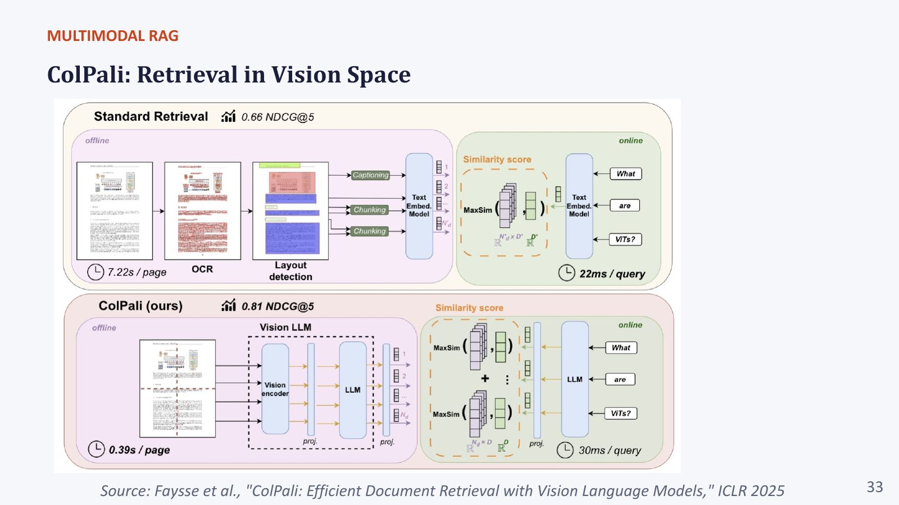
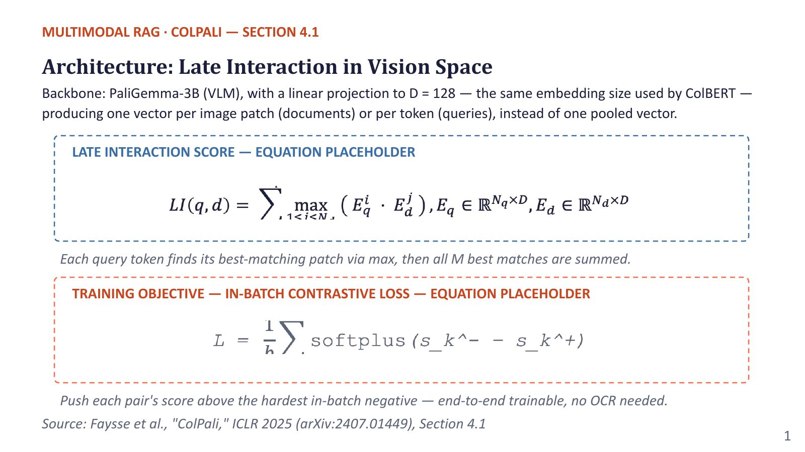
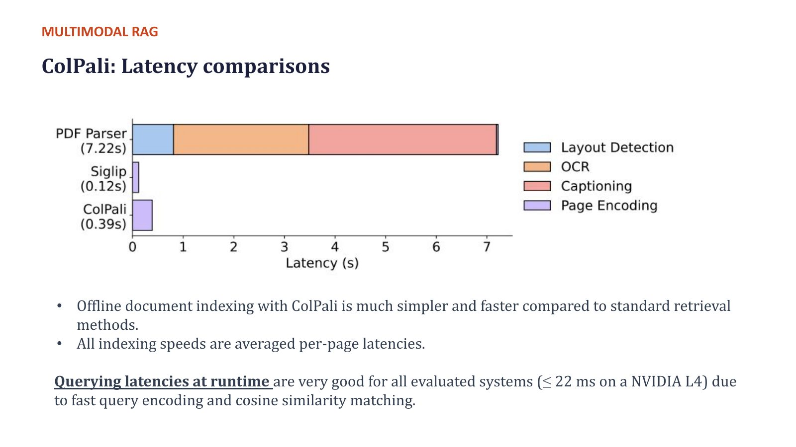
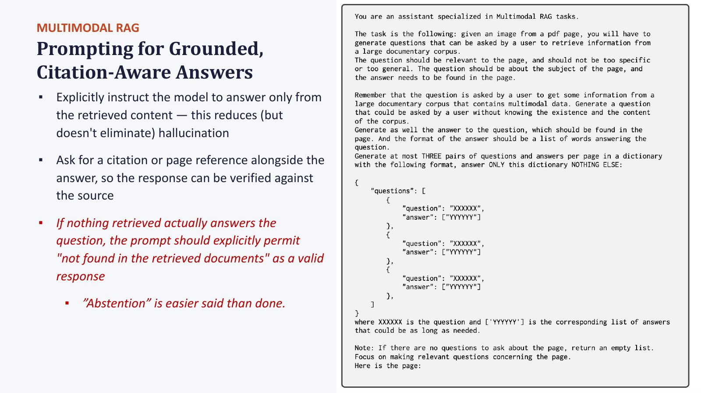

# Section 5 — ColPali Deep Dive: Document Retrieval in Vision Space

> **Where this fits:** This is the lecture's centrepiece: *"Let's go deep on one representative, well-studied technique."* ColPali is **Col**BERT + **Pali**Gemma. It combines ColBERT's late interaction (Section 2.E) with a vision-language backbone, so a **page screenshot** becomes a set of patch vectors that a text query can search directly. There is no OCR, no layout parsing and no captioning. The professor: *"I would not expect you to understand every bit of it, but understand **what challenges it is trying to cover** and how, intuitively… so when you choose the next base model, you choose based on who employs that idea."*
> **Slides:** 30–33, the "Section 4.1" architecture slide, latency, 34, 40–43 · **Post-read:** slides 7–8, 12–14 · **Transcript:** 01:33:10 – 01:51:03, 02:15:05 – 02:20:00
> **Paper:** Faysse et al., *"ColPali: Efficient Document Retrieval with Vision Language Models"*, ICLR 2025 (arXiv:2407.01449)

---

## 5.A — The standard pipeline ColPali replaces, and what it costs

The professor walked through the paper's "standard retrieval" figure:

```
OFFLINE (per page):
  PDF ─► PDF parser / OCR (extract words)                        ≈ 3 s   (OCR)
      ─► Document layout detection (paragraph, title, table,      ≈ 1 s
         figure, header…)
      ─► Chunking (different strategy per element type)
      ─► Captioning of figures/tables with a large VLM             (the heaviest step)
      ─► Text embedding model ─► N_d' vectors per page (one per chunk)
                                                          TOTAL ≈ 7.22 s / page
ONLINE (per query):
  Query ─► text embedding (d' dims) ─► cosine vs every chunk vector ─► top-k    ≈ 22 ms
```

The per-step times are the professor's reading of the figure (*"layout detection takes about one second, OCR almost three seconds, captioning with a very large model takes this many seconds"*). The **7.22 s/page total** is on the slide and post-read.


*Slide "ColPali: Retrieval in Vision Space" (from the paper's Figure 1). **Top, standard retrieval:** offline, PDF → OCR → layout detection → captioning → chunking → text embedding model (**7.22 s/page**); online, query → text embedding → similarity → top pages (**22 ms/query**), with **0.66 nDCG@5**. **Bottom, ColPali:** offline, page image → vision LLM → one vector per patch (**0.39 s/page**); online, query → LLM → MaxSim against every page (**30 ms/query**), with **0.81 nDCG@5**. Better, faster to index, slightly slower to query.*

### Real-world analogy
The standard pipeline is like **retyping every printed page** into Word, then describing each figure in words, then searching the Word files. That's slow, typos creep in, and figure descriptions miss things. ColPali is like **photocopying each page** and training an assistant who can glance at the photocopies and point at the right one. Nothing is retyped, so nothing is mistyped.

Problems he highlighted along the way:
- **Chunking is itself hard:** too big loses information, too small gives redundant and noisy chunks, and cross-references (text on one page pointing to a figure on the next) break coherence.
- **Captioning dominates indexing cost**, and captions are lossy (Section 3.B).
- **Every stage can fail independently.** An OCR error propagates into chunking, which propagates into the embedding. The post-read calls it *"three brittle steps"*.

---

## 5.B — ColPali architecture

```
                         ┌───────────── PaliGemma-3B ─────────────┐
Page image ─► resize ─►  │ SigLIP vision encoder ─► 1024 patch    │
(448×448)                │ tokens ─► linear proj ─► Gemma-2B LM   │ ─► last hidden states
                         └────────────────────────────────────────┘          │
                                                                              ▼
                                                  Linear projection → D = 128 (+ L2 norm)
                                                                              │
                                     Document = ~1030 vectors × 128 dims  ◄───┘
                                     (one per image patch, + a few prompt tokens)

Query text ─► same PaliGemma LM ─► same projection ─► N query vectors × 128 dims
```

### Component by component
| Part | What it is | Why it's there |
|---|---|---|
| **Backbone: PaliGemma-3B** | Google's VLM: a **SigLIP** vision encoder (🔬 SigLIP-So400m, patch size 14) + **Gemma-2B** language model | Small (3B), strong on document understanding, released checkpoints fine-tuned for **different image resolutions and tasks**. The professor: *"a strong candidate because of its small size."* |
| **Patches** | 🔬 448×448 input, 14-px patches → 32 × 32 = **1024 patch tokens** | One vector per patch, so the page keeps its **spatial granularity** |
| **Through the LM** | Patch tokens pass through Gemma's transformer layers, not just SigLIP | Each patch vector becomes **contextualised**: it "knows" about the text and layout around it and is aligned with the language model's token space, so text queries can match it |
| **Projection to D = 128** | A trained linear layer on every output vector | *"The same embedding size used by ColBERT."* It makes the multi-vector index ~16× smaller than keeping 2048-d Gemma states. |
| **Multi-vector output** | *"One vector per image patch (documents) or per token (queries), instead of one pooled vector"* | Enables late interaction (Section 2.E) |

### How the professor made it concrete
*"Consider the document as an image. How many patches? 1, 2, 3 … 12 patches, so there will be 12 vectors. The query has one word, two words, three words, so 3 vectors. Of course it is sub-word based, so there'll be more than three, but for simplicity: 12 and 3. Among these 12 and 3 you calculate the late-interaction score."*

🔬 **Query augmentation:** like ColBERT's [MASK] padding, ColPali appends a few special (`<unused0>`) tokens to each query. They act as learnable "soft expansion" slots, giving the query extra vectors to match with.

### Code: look inside ColPali's input sequence (needs only the processor, ~MBs, not the 6 GB model)
```python
# pip install colpali-engine pillow
from colpali_engine.models import ColPaliProcessor
from PIL import Image
proc = ColPaliProcessor.from_pretrained("vidore/colpali-v1.3")

batch = proc.process_images([Image.new("RGB", (448, 448), "white")])
ids, mask = batch["input_ids"][0], proc.get_image_mask(batch)[0]
pos = mask.nonzero().flatten()
print("sequence length:", len(ids), "| image tokens:", int(mask.sum()))
print("image token positions: first", int(pos[0]), "last", int(pos[-1]))
print("non-image tokens:", proc.tokenizer.convert_ids_to_tokens(ids[~mask].tolist()))
q = proc.process_queries(["What was Q3 revenue growth?"])
print("query tokens:", proc.tokenizer.convert_ids_to_tokens(q["input_ids"][0].tolist()))
```
Actual output:
```
sequence length: 1031 | image tokens: 1024
image token positions: first 0 last 1023
non-image tokens: ['<bos>', '<bos>', 'Describe', '▁the', '▁image', '.', '\n']
query tokens: ['<bos>', 'What', '▁was', '▁Q', '3', '▁revenue', '▁growth', '?', '<pad>', '<pad>', '<pad>', '<pad>', '<pad>', '<pad>', '<pad>', '<pad>', '<pad>', '<pad>']
```
Three facts you can now **see** instead of memorise:
1. A page = **1024 patch tokens (positions 0–1023) + 7 prompt tokens**, 1031 in total, which is where the notebook's "1031" comes from.
2. The patches come **first**. (This matters for the lab's heatmap bug, Section 8.F.)
3. The query gets **10 trailing `<pad>` tokens**. That's the **query augmentation** from the paper. They get their own output vectors, which act as learned "expansion" slots in MaxSim. "Q3" is split into `▁Q` + `3`: sub-word tokens, as the professor warned.

> 📚 **Go deeper**
> - ColPali paper: https://arxiv.org/abs/2407.01449 · authors' blog walkthrough: https://huggingface.co/blog/manu/colpali
> - PaliGemma paper: https://arxiv.org/abs/2407.07726 · HF blog: https://huggingface.co/blog/paligemma
> - Model card (v1.3, used in the lab): https://huggingface.co/vidore/colpali-v1.3

> 🔗 **Notebook link:** the lab's `colpali-v1.3` returns **1031 vectors × 128 dims** per image: 1024 patches + 7 non-spatial prompt tokens. The notebook comment says so explicitly (Section 8.E).

> 💡 **Learning Thought:** The key design move is **reusing a model that can already read documents** (PaliGemma was pretrained on OCR and document tasks) and **re-purposing its hidden states as retrieval vectors**. ColPali doesn't teach a model to read. It teaches a reading model to *produce searchable vectors*. When you evaluate a new retriever, ask the same question: *what does the backbone already know how to see?*

---

## 5.C — The late-interaction score, worked

$$LI(q, d) = \sum_{i=1}^{N_q} \max_{j \in [1, N_d]} \langle \mathbf{E}_q^{(i)}, \mathbf{E}_d^{(j)} \rangle$$

*"Each query token finds its best-matching patch via max, then all N_q best matches are summed."*


*Slide "Architecture: Late Interaction in Vision Space". The PDF's text layer calls these "equation placeholders", but the rendered slide shows both formulas: LI(q,d) = Σᵢ max_j ⟨E_q⁽ⁱ⁾, E_d⁽ʲ⁾⟩ with E_q ∈ ℝ^{N_q×D}, E_d ∈ ℝ^{N_d×D}, and the loss L = (1/b) Σ_k softplus(s_k⁻ − s_k⁺).* It doesn't matter how many patches the document has: *"for each query token you look at every one of them and take the max."*

### Worked example
Query *"Q3 revenue growth"* → 3 query tokens. Two candidate pages, simplified to 4 patches each. Entries are dot products between unit vectors:

**Page A** (has a bar chart of quarterly revenue):
| | patch 1 (title) | patch 2 (y-axis "Revenue") | patch 3 (bar "Q3") | patch 4 (footer) | **max** |
|---|---|---|---|---|---|
| "revenue" | 0.2 | **0.9** | 0.1 | 0.3 | 0.9 |
| "Q3" | 0.1 | 0.4 | **0.8** | 0.2 | 0.8 |
| "growth" | 0.3 | **0.7** | 0.6 | 0.1 | 0.7 |
| | | | | **LI(q, A)** | **2.4** |

**Page B** (a generic "About the company" page):
| | p1 | p2 | p3 | p4 | **max** |
|---|---|---|---|---|---|
| "revenue" | 0.4 | 0.5 | 0.3 | 0.2 | 0.5 |
| "Q3" | 0.2 | 0.3 | 0.4 | 0.1 | 0.4 |
| "growth" | 0.5 | 0.4 | 0.3 | 0.2 | 0.5 |
| | | | | **LI(q, B)** | **1.4** |

Page A wins, 2.4 vs 1.4. Different query tokens found their evidence in **different regions** of the same page (axis label, bar label), which one pooled vector would have blurred.

### Code: real ColPali retrieval (GPU; from the lab notebook, Cells 4-A to 4-C)
```python
# pip install colpali-engine   (Colab T4: use torch.float16 — T4 has no native bfloat16)
import torch
from colpali_engine.models import ColPali, ColPaliProcessor
model = ColPali.from_pretrained("vidore/colpali-v1.3", torch_dtype=torch.float16, device_map="cuda:0").eval()
proc  = ColPaliProcessor.from_pretrained("vidore/colpali-v1.3")

with torch.no_grad():
    page_embs = model(**proc.process_images(pages).to(model.device))       # [n_pages, 1031, 128]
    q_embs    = model(**proc.process_queries(["What was Q3 revenue growth?"]).to(model.device))

# Option 1: the lab's explicit MaxSim (one page at a time)
scores = [(q_embs[0] @ p.T).max(dim=1).values.sum().item() for p in page_embs]
# Option 2: the library's batched scorer (same maths, handles padding)
scores2 = proc.score_multi_vector(q_embs, page_embs)                       # [n_queries, n_pages]
```
`(q @ p.T)` is the N_q × 1031 similarity matrix. `.max(dim=1)` picks each query token's best patch, and `.sum()` adds them up: the formula, line for line. The newer equivalent API is `MultiVectorEncoder(...).similarity(...)` in Sentence Transformers ≥ 6 (Section 4.B).

**Scale in reality:** ~20 query vectors × 1030 patches = **~20,600 dot products of 128-d per page**, versus 1 for a single-vector retriever.

---

## 5.D — Training objective: in-batch contrastive loss with softplus

### The setup
A batch of b (query, page) pairs: (q₁, d₁), …, (q_b, d_b). For query q_k:
- **Positive score:** s⁺_k = LI(q_k, d_k)
- **Hardest in-batch negative:** s⁻_k = max over l ≠ k of LI(q_k, d_l), the most confusable *other* page in the batch

$$\mathcal{L} = \frac{1}{b}\sum_{k=1}^{b} \text{softplus}\big(s_k^- - s_k^+\big), \qquad \text{softplus}(x) = \log(1 + e^x)$$

*"Push each pair's score above the hardest in-batch negative. End-to-end trainable, no OCR needed."*

### It is the softmax form the professor wrote
He wrote it as e^{s⁺} / (e^{s⁻} + e^{s⁺}). They're identical:

$$\text{softplus}(s^- - s^+) = \log\left(1 + e^{s^- - s^+}\right) = \log\frac{e^{s^+} + e^{s^-}}{e^{s^+}} = -\log\frac{e^{s^+}}{e^{s^+} + e^{s^-}}$$

It is a **2-way softmax cross-entropy**: "is the positive more likely than the hardest negative?" *"Just to make sure it is normalised. That is all."*

### Worked numbers
| s⁺ | s⁻ | s⁻ − s⁺ | Loss = log(1 + e^(s⁻−s⁺)) | Gradient = sigmoid(s⁻ − s⁺) |
|---|---|---|---|---|
| 12 | 10 | −2 | log(1.135) = **0.127** | 0.119 (well separated: small push) |
| 12 | 12 | 0 | log 2 = **0.693** | 0.500 (tie: medium push) |
| 12 | 13 | +1 | log(3.718) = **1.313** | 0.731 (negative wins: strong push) |
| 12 | 22 | +10 | ≈ **10.00** | ≈ 1.000 (capped) |

### Code: the whole training objective on a toy batch (PyTorch, CPU)
```python
import torch, torch.nn.functional as F
torch.manual_seed(0)
b, n_q, n_d, dim = 4, 6, 20, 128                          # 4 (query, page) pairs in the batch
Q = F.normalize(torch.randn(b, n_q, dim), dim=-1)         # query token vectors
D = F.normalize(torch.randn(b, n_d, dim), dim=-1)         # page patch vectors
D[:, :n_q] = F.normalize(Q + 0.3 * torch.randn_like(Q), dim=-1)   # make page k really match query k

sim = torch.einsum("iqd,jpd->ijqp", Q, D)                 # every query i vs every page j, token-by-patch
LI  = sim.max(dim=3).values.sum(dim=2)                    # [b, b] late-interaction score matrix
pos = LI.diag()                                           # s⁺_k = LI(q_k, d_k)
neg = (LI - torch.eye(b) * 1e6).max(dim=1).values         # s⁻_k = hardest OTHER page in the batch
loss = F.softplus(neg - pos).mean()                       # ColPali's loss
print(LI.round(decimals=2)); print("loss =", round(loss.item(), 4))
```
Actual output:
```
tensor([[1.5400, 0.9800, 1.1100, 0.9300],
        [1.2100, 1.7700, 0.9400, 0.7900],
        [1.0000, 1.0400, 1.7700, 0.9600],
        [1.1100, 1.1000, 0.9700, 1.8000]])
loss = 0.4381
```
The diagonal (true pairs) is the largest value in each row. For row 1, s⁺ = 1.54 and the hardest negative s⁻ = 1.11 (page 3). Training widens these gaps. "In-batch" means the other pages in the batch serve as negatives for free.

### Code: softplus vs its gradient
```python
import numpy as np
softplus = lambda x: np.log1p(np.exp(x)); sigmoid = lambda x: 1 / (1 + np.exp(-x))
for sp, sn in [(12, 10), (12, 12), (12, 13), (12, 22)]:
    x = sn - sp
    print(f"s+={sp} s-={sn}: loss={softplus(x):.3f}  grad={sigmoid(x):.3f}")
```
Actual output: `loss=0.127 grad=0.119`, `loss=0.693 grad=0.500`, `loss=1.313 grad=0.731`, `loss=10.000 grad=1.000`, matching the table above. The loss keeps growing, and the **gradient saturates at 1**.

### Why softplus? The professor's explanation, made precise
He contrasted it with a **Euclidean (squared) loss**: *"Euclidean loss is unbounded. It can be very high or very close to 0, which we don't like numerically. The derivative gets multiplied through the chain rule; with an L2 loss it can blow up the derivative."*

> ⚠️ **Trap (professor's wording):** he said softplus is *"a function bounded between 0 and 1"*. **The function isn't bounded.** softplus(x) ranges over (0, ∞) and grows linearly for large x (the last row above: loss ≈ 10). What *is* bounded in (0, 1) is its **derivative**, the **sigmoid**. That's the property that matters: the gradient can never exceed 1, however badly a pair is ranked, whereas a squared loss's gradient grows with the error (at error 10 it's 20). Softplus is a **smooth version of the hinge loss max(0, s⁻ − s⁺)**: near-zero loss once the positive clearly wins, and a linear, stable penalty when it doesn't.

His broader point: *"Softmax, Gumbel-softmax, softplus… do you need to know all these functions? Not really. What you need to know is **what problem it is solving**."* Here the problem is **stable, bounded gradients for a ranking objective**.

> 💡 **Learning Thought:** Look at what the loss compares: the positive against the **hardest** negative in the batch, not the average one. This is hard-negative mining (Section 1.F) built into the loss. The model spends its gradient on the page it currently confuses most with the right one, which is exactly the confusion that shows up at query time.

---

## 5.E — Latency: 0.39 s vs 7.22 s per page

| | Standard pipeline | ColPali |
|---|---|---|
| **Offline indexing** (per page, averaged) | **7.22 s** (OCR + layout + captioning + embedding) | **0.39 s** (one VLM forward pass) |
| **Online query** (NVIDIA L4) | ≈ 22 ms | ≈ 30 ms |


*Slide "ColPali: Latency comparisons": per-page offline indexing time. The **PDF parser** bar (7.22 s) splits into layout detection (short), OCR (medium) and captioning (the longest segment). **SigLIP** (0.12 s) and **ColPali** (0.39 s) are pure page encoding. Most of the traditional pipeline's time goes to captioning figures with a large model.*

- Indexing is **~18.5× faster** (7.22 / 0.39). *"It is just running inference over a GPU for a document directly, which is naturally going to be faster."*
- Querying is *"very good for all evaluated systems (≤ 22 ms on an L4) due to fast query encoding and cosine similarity matching."* ColPali is *"slightly more because you have slightly more dot products, which is fine. You can also reduce the number of final tokens by pooling."*
- Post-read: *"The difference is entirely in the offline indexing step."*

**Scale it:** 1M pages × 7.22 s = 7.22M s ≈ **84 GPU-days** vs 1M × 0.39 s = 390K s ≈ **4.5 GPU-days**.

> ⚠️ **Trap (live Q&A):** *"Can the 7.22 s be done in parallel to reduce the time for layout, OCR, etc.?"* **Partly.** Different **pages** can be processed in parallel, which cuts wall-clock time. But within a page the steps are **sequential** (layout needs the OCR output, chunking needs the layout, captioning needs the detected figures), so per-page latency and **total compute cost** don't shrink. Parallelism buys speed with more machines. ColPali actually reduces the work.

---

## 5.F — Heatmap interpretability

From the post-read and the notebook: each patch gets a relevance score = **its max similarity with any query token**. The 1024 scores reshape to a **32 × 32 grid** and overlay on the page.

```
patch_score_j = max_i ( q_i · d_j )      → 1024 values → reshape 32×32 → overlay heatmap
```

*"The chart lights up for a chart-based question; the table lights up for a table query. This is the **explainability advantage** of late interaction over single-vector retrieval."*

Note the direction: **scoring** takes the max over *patches* for each query token (then sums). The **heatmap** takes the max over *query tokens* for each patch. They are different reductions of the same N_q × N_d similarity matrix.

**Practical uses:**
- **Debugging retrieval:** did the page win for the right reason (the chart), or because of a matching logo in the header?
- **Region-level grounding:** crop the hot region and send only that to OCR or the VLM (Section 6.A)
- **Evidence for users:** highlight *where* on the page the answer came from

### Code: a correct heatmap (fixes the lab's slicing)
```python
import torch, math, numpy as np
from PIL import Image
import matplotlib.pyplot as plt

def colpali_heatmap(page_img, page_emb, q_emb, batch_images):
    """page_emb: [1031,128] for this page; q_emb: [n_q,128]; batch_images: processor output for this page."""
    mask = proc.get_image_mask(batch_images)[0]           # True at the 1024 PATCH positions (0..1023)
    patches = page_emb[mask]                              # [1024,128] (not page_emb[-1024:])
    sim = q_emb.float() @ patches.float().T               # [n_q, 1024]
    per_patch = sim.max(dim=0).values                     # heatmap: best query token for EACH patch
    g = int(math.sqrt(per_patch.numel()))                 # 32
    heat = per_patch.reshape(g, g).cpu().numpy()
    heat = (heat - heat.min()) / (heat.max() - heat.min() + 1e-9)
    heat = np.asarray(Image.fromarray((heat * 255).astype("uint8")).resize(page_img.size)) / 255
    plt.imshow(page_img); plt.imshow(heat, cmap="hot", alpha=0.5); plt.axis("off"); plt.show()
```
The authors' library also ships per-query-token similarity maps: `colpali_engine.interpretability.get_similarity_maps_from_embeddings(...)` + `plot_all_similarity_maps(...)` (install `colpali-engine[interpretability]`). These show **one heatmap per query word**, which is great for seeing that "revenue" lights up the axis label while "Q3" lights up the bar.

> 🔗 **Notebook link:** `colpali_heatmap()` in Cell 4-D, demoed with the query *"a legal document"*. Section 8.F notes a likely indexing bug in how that cell picks the patch vectors.

---

## 5.G — Storage cost, worked

Every patch gets its own vector, so *"late-interaction indexes are larger and more expensive to store."*

**Per page (bfloat16 = 2 bytes/number):** 1030 vectors × 128 dims × 2 B = **263,680 B ≈ 258 KB**
*(The notebook stores float32 on CPU: 1031 × 128 × 4 B ≈ 528 KB/page.)*

**At ViDoRe scale, the slide's ~127K pages:**
| Index | Per page | 127K pages |
|---|---|---|
| ColPali multi-vector (bf16) | 258 KB | 127,000 × 263,680 B ≈ **33.5 GB** |
| Single 768-d float32 vector | 3 KB | ≈ **390 MB** |
| Single 128-d bf16 vector | 256 B | ≈ **32.5 MB** |

Same 128-d size, 1030 vectors vs 1: a **~1000× larger index** (post-read: *"a 1000× index size increase"*).

### Code: size your own index before you build it
```python
def index_size(pages, vecs_per_page=1030, dim=128, bytes_per_num=2):
    return pages * vecs_per_page * dim * bytes_per_num
for name, v, b in [("ColPali bf16", 1030, 2), ("ColPali int8", 1030, 1),
                   ("ColPali pooled ÷3, bf16", 343, 2), ("single 128-d bf16", 1, 2)]:
    print(f"{name:24s} {index_size(127_000, v, 128, b)/1e9:8.3f} GB for 127k pages")
```
Output: `33.491`, `16.746`, `11.152`, `0.033` GB. This is how pooling and quantisation turn an impractical index into a practical one.

**Query compute also grows linearly with the corpus:** ~20 × 1030 dot products per page. Brute-force MaxSim over millions of pages doesn't serve in real time.

### Mitigations (🔬 mostly beyond the lecture)
| Technique | Idea |
|---|---|
| **Token pooling** (the professor: *"reduce the number of final tokens by pooling"*) | Merge similar neighbouring patch vectors (e.g. 1030 → ~340), with small quality loss |
| **Quantisation / binarisation** | 128 × 2 B → 128 bits = 16 B per vector (16× smaller) |
| **Two-stage retrieval** | A cheap single-vector (or BM25) stage gets ~1000 candidate pages; run MaxSim only on those |
| **PLAID-style indexes** | ColBERTv2's centroid-based candidate generation + compressed residuals |

---

## 5.H — ViDoRe and nDCG@5

### ViDoRe (Visual Document Retrieval benchmark)
- **Page-level retrieval** across domains, languages and visual styles. The slide says **~127K PDF pages**.
- Academic subsets (DocVQA, InfoVQA, TAT-DQA, arXivQA, TabFQuAD) + practical topics (energy, government reports, healthcare, AI, sustainability). 🔬 *From the paper.*
- 🔬 *Caution on the "127K" figure:* the ColPali paper's **training set** is roughly 127K query–page pairs, and the evaluation subsets are much smaller. The slide's number may conflate the two, so treat it as "on the order of 10⁵ pages".

### How ViDoRe's queries were generated: the prompt the professor showed
*"You also want to understand **how benchmarks are created**."* The generation prompt told an LLM:
- *"You are an assistant specialised in multimodal RAG. Your task is **not to answer**, but to generate questions a user could ask to retrieve information from a large document corpus."*
- The question should be **relevant to the page**, **not too specific, not too general**, about the page's **subject**, and **answerable from the page**.
- Critically: *"Generate a question that could be asked by a user **without knowing the existence and content of the corpus**."*


*Slide "Prompting for Grounded, Citation-Aware Answers". The right side shows the actual prompt used to **generate ViDoRe's benchmark questions** from each page: "…generate questions that could be asked by a user without knowing the existence and the content of the corpus… Generate at most THREE pairs of questions and answers per page in a dictionary…". The left side holds the grounded-prompting rules covered in Section 6.B.*

The professor's gloss: real users don't say *"tell me about Figure 3"*. They don't know there is a Figure 3. They ask *"did the study cover India?"* or *"what were the key takeaways?"*. *"When you look at how benchmarks are created, it actually looks into the **mindset of the user**."*

### nDCG: why rank position matters
*"Precision, recall and F1 look at documents as a **bag**: rank does not matter. In nDCG, rank matters: is it retrieved, and at which rank?"* (Quiz: ViDoRe evaluates **page-level retrieval across visual and textual content**, primary metric **nDCG@5**.)

$$\text{DCG@}k = \sum_{i=1}^{k} \frac{rel_i}{\log_2(i+1)}, \qquad \text{nDCG@}k = \frac{\text{DCG@}k}{\text{IDCG@}k}$$

IDCG = the DCG of the **ideal** ordering, so nDCG lies between 0 and 1.

**Single relevant page (the ViDoRe case).** IDCG = 1, so nDCG@5 = 1 / log₂(rank + 1):
| Rank of correct page | 1 | 2 | 3 | 4 | 5 | > 5 |
|---|---|---|---|---|---|---|
| nDCG@5 | **1.000** | 0.631 | 0.500 | 0.431 | **0.387** | 0 |

(The post-read: *"rank 1 scores 1.0; rank 5 scores 1/log₂6 ≈ 0.39."*)

**Graded relevance: the professor's D1/D2/D3 example.** Ideal ordering: D3 (rel 3), D2 (rel 2), D1 (rel 1). The system returns D1, D2, D3:
- DCG = 1/log₂2 + 2/log₂3 + 3/log₂4 = 1 + 1.262 + 1.500 = **3.762**
- IDCG = 3/1 + 2/1.585 + 1/2 = 3 + 1.262 + 0.5 = **4.762**
- nDCG@3 = 3.762 / 4.762 = **0.790**

The most important document sat at the bottom, so the score is penalised even though *all three* relevant documents were retrieved. Precision@3 would be a perfect 1.0.

*"D3 occurring below is penalised more; D4 at 6th instead of 4th is penalised much less. That is the **discount**: we care less about lower ranks."* The professor described the discount as a γ^(rank−1) factor, which is a variant. The standard form uses 1/log₂(rank + 1), and some versions use gain 2^rel − 1 instead of rel.

### Code: nDCG from scratch
```python
import numpy as np
def ndcg_at_k(rels, k):
    """rels: relevance of each returned result, in the order returned (0 = irrelevant)."""
    rels = np.asarray(rels, float)[:k]
    disc = 1 / np.log2(np.arange(2, len(rels) + 2))     # 1/log2(rank+1)
    ideal = np.sort(rels)[::-1]                          # best possible ordering of the same results
    return (rels * disc).sum() / (ideal * disc).sum() if ideal.sum() else 0.0

print([round(ndcg_at_k([0] * (r - 1) + [1], 5), 3) for r in range(1, 6)])  # single relevant page at rank r
print(round(ndcg_at_k([1, 2, 3], 3), 3))                                    # D1, D2, D3 returned; ideal D3, D2, D1
```
Actual output: `[1.0, 0.631, 0.5, 0.431, 0.387]` and `0.79`, matching both tables above. (Libraries: `sklearn.metrics.ndcg_score`, `pytrec_eval`, `ranx`. Note that this simplified version computes IDCG from the *returned* results. The standard definition uses all relevant documents, which differs when relevant items fall outside the top-k.)

> 📚 **Go deeper**
> - Discounted cumulative gain, with worked examples: https://en.wikipedia.org/wiki/Discounted_cumulative_gain
> - Live ViDoRe leaderboard: https://huggingface.co/spaces/vidore/vidore-leaderboard

> ⚠️ **Trap (live Q&A):** *"What is NDCG@5 / what does NDCG stand for?"* **Normalised Discounted Cumulative Gain at the top 5.** *Gain* = relevance of each result. *Cumulative* = summed over ranks. *Discounted* = divided by log₂(rank + 1), so lower ranks count less. *Normalised* = divided by the ideal ordering's score, so 1.0 = perfect ranking. @5 = only the top 5 results count.

---

## 5.I — Performance comparison (ViDoRe, nDCG@5)

| Approach | Relative performance |
|---|---|
| **BM25 on OCR-extracted text** | Baseline, the weakest. Entirely blind to visual content. |
| **Text embeddings on OCR text** (e.g. BGE-M3) | Moderate improvement. Stronger text matching, still blind to charts and layout. |
| **Captioning pipelines** (a strong proprietary VLM captions the figures, then embed) | Better, but slow and still lossy |
| **ColPali** (vision space) | **Strongest.** Beats even pipelines that use a strong proprietary VLM just to caption visuals. |

Numbers quoted in class: **≈ 0.81 (ColPali) vs ≈ 0.66 (text pipelines)**. *"Consult the current ViDoRe leaderboard for up-to-date numbers."*

**Why text embeddings on OCR barely beat BM25** (the professor: *"these are very good questions to ask yourself"*): the bottleneck isn't the text-matching model. It's that **OCR already lost the spatial information and layout**. A better embedder can't recover what the input no longer contains.

🔬 **The ablation that proves late interaction matters:** the paper also trains **BiPali**, the same PaliGemma backbone but with **one pooled vector** per page. It scores far below ColPali (roughly high-50s vs low-80s nDCG@5). The vision backbone alone isn't enough. **Multi-vector late interaction is where most of the gain comes from.**

---

## 5.J — How SOTA systems are built, remaining challenges, and successors

### Training recipe
- **Initialise** from a pretrained VLM backbone (PaliGemma)
- **Fine-tune** specifically to produce page-level embeddings on **(query, page-image) pairs**, *"so the model learns directly what a page looks like when it actually answers a given question"*
- 🔬 The paper: LoRA adapters on the LM + projection; ~127K pairs, mixing academic QA datasets with **synthetic queries generated by an LLM from web-crawled PDFs** (the prompt in 5.H)
- *"If you want to train or retrain, you need to worry about this"*: you need (query, page) pairs for your domain

**Result:** *"a single, simplified pipeline that replaces OCR, layout analysis and separate text embedding: three brittle steps collapsed into one."*

### Remaining challenges (slide 43)
| Challenge | Detail |
|---|---|
| **Index size** | Every patch gets its own vector, so ~1000× a single-vector index (5.G) |
| **Generalisation gap** | Newer, harder benchmark versions show strong scores *"don't fully generalise to messier real-world documents"*. *"You can always go to a company or a government agency where the real documents are much messier."* Open-source models struggle more than proprietary ones. |
| **Multi-page / multi-document reasoning** | Largely unsolved: each page is scored independently (Section 6.D) |
| **Faithfulness evaluation** | No standard way to check that the generated answer is actually supported by the retrieved pages |

### How the model family has moved since the paper (ViDoRe score, from the official ColPali repo)
| Model | ViDoRe | Backbone / note |
|---|---|---|
| `vidore/colpali` (paper checkpoint) | 81.3 | PaliGemma-3B, the lecture's "≈0.81" |
| `vidore/colpali-v1.3` (**used in the lab**) | 84.8 | Same backbone, better training |
| `vidore/colqwen2-v1.0` | 89.3 | Qwen2-VL-2B, dynamic resolution |
| `vidore/colqwen2.5-v0.2` | 89.4 | Qwen2.5-VL |
| `vidore/colSmol-256M` | 80.1 | **256M params**, near the paper's 3B ColPali at ~1/12 the size |

Two lessons: backbone upgrades keep paying off, and tiny models (colSmol) now match the original, which is useful when GPU budget matters. Also note: **`colpali-engine` is now deprecated in favour of Sentence Transformers ≥ 6 (`MultiVectorEncoder`)**. The lab's code still works, but new projects should use the new API (Section 4.B).

> 📚 **Go deeper**
> - Official repo (model table, training code, migration notes): https://github.com/illuin-tech/colpali
> - ColQwen2 model card: https://huggingface.co/vidore/colqwen2-v1.0
> - VisRAG: https://arxiv.org/abs/2410.10594
> - PLAID-style fast late-interaction serving: https://arxiv.org/abs/2205.09707

### Where to go next (post-read)
- **ColQwen2** (Qwen2-VL backbone): stronger than ColPali on diverse corpora; handles **dynamic resolution** instead of a fixed 448×448
- **VisRAG** (MiniCPM-V backbone): vision-space retrieval + generation directly on page images. 🔬 *Note: VisRAG's retriever uses a **single pooled vector** per page, not late interaction. The post-read groups it under "the same principle", which holds for vision-space retrieval but not for multi-vector matching.*
- **Agentic retrieval** (the generator decides when to retrieve more), **multi-page reasoning**, **faithfulness evaluation**

> 💡 **Learning Thought:** ColPali's win is **removing a brittle intermediate representation** (OCR text) and letting a learned model go straight from pixels to a searchable form. It pays with a **larger index**. That trade (quality and pipeline simplicity vs storage) is the one you'll weigh in every real deployment. The mitigations (pooling, quantisation, two-stage retrieval) are how you make it affordable.

---

## ✅ Quick Check (from the deck, MM RAG Q4; plus self-made)
1. What does the ViDoRe benchmark specifically evaluate?
2. *(self-made)* What's ColPali's backbone, and what does "Col" + "Pali" stand for?
3. *(self-made)* Loss when s⁺ = 5 and s⁻ = 5?
4. *(self-made)* nDCG@5 if the single relevant page is at rank 3?
5. *(self-made)* Why is ColPali's index ~1000× larger than a single-vector index of the same dimension?

<details><summary>Answers</summary>

1. **Page-level document retrieval across visual and textual content.** It targets visually rich documents, not plain text.
2. **PaliGemma-3B** (SigLIP vision encoder + Gemma-2B LM). **Col**BERT-style late interaction + **Pali**Gemma.
3. softplus(0) = **log 2 ≈ 0.693**
4. 1 / log₂(4) = **0.5**
5. It stores **~1030 vectors per page** (one per patch + a few prompt tokens) instead of 1.
</details>

---

## 🎯 Interview Questions

**Q1. Explain ColPali end to end in two minutes.**
> Render each PDF page as an image. PaliGemma-3B encodes it: a SigLIP vision encoder turns the 448×448 page into 1024 patch tokens, Gemma's transformer contextualises them, and a linear layer projects each output to 128-d. So each page becomes ~1030 small vectors, stored offline. At query time the same model encodes the query text into per-token 128-d vectors. The page score is ColBERT's MaxSim: each query token takes its best-matching patch, and the maxima are summed. It's trained on (query, page) pairs with an in-batch contrastive softplus loss against the hardest negative page. Result: no OCR/layout/captioning, 0.39 s vs 7.22 s per page to index, and best-in-class ViDoRe nDCG@5 (≈0.81 vs ≈0.66 for OCR+text pipelines). Cost: a ~1000× larger index.

**Q2. Why does ColPali beat an OCR + strong text embedder pipeline?**
> OCR discards the geometry: axis-to-value relations in charts, table cell structure, which caption belongs to which figure, the visual salience of headings. A better text embedder can't recover information the input no longer holds. ColPali's patch vectors keep layout and visual content, and late interaction lets each query term match the specific region (axis label, bar, table cell) that contains it. The BiPali ablation (same backbone, pooled single vector) scores far lower, so the multi-vector matching is essential, not just the vision backbone.

**Q3. Your ColPali index for 5M pages is 1.3 TB. How do you make it serviceable?**
> 5M × 258 KB ≈ 1.3 TB. Options: (1) **Token pooling**: merge similar patch vectors (≈3× smaller, small nDCG loss). (2) **Quantise** to int8 or binary (2–16× smaller). (3) **Two-stage retrieval**: a single-vector page embedding (or BM25 on a text layer) retrieves ~1000 candidates in an ANN index, and MaxSim runs only on those, loading their multi-vectors from SSD/object storage. (4) PLAID-style centroid pruning. (5) Shard by tenant or collection. Measure nDCG@5 after each step against the uncompressed baseline.

**Q4. Write ColPali's training loss and explain every term.**
> For a batch of b (query, page) pairs: s⁺_k = LI(q_k, d_k), s⁻_k = max_{l≠k} LI(q_k, d_l), L = (1/b) Σ_k softplus(s⁻_k − s⁺_k), with softplus(x) = log(1 + eˣ). It equals −log(e^{s⁺}/(e^{s⁺} + e^{s⁻})), a 2-way softmax between the positive and the **hardest** in-batch negative. It's a smooth hinge: near zero when the positive clearly wins, linear when it loses. Its gradient is sigmoid(s⁻ − s⁺), bounded in (0, 1), which keeps training stable, unlike a squared-error loss whose gradient grows with the error.

**Q5. When would you NOT use ColPali?**
> Clean born-digital text documents with a reliable text layer and little visual content (a text RAG pipeline is cheaper and just as good). Very large corpora on a tight storage budget. Workloads needing exact structured extraction (numbers into a database), where a parser plus validation is more precise. Low-change, low-volume documents where parser cost is trivial. Use ColPali when the evidence lives in charts, tables, scans or complex layouts.

**Q6. Explain nDCG@5 with a number.**
> Relevant results are discounted by 1/log₂(rank + 1) and normalised by the ideal ordering. With one relevant page, nDCG@5 = 1.0 at rank 1, 0.63 at rank 2, 0.5 at rank 3, 0.39 at rank 5, and 0 below rank 5. Unlike Recall@5, which gives full credit anywhere in the top 5, it rewards putting the answer **first**. That matters for RAG because generators attend best to the top of their context.

---

## ✅ Self-check
- [ ] I can list the stages of the standard PDF pipeline and why it takes 7.22 s/page
- [ ] I can draw ColPali's architecture: PaliGemma (SigLIP + Gemma), 1024 patches, projection to 128
- [ ] I can compute a late-interaction score from a similarity matrix
- [ ] I can write the softplus loss, show it equals a 2-way softmax, and correct the "bounded 0–1" claim
- [ ] I can compare offline and online latency, and explain why parallelism doesn't reduce cost
- [ ] I can explain how a heatmap is built from the same similarity matrix
- [ ] I can compute index size per page and at 127K pages
- [ ] I can compute nDCG for single and graded relevance
- [ ] I can explain the BM25 → BGE-M3 → ColPali ordering and the BiPali ablation
- [ ] I can name ColPali's remaining challenges and 2 successors
