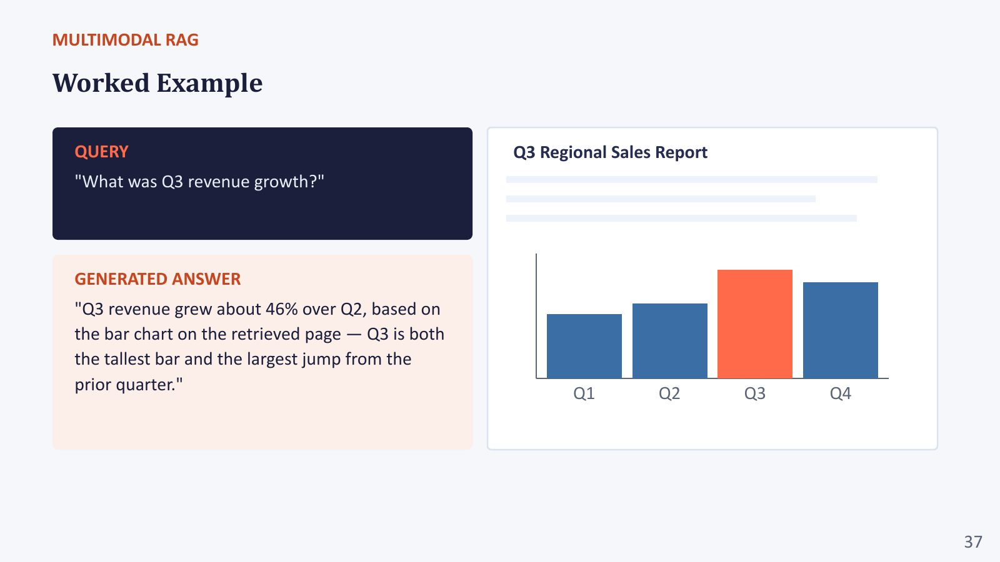
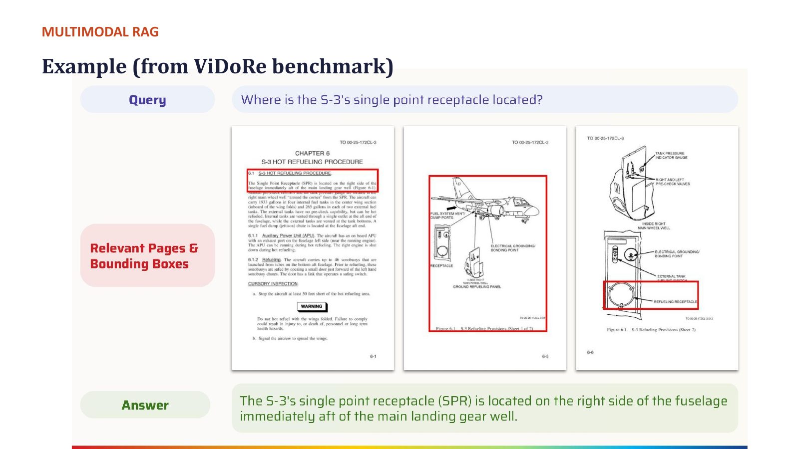

# Section 6 — Generation, Grounding and Pitfalls

> **Where this fits:** After ColPali (the "find" half), the lecture turns to the "read" half: how a VLM turns retrieved pages into a **grounded, cited** answer, and every way the whole pipeline can still fail. The professor deliberately spent less time on generation: *"Given the question, we retrieve the document, which can be correct or incorrect. Given the documents, we generate the answer, which can be correct, incorrect, grounded or hallucinated… you have to **fix retrieval first**, which is why we talked a lot more about retrieval than generation."*
> **Slides:** 35–39, 43–44 · **Post-read:** slides 11–13 · **Transcript:** 01:54:12 – 02:15:05, 02:20:00 – 02:22:00

---

## 6.A — The generation step

> *"The retrieved pages (as images, extracted text, or both) get passed into a VLM alongside the original query. The VLM's job is to read the retrieved content and produce an answer grounded in it, rather than in its own memorised knowledge."*

This is **the VQA and document-intelligence capability from Lecture 2**, *"now applied to content the system chose for itself."*

### What to hand the generator: three options
| Input to the generator | Pros | Cons |
|---|---|---|
| **Page images** only | Keeps charts and layout; a strong VLM reads them directly | Small or open VLMs misread numbers; high image-token cost |
| **Extracted text** only (OCR on the retrieved pages) | Cheap; works with any LLM; exact strings | Loses charts and layout again |
| **Both** | Best accuracy: the image for structure, the text for exact values | More tokens |

### The professor's practical recipe: retrieve by vision, localise, then read precisely
*"What we did not fully cover: once the retrieval is done, from the max similarity you can get the **chunks where the query-similar information lies**. Then you can do your OCR, layout detection etc. **on that particular part** and get the textual information, and use an LLM to get the answer. Or use the VLM on only that patch. That is much easier than putting all the documents together in the context, which is obviously not possible for many VLMs and LLMs."*

```
Query ─► ColPali retrieves top-k pages ─► MaxSim heatmap finds the hot region(s)
      ─► crop region ─► OCR / layout on the crop (or VLM on the crop)
      ─► LLM/VLM answers from the precise evidence + cites page & region
```

And his view on open vs proprietary readers: *"Proprietary VLMs can definitely do some of these things very well. Otherwise, I would do OCR and layout detection on the **generator side, not the retriever side**. The retriever can be fast using ColPali. Once retrieved, I'd do the generator side maybe through LLMs. If I'm in academia, this is what I'd do."*

### Code: localise → crop → OCR only the hot region
```python
# Continues the heatmap code from Section 5.F: `per_patch` is the [32, 32] relevance grid for the top page.
import numpy as np, easyocr

def crop_hot_region(page_img, heat32, keep=0.6, pad=1):
    """Crop the bounding box of patches whose relevance ≥ keep × max."""
    ys, xs = np.where(heat32 >= keep * heat32.max())
    y0, y1 = max(ys.min() - pad, 0), min(ys.max() + pad + 1, 32)
    x0, x1 = max(xs.min() - pad, 0), min(xs.max() + pad + 1, 32)
    W, H = page_img.size
    return page_img.crop((x0 * W // 32, y0 * H // 32, x1 * W // 32, y1 * H // 32))

reader = easyocr.Reader(["en"])                            # same OCR the lab uses (Cell 2-A)
crop = crop_hot_region(top_page_img, heat32)
exact_text = " ".join(t for _, t, conf in reader.readtext(np.array(crop)) if conf > 0.4)
# → give the LLM/VLM both `crop` (pixels) and `exact_text` (precise numbers), plus the page number
```
Real-world parallel: a human analyst doesn't re-read the whole annual report. They find the right page, then **zoom into the table** and copy the exact numbers.

> 💡 **Learning Thought:** Put **expensive precision where the candidate set is small**. OCR over 1M pages is wasteful, but OCR over 3 retrieved crops is nearly free. This mirrors the retrieve-then-rerank funnel (Section 1.D): cheap and broad first, expensive and exact last.

---

## 6.B — Prompting for grounded, citation-aware answers

### Three rules from the slide
1. **Answer only from the retrieved content.** *"This reduces (but doesn't eliminate) hallucination."*
2. **Ask for a citation or page reference** with the answer, *"so the response can be verified against the source."* The professor: *"Tell me the passage, the paragraph, the chart, the figure. When we upload something into ChatGPT or Claude, we want: give me the answer and give me the passage you got it from."*
3. **Explicitly permit "not found in the retrieved documents"** as a valid response. *"'Abstention' is easier said than done."*

### A prompt that applies all three
```text
SYSTEM:
You answer questions using ONLY the retrieved pages provided below.
- Do not use outside knowledge, even if you believe you know the answer.
- After every factual claim, cite its source as [doc_id, page N] and, if the
  evidence is a chart or table, name it (e.g., "Figure 3 bar chart").
- If the pages do not contain enough information to answer, reply exactly:
  "Not found in the retrieved documents." Do not guess.
- For numbers read from charts, first state the values you read, then compute.

USER:
<page doc=AR2024 page=12> [image] </page>
<page doc=AR2024 page=13> [image] </page>
Question: What was Q3 revenue growth?
```

*(The slide with these three rules, next to the ViDoRe question-generation prompt, is shown in Section 5.H.)*

### Code: verify citations automatically (runs anywhere, no ML needed)
```python
import re
pages = {  # text of the retrieved pages (OCR or text layer), keyed by (doc, page)
    ("AR2024", 12): "Q3 Regional Sales Report. Revenue by quarter (INR cr): Q1 90, Q2 100, Q3 146, Q4 120.",
    ("AR2024", 13): "Headcount grew to 4,200 employees across 12 offices.",
}
answer = "Q3 revenue grew 46% over Q2 (from 100 to 146) [AR2024, page 12]. Headcount is 4,500 [AR2024, page 13]."

def verify_citations(answer, pages):
    report = []
    for sentence in re.split(r"(?<=\])\s*", answer):
        cite = re.search(r"\[(\w+), page (\d+)\]", sentence)
        if not cite: continue
        src = pages.get((cite.group(1), int(cite.group(2))), "")
        nums = re.findall(r"\d[\d,]*\.?\d*", sentence.split("[")[0])
        missing = [n for n in nums if n.replace(",", "") not in src.replace(",", "") and not n.endswith("%")]
        report.append((sentence.strip(" .")[:45], "OK" if not missing else f"UNSUPPORTED {missing}"))
    return report
for r in verify_citations(answer, pages): print(r)
```
Actual output:
```
('Q3 revenue grew 46% over Q2 (from 100 to 146)', 'OK')
('Headcount is 4,500 [AR2024, page 13]', "UNSUPPORTED ['4,500']")
```
The second claim **cites a real page**, but the page says 4,200. That's pitfall 4 ("over-trusting citations"), caught by 15 lines of code. Derived numbers (the 46%) need a separate arithmetic check. Production systems use this kind of cheap deterministic check *before* any LLM-judge.

### Grounded vs unconstrained prompting (post-read, and the lab's two modes)
| Mode | Instruction | Risk |
|---|---|---|
| **Grounded** | "Use ONLY the retrieved text/images. If absent, say 'Not found.'" | Safer; may abstain more often |
| **Unconstrained** | "Answer the question" / "use retrieved text and your general knowledge" | *"Fluent and confident, but may be sourced from memorised knowledge that predates the document, contradicts the chart, or is simply hallucinated"* |

> 🔗 **Notebook link:** `generate_answer(..., grounded=True/False)` in Cell 6-B implements both system prompts. The grounded one ends with *"say: 'Not found in retrieved text.'"* Run the same query both ways and compare (Section 8.H).

### Why abstention is hard: the professor's NPTEL example
In one of his projects, a system answered students' questions about an **NPTEL lecture video**. *"The answer should be based on what is taught in the video, not what is taught outside. I may describe softplus more abstractly, someone else more concretely. Which should we use? Since it's video-based QA, answer based on what is taught in that class."*

That is a **closed-world** setting: *"strictly follow what is in the video; what isn't in the video, I'm not going to answer."* The open question: *"If you instruct the LLM or VLM, can they do it properly? This is the big problem."* Models are trained to be helpful and to produce an answer, so saying "I don't know" works against that training.

> 💡 **Learning Thought:** Grounding instructions **shift probabilities, they don't enforce rules**. The model can still slip in parametric knowledge, especially when it's confident (a famous fact) or when the retrieved content is ambiguous. Treat the prompt as the first defence, and add **verification** after generation: check that each cited page actually contains the claimed value, run an NLI or LLM-judge check for "claim supported by evidence?", and send low-support answers to abstention.

---

## 6.C — Worked example: the Q3 revenue chart

**Query:** *"What was Q3 revenue growth?"* The retrieved page is a *"Q3 Regional Sales Report"* with a bar chart for Q1–Q4.


*Slide "Worked Example": the query, the retrieved "Q3 Regional Sales Report" bar chart (Q3 highlighted as the tallest bar), and the generated grounded answer.*

**Generated (grounded) answer:** *"Q3 revenue grew about **46%** over Q2, based on the bar chart on the retrieved page. Q3 is both the tallest bar and the largest jump from the prior quarter."*

**How to check it** (suppose the bars read Q1 = 90, Q2 = 100, Q3 = 146, Q4 = 120):
- Q3 vs Q2: (146 − 100) / 100 = **+46%** ✓
- Q2 vs Q1: (100 − 90) / 90 = +11%
- Q4 vs Q3: (120 − 146) / 146 = −18%
- So Q3 is both the tallest bar and the largest quarter-on-quarter jump ✓

**What makes this a good grounded answer:** it (1) gives the number, (2) names the **visual source** (the bar chart), (3) gives the reasoning that ties the claim to the evidence, and (4) is **verifiable**: a human can look at the chart and check it.

### Code: extract-then-compute (let code do the arithmetic)
```python
import json
EXTRACT_PROMPT = """Look at the bar chart on the page. Return ONLY JSON:
{"unit": "...", "values": {"Q1": number, "Q2": number, "Q3": number, "Q4": number}, "page": number}"""
# vlm_output = call_vlm(page_image, EXTRACT_PROMPT)       # the VLM only READS values
vlm_output = '{"unit": "INR cr", "values": {"Q1": 90, "Q2": 100, "Q3": 146, "Q4": 120}, "page": 12}'
d = json.loads(vlm_output); v = d["values"]
qs = list(v)
growth = {qs[i]: (v[qs[i]] - v[qs[i-1]]) / v[qs[i-1]] * 100 for i in range(1, len(qs))}
print({k: f"{g:+.0f}%" for k, g in growth.items()}, "| largest jump:", max(growth, key=growth.get))
# → {'Q2': '+11%', 'Q3': '+46%', 'Q4': '-18%'} | largest jump: Q3
```
The model **reads**, Python **computes**. The extracted JSON is also something you can show the user and check against the chart, which a free-text answer isn't.

**How it goes wrong:** the VLM misreads the bar heights. Small VLMs are notoriously weak at reading exact values from charts. This is the "extract-then-reason" lesson from Lecture 2's chart QA: have the model **first list the values it reads**, then compute. Arithmetic errors then become visible and checkable.

---

## 6.D — Multi-hop across pages: the ViDoRe S-3 refuelling example

The professor's favourite example of why generation needs **reasoning**, not just reading.

**Query:** *"Where is the S-3 single-point receptacle located?"* (from an aircraft manual about the **S-3 hot refuelling procedure**)

**The evidence chain:**
1. One page describes the hot-refuelling procedure and **refers to Figure 61**
2. Figure 61 appears in the context of **two different pages** (65 and 66). *"I have to search over the 61 things."*
3. The figure/page shows the receptacle is *"located on the **right side of the fuselage, immediately aft of the main landing gear**."*

*"You need to connect information from pages 61, 65 and 66… You need multiple jumps. This is a great example of what a **multimodal chain of thought** looks like: you cannot always find the information in one single place; you connect the information here to here. From here you know **where to search**; from there you get the answer."*


*Slide "Example (from ViDoRe benchmark)". Query: "Where is the S-3's single point receptacle located?" Three relevant pages, with red bounding boxes marking the evidence: the hot-refuelling procedure text (which points to a figure) and two technical drawings. Answer: "The S-3's single point receptacle (SPR) is located on the right side of the fuselage immediately aft of the main landing gear well."*

### Why this breaks standard multimodal RAG
- **Retrieval scores each page independently.** The page with the answer may not look like the query: it's about Figure 61, not about "receptacle location". This is **abductive retrieval** again (Section 0.F): the page you need is a missing link.
- **The first hop only tells you where to look next**, so a single retrieval round can't succeed.
- The reader has to **merge evidence across pages**, which *"is still an open problem."*

**What helps:** **iterative / agentic retrieval**. Retrieve → read → extract the new reference ("Figure 61") → retrieve again with it → answer. Also: indexing cross-references (figure → page) as metadata, and larger top-k with a reasoning-capable reader.

### Code: an iterative (agentic) multi-hop loop
```python
import re
def multi_hop_answer(question, retrieve, read, max_hops=3):
    """retrieve(query, k) -> list of pages; read(question, pages) -> dict(answer, supported, pointers)."""
    evidence, query = [], question
    for hop in range(max_hops):
        evidence += [p for p in retrieve(query, k=3) if p not in evidence]
        result = read(question, evidence)   # VLM prompt: "answer if supported; else list references to follow,
                                            #  e.g. figure/section numbers you need"
        if result["supported"]:
            return result["answer"], evidence
        if not result["pointers"]:
            break
        query = " ".join(result["pointers"])       # e.g. "Figure 61 single point receptacle"
    return "Not found in the retrieved documents.", evidence

# Cheap alternative with no extra LLM calls: at INDEXING time, extract references like "Figure 61",
# "see Section 4.2" with a regex and store a reference→page map, so hop 2 becomes a lookup.
refs = re.findall(r"(Figure|Fig\.|Section|Table)\s+(\d+(?:\.\d+)*)", "Refer to Figure 61 and Section 4.2.")
print(refs)   # [('Figure', '61'), ('Section', '4.2')]
```

The professor's verdict: *"VLMs give you an overall answer, but I would not really trust them as a generator for this. It is quite hard, other than for top VLMs trained on very large numbers of documents, which are generally proprietary."*

---

## 6.E — Common pitfalls, and "jagged intelligence"

| # | Pitfall | What happens | Mitigation |
|---|---|---|---|
| 1 | **Retrieval failure** | The right page, or the right portion, isn't retrieved. *"No amount of good prompting fixes the answer."* | Measure retrieval recall separately; hybrid retrieval; larger k + reranking; better chunking |
| 2 | **Hallucination despite retrieval** | The model ignores the retrieved content and answers from memory, or invents a plausible value | Grounded prompts, citation requirement, post-hoc verification, stronger/instruction-tuned reader |
| 3 | **Irrelevant context** | A topically related but unhelpful page **distracts** the generator toward a wrong answer | Rerank and prune the top-k; robustness training with distractors (Section 7.E); ask the model to first judge each page's relevance |
| 4 | **Over-trusting citations** | *"A cited page number doesn't guarantee the answer was actually derived from it."* The model can cite a page it never really used. | Automatically check that the cited page contains the claimed value; show the highlighted evidence to users |

On pitfall 4 the professor gave a practical warning: *"If you upload a document beyond ~100 pages, I don't think it generally reads beyond a certain number of pages unless you explicitly tell it to."* A long context window doesn't mean the model used all of it.

### Jagged intelligence: why hallucination is so hard to eliminate
*"There is no exact science as of now which tells you how to prevent hallucination."* The professor's explanation:

- **Human knowledge is cumulative.** If you have engineering knowledge, you reliably have class-12, class-10 and class-2 knowledge underneath it.
- **Model competence is jagged.** A model can do well on class-12 maths and then fail something from class 5. *"It is not really cumulative in nature."*
- **It is non-robust.** *"Add a little noise to an image, imperceptible to human beings, and all the things can vary."* (adversarial fragility)

So *"hallucination can happen even if you have the best model and the best retrieval."* You can't assume that because the model handled a hard question, it will handle an easier one.

### Code: an automatic faithfulness check with an NLI model (CPU)
```python
# pip install sentence-transformers sentencepiece protobuf
from sentence_transformers import CrossEncoder
nli = CrossEncoder("cross-encoder/nli-deberta-v3-small")     # outputs: contradiction, entailment, neutral
evidence = "Revenue by quarter (INR cr): Q1 90, Q2 100, Q3 146, Q4 120."
claims = ["Q3 revenue was 146 crore.", "Q3 revenue was lower than Q2.", "The company hired 500 people in Q3."]
for c, p in zip(claims, nli.predict([(evidence, c) for c in claims], apply_softmax=True)):
    print(f"{c:40s} contra={p[0]:.2f} entail={p[1]:.2f} neutral={p[2]:.2f}")
```
Actual output:
```
Q3 revenue was 146 crore.                contra=0.01 entail=0.85 neutral=0.14
Q3 revenue was lower than Q2.            contra=0.01 entail=0.01 neutral=0.97
The company hired 500 people in Q3.      contra=0.00 entail=0.00 neutral=1.00
```
Read this carefully, because it's a lesson in itself. Claims 1 and 3 are judged correctly: supported, and not in the evidence (a hallucination flag). But claim 2 is **false** (146 > 100), and the small NLI model only says "neutral" instead of "contradiction". **Small NLI models don't do arithmetic comparisons.** So a practical faithfulness stack is: deterministic checks for numbers (the citation verifier in 6.B, the extract-then-compute in 6.C) + NLI or LLM-judge for textual claims + human review for high-stakes answers. It's also why "faithfulness evaluation" is still listed as an open problem.

> 📚 **Go deeper**
> - RAGAS (faithfulness, answer relevance, context precision/recall): https://docs.ragas.io/ · paper: https://arxiv.org/abs/2309.15217
> - Hallucination survey: https://arxiv.org/abs/2311.05232

> 💡 **Learning Thought:** The four pitfalls map onto the pipeline: (1) is a **retriever** failure, (3) is a **retriever–generator handoff** failure, and (2) and (4) are **generator** failures. Build **evaluation per stage** (retrieval recall/nDCG; answer accuracy given the gold page; faithfulness given the retrieved pages). Otherwise you'll tune the prompt to fix what is really a chunking bug.

---

## 6.F — Why this is hard

| Difficulty | Explanation |
|---|---|
| **Chunking has no right answer** | *"Generally done manually and domain-wise."* Context and precision trade off at every granularity. |
| **Cross-modal ranking** | Aligning text relevance and visual relevance in **one** ranking is harder than ranking either alone. The professor's subtle point: *"this text is not one type of text. It can be **spatially located text**. 'Revenue' written along a y-axis is not the same as the word 'revenue' in a sentence, because it has a spatial relation to the bars."* |
| **Multi-page reasoning** | Answers spanning pages (6.D). *"Text benchmarks are getting saturated, but document multimodal benchmarks are yet to be saturated."* |
| **Evaluation compounds** | You must evaluate retrieval **and** generation together, and errors multiply |

**Worked compounding:** retrieval recall@5 = 0.80, and the generator is correct and faithful 85% of the time *when given the right page*:
- End-to-end accuracy ≤ 0.80 × 0.85 = **0.68**
- Raising the generator to 0.95 gets you only 0.80 × 0.95 = 0.76. Raising retrieval to 0.95 gets 0.95 × 0.85 = 0.81.

Improve the **weakest stage first**, and usually that's retrieval.

---

## 6.G — Remaining challenges for multimodal RAG

(Overlaps Section 5.J; listed here for completeness.)
1. **Late-interaction index size**: every patch is a vector
2. **Benchmark → real-world gap**: *"real documents are much messier, with much less structure"*; open-source models lag proprietary ones
3. **Multi-page and multi-document reasoning**: largely unsolved
4. **Faithfulness**: *"there is no fully standardised way yet to evaluate whether a generated answer is genuinely supported by what was retrieved."* 🔬 Practical proxies: LLM-as-judge "is each claim supported by the evidence?", NLI-based entailment checks, citation-precision checks, RAGAS-style metrics (faithfulness, answer relevance, context precision/recall). All are imperfect.

---

## 6.H — When to use which retrieval strategy

| Corpus | Strategy | Why |
|---|---|---|
| **Pure text, no visual structure** | Text search alone (BM25 / dense / hybrid) | *"No need for the added complexity of multimodal retrieval"* |
| **Photo or product corpus, simple queries** | Image search with CLIP-style embeddings | The right level of complexity for high-level visual queries |
| **Real-world documents mixing text, tables and charts** | **Multimodal RAG, ideally vision-space retrieval** | *"Worth the added cost"* |

The professor's deciding concept is **spatial locality**: *"One of the biggest differences between an image and text is its spatiality… Text search alone will never be sufficient because it will never capture the spatial relations, which is why for real-world documents (papers, books, medical documents) multimodal RAG is the way to go."* Document embeddings learn **both the OCR part and the spatial part**.

### Code: the decision rule as a function (a useful checklist)
```python
def choose_strategy(has_charts_tables_layout: bool, is_photo_corpus: bool,
                    needs_exact_ids: bool, scanned: bool) -> str:
    if has_charts_tables_layout or scanned:
        return "Multimodal RAG: vision-space retrieval (ColPali/ColQwen) + VLM reader (+ OCR on crops)"
    if is_photo_corpus:
        return "Image search: CLIP/SigLIP embeddings + ANN index"
    return "Text RAG: " + ("hybrid BM25 + dense" if needs_exact_ids else "dense") + " + reranker"

print(choose_strategy(False, False, True, False))   # e.g. an internal wiki with ticket IDs
print(choose_strategy(True, False, False, False))   # e.g. annual reports
```

> ⚠️ **Trap (live Q&A):** *"I have a limited set of documents and want a Q/A system. Is multimodal RAG a good idea?"* **It depends on what the documents contain, not how many there are.** Mostly plain text → normal text RAG is simpler and enough. Important tables, charts, diagrams or layouts → multimodal RAG, because text-only RAG will miss that information.

---

## ✅ Quick Check (from the deck, MM RAG Q5; plus self-made)
1. What's a key pitfall even when retrieval succeeds?
2. *(self-made)* Name the three instructions of a grounded, citation-aware prompt.
3. *(self-made)* Retrieval recall 0.9, generator accuracy-given-gold 0.7. What's the upper bound on end-to-end accuracy, and which stage do you fix first?
4. *(self-made)* Why does the S-3 receptacle question defeat single-shot retrieval?
5. *(Pre-read discussion Q3)* The answer is correct but cites the wrong page. Success or failure?

<details><summary>Answers</summary>

1. **The model can still hallucinate and ignore the retrieved content.** Successful retrieval doesn't guarantee faithful use.
2. **Answer only from retrieved content · cite page/region · explicitly allow "not found".**
3. 0.9 × 0.7 = **0.63**. Fix the **generator** first (the weaker stage).
4. The answer requires **following a reference across pages** (procedure → Figure 61 → pages 65/66). The page with the answer doesn't look like the query, so you need **iterative / multi-hop** retrieval and reasoning.
5. **A failure.** The citation is the verification path. A right answer with a wrong citation means it probably came from **parametric memory**, which is exactly what grounding is meant to prevent. It will fail silently on the next document the model doesn't already know.
</details>

---

## 🎯 Interview Questions

**Q1. How do you reduce hallucination in a multimodal RAG system? Be specific, and cover every stage.**
> **Retrieval:** high recall (hybrid + rerank), clean chunking, page metadata, so the right evidence is in context. **Context:** prune irrelevant pages (a reranker, or a relevance-judging pass) so distractors don't mislead. **Prompt:** answer only from the evidence, cite [doc, page, figure] for every claim, explicit "Not found" option, extract-then-compute for charts. **Generator:** a strong instruction-tuned VLM, or OCR on the retrieved crops for exact values. **Post-hoc:** verify each citation contains the claimed value, NLI/LLM-judge the support, and abstain when support is low. **Evaluation:** measure faithfulness separately from accuracy.

**Q2. Why is "retrieval is correct" not sufficient?**
> Four failure modes remain after correct retrieval: the model ignores the evidence and answers from memory, a distracting co-retrieved page misleads it, it misreads the chart, or it cites a page it didn't actually use. Grounding **reduces** hallucination but doesn't **eliminate** it, and the model's competence is "jagged". So you verify, you don't trust.

**Q3. How would you design a system that answers multi-hop questions across manual pages?**
> An agentic loop: retrieve the top-k pages → the VLM reads them and extracts both a partial answer and **new pointers** (figure numbers, section references, entities) → re-query with those pointers (and use a figure→page map built at indexing) → repeat until the answer is supported or a hop budget runs out → compose the answer citing every page in the chain. Evaluate on multi-page benchmark subsets; watch latency and the risk of drift across hops.

**Q4. The model says "Not found" too often after you added grounding instructions. What do you do?**
> Check whether it's genuine: measure retrieval recall on those queries (perhaps the evidence really is missing, and the fix is in retrieval or chunking). If the evidence *is* present, the reader may be failing to read it (small VLM, low image resolution, chart misread): hand it OCR text of the crop as well as the image, raise the resolution, or use a stronger reader. Loosen the wording slightly ("if the pages contain partial information, answer with what is supported and state what is missing"). Evaluate abstention precision and recall on a labelled set with both answerable and unanswerable questions.

**Q5. What does "spatially located text" mean, and why does it matter for retrieval?**
> Text whose meaning depends on **where** it sits: axis labels, table headers, legends, callouts on diagrams. "120" under "Q3" in a bar chart means Q3's value. The same "120" in flattened OCR output is ambiguous. Text-only retrieval and generation lose that relation. Vision-space retrieval and VLM readers keep it, which is why they win on charts and tables.

---

## ✅ Self-check
- [ ] I can list the three input options for the generator and the professor's localise-then-read recipe
- [ ] I can write a grounded, citation-aware prompt with abstention from memory
- [ ] I can explain why abstention is hard (the NPTEL closed-world example)
- [ ] I can verify the Q3 revenue example numerically and name how it could go wrong
- [ ] I can walk through the S-3 multi-hop example and propose a design that handles it
- [ ] I can name the 4 pitfalls with a mitigation each, and explain "jagged intelligence"
- [ ] I can show how retrieval and generation errors compound, with numbers
- [ ] I can choose between text search, image search and multimodal RAG using "spatial locality"
