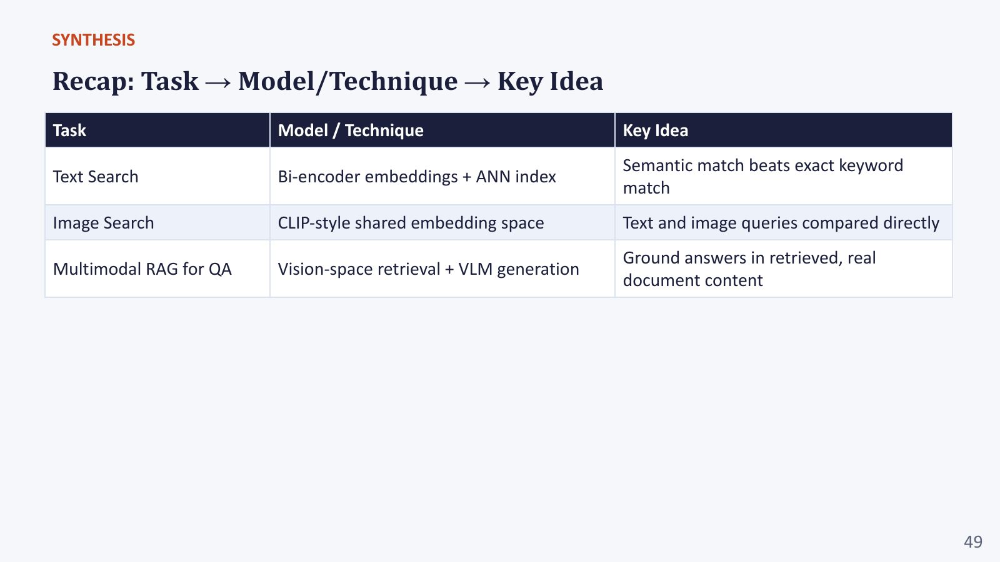

# Section 7 — The Multimodal RAG Landscape: Applications, Retrieval, Fusion, Reasoning, Training

> **Where this fits:** The deck surveys the whole field using Abootorabi et al., *"Ask in Any Modality: A Comprehensive Survey on Multimodal RAG"* (2025): **where** multimodal RAG is used, **what** gets retrieved, **how** retrieved evidence is fused and reasoned over, and **how** these systems are trained. Live, the professor covered most of these ideas in the opening architecture walkthrough (Section 0.E) and came back at the end for applications, especially **Re-Imagen**. Read this section as the **map of options** around the one technique (ColPali) you studied in depth.
> **Slides:** 23–29 · **Post-read:** slides 6, 10 · **Transcript:** 00:20:38 – 00:28:47, 02:22:00 – end

---

## 7.A — Where multimodal RAG is used

| Category | Applications (examples named in the survey) |
|---|---|
| **Content generation** | Image captioning, **text-to-image synthesis**, visual storytelling, multimodal summarisation |
| **Knowledge-intensive QA** | Open-domain and knowledge-seeking QA, **video-based QA**, **fact verification** |
| **Healthcare** | Medical VQA (**MMed-RAG**), radiology report generation (**RULE**), patient support (**AsthmaBot**) |
| **Software engineering** | Code completion (**DocPrompting**: retrieve API docs), commit-message generation (**RACE**), code summarisation (**REDCODER**) |
| **Fashion, e-commerce and emerging** | Style-aware product search, autonomous driving (**RAG-Driver**: retrieve similar driving situations), geolocation (**Img2Loc**: retrieve geotagged similar images) |

The professor's summary: *"Everywhere you need some information to actually give the proper answer… you might find cases where you don't have the entire information in the context and you need something else."*

### Deep example: Imagen → Re-Imagen (retrieval for *generation*)
The professor chose this one *"because I felt it very necessary"*. It shows retrieval helping **image generation**, not just QA.

- **Prompt:** *"A **Barbado da Terceira** is standing by the river."*
- *"A dog standing by a river is very easy to generate. But what about this Portuguese dog breed, which I'm sure most of us have never heard of?"* A text-to-image model (Imagen) has seen few or no images of this rare breed, so it produces a generic dog.

*Slide "Imagen → Re-Imagen" (Re-Imagen paper, Figure 1). For rare entities (a Barbado da Terceira dog by a river, Picarones food with wine, Uzhupudu, a monument to the fallen shipyard workers), **Imagen** hallucinates a generic lookalike, while **Re-Imagen**, given retrieved "Entity Reference" images, renders the real entity faithfully.*

- **Re-Imagen (Retrieval-Augmented Imagen, Google 2022):** first **retrieve image–text pairs** of the rare entity from an external database, then **condition the diffusion model** on those retrieved examples along with the prompt. The model now "knows" what the breed looks like **without retraining**.

### Real-world examples of the same pattern
- **GitHub Copilot / code assistants:** retrieve the relevant files and API docs from *your* repo before completing code (DocPrompting-style). The model has never seen your internal library.
- **Customer-support copilots:** retrieve similar past tickets and their resolutions, then draft a reply.
- **Visual product search at IKEA or Pinterest:** retrieve similar items, then generate "complete the look" suggestions.

> 📚 **Go deeper**
> - Re-Imagen paper: https://arxiv.org/abs/2209.14491
> - The survey behind this whole section (see its application tables): https://arxiv.org/abs/2502.08826

> 💡 **Learning Thought:** Re-Imagen is the **rabbit-species argument (Section 0.B) applied to generation**. Rare, long-tail and new entities can't all be memorised in the weights, so you retrieve them at inference time. The pattern "**retrieve exemplars, then condition the generator**" works whatever the output modality: text, code, images, driving actions or locations.

---

## 7.B — What gets retrieved: four modality types

| Retrieval type | How it works | Examples |
|---|---|---|
| **Text-centric** | BM25 and dense retrievers dominate; **ColBERT-style token-level matching** improves precision | **BGE-M3** 🔬 (one model producing dense, sparse *and* multi-vector representations) |
| **Vision-centric** | Retrieve using **image representations directly** | Reference-image queries; **composed image retrieval**: *reference image + modification text* ("this dress, but in red") |
| **Video-centric** | Vision retrieval + **temporal dynamics** | Incremental retrieval over a stream; long-context video understanding (retrieve the relevant **clips** instead of feeding a 2-hour video) |
| **Document and layout** | Retrieve **whole page images** directly, integrating text, tables and layout | **ColPali** (Section 5) |

### Code: composed image retrieval, the simplest baseline (CLIP embedding arithmetic)
"Show me **this** (image), but **blue** (text)." A classic zero-training baseline: add the text-embedding direction for the change to the reference image's embedding.
```python
# pip install open_clip_torch pillow
import torch, open_clip
from PIL import Image, ImageDraw
def img(shape, color):
    im = Image.new("RGB", (224, 224), "white"); d = ImageDraw.Draw(im)
    (d.ellipse if shape == "circle" else d.rectangle)([40, 40, 184, 184], fill=color); return im
names = ["red circle", "blue circle", "red square", "blue square", "green circle"]
corpus = [img(*n.split()[::-1]) for n in names]

model, _, pre = open_clip.create_model_and_transforms("ViT-B-32", pretrained="laion2b_s34b_b79k")
tok = open_clip.get_tokenizer("ViT-B-32"); model.eval()
norm = lambda x: x / x.norm(dim=-1, keepdim=True)
with torch.no_grad():
    I = norm(model.encode_image(torch.stack([pre(x) for x in corpus])))
    ref = I[0]                                                          # reference image: the red circle
    delta = norm(model.encode_text(tok(["a blue shape"])))[0] - norm(model.encode_text(tok(["a red shape"])))[0]
    for name, q in [("image only", ref), ("image + (blue - red)", norm(ref + delta))]:
        s = I @ q; order = s.argsort(descending=True)[:3]
        print(f"{name:22s}", [(names[i], round(s[i].item(), 3)) for i in order])
```
Actual output:
```
image only             [('red circle', 1.0), ('blue circle', 0.917), ('green circle', 0.845)]
image + (blue - red)   [('blue circle', 0.849), ('red circle', 0.766), ('green circle', 0.699)]
```
The modification moved rank 1 from the red circle to the **blue circle**, keeping the shape and changing the colour. Real composed-retrieval models learn this combination, but the principle is the same.

> ⚠️ **Trap (live Q&A):** *"What are some common open-source models for video RAG?"* Usually **two roles**. (1) A **video/clip embedding model** for retrieval (frame-level CLIP/SigLIP embeddings, or video encoders such as InternVideo). (2) A **video-language model** for reading and answering, e.g. **Qwen2.5-VL, LLaVA-Video, VideoLLaMA, InternVL**. Same split as document RAG: a fast retriever, a capable reader.

---

## 7.C — Fusing what's retrieved

Once you have evidence from different modalities (or retrievers), how do you combine it?

| Mechanism | How | Trade-off |
|---|---|---|
| **Score fusion and alignment** | Embed modalities into a **shared space** (often CLIP-based), then **combine similarity scores** directly, or fuse **ranks** (RRF) | Simple and interpretable; needs comparable scores or rank-based fusion |
| **Attention-based fusion** | **Cross-attention** dynamically weights retrieved evidence against the query. Each piece *"competes for the generator's attention based on its relevance to the current query token"* | Learned and flexible; happens **inside** the model (needs training or a capable VLM) |
| **Unified frameworks** | Project everything (text, tables, images) into **one coherent representation** before generation, sometimes by converting images to captions or vice versa | Simple downstream; *"sacrifices visual fidelity for simplicity"* |

**Where fusion happens** (🔬 standard terminology):
- **Late fusion (rank/score level):** separate retrievers, merge their result lists. Example: the lab's RRF of FAISS-text + ColPali (Section 8.G).
- **Early / representation-level fusion:** merge embeddings before retrieval (a shared space, or concatenated features).
- **In-model fusion:** hand all evidence to the generator and let its attention do the weighting.

### Code: why raw score fusion goes wrong, and RRF doesn't
```python
bm25    = {"A": 18.2, "B": 12.0, "C": 3.1}        # unbounded keyword scores   → ranks A1, B2, C3
cosine  = {"A": 0.10, "B": 0.79, "C": 0.62}        # dense scores in [-1, 1]    → ranks B1, C2, A3
naive   = {d: bm25[d] + cosine[d] for d in bm25}   # BM25's scale dominates; dense barely matters
rank = lambda s: {d: r for r, d in enumerate(sorted(s, key=s.get, reverse=True), 1)}
rb, rc = rank(bm25), rank(cosine)
rrf = {d: 1/(60 + rb[d]) + 1/(60 + rc[d]) for d in bm25}
print("naive sum:", sorted(naive, key=naive.get, reverse=True))
print("RRF      :", sorted(rrf, key=rrf.get, reverse=True), {d: round(v, 5) for d, v in rrf.items()})
```
Actual output:
```
naive sum: ['A', 'B', 'C']
RRF      : ['B', 'A', 'C'] {'A': 0.03227, 'B': 0.03252, 'C': 0.032}
```
The naive sum is just BM25's order: the dense retriever, which ranked A **last**, has almost no influence because 0.8 is small next to 18. RRF gives each retriever an equal vote, so B (ranks 2 and 1) beats A (ranks 1 and 3). One subtlety worth knowing: with k = 60, ranks (1, 3) score 0.032266, slightly *above* ranks (2, 2) at 0.032258, so RRF slightly rewards a single strong vote. Consensus wins when it's at least as strong, as for B here.

> 💡 **Learning Thought:** Scores from different retrievers are in **different units**: BM25 is unbounded, cosine is in [−1, 1], MaxSim grows with query length. Adding them raw lets one retriever dominate for arbitrary reasons. **Fuse ranks (RRF) or calibrate first.** This one detail is behind many "hybrid search made things worse" reports.

---

## 7.D — Reasoning over retrieved knowledge

| Strategy | What it does | Notes |
|---|---|---|
| **In-context learning** | Retrieved examples act as **few-shot demonstrations**. *"Just give it in the prompt."* | No retraining. Works well for consistent formats (e.g. retrieve similar solved cases). |
| **Structured reasoning (CoT)** | Break a complex query into **sequential steps**; *"iteratively look at each document and refine the answer"* | **Tree of RAG:** branch into several reasoning/retrieval paths and pick the best-supported conclusion |
| **Instruction tuning** | Fine-tune the generator to **decide when to retrieve, judge relevance, and answer**, *"rather than always retrieving blindly"* | 🔬 e.g. Self-RAG, with learned "retrieve?" and "is this relevant/supported?" reflection tokens |
| **Source attribution** | Cite exactly which evidence (page, **region**, sentence) supports each part of the answer | Makes outputs verifiable (Section 6.B) |
| **Agentic interaction** | *"Each document is looked at by a separate agent, and they all collate the information to a central agent."* Or the generator **decides when to retrieve more** (agentic retrieval) | Map-reduce over evidence; handles multi-hop (Section 6.D); costs more calls |

### Code: in-context learning with retrieved examples (few-shot from your own data)
```python
# Retrieve the most similar SOLVED cases and put them in the prompt as demonstrations.
solved = [("Invoice shows GST 18% on 1,000", "Tax = 180"),
          ("Invoice shows GST 12% on 2,500", "Tax = 300"),
          ("Receipt: 3 items at 40 each", "Total = 120")]
def build_icl_prompt(query, retrieve_similar, k=2):
    shots = retrieve_similar(query, solved, k)            # e.g. the dense retriever from Section 1.C
    demo = "\n".join(f"Q: {q}\nA: {a}" for q, a in shots)
    return f"{demo}\nQ: {query}\nA:"
print(build_icl_prompt("Invoice shows GST 5% on 4,000", lambda q, s, k: s[:k]))
```
No retraining: the model copies the **format and reasoning pattern** of the retrieved examples.

> 📚 **Go deeper**
> - Self-RAG (learns when to retrieve and critiques its own evidence): https://arxiv.org/abs/2310.11511
> - Survey sections on fusion and reasoning: https://arxiv.org/abs/2502.08826

> 💡 **Learning Thought:** These strategies sit on a scale from **"retrieval is a fixed pre-step"** (ICL: retrieve once, then generate) to **"retrieval is a tool the model calls"** (agentic: retrieve, reason, retrieve again). Multi-hop and abductive questions (Sections 0.F, 6.D) need the far end of that scale. This is where multimodal RAG meets the agentic-AI parts of this programme.

---

## 7.E — How multimodal RAG systems are trained

| Component | Training signal |
|---|---|
| **Multi-stage process** | **Pretraining** on large paired datasets builds cross-modal relationships, then **fine-tuning** adapts to a task using cross-modal attention |
| **Alignment loss (retriever)** | **Contrastive (InfoNCE)**: pull a query and its correct content together, push mismatched pairs apart. **Hard negatives** sharpen it (Section 1.F; ColPali's version is in 5.D). |
| **Generation loss (reader)** | Standard **cross-entropy** (next-token prediction) for text; **diffusion or GAN-style losses** when the output is an image (e.g. Re-Imagen) |
| **Robustness training** | *"Deliberately inject irrelevant or noisy retrieved content during training, so the generator learns to ignore it rather than be misled."* |

**Robustness training, concretely** (🔬 typical recipe): build each training example as 1 gold page + 3–4 **distractor** pages (topically similar hard negatives from the retriever), shuffled into different positions. Supervise on the correct, cited answer. Include some examples with **no** gold page, supervised to answer "Not found". This directly trains against pitfalls 3 (irrelevant context) and 2 (hallucination) from Section 6.E, and teaches abstention.

### Code: build robustness-training examples (gold page + distractors + unanswerables)
```python
import random
def make_training_examples(qa_items, retriever, n_distractors=3, p_unanswerable=0.2, seed=0):
    """qa_items: list of dict(question, answer, gold_page). retriever(q, k) returns page ids (hard negatives)."""
    rng, out = random.Random(seed), []
    for it in qa_items:
        hard_negs = [p for p in retriever(it["question"], k=10) if p != it["gold_page"]][:n_distractors]
        if rng.random() < p_unanswerable:                        # teach abstention
            pages, target = hard_negs, "Not found in the retrieved documents."
        else:
            pages = hard_negs + [it["gold_page"]]
            target = f'{it["answer"]} [page {it["gold_page"]}]'   # teach citation
        rng.shuffle(pages)                                        # gold page at a random position
        out.append({"question": it["question"], "pages": pages, "target": target})
    return out

demo = make_training_examples([{"question": "Q3 revenue?", "answer": "146 cr", "gold_page": 12}],
                              retriever=lambda q, k: [11, 12, 13, 14, 15])
print(demo)
# Actual output: [{'question': 'Q3 revenue?', 'pages': [14, 13, 11, 12], 'target': '146 cr [page 12]'}]
```
Fine-tune the reader (e.g. LoRA on a small VLM) on these examples, and it learns to **find the gold page among distractors, cite it, and abstain** when it's missing.

---

## 7.F — Training retriever and generator together, and when you shouldn't train at all

### The joint-training view (slide 29; the full derivation is in Section 2.C–D)
- **The core difficulty:** *which documents should have been retrieved* isn't observed. It's a **latent variable**.
- **EM-style loop:** E-step, score and retrieve with the current model; M-step, update the model to make the correct answer more likely given what was retrieved.
- *"Retriever and generator improve each other in a loop."*
- **Origin:** the **RAG** and **REALM** papers (2020), which marginalise over the top-k documents during training.
- **In practice:** *"most production systems approximate this with a simpler two-stage recipe: pretrain the retriever and generator separately, then fine-tune jointly on task-specific data."*

### Do you need to fine-tune at all?
> ⚠️ **Trap (live Q&A):** *"Multimodal RAG would need fine-tuning whenever the domain or context changes, since it has to understand the document structure, domain and format. Right?"* **Not necessarily.** A domain or format change does not automatically mean fine-tuning. Modern multimodal models often handle new document structures through **pretrained capability + good prompting**. First adjust **parsing, chunking, retrieval strategy and prompts**. Fine-tune only when the model **consistently fails** on domain-specific patterns, or you need specialised behaviour that prompting and retrieval can't provide.

> ⚠️ **Trap (live Q&A):** *"Trained domain model vs a general LLM with RAG: which gives the best answers?"* In RAG, **domain knowledge comes mainly from retrieval**, so a general pretrained LLM reading the right pages usually does well. Fine-tune the **LLM** for **behaviour** (terminology, output format, specialised task skill). Fine-tune the **embedding or reranking model** when **retrieval** is the weak point (domain shift, Section 1.H). Facts go in the index; skills go in the weights.

**Decision order for a new domain:**
1. Off-the-shelf retriever + reader, with good chunking and prompts → build an eval set → measure
2. If **retrieval** is weak → hybrid + reranker → fine-tune the embedder on in-domain (query, page) pairs (synthetic queries work)
3. If **reading** is weak with the gold page in context → stronger reader, or OCR on crops → LoRA fine-tune the reader on in-domain QA with distractors
4. Joint end-to-end training → rarely worth the cost outside research

> 💡 **Learning Thought:** The most useful diagnostic in all of RAG is: **"does the answer improve if I hand the model the gold page?"** If yes, your problem is retrieval. If no, your problem is reading. That one experiment tells you *which* component to train, if any.

---

## ✅ Quick Check (self-made; the survey slides have no quiz)
1. What problem does Re-Imagen solve, and how?
2. What is composed image retrieval?
3. Name the three fusion mechanisms.
4. What does robustness training inject, and why?
5. The answer improves dramatically when you hand the model the gold page. What should you fix?

<details><summary>Answers</summary>

1. Text-to-image models can't render **rare entities** they've barely seen (Barbado da Terceira). Re-Imagen **retrieves image–text examples** of the entity and conditions the diffusion model on them.
2. A query of **reference image + modification text** ("this dress but red"), retrieving images that satisfy both
3. **Score fusion and alignment · attention-based fusion · unified frameworks**
4. **Irrelevant or noisy retrieved content** (distractors), so the generator learns to ignore them rather than be misled
5. **Retrieval** (recall, chunking, reranking), not the generator
</details>

---

## 🎯 Interview Questions

**Q1. Give three multimodal RAG applications outside document QA and say what is retrieved in each.**
> Re-Imagen: retrieve reference images of rare entities to condition text-to-image generation. RAG-Driver: retrieve similar past driving scenarios (video + actions + explanations) to ground a driving policy's decision and explanation. Img2Loc: retrieve geotagged images similar to a query photo, and let a model reason about the location from their coordinates. Also medical VQA: retrieve similar labelled scans plus textbook passages.

**Q2. You have a text retriever and an image retriever. How do you merge their results?**
> Their scores aren't comparable, so either use **RRF** (score = Σ 1/(k + rank), k ≈ 60), which is parameter-light and robust, or calibrate each to a probability (e.g. with a logistic model on labelled data) and take a weighted sum. Then optionally rerank the fused top-N with a cross-modal reranker or a VLM. Evaluate the fused list with nDCG against each single retriever. Fusion should beat both; if it doesn't, check for one retriever being systematically noisy.

**Q3. What is agentic RAG, and when is it worth the extra cost?**
> The model treats retrieval as a **tool**: it decides whether and what to retrieve, reads the results, and can retrieve again with refined queries (or delegates documents to sub-agents and aggregates). It's worth it for multi-hop questions (pointer-following across pages), ambiguous queries that need reformulation, and cases where one retrieval round has low recall. It isn't worth it for simple lookups, where it only adds latency (several model calls), cost and failure modes (drift, loops).

**Q4. How would you train a reader that doesn't get distracted by irrelevant retrieved pages?**
> Robustness training: build examples with the gold page mixed among hard-negative distractors from your own retriever, at random positions, and supervise on the correct, cited answer. Add unanswerable examples (no gold page) supervised to "Not found". Optionally train an explicit relevance-judgement step first (Self-RAG-style). Evaluate accuracy as the number of distractors grows, and abstention precision/recall.

**Q5. When do you fine-tune the embedder vs the generator vs neither?**
> Neither: first, if an off-the-shelf pipeline with good chunking and prompts meets the target. Embedder (or reranker): when retrieval recall/nDCG is low on in-domain queries (domain vocabulary, document types unlike web data). Generator: when accuracy stays low **even with the gold page in context** (format, domain reasoning, chart reading), or you need a specific output behaviour. Diagnose with the gold-page experiment before training anything.

---

## ✅ Self-check
- [ ] I can name one application per category and explain Re-Imagen's retrieve-then-condition idea
- [ ] I can describe the four retrieval modality types with an example of each
- [ ] I can compare score, attention and unified fusion, and explain why raw scores shouldn't be added
- [ ] I can place ICL, CoT/Tree-of-RAG, instruction tuning and agentic retrieval on the fixed-step ↔ tool-use scale
- [ ] I can describe InfoNCE, generation losses and robustness training
- [ ] I can explain the EM view, and why production systems use two-stage training or none
- [ ] I can use the "gold page" experiment to decide what, if anything, to fine-tune
